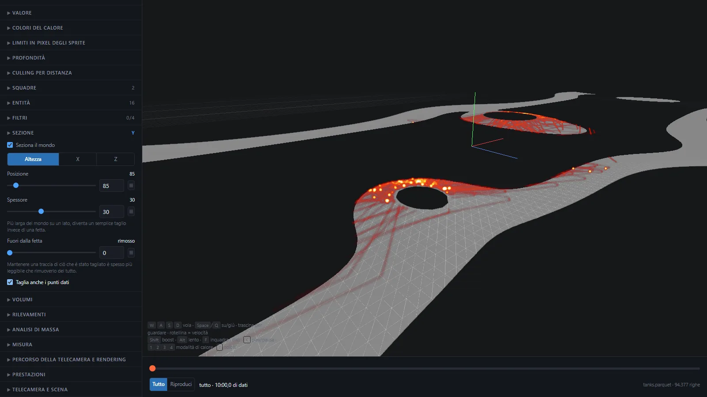

# Sezione

**Sezione** taglia il mondo come una fetta di torta, così puoi guardare dentro gli edifici. Usalo quando i muri nascondono il calore interessante, per esempio per vedere un solo piano di un edificio.

## Provalo {#try-it}

1. Carica un livello e alcuni dati, e apri **Sezione**.
2. Spunta **Seziona il mondo**. L'asse è **Altezza**.
3. Trascina **Posizione** su e giù: la fetta si sposta attraverso il livello.
4. Rendi **Spessore** sottile per una pianta, o largo per "tutto ciò che sta sotto qui".
5. Tieni **Fuori dalla fetta** a 0 per togliere il resto, oppure alzalo per tenere una traccia tenue.



La fetta taglia **la geometria del livello e i punti dati insieme** - tagliare solo il livello lascerebbe il calore a fluttuare dove prima c'era il suo edificio. È il complemento dell'[occlusione per profondità](depth-and-culling.md): una volta che il livello nasconde correttamente ciò che gli sta dietro, anche l'interno di un edificio è nascosto. Il pannello viene mostrato quando c'è qualcosa da sezionare (un dataset o un livello 3D); la sua intestazione mostra l'asse quando è attivo, *off* altrimenti.

```
vista laterale    Posizione = dove sta la fetta
 ----------       Spessore = quanto è alta la fetta
 | piano 3 |
 |=========|  <--- fetta (tenuta)
 | piano 2 |  <--- fuori: tolto (o tenue)
 | piano 1 |
 ----------
```

## Controlli {#controls}

| Controllo | Predefinito | Significato |
|---|---|---|
| **Seziona il mondo** | off | Accende la fetta. Finché la posizione è ancora al valore iniziale 0 e lo spessore a quello iniziale 500, accendendola li sposta al centro dell'asse e al 15% della sua estensione. |
| Asse | **Altezza** | *Altezza* (Y), *X* o *Z*. Cambiare asse sposta la fetta al centro del nuovo asse. |
| **Posizione** | il centro | Centro della fetta, in unità del mondo, lungo l'estensione dell'asse (passi di 500). |
| **Spessore** | 15% dell'estensione | Da 1/500 dell'estensione a due volte l'estensione, a passi logaritmici. Quando è largo quanto l'estensione, mostra *oltre il mondo*: un lato arriva allora oltre il mondo e si tratta di un semplice taglio invece che di una fetta. |
| **Fuori dalla fetta** | 0, *tolto* | Quanto di ciò che sta fuori resta visibile, 0-100%. Una traccia tenue di ciò che è stato tagliato via spesso si legge meglio che toglierlo del tutto. |
| **Taglia anche i punti dati** | attivo | Disattivato lascia il calore intero, quindi si vede attraverso il taglio - utile per vedere che cosa c'è sopra e sotto la fetta. |

L'estensione di un asse è quella del livello 3D quando è caricato, altrimenti quella del dataset.

La sezione è indipendente dall'[esclusione per distanza](depth-and-culling.md#distance-culling), che taglia lungo la direzione di vista anziché lungo un asse del mondo; le due si combinano. Una modifica a qualsiasi impostazione della sezione riavvia l'accumulo del calore.

## Per gli sviluppatori {#for-developers}

La fetta viene verificata sulla posizione nel mondo di ogni riga nello shader dei vertici: una riga fuori da essa ha il suo contributo moltiplicato per il valore *Fuori*, quindi a 0 viene scartata prima che venga disegnato qualsiasi frammento. Gli shader del livello applicano la stessa verifica a ogni frammento del terreno, delle strutture e dell'acqua.
