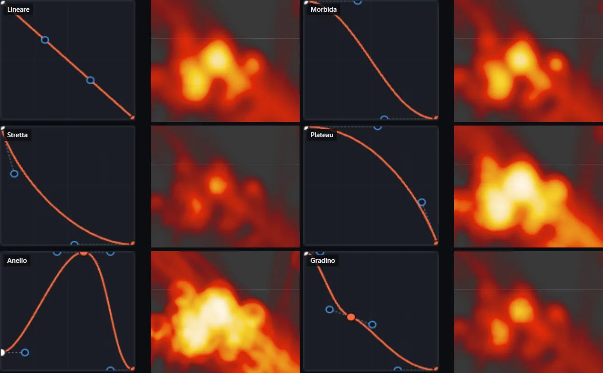

# Forma dello sprite

Ogni riga viene disegnata come uno sprite rotondo che guarda sempre la telecamera. La sua dimensione e il profilo dal centro al bordo - la **rampa** - decidono se un punto caldo si legge come un puntino stretto, una nuvola morbida, un disco o un anello. Questi comandi sono nelle sezioni **Forma del calore** e **Limiti in pixel degli sprite** della barra laterale, e si applicano a [Calore](heat.md), [Differenza](difference.md), [Calore per squadra](team-heat.md) e, come mezza larghezza di una linea, a [Calore lineare](line-heat.md).

Cambiarne uno qualsiasi riavvia l'accumulo (il campo deve essere ridisegnato con la nuova forma).

Pensa a ogni puntino come a una macchia morbida di luce. Una macchia piccola mostra i singoli punti; una macchia grande unisce i vicini in una nuvola. La forma decide quanto è morbido il bordo.



## Raggio dello sprite {#sprite-radius}

Il raggio dello sprite in **unità del mondo** (indicate come metri). Predefinito 6, e a ogni caricamento l'estensione orizzontale dei dati / 120 - abbastanza grande perché i campioni vicini lungo un percorso si uniscano in una fascia invece di sembrare un filo sottile. Cursore logaritmico 0,05-2000, la maniglia arriva fino a 50.000.


Le cose lontane appaiono più piccole, quindi uno sprite si rimpicciolisce sullo schermo con la distanza. Con la proiezione parallela è uguale ovunque, ed è in parte per questo che la vista parallela è quella giusta per confrontare i punti caldi ([Telecamera](camera.md#projection)).

## Limiti in pixel {#pixel-clamps}

**Limiti in pixel degli sprite** (chiusi di default) limitano il raggio sullo schermo dopo la conversione qui sopra.

| Controllo | Predefinito | Intervallo (rotella) | Perché |
|---|---|---|---|
| **Raggio minimo in pixel** | 1 px | 0-16 (512) | Impedisce che i dati lontani scompaiano sotto un pixel. |
| **Raggio massimo in pixel** | 96 px | 2-1024, logaritmico (8192) | La protezione dal sovradisegno. Uno sprite che copre N pixel costa N operazioni di fusione, quindi un raggio non limitato vicino alla telecamera è ciò che trasforma un fotogramma veloce in uno lento. Oltre l'altezza della vista smette di limitare qualsiasi cosa. |

**Stessa densità a ogni zoom** (nella sezione Forma del calore, predefinito attivo) lavora insieme ai limiti. Uno sprite che un limite rende più grande (lontano) o più piccolo (da vicino) mantiene il calore che aggiungerebbe alla sua dimensione reale, così un colore significa lo stesso numero di righe per area di terreno a qualsiasi zoom. Disattivato, uno sprite limitato aggiunge il suo peso pieno alla sua dimensione limitata, e l'immagine cambia mentre voli verso di esso.

## Intensità al centro e al bordo {#centre-and-edge-intensity}

Il calore che uno sprite aggiunge esattamente al centro (**Intensità al centro**, predefinito 1, 0-10, rotella 1000) e al bordo (**Intensità al bordo**, predefinito 0, da -2 a 10, rotella 1000). Il valore della rampa *t* (1 al centro, 0 al bordo, modellato dall'attenuazione o dalla curva qui sotto) fa da interpolazione tra i due (la formula è sotto [Per gli sviluppatori](#for-developers)).

Un'**intensità al bordo negativa** fa sottrarre il bordo, che scava un alone freddo attorno a ogni punto caldo e rende più nitidi i gruppi l'uno rispetto all'altro. La visibilità include l'[occlusione](depth-and-culling.md) e la [sezione](slice.md); la dissolvenza è la dissolvenza della [Durata](timeline.md#history); il segno è ±1 in [Differenza](difference.md).

## Forma della rampa: Attenuazione o Curva {#ramp-shape-falloff-or-curve}

**Forma della rampa** passa tra due modi di modellare *t* attraverso lo sprite. Con *d* la distanza dal centro (0) al bordo (1):

### Attenuazione {#falloff}

Mostrata quando è selezionata *Attenuazione* (il predefinito).

- **Attenuazione** (predefinito 1,6, 0,1-8, rotella 64): `t = (1 - d) ^ attenuazione`. 1 è una rampa lineare dritta; valori più alti tirano il calore verso il centro e stringono il punto caldo; sotto 1 lo appiattisce in un disco.
- **Rampa morbida** (predefinita attiva): applica una curva a S smoothstep a *t*, così lo sprite sfuma sul bordo invece di terminare su un contorno visibile.

### Editor della curva {#the-curve-editor}

Mostrato quando è selezionata *Curva*. Una sezione trasversale letterale di uno sprite: distanza dal centro attraverso (*centro* a sinistra, *bordo* a destra), calore in alto. La curva è una Bézier cubica a tratti attraverso punti di controllo, ciascuno con due maniglie.

| Azione | Effetto |
|---|---|
| Doppio clic sul grafico | Aggiunge un punto a quella distanza (mantenuto tra 0,02 e 0,98), sulla curva e con la pendenza della curva lì, così aggiungerlo non cambia nulla finché non lo trascini. |
| Trascina un punto | Lo sposta. Le altezze restano tra 0 e 1. |
| Trascina un piccolo cerchio | Piega il segmento accanto (sposta quella maniglia). |
| Alt-clic o clic destro su un punto | Lo rimuove. I due estremi non si possono rimuovere. |
| Un pulsante predefinito | Sostituisce la curva con il predefinito. |

Gli estremi sono fissi al centro e al bordo; la loro altezza però è ancora a tua scelta.

**Predefiniti** ([`curve.ts`](https://github.com/Holdi601/3DHeat/blob/main/src/state/curve.ts)):

| Predefinito | Forma | Uso |
|---|---|---|
| **Lineare** | Dritta da 1 a 0 | Identica ad *Attenuazione* 1 con *Rampa morbida* spenta. |
| **Morbida** | Curva a S | La curva predefinita; quella che dà *Rampa morbida* con attenuazione 1. |
| **Stretta** | Un nucleo ripido, una gonna lunga e tenue | Dati radi. |
| **Plateau** | Piatta, poi un calo rapido | Si legge come un disco invece che come una macchia. |
| **Anello** | 0,15 al centro, 1 al 62% del raggio, 0 al bordo | Uno sprite vuoto: mostra dove passano i percorsi invece di dove si fermano. |
| **Gradino** | Attenuazione a due stadi, 0,45 al 35% | Separa un nucleo denso dai suoi dintorni. |

## Appiattisci sul piano del terreno {#flatten-onto-ground-plane}

**Appiattisci sul piano del terreno** (predefinito spento) ignora l'altezza di ogni riga e disegna tutto il calore a un'unica altezza - la Y più bassa dei dati - la classica mappa di calore 2D. Con questo attivo, l'occlusione per profondità e *Nascondi dietro il terreno* sono spente (ogni punto starebbe esattamente sulla superficie contro cui viene testato), e la sezione Profondità lo dice.

## Per gli sviluppatori {#for-developers}

### Formule {#formulas}

Raggio sullo schermo in pixel: `radius × P[1][1] / w × viewport height / 2`, dove `P` è la matrice di proiezione e `w` è la profondità di vista del punto.

Il calore che uno sprite aggiunge:

```
heat added = mix(edge, centre, t) × sample weight × sign × fade × visibility
```

### La curva {#the-curve}

Le maniglie vengono limitate orizzontalmente al loro segmento, quindi la curva è sempre una funzione della distanza: trascinare una maniglia ben oltre il punto successivo la appiattisce contro di esso invece di ripiegare la curva su se stessa, cosa che renderebbe il risultato dipendente da quale radice un solutore avesse trovato.

### Come viene disegnata la curva {#how-the-curve-is-drawn}

La curva viene fissata in una tabella di 256 voci ogni volta che cambia, caricata come texture float a 16 bit, e campionata per frammento con filtraggio lineare e un rientro di mezzo texel così entrambe le estremità restano esatte. Risolvere una Bézier per x richiede iterazioni, che non hanno posto nello shader più caldo del programma, e una lettura da tabella costa anche meno del `pow()` usato dall'attenuazione. A 16 bit invece che a 8 perché con 8 bit compare il banding una volta che si sommano migliaia di sprite; il float a mezza precisione a 16 bit è filtrabile nel WebGL2 base, mentre il 32 bit richiede un'estensione.
