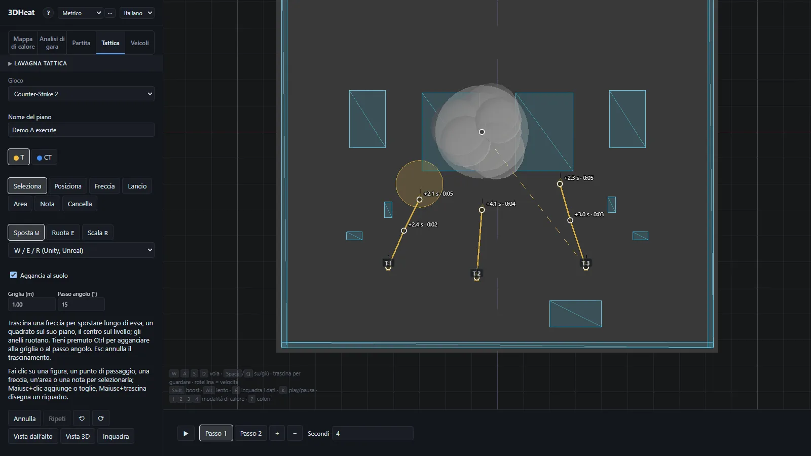

# Lavagna tattica

La scheda **Tattica** è una lavagna da disegno per un piano di squadra: metti piccole figure su una mappa, disegni frecce per indicare dove vanno, e premi play per vedere cosa succede. Usala per pianificare un round o un attacco prima di giocare. Condivide la tela, la telecamera e il [livello](levels.md) con le altre schede e nient'altro; un piano non è un dato e non disegna calore.

## Il tuo primo piano {#your-first-plan}

1. Apri la scheda **Tattica**. Scegli il **Gioco** (per esempio Counter-Strike 2) e, per Valorant, premi **Carica le mappe di Valorant** e scegli una **Mappa**. Oppure carica prima un [livello](levels.md).
2. Scegli uno **Schieramento** (imposta il colore) e premi **Vista dall'alto**.
3. Scegli **Luogo**, scegli una figura in **Figure** (usa **Cerca figure** per trovarne una) e clicca sulla mappa. Mettine due o tre.
4. Scegli **Freccia**, clicca su una figura, clicca lungo il percorso che dovrebbe seguire, e premi **Invio** per finire la freccia.
5. Premi **+** sotto la vista per aggiungere il passo 2. Ogni figura inizia dove è finita la sua freccia. Disegna altre frecce lì.
6. Premi **▶** (o `K`) per riprodurre il piano dal passo mostrato fino alla fine.
7. Dai un nome al piano in **Nome del piano** e premi **Salva**.

## Iniziare un piano {#starting-a-plan}

| Comando | Cosa fa |
|---|---|
| **Gioco** | Sceglie gli schieramenti e le figure che la tavolozza offre: Counter-Strike 2 (T, CT; giocatori e utilità), Valorant (Attacco, Difesa; giocatori e abilità generiche), Battlefield, Squad, Arma (fanteria, veicoli di terra, aerei, barche), DCS / War Thunder / IL-2 (jet, aerei a elica, elicotteri, difesa aerea, terra, navi, armi), e Altro. Un piano che ha già figure mantiene i suoi schieramenti quando cambia il gioco. |
| **Nome del piano** | Il nome con cui il piano viene salvato. |
| **Mappa**, **Carica le mappe di Valorant** | Con Valorant scelto: **Carica le mappe di Valorant** ottiene l'elenco delle mappe da [valorant-api.com](https://valorant-api.com); **Mappa** poi mette la minimappa della mappa scelta come livello, inquadrata dall'alto. L'immagine viene scaricata quando la scegli e non viene mai distribuita. L'avviso di Riot viene mostrato mentre è sullo schermo (vedi sotto). |
| **Schieramento** | Lo schieramento a cui appartiene la prossima figura, freccia o area; prende il colore dello schieramento. |

Senza un livello la lavagna è il piano di terra piatto. Carica un livello sotto **Livello** per
pianificare su una mappa vera: una mappa CS2 esportata con lo strumento CS2, un livello della
libreria, oppure un'immagine di mappa.

## Strumenti {#tools}

| Strumento | Clic | Note |
|---|---|---|
| **Seleziona** | Una figura, un punto di passaggio, una freccia, un'area o una nota la seleziona. | Shift+clic aggiunge o toglie; Shift+trascinamento disegna un riquadro intorno a ciò che va aggiunto. La selezione ottiene un gizmo di trasformazione (vedi sotto); `Canc` o `Backspace` lo rimuove. `M` sposta la figura selezionata al clic successivo. |
| **Luogo** | Mette giù la figura scelta. | Una figura si sceglie nella tavolozza **Figure** (con **Cerca figure**). Senza nulla selezionato, `R` gira la prossima figura di 15° prima di metterla (`Shift+R` nell'altro verso). |
| **Freccia** | Ogni clic aggiunge un punto; Invio, un doppio clic o un clic destro la chiudono, Esc la annulla. | **Sposta**, **Attacco** (punta più larga) oppure **Sorveglia** (una linea sottile all'altezza degli occhi). Una freccia iniziata su una figura è il percorso di quella figura in questo passo: riprodotta, la figura lo percorre, e il passo successivo inizia dove è finito. |
| **Lancio** | Chi lancia, poi dove atterra. | Un arco tratteggiato dall'uno all'altro, e l'utilità scelta (fumo, flash, molotov, ...) compare dove atterra e resta da questo passo in poi. |
| **Area** | Il centro, poi il bordo. | Un disco nel colore dello schieramento. |
| **Nota** | Dove va la nota; chiede il suo testo. | Mostrata come uno spillo, con il suo testo sopra. |
| **Cancella** | Una figura, freccia, area o nota. | La rimuove da questo passo in poi; nel suo primo passo, la rimuove del tutto. |

**Annulla** e **Ripeti** (`Ctrl+Z`; `Ctrl+Y` o `Ctrl+Shift+Z`) scorrono ogni modifica. Una riga sotto il piano mostra quante figure, frecce e passi ha. **Vista dall'alto** guarda dritto in basso (ortogonale), **Vista 3D** torna alla prospettiva, **Fotogramma** adatta il piano, o il livello quando il piano è vuoto.

**Dimensione figure** scala ogni figura sulla lavagna; 1× è la dimensione reale, che da molto in alto sono pochi pixel per una persona.

## Spostare, girare e scalare {#moving-turning-and-scaling}

Tutto sulla lavagna si può spostare come in un editor 3D: figure, utilità, segnalini, singoli punti di passaggio e frecce intere, aree e note. Ciò che è selezionato ottiene un gizmo al suo centro:

| Modalità | Tasti | Maniglie |
|---|---|---|
| **Sposta** | W (o G) | Una freccia per asse (X rosso, Y verde e in alto, Z blu) si sposta lungo di esso; un quadrato si sposta sul suo piano; il centro si sposta sul livello sotto il puntatore. |
| **Ruota** | E (o R) | Un anello per asse gira intorno ad esso. Gli anelli di una singola figura sono il suo imbardata, beccheggio e rollio propri; un gruppo gira intorno agli assi del mondo attorno al suo centro. |
| **Scala** | R (o S) | Allarga o restringe la selezione dal suo centro lungo un asse o in ogni direzione; il raggio di un'area cresce con essa. |

**Chiavi** passa tra W / E / R (Unity, Unreal) e G / R / S (Blender); i tasti scelgono la modalità solo quando qualcosa è selezionato, e altrimenti spostano la telecamera. Quindi `R` significa **Scala** con i tasti W / E / R e **Ruota** con i tasti G / R / S quando qualcosa è selezionato, e gira la prossima figura da mettere quando non c'è nulla. Tutti i tasti della lavagna sono elencati nel [riferimento della tastiera](keyboard-reference.md#tactics-board). Tieni premuto **Ctrl** mentre trascini per agganciare uno spostamento alla **Griglia** (metri) o una rotazione al **Passo angolare**. **Aggancia al suolo** (attivo di default) mette persone, veicoli, segnalini, punti di passaggio e aree spostati sulla superficie del livello; aerei ed elicotteri mantengono la loro altezza, e un trascinamento lungo la freccia Y non si aggancia mai. Trascinare una maniglia non sposta mai la telecamera. **Esc** annulla un trascinamento, e ogni modifica è un passo di Annulla.

I punti di passaggio appaiono come puntini sulle frecce del passo mostrato: cliccane uno per selezionarlo, trascinalo per spostarlo, Canc per toglierlo. La sezione **Selezionate** mostra il posto della selezione in metri, l'imbardata, il beccheggio e il rollio di una figura in gradi, e il raggio di un'area, ognuno da digitare.

## Cronometraggio {#timing}

Il percorso di una figura è cronometrato: ogni tratto richiede la sua lunghezza sul livello - campionata sulla superficie ogni un paio di metri, così una collina o una scalinata tra due punti conta - alla velocità della sua **modalità** di movimento per quella figura in quel gioco, più l'eventuale **attesa** a un punto di passaggio. La fanteria striscia, si accovaccia, cammina (silenziosa), corre o sprinta; i veicoli e le barche strisciano, vanno con cautela, normalmente o di corsa; aerei ed elicotteri volano lenti, in crociera, in velocità di combattimento o al massimo. Una modalità che il gioco non ha (CS2 non ha lo sprint) prende la più vicina che ha. Come una salita rallenta dipende dal gioco: in CS2 e Valorant conta solo la distanza orizzontale, come nei giochi; i simulatori militari rallentano la fanteria in salita (funzione di marcia di Tobler) e i veicoli in base alla pendenza.

Le velocità vengono da tabelle per gioco con le loro fonti (vedi [Velocità di movimento](tactics-speeds.md)): CS2 per l'arma impugnata, dalle definizioni delle armi del gioco; Valorant per arma; Battlefield, Squad, Arma e i giochi aerei per tipo e classe di veicolo. **Si muove come** sceglie il profilo di una figura (un'arma, un tipo di veicolo); **Propria (m/s)** sostituisce qualunque modalità per quella figura. Le modalità hanno i nomi che mostra la lavagna: *Striscia*, *Accovacciato*, *Cammina (silenzioso)*, *Corri*, *Sprint*; *Cauto*, *Normale*, *Di corsa*; *Lento*, *Crociera*, *Combattimento*, *Massimo*.

Ogni punto di passaggio mostra il tempo dall'ultimo e il tempo dall'inizio del piano ("+3,9 s · 0:12"). Il percorso della figura selezionata elenca ogni tratto con la sua modalità, lunghezza e tempo, l'attesa e l'arrivo. **Arrivi** sotto **Cronometraggio** mette ogni figura con un percorso su una sola linea del tempo, il primo arrivo in alto. Con **Riproduci in tempo reale** (attivo di default) un passo dura finché non arriva il percorso più lento e ogni figura si muove alla propria velocità; **Secondi** è allora la lunghezza minima del passo. **Unità del livello per metro** dice in che unità è il livello: 39,37 per le mappe CS2 (unità di gioco), 1 per le mappe in metri.

## Confronto con i dati delle partite {#compare-with-match-data}

**Carica file partita…** legge le tabelle delle partite CS2 della mappa (i file Parquet dello strumento CS2, quanti se ne vuole; solo le colonne necessarie, in background); **Usa i dati caricati** prende i dati caricati nel visualizzatore. Poi:

- **Arrivo più rapido sulla mappa** colora la mappa in base al tempo dall'inizio del round con cui un giocatore ha raggiunto per primo ogni punto - il pulsante **Il più veloce** mostra il più rapido su tutti i round, **Tipico (mediana)** il round di mezzo - dal verde all'inizio al rosso alla fine, per uno schieramento o per entrambi. Mostra cosa è possibile e quando.
- Il percorso selezionato viene confrontato con quello che i giocatori hanno ottenuto dal suo inizio (o dall'inizio del round) alla sua fine, ogni fine un disco del raggio impostato: "Più veloce osservato 14,2 s, p10 15,0 s, mediana 18,3 s su 41 prove; il tuo piano 15,1 s".
- Le velocità a cui i giocatori si sono davvero mossi - correndo, camminando, accovacciati, dalle colonne di camminata e accovacciamento delle tabelle - in m/s.

## Passi {#steps}

La barra sotto la vista contiene i passi. Un piano ne inizia con uno; **+** ne aggiunge uno, e ogni figura inizia lì dove è finito il suo percorso nell'ultimo passo; **−** rimuove quello mostrato. **Secondi** è quanto dura il passo mostrato quando viene riprodotto. **▶** (K) riproduce dal passo mostrato fino alla fine: le figure con un percorso lo percorrono, le figure spostate in un nuovo posto nel passo successivo scivolano lì, le altre restano ferme. Mentre un passo è mostrato, il posto di ogni figura nel passo successivo viene disegnato come un fantasma tenue, e le frecce dell'ultimo passo sono appena visibili sotto quelle di questo.

## Salvataggio {#saving}

La sezione **File** contiene **Salva**, **Apri** e **Svuota**. **Salva** scrive il piano come `<nome>.h3dplan.json` (JSON semplice: schieramenti, passi, figure con un posto per passo, frecce, aree, note); **Apri** ne legge uno. Un file di un'altra versione, o uno che non è un piano, viene rifiutato con il motivo. **Svuota** svuota il piano; Annulla lo riporta.

## Figure {#figures}

Ogni figura è costruita dal visualizzatore stesso: forme semplici sulla dimensione pubblicata di un tipo, con le caratteristiche che la distinguono dalle vicine - le ruote di rotolamento e la torretta di un carro, i cannoni, i missili e i radar di un veicolo di difesa aerea, la pianta dell'ala di un aereo, la coda e i motori, i rotori e le ali corte di un elicottero. Niente è preso da un gioco. Un modello inventato da un gioco viene mostrato come la figura generica della sua classe. Vedi [Figure](figures.md#which-figure-a-unit-gets) per come i dati trovano la loro figura.

## Avviso di Riot {#riots-notice}

Le mappe di Valorant vengono mostrate secondo la politica "Legal Jibber Jabber" di Riot Games, che permette ai progetti gratuiti della comunità di usarle e chiede questo avviso ovunque compaiano: *3DHeat was created under Riot Games' "Legal Jibber Jabber" policy using assets owned by Riot Games. Riot Games does not endorse or sponsor this project.* Le abilità sulla lavagna sono forme generiche, non l'arte di Riot.
