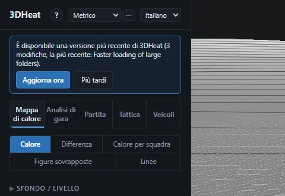

# Aggiornamenti

Il visualizzatore ti dice quando esiste una versione più recente, e si aggiorna da solo solo se glielo permetti. Nulla viene cambiato sul tuo computer senza la tua risposta.

## Aggiornare il visualizzatore {#update-the-viewer}

1. **Nella pagina.** Quando esiste una versione più recente, compare un riquadro sotto il nome in cima alla barra laterale: "È disponibile una versione più recente di 3DHeat". Clicca **Aggiorna ora**. La pagina si ricarica da sola al termine. **Più tardi** nasconde il riquadro finché non ricarichi la pagina.
2. **Se dice di eseguire restart.bat**, chiudi la finestra del server (la finestra nera che ha aperto `start.bat`) e fai doppio clic su `restart.bat`.
3. **All'avvio del visualizzatore.** Anche `start.bat` controlla. Se esiste una versione più recente, chiede **Update now? [Y/N]**. Premi `Y` per aggiornare. Premi `N`, oppure aspetta 60 secondi senza rispondere, per avviare la versione che hai.



Una copia con modifiche proprie non viene mai aggiornata al posto tuo: il riquadro ti dice soltanto che un aggiornamento è in attesa, e dice di salvare (commit) o mettere da parte (stash) le modifiche ed eseguire `git pull`. Una copia non installata con git (per esempio un file zip) non mostra nulla.

Come funziona il controllo, passo per passo:

```
pagina ---(dopo 4 s, poi ogni 6 h)---> server di sviluppo ---> git fetch
   indietro?  no  -> non si mostra nulla
              sì  -> modifiche o commit propri?  sì -> ti avvisa soltanto
                                                 no -> [Aggiorna ora] -> git pull
                                                        -> ricarica, oppure "esegui restart.bat"
```

## Le regole di sicurezza {#the-safety-rules}

- **Solo avanzamento veloce** (`git pull --ff-only`): un aggiornamento non unisce, non rebasa e non riscrive nulla.
- **Nessuna modifica locale**: una copia con modifiche non salvate ai file tracciati (`git status --porcelain --untracked-files=no` non vuoto) non viene mai aggiornata automaticamente - il lavoro di qualcuno non deve essere sovrascritto da un aggiornamento. Viene solo avvisata che un aggiornamento è in attesa. I file non tracciati (dati, esportazioni) non contano come modifiche.
- **Nessun commit locale**: una copia con commit che il ramo a monte non ha ("divergente") non viene aggiornata - un avanzamento veloce non può portarla al passo, e unire è compito di `git pull` a mano. La pagina e `start.bat` lo dicono con le stesse parole, e `start.bat` avvia la versione che c'è.
- **Solo dalla pagina stessa**: la richiesta di aggiornamento del server di sviluppo deve portare un'intestazione personalizzata e, quando il browser invia un `Origin`, provenire dall'host del server stesso (qui sotto).
- Viene aggiornata solo una copia git con un ramo a monte; tutto il resto (una copia senza `.git`, git non installato, una build statica) viene lasciato stare e non dice nulla.

## Cosa fa start.bat {#what-startbat-does}

`start.bat` (fai doppio clic; la finestra è il server) fa, in ordine:

1. Trova Node.js - nel `PATH`, altrimenti in `%ProgramFiles%\nodejs`, `%ProgramFiles(x86)%\nodejs` o `%LOCALAPPDATA%\Programs\nodejs` - e, se manca, propone di installarlo con `winget install -e --id OpenJS.NodeJS.LTS` (chiede Y/N; dopo bisogna riaprire la finestra perché Windows legga il nuovo `PATH`).
2. **Aggiornamenti**, quando git è installato e la cartella ha `.git`:
   - `git fetch --quiet` (senza rete o senza ramo a monte: saltato in silenzio);
   - conta `git rev-list --count HEAD..@{u}`; niente indietro: non dice nulla;
   - modifiche locali: "È disponibile una versione più recente di 3DHeat (N modifiche), ma questa copia ha modifiche locali, quindi non viene aggiornata. Salvale o mettile da parte, poi esegui git pull." - e avvia la versione che c'è;
   - commit propri (`git rev-list --count @{u}..HEAD` diverso da 0): "È disponibile una versione più recente di 3DHeat (N modifiche), ma questa copia ha commit propri che la versione più recente non ha, quindi non viene aggiornata. Aggiornala con git pull." - e avvia la versione che c'è;
   - altrimenti "È disponibile una versione più recente di 3DHeat (N modifiche)." e la domanda **Update now? [Y/N]**. `N`, o nessuna risposta per 60 secondi, stampa "Non aggiornato; avvio della versione che hai." e avvia la versione che c'è. Con `Y`: "Aggiornamento in corso...", segnala se cambiano `package.json` o `package-lock.json`, esegue `git pull --ff-only` (se anche questo fallisse - per esempio per la rete: "L'aggiornamento non è andato a buon fine; avvio della versione che hai."), poi `git submodule update --init` (gli strumenti fissati, vedi [Manutenzione della documentazione](maintaining.md#the-tools-under-exporters)), poi `npm install` quando sono cambiati i file del pacchetto ed esiste `node_modules`, e "Aggiornato."
3. Rifiuta di avviare un secondo server: quando qualcosa è già in ascolto sulla porta **5273** lo dice e rimanda a `restart.bat` / `stop.bat`.
4. Alla prima esecuzione (nessun `node_modules`), chiede prima di scaricare le dipendenze (circa 300 MB in `node_modules\`, nulla a livello di sistema).
5. Avvia il server di sviluppo su `127.0.0.1:5273` (`--strictPort`) e apre il browser quando è pronto.

`restart.bat` ferma il server (per porta) ed esegue di nuovo `start.bat`, quindi fa la stessa domanda. `stop.bat` si limita a fermarlo.

## Per gli sviluppatori {#for-developers}

### Durante l'esecuzione: la rotta di aggiornamento {#while-it-runs-the-update-route}

Il server di sviluppo (plugin Vite `heat3d-self-update` in `vite.config.ts`) serve `/__heat3d/update`. Esiste solo sul server di sviluppo - non in una build statica e non in `vite preview`.

**`GET /__heat3d/update`** risponde se la copia è indietro:

```json
{ "checkout": true, "upstream": "origin/main", "behind": 3, "ahead": 0, "dirty": false, "latest": "l'oggetto dell'ultimo commit" }
```

- `checkout: false` quando la cartella non è una copia git;
- esegue `git fetch --quiet` **al massimo ogni 30 minuti** (le richieste nel frattempo rispondono in base all'ultimo fetch);
- `behind` / `ahead` da `git rev-list --count HEAD..@{u}` / `@{u}..HEAD`, `dirty` da `git status --porcelain --untracked-files=no`, `latest` l'oggetto dell'ultimo commit del ramo a monte;
- senza ramo a monte, `upstream: null` e `behind: 0`.

**`POST /__heat3d/update/apply`** porta la copia al passo:

1. Rifiutata con `403 { ok: false, reason: "forbidden" }` a meno che la richiesta non abbia l'intestazione `X-Heat3d-Update: 1` e, quando porta un `Origin`, l'host di quell'origine non sia l'`Host` della richiesta. Un modulo cross-site non può inviare un'intestazione personalizzata senza una preflight CORS, che questo server non concede mai.
2. Niente da fare (non una copia, nessun ramo a monte, non indietro): `{ ok: true, updated: false }`.
3. Modifiche locali: `{ ok: false, reason: "dirty" }`; commit locali: `{ ok: false, reason: "diverged" }`.
4. Altrimenti: annota i file che cambiano (`git diff --name-only HEAD @{u}`), `git pull --ff-only` (timeout 2 min), `git submodule update --init` (un fallimento viene ignorato), `npm install` quando sono cambiati `package.json` o `package-lock.json` (timeout 15 min), e risponde `{ ok: true, updated: true, restart }` - `restart` dice perché il server in esecuzione non può recepire l'aggiornamento: `"dependencies"` quando le dipendenze sono state reinstallate, `"config"` quando è cambiato solo un file `vite.config`, `false` quando non serve un riavvio.
5. Un comando git o npm che fallisce risponde `{ ok: false, reason: "<l'errore, fino a 300 caratteri>" }`.

Le risposte sono JSON con `Cache-Control: no-store`. Il server ascolta solo su `127.0.0.1`, quindi la rotta non è raggiungibile dalla rete.

### L'avviso nella pagina {#the-notice-in-the-page}

`UpdateBanner`, sotto il nome in cima alla barra laterale:

- Interroga la rotta **4 secondi** dopo il caricamento della pagina (non nei primi secondi: la pagina ha un dataset da caricare e una GPU da avviare) e di nuovo **ogni 6 ore** finché la pagina resta aperta.
- Non mostra **nulla** quando la rotta non esiste (una build statica), la cartella non è una copia git, o non c'è nulla di più recente - un avviso a ogni avvio è uno che la gente impara a ignorare.
- Indietro, senza modifiche locali: "È disponibile una versione più recente di 3DHeat (N modifiche, la più recente: <oggetto>)." con **Aggiorna ora** e **Più tardi** (*Più tardi* lo nasconde finché la pagina non viene ricaricata).
- Indietro, con modifiche locali: la stessa frase e "Questa copia ha modifiche locali, quindi non viene aggiornata automaticamente; salvale o mettile da parte, poi esegui git pull." - senza pulsante.
- **Aggiorna ora** invia una richiesta a `/apply` ("Aggiornamento in corso..."). Poi:
  - "Aggiornato. La pagina si ricarica." - e ricarica 1,5 s dopo (il server serve già i file nuovi);
  - quando le dipendenze sono state reinstallate: "Aggiornato. Le sue dipendenze sono cambiate: chiudi la finestra del server ed esegui **restart.bat** per completare.";
  - quando è cambiata solo la configurazione del server: "Aggiornato. Le sue impostazioni del server sono cambiate: chiudi la finestra del server ed esegui **restart.bat** per completare.";
  - nulla da portare dentro dopo tutto (`updated: false` - la copia è stata già portata al passo nel frattempo, per esempio da `start.bat`): "Nulla da aggiornare: questa copia è già la versione più recente." - e nessun ricaricamento;
  - rifiutata: la frase sulle modifiche locali, oppure "Questa copia ha commit propri che la versione più recente non ha; aggiornala con git pull.", oppure "L'aggiornamento non è andato a buon fine: <motivo>".
