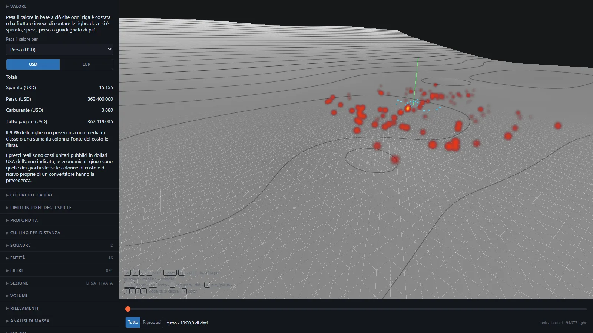

# Pesatura per valore

Ogni colpo, munizione, veicolo perso e litro di carburante ha un prezzo. Il visualizzatore calcola quanto è costata o quanto ha reso ogni riga e può pesare il calore in base a questo, così la mappa mostra **dove sono finiti i soldi** invece di dove si trovano le righe.

## Come si usa {#how-to-use-it}

1. Carica dati con eventi (colpi, uccisioni, morti) e nomi di veicoli o armi.
2. Apri **Valore** nella barra laterale del Calore.
3. Scegli **Pesa il calore per**, per esempio *Perso (USD)*. Ora il calore somma il prezzo di ogni riga invece di 1.
4. Leggi **Totali**: la somma di ogni colonna di valore per ciò che è mostrato (si applicano i filtri e la finestra temporale).
5. Dove i prezzi sono denaro reale, compare un interruttore **USD / EUR**.

Scegli la prima voce vuota del menu per contare di nuovo le righe.

## Che cosa si può pesare {#what-can-be-weighed}

Le colonne di valore vengono aggiunte al caricamento, una per tipo e per valuta:

| Tipo | Righe su cui cade | Come viene prezzato |
|---|---|---|
| **Sparato** | colpi e lanci | l'arma, altrimenti una media per tipo di munizione |
| **Speso** | acquisti, comparse | colonne di denaro del gioco (per esempio il menu d'acquisto di uno sparatutto) |
| **Perso** | morti, distrutti | il proprio veicolo, altrimenti la media della sua classe |
| **Distrutto** | uccisioni | il veicolo bersaglio |
| **Danni inflitti** | colpi a segno | una quota del valore del bersaglio |
| **Carburante** | posizioni | carburante usato, da una colonna del carburante o stimato dalla classe e dal tempo |
| **Tutto pagato** | | sparato + speso + perso + carburante |
| **Guadagnato** | ricompense | le colonne di ricompensa del gioco (`earn_…`) |
| **Netto** | | guadagnato meno pagato; disegnato come calore con segno (rampa positiva dove si è guadagnato di più, negativa dove si è pagato di più) |

I nomi delle colonne sono `cost_<tipo>_<valuta>`, `earn_<valuta>` e `net_<valuta>`. Un convertitore che conosce la valuta propria del gioco (per esempio un convertitore di replay che scrive i crediti del gioco) ha la precedenza sulle tabelle dei prezzi integrate.

## Le tabelle dei prezzi {#the-price-tables}

| Tabella | Valuta |
|---|---|
| Militare reale: missili, bombe, proiettili, contromisure, aerei, elicotteri, veicoli terrestri, navi, carburante | USD (EUR = USD × 0,92, il valore fisso `EUR_PER_USD` in [`cost.ts`](https://github.com/Holdi601/3DHeat/blob/main/src/data/cost.ts); non è un cambio in tempo reale) |
| Menu d'acquisto degli sparatutto e ricompense per le uccisioni | i crediti del gioco |
| Giochi di carri e navi | i crediti del gioco |
| Giochi strategici (più risorse) | una colonna per risorsa più una combinata |
| Wargame | punti |

Il gioco viene riconosciuto dai nomi nei dati. I prezzi reali vengono da fonti pubbliche (documenti di bilancio, enciclopedie) o sono segnati come stime; non sono corretti per l'inflazione. L'elenco generato delle tabelle è in [Tabelle dei valori](ref-value-tables.md).

## Stime {#estimates}

La colonna di categoria aggiuntiva **Fonte del costo** dice come è stata prezzata ogni riga: `table`, `class average`, `estimate` oppure `none`. La sezione Valore mostra quale quota delle righe prezzate sono medie o stime. Per tenere solo le righe prezzate con esattezza, togli la spunta da *estimate* e *class average* sotto **Fonte del costo** in [Filtri](filters.md).

## Dove altro compare il valore {#where-else-value-shows}

- [Approfondimenti](insights.md): i risultati *Terreno costoso* e *Terreno che rende*.
- [Ripartizione](breakdown.md): denaro guadagnato, perso e netto per squadra, giocatore o arma.
- [Volumi](volumes.md): colonne di valore nelle statistiche e nel confronto.
