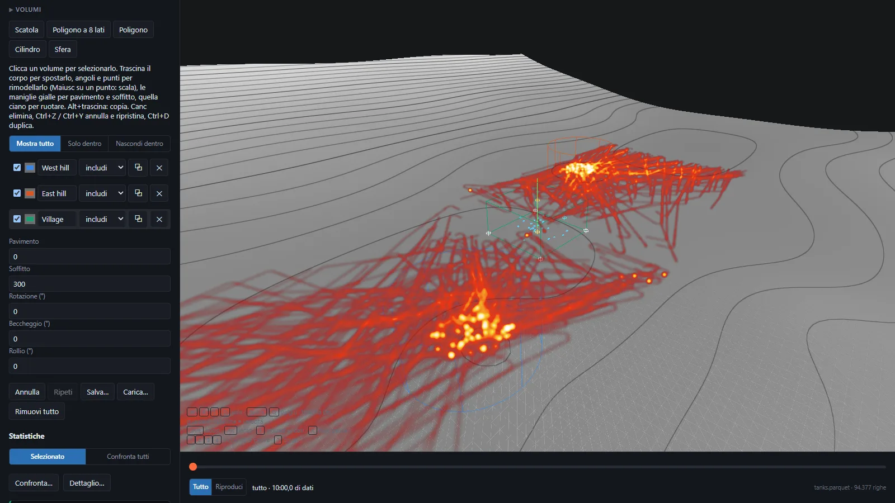
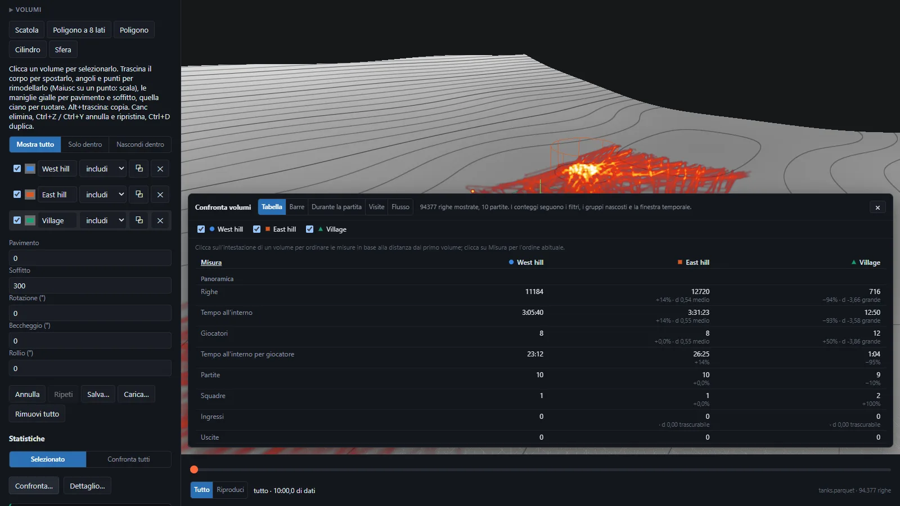
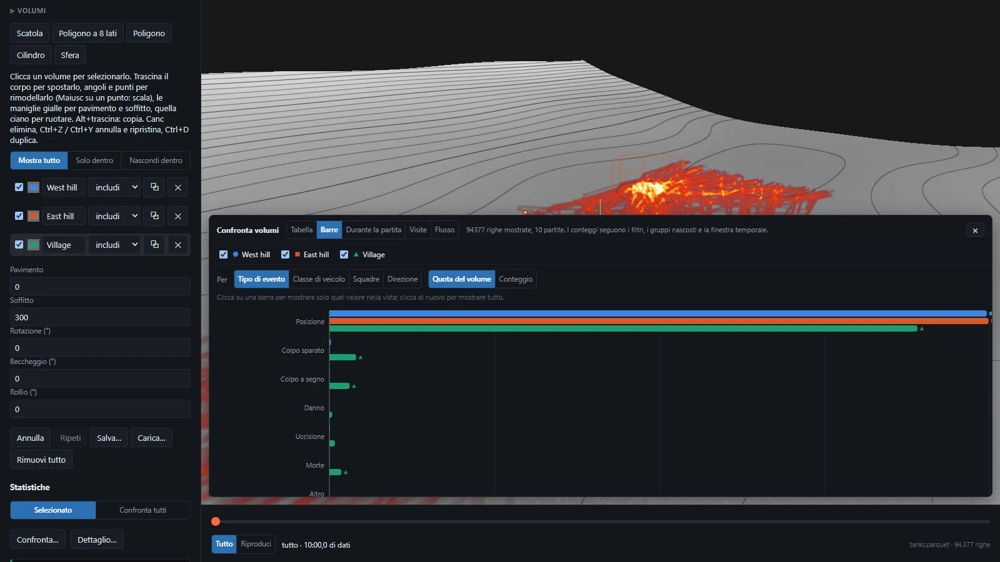

# Volumi e confronto

Un **volume** è una scatola invisibile (o un cilindro, o una sfera) che disegni intorno a un luogo, per chiedere: cosa è successo qui dentro? Usalo per contare le uccisioni su un ponte, per confrontare due colline o per mostrare solo l'attività in una zona.

```
vista dall'alto           disegni una forma ->  il visualizzatore conta
+------------+            ciò che sta dentro:
|   ( A )    |             righe, giocatori, uccisioni, tempo ...
|        [B] |            Confronta A con B, affiancati.
+------------+
```



I volumi misurano ciò che succede al loro interno, filtrano la vista su di essi, esportano le loro righe e possono essere confrontati affiancati. Vedi anche il [glossario](glossary.md) per riga, persona e partita.

## Disegna un volume {#draw-a-volume}

1. Apri **Volumi** nella barra laterale.
2. Scegli uno strumento e disegna nella vista 3D o sulla mappa 2D. Pavimento e soffitto partono dai dati sottostanti. Esc annulla.
3. Clicca sul volume per selezionarlo; compaiono le sue **Statistiche**.

| Strumento | Come si disegna |
|---|---|
| **Scatola** | Trascina un rettangolo (Shift: un quadrato). Un clic piazza una scatola predefinita. |
| **n-gono** | Trascina dal centro (Shift lo mantiene regolare). *Angoli* imposta n, da 3 a 64 (predefinito 8, quindi il pulsante mostra **8-gono**). |
| **Poligono** | Clicca sugli angoli; chiudi con un doppio clic, Invio o un clic sul primo angolo. Backspace rimuove l'ultimo angolo. |
| **Cilindro** | Trascina il raggio. |
| **Sfera** | Trascina il raggio; poggia sul terreno. |

## Modifica {#edit}

- Clicca un volume per selezionarlo. Trascina il suo corpo per spostarlo, gli angoli per rimodellarlo (Shift su un angolo scala).
- Le maniglie **gialle** impostano pavimento e soffitto, la maniglia **ciano** lo ruota.
- Alt+trascina copia, Canc rimuove, Ctrl+Z / Ctrl+Y annulla e ripristina, Ctrl+D duplica. **Rimuovi tutto** elimina ogni volume.
- Valori esatti: Pavimento, Soffitto, Rotazione / Passo / Rollio (scatole), Raggio (sfere, cilindri).

Ogni riga di volume ha una casella di visualizzazione, un colore, un nome, **includi** o **escludi**, duplica ed elimina. I volumi vengono salvati nel browser per ogni dataset, e **Salva…** / **Carica…** scrivono e leggono un file `volumes.json`.

## Filtra la vista {#filter-the-view}

| Filtro | Effetto |
|---|---|
| **Mostra tutti** (predefinito) | I volumi misurano soltanto. |
| **Solo dentro** | Calore, replay e [analisi dei colpi](hit-analysis.md) disegnano solo ciò che sta dentro i volumi inclusi e fuori da quelli esclusi. |
| **Nascondi dentro** | Il contrario. |

Il filtro GPU accetta fino a 8 volumi con 64 punti di contorno in tutto; un "!" segna un volume oltre quel limite. Statistiche ed esportazione lo contano comunque.

## Statistiche {#statistics}

L'area **Statistiche** segue i filtri, la finestra temporale e i gruppi nascosti. *Selezionato* mostra il volume selezionato, *Confronta tutti* mette ogni volume affiancato. Mostra:

- **Righe dentro (mostrate)** e **Righe dentro (tutti i dati)**, **Giocatori**, **Squadre**, **Partite**, **Tempo all'interno**, **Ingressi / uscite**, **Calore massimo**, **Calore medio**, **Volume / impronta** e un istogramma **Quando**;
- per colonna: categorie con **Lift** (quota dentro divisa per quota in tutti i dati mostrati), e numeri con intervallo, mediana e percentili dal 5° al 95°.

**Statistiche come CSV / JSON** le salva. **Esporta i dati dentro** scrive le righe dentro come CSV o Parquet (*Solo le righe mostrate* attivo di default), un volume o tutti, con una colonna che dice quale volume contiene ogni riga.

## Confronta i volumi {#compare-volumes}

Con due o più volumi visibili, premi **Confronta…**.

1. Disegna tre volumi, per esempio Collina ovest, Collina est e Villaggio.
2. Premi **Confronta…** sotto Statistiche.
3. In **Tabella**, leggi la differenza di ogni valore rispetto al primo volume.
4. Passa a **Barre** per vedere le quote come barre.



| Vista | Mostra |
|---|---|
| **Tabella** | Righe, tempo dentro, giocatori, partite, squadre, ingressi, uscite, visite, durata delle visite, uccisioni, morti, uccisioni per morte, uccisioni al minuto, tempo per giocatore, colonne di valore; raggruppate per eventi, classe di veicolo, giocatore o IA, squadra e direzione. Ogni valore mostra la sua differenza rispetto al primo volume e una dimensione dell'effetto (trascurabile, piccola, media, grande). Clicca l'intestazione di un volume per ordinare per distanza dal primo. |
| **Barre** | Conteggi o quote per evento, classe, attore, squadra o direzione. Clicca una barra per filtrare la vista su di essa. |
| **Durante la partita** | Un grafico per volume lungo i minuti della partita: presenza, righe o uccisioni. Clicca per saltare lì. |
| **Visite** | Diagrammi a scatola e a violino della durata delle visite (scala logaritmica). |
| **Flusso** | Dove vanno le tracce dopo aver lasciato ogni volume: una matrice delle transizioni o nastri di flusso. |



## Suggerimenti {#tips}

- Parti da un rilevamento: in [Rilevamenti](insights.md), **Volume qui** aggiunge un cilindro intorno al luogo del rilevamento.
- **Dettaglio…** apre il [Dettaglio](breakdown.md) per il volume selezionato: chi e cosa rende meglio al suo interno.
- Il [calore direzionale](directional-heat.md) può tracciare le direzioni dentro il volume selezionato.
- La [scheda Veicoli](hit-analysis.md#restrict-to-an-area) usa gli stessi volumi come filtro d'area.
