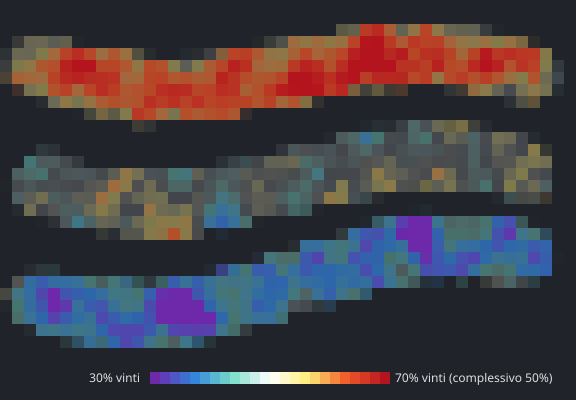

# Percentuale di vittorie: quanto spesso vince un punto, un percorso o una giocata

Dove si mette un giocatore, che strada prende, dove lancia le sue granate, e quanto spesso il suo lato poi vince il round. La **mappa delle percentuali di vittoria** colora ogni punto secondo la quota delle righe lì che appartengono a round vinti dal lato della riga. La confronta con la quota su tutto ciò che è mostrato: caldo dove è più alta, freddo dove è più bassa, niente dove è uguale.

*L'immagine mostra dati inventati: tre percorsi su un livello vuoto, con il 68%, il 50% e il 33% delle loro righe in round vinti.*

Servono dati che dicano chi ha vinto: le [colonne di esito](data-formats.md#outcome-columns) (`won`, `matchWon`, `roundEndReason`). I convertitori di CS2 e War Thunder le scrivono; qualsiasi file può averle.

## Provalo {#try-it}

1. Carica partite con una colonna di esito e premi `2` (**Differenza**).
2. In **Suddivisione per differenza**, premi **Percentuale di vittorie per round** (o **Percentuale di vittorie per partita**). Mette i round vinti su **+** e quelli persi su **−**, e passa il pannello a **Quota di +**.
3. Leggi i colori. Il pannello dice la quota complessiva: *In totale 52,0% di 1.200.000 righe sono su +.*
4. Restringi con i [filtri](filters.md): un lato (T o CT), un tipo di evento (*Posizione* per dove stava la gente, *Colpo sparato* o *Lancio* per da dove hanno sparato o lanciato), un acquisto, una mappa.

Un punto caldo con righe *Posizione* è un punto i cui occupanti tendevano a vincere il round. Con righe *Uccisione* è un punto dove le uccisioni fatte hanno portato a round vinti.

## Le impostazioni {#the-settings}

| Impostazione | Cosa fa | Predefinito |
|---|---|---|
| **Differenza** / **Quota di +** | la differenza stessa, o la quota del lato + tra le righe di entrambi i lati | Differenza |
| **Colore pieno a** | quanto sopra o sotto la quota complessiva un punto viene mostrato a colore pieno, in punti | ± 20 punti |
| **Righe minime per colorare un punto** | un punto con meno righe non viene colorato; compare gradualmente a partire dalla metà | 12 |
| **Attrazione verso la quota complessiva (righe)** | ogni punto parte da questo numero di righe alla quota complessiva, così un punto con 3 righe, tutte vinte, non appare al 100% | 12 |

Tutte e tre agiscono sull'immagine finita: trascinarle non fa mai ripartire l'accumulo.

La quota vale per qualsiasi suddivisione, non solo per le vittorie: *Quota di +* con una suddivisione per lato mostra dove i T erano la parte maggiore della presenza, e con una suddivisione per i file di due mappe, dove le righe di un file superano quelle dell'altro.

## Righe, non round {#rows-not-rounds}

La mappa conta righe. Un giocatore che resta venti secondi in un punto aggiunge una riga a ogni campione, tutte di un solo round. Quindi la prova in un punto sono le righe vicine, non i round. Per questo il minimo e l'attrazione sono in righe, e per questo sono più grandi di quanto vale un round.

Per i round stessi:

- **[Dettaglio](breakdown.md)** su un punto, sulla vista o su un volume: *Vittorie %* conta il round di ogni giocatore una volta, attirato allo stesso modo verso la percentuale complessiva del punto (4 round).
- Statistiche dei **[Volumi](volumes.md)**: *Percentuale di vittorie*, i round con un giocatore dentro il volume, ciascuno una volta, attirati verso la percentuale su tutto ciò che è mostrato, con i conteggi.

## Filtri di esito {#outcome-filters}

Il pannello [Filtri](filters.md) elenca le colonne di esito subito dopo quelle proprie del visualizzatore: **Esito del round** ed **Esito della partita** (*Tutti*, *Vinto*, *Perso*) e **Come è finito il round** (Eliminazione, Bomba esplosa, Bomba disinnescata, Tempo scaduto, Resa, Pareggio, Obiettivo, Zone tenute, Ticket persi, Tutti i veicoli persi), nella lingua del visualizzatore.

## Per gli sviluppatori {#for-developers}

La passata del calore scrive tre somme nel target a quattro canali usato dal calore per squadra: il calore `R = Σ|v|`, il calore del lato + `P` e `S = Σ v²/w`, dove `w` è il peso della passata (peso di campionamento per guadagno del fotogramma). La composizione legge la quota `P/R` (una media pesata dal kernel) e le righe su cui si basa, `n = R²/S` (la dimensione campionaria effettiva di Kish). Attira la quota verso quella complessiva, `p = (n·P/R + m·r0)/(n + m)`, e colora `p - r0` sull'intervallo con le rampe della differenza.

`n` elimina ogni fattore comune alle righe di un pixel: il guadagno del fotogramma, il peso di campionamento, il peso d'area di uno sprite limitato. Così l'immagine è la stessa a ogni zoom e densità di campionamento, e i fotogrammi di una riga ogni k si uniscono al tutto senza che i colori saltino. La quota complessiva viene dai conteggi per lato della CPU, al decimo di punto percentuale; nulla viene riletto dalla GPU. Il calcolo e le sue verifiche: [`render/rateMap.ts`](https://github.com/Holdi601/3DHeat/blob/main/src/render/rateMap.ts) e il suo test.

Costa quanto il calore per squadra: il target a quattro canali quadruplica la banda di blending della passata del calore, solo mentre *Quota di +* è attivo.
