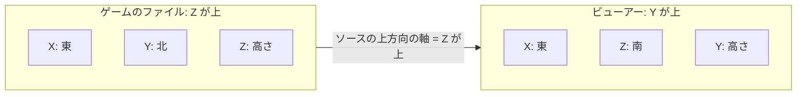

# 軸、単位、時間

ゲームとマップは、どちらが上か、ユニットの長さがどれくらいか、時間をどう書くかについて一致していません。このページでは、データを正しい向き、正しい大きさ、正しい速さで表示させる3つの設定を説明します。

マップが床のように寝ている代わりに壁のように立っている場合は、**ソースの上方向の軸**を切り替えてください。

**ソースの上方向の軸**が間違っていると、マップは壁のように立ちます。正しければ、床のように寝ます。

## ビューアーが描く世界 {#the-world-the-viewer-draws-in}

ビューアーの世界は **Y が上**です。X と Z が地面の平面、Y が高さです。多くのゲームエンジンは **Z が上**です。それらでは X と Y が地面、Z が高さです。一部のエンジンは、鏡像（左手系）でもあります。対応づけは、ファイルの軸をビューアーの軸にどう変換するかを示します。（厳密には、ビューアーは右手系です。three.js の規則です。）

### 上方向の軸 {#up-axis}

[列マッピング](column-mapping.md)の**ソースの上方向の軸**:

| 設定 | ファイル (x, y, z) がワールド (X, Y, Z) になる |
|---|---|
| *Z が上（多くのゲームエンジン）* - 既定 | (x, **z**, **y**): ファイルの Z が高さになり、ファイルの Y がワールドの Z になる |
| *Y が上（グラフィックスの慣習）* | (x, y, z) のまま |

Z が上のデータでは、3つの配列はコピーされず、付け替えられます（[`remapAxesInPlace`](https://github.com/Holdi601/3DHeat/blob/main/src/data/ingest.ts)）。大きな読み込みでは、これで数百メガバイトが節約されます。推定はサンプルから行われます。Y と Z の列のうち、ばらつきが小さい方が上になります。

### 反転 {#flips}

**X を反転**、**Y を反転**、**Z を反転**は、付け替えの前に、その名前の*ファイルの*軸の符号を反転します。そのため、Z が上のとき、*Y を反転*すると、最終的にワールドの Z になるものの符号が反転します。反転は読み込んだデータを変えます。[定規](measure.md)、スライス、カメラの姿勢が示す座標は、反転後のものになります。

データを**変えずに**鏡像の世界を正しい向きで描くには、代わりに **カメラとシーン → ワールドの軸を反転** を使います（[カメラ](camera.md#invert-world-axis)）。ツールが示すすべての座標がそのゲームの本来の値のままになるため、左手系の世界を持つゲームには、この方が適しています。

### 単位のスケール {#unit-scale}

**単位スケール**は、すべての位置に掛けます。*1 (m)* は 1 に、*0.01 (cm→m)* は 0.01 に設定します（Unreal Engine の単位はセンチメートルなので 0.01 を使います。Source エンジンの単位はインチなので 0.0254 を使います。どちらもメートルではありません）。ボックスは任意の値を受け付けます。0 と入力した場合や、数字でない値は 1 に置き換えられます。

ビューアーは距離（スプライトの半径、カリングの距離、定規、飛行速度）をメートルで表示します。これは、スケールされたワールドの単位がメートルの場合にのみ正しくなります。そうでなくても壊れることはありません。ラベルが単位に関係なく「m」と読めるだけです。

## 時間 {#time}

### 時間の単位 {#time-units}

目安: 17000000000 のような値（10桁以上）は Unix タイムスタンプです。0、0.25、0.5 のような値は、開始からの秒数です。

| 時間の単位（メニューのラベル） | 読み方 | 表示される壁時計 |
|---|---|---|
| *秒（相対）* | 値 × 1 s | なし |
| *ミリ秒（相対）* | 値 × 0.001 s | なし |
| *マイクロ秒（相対）* | 値 × 10^-6 s | なし |
| *ナノ秒（相対）* | 値 × 10^-9 s | なし |
| *Unix タイムスタンプ（秒）* | 1970-01-01 UTC からの秒数 | あり |
| *Unix タイムスタンプ（ミリ秒）* | 1970-01-01 UTC からのミリ秒数 | あり |
| *ISO-8601 の日付文字列* | `2026-03-14T18:02:11.250Z` などの文字列。ブラウザーの `Date.parse` で解析 | あり |

絶対単位（最後の3つ）を使うと、データセットは最も早い行の壁時計の時刻を保持し、タイムラインは再生ヘッドの横に現在の UTC の時刻（`HH:MM:SSZ`）を表示します。

**Parquet の `TIMESTAMP` と `DATE` の列** は、本物の時刻にデコードされます。そのため、その単位の設定は無視され、パネルはそう表示します。`DATE` の列は1日単位です。1日のすべての行が同じ時刻を共有し、再生は1日ずつ飛びます。パネルはこれを警告します。

**ISO-8601 の文字列は、CSV でも Parquet でも動きます。** ISO の単位を指定したテキストの時刻の列は、異なる文字列ごとに1度だけ解析されます。どれも解析できない場合、読み込みは *対応した時刻の列に解析できる ISO-8601 のタイムスタンプがありません* で失敗します。対応づけは、サンプルの値のどれも解析できないときには、すでに開始を拒否します。Parquet の `TIMESTAMP` の列は、どの単位が設定されていても時刻として読まれます。ISO の単位を指定した数値の Parquet の列は、Unix ミリ秒として読まれます。数値の単位を指定したテキストの時刻の列は、読み込み前に拒否されます。すべての値が NaN として読まれてしまうためです。

### 時間の保存方法 {#how-time-is-stored}

ファイルを統合する間、時刻は 64 ビットの秒として扱われるため、絶対的なエポックは秒未満の詳細を保ちます。すべてのファイルが揃うと、選択全体の最も早い時刻が 0 になり、すべての行は、そこからの 32 ビットの秒を保存します。32 ビットの浮動小数点は、仮数部が 24 ビットです。約1日半までの範囲は 1/100 秒より細かく解像され、半年の範囲は約1秒まで解像されます。時刻がないか数字でない行は、開始の 0 に置かれます。

行は時刻で並べ替えられます。これによりタイムラインが軽くなります。時間の窓は、2回の二分探索で見つかります（[サンプリングと予算](sampling-and-budgets.md)を参照）。

### 経過時間と壁時計 {#elapsed-time-versus-wall-clock}

`match_time` や `round_time` のような時刻の列は、それぞれの試合自身の開始から数えます。それを選ぶと、すべての試合が1つの共通の軸に並びます。すべての試合の3分目に何が起きたかを比べるのに適しています。パネルはこれを指摘します。壁時計の列は、試合を実際に起きた順番に並べ、重なっていた部分は重ねて表示します。

## 見ている方向 {#look-direction}

見ている方向は、[ボックスリプレイ](box-replay.md)（各ボックスからの光線）でのみ使われます。ラジアンで、ヨーとピッチという2つの角度として保存されます。

- **ヨー / ピッチの列**は、そのまま読まれます。*度* を選ぶと、度からラジアンに変換されます。上方向の軸や反転による調整は行われません。
- **方向ベクトルの列**は、位置と同じ付け替えと反転を通り、その後、ワールドの軸でヨー = atan2(x, -z)、ピッチ = atan2(y, √(x² + z²)) になります。そのため、鏡像のソースの世界でも、光線はボックスが向いている方向を指します。

反転、方向ベクトル、または調整された角度の後に、ヨー / ピッチの列が逆向きになってしまう場合は、それが修正すべき箇所です。
