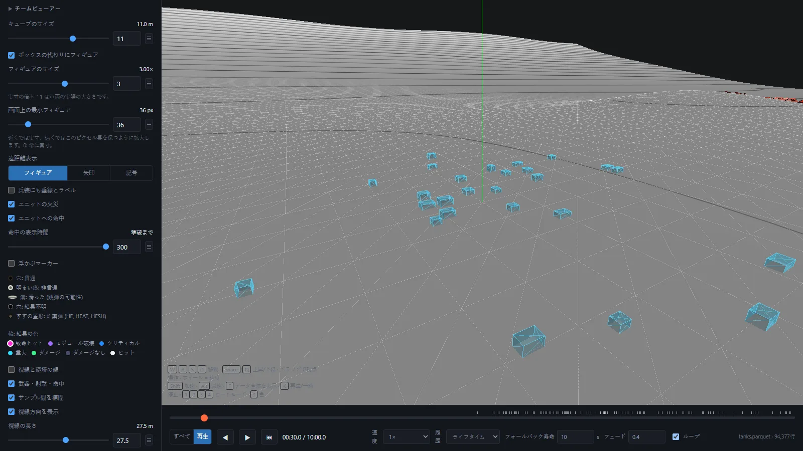

# フィギュアオーバーレイ（ボックスリプレイ）

小さな映画です。人ごとに1体のフィギュアがあり、時間の進みとともに動き、後ろに軌跡が付きます。

このモードは、モードバーでは **フィギュアオーバーレイ** と呼ばれます。このページは以前は「ボックスリプレイ」と呼ばれていました。フィギュアができる前は、人ごとにボックスがあったからです。「フィギュアリプレイ」と「ボックスリプレイ」は同じ意味です。**フィギュアオーバーレイ**には数字キーがありません。モードバーで選んでください。[人](glossary.md)ごとに1体のフィギュア（またはボックス）を、[タイムライン](timeline.md)に沿って動かして描きます。視線の光線と軌跡は任意です。これは密度ではなく、再生です。*誰がいつどこにいたか*を示します。人の列が必要です。時刻の列がない場合、すべてのサンプルが一度に描かれます。

## 使い方 {#how-to-use-it}

1. 人の列と時刻の列を持つデータを読み込みます。
2. モードバーで **フィギュアオーバーレイ** を選びます。
3. タイムラインを **再生** に切り替え、再生を押します（`K`）。
4. **チームビューアー**を開くと、**軌跡の長さ**、フィギュアのサイズ、視線の光線を変えられます。

このモードではヒートは描かれず、自動のスプライト予算は働きません。

既定では、各人はボックスではなく、その人が何であるかのフィギュアとして描かれます。ユニットがどのフィギュアを得るかは[フィギュア](figures.md)を、ラベル、追従カメラ、2つのユニットの間の計測、イベント一覧は[試合のリプレイ](match-replay.md)を参照してください。

## チームビューアーのパネル {#the-team-viewer-panel}

このモードでは、ヒートのパネルの代わりに表示されます。

| 設定 | 既定値 | 範囲（ジョグ） | 意味 |
|---|---|---|---|
| **ボックスの代わりにフィギュア** | オン | | 各人を、その人が何であるかのフィギュアとして描きます。徒歩の兵士、データが示す戦車や航空機です。データが何も示さないものは、ボックスのままです。 |
| **フィギュアのサイズ** | 1× | | 1× は実物大です。 |
| **画面上の最小フィギュア** | 36 px | 0 = 常に実物大 | 近くでは実物大です。遠くでは、フィギュアはこのピクセル数の長さを保つように大きくなります。 |
| **武器・射撃・命中** | オン | | 飛行中の武器（煙付き）、曳光弾、着弾、命中、撃破。命中から推定された曳光弾は破線です。 |
| **キューブのサイズ** | エンティティのサイズ、または読み込み時に範囲 / 500 | 0.05〜200 m、対数（5000） | 各ボックスの辺の長さ。[エンティティのサイズ](sessions-persons-groups.md#entity-size)を参照してください。 |
| **サンプル間を補間** | オン | | 同じセッションにある同じ人の2つのサンプルの間では、その間の比例した位置にボックスを置きます。セッションの境界をまたぐことは決してありません。 |
| **視線方向を表示** | オン | | 各ボックスから、その人の視線方向への光線（[視線の列](axes-units-and-time.md#look-direction)が必要）。 |
| **視線の長さ** | エンティティのサイズ × 4、または読み込み時に範囲 / 200 | 0.5〜500 m、対数（20,000） | 視線方向がオンの間に表示されます。 |
| **軌跡の長さ** | 8 s | 0〜300 s（86,400）。0 = オフ | 各人の後ろに描かれる履歴の秒数。 |
| **生のサンプルをすべて描画** | オフ | | 人ごとに補間された1つのボックスの代わりに、窓の中の保存されたサンプルごとに1つのボックス。操作性を保つため間引かれます。 |

パネルのヒントは、補間と軌跡が1つのセッションの中のサンプルだけをつなぐこと、そして、読み込みに[共有された名前](sessions-persons-groups.md#names-worn-by-several-things-at-once)があるとき、いくつの名前が単独のサンプルとして描かれるかを説明します。

## 再生中のセッション {#the-session-being-played}

セッションの列があるとき、サイドバーの上部の **セッション** の選択（[セッション](sessions-persons-groups.md#the-session-picker)）が、どの試合を再生するかを決めます。読み込み時には、最もにぎやかなものが選ばれます。そのセッションの行だけがボックスと軌跡になり、タイムラインは、データセット全体ではなく、そのセッションの範囲で動きます。*すべてのセッション* を選ぶと、すべてのセッションを同時に再生します。それでも、セッションをまたいでサンプルをつなぐことはありません。

## いつ何が描かれるか {#what-is-drawn-when}

[`TrackCursor`](https://github.com/Holdi601/3DHeat/blob/main/src/data/tracks.ts) より:

**ライブのボックス**（再生モード、生のサンプルはオフ）。見えている各人について、再生ヘッド以前の最新のサンプル:

- その人に次のサンプルがあり、同じセッションにあり、名前が共有されていなければ、ボックスは時間に比例して2つのサンプルの間に置かれます。ヨーは短い方向に補間され、ピッチは線形に補間されます（*補間*がオンのとき）。
- そうでなければ、ボックスは最後のサンプルに留まり、タイムラインの**フォールバックの寿命**（既定 10 s）の間は表示されたあと、取り除かれます。そのため、脱落したプレイヤーが残り続けることはありません。

**すべてモード**は再生ヘッドを無視し、範囲内のすべてのサンプルをボックスとして描きます。

**生のサンプル**は、窓の中の保存されたサンプルごとにボックスを描きます。*窓*の履歴では*範囲*、それ以外では再生ヘッドまでのすべて。最大 65,536 個のボックスです。それ以上のサンプルがあるときは、k 個ごとに1つが描かれます。

**軌跡**（軌跡の長さが 0 より大きく、生のサンプルが描かれていないとき）: 再生ヘッドまでの、最後の*軌跡の長さ*秒の間にある、人の連続する各サンプルの組の間の線。年齢とともに不透明度 80% から透明へフェードします。軌跡はセッションの変更で止まり、共有された名前には描かれません。最大 131,072 頂点です。それ以上の場合は、行が均等に飛ばされます。

**誰が見えるか:** 人は、[チーム一覧](teams-list.md)でその人の組のチェックが外されているとき（組は最初の行の組）、組のフィルターから外れているとき、または[エンティティ](entities.md)パネルで選択があり、その人を含まないときには隠されます。列の[フィルター](filters.md)は、ボックスには適用されません。

## 色 {#colours}

組ごとに1つの色相のファミリー、メンバーごとに1つの濃淡です。そのため、ひと目で誰がどちら側かが分かります（[`teamMemberColor`](https://github.com/Holdi601/3DHeat/blob/main/src/render/colors.ts)）。組の色相は、固定された10色を循環します。青、赤、緑、アンバー、バイオレット、シアン、マゼンタ、ライム、オレンジ、インディゴです。組のメンバーは、明度 42〜76%、彩度 90〜65% に分けられます。

## 注 {#notes}

- フィギュアオーバーレイは、何かが変わったときだけフィギュアを作り直します。変化のないフレームは、前回のものを描き直します。
- [統計のオーバーレイ](performance-and-stats.md)の *キューブ* の行は、画面上のボックスの数を数えます。
- フィギュアオーバーレイは、レベルと同じシーンに描かれるため、[被写界深度](camera.md#depth-of-field)はボックスをぼかしますが、ヒートはぼかしません。
