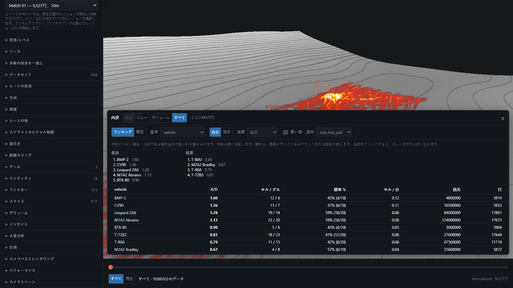
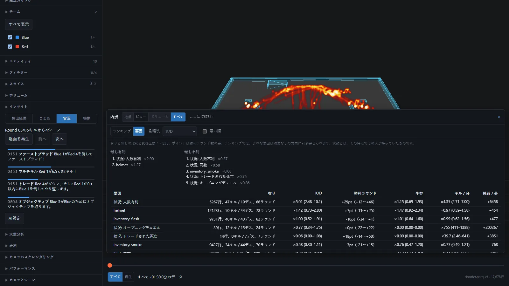

# 内訳: どこで誰が何を最もうまくやったか

**内訳**は1つの問いに答えます。この場所で、どの車両、プレイヤー、または兵装が最もうまくいっているか。たとえば、橋で勝つ戦車を見つけたり、ヘルメットが本当に役立つかどうかを確認したりするのに使います。

どこか1か所で起きたこと（選んだ地点、ビュー、ボリューム、または表示されているすべて）を、任意のカテゴリで順位付けし、すべての状態の要因を、ある場合とない場合で比べて測ります。

## 試してみる {#try-it}

1. キルと死亡のある試合を読み込み、**ボリューム**を開きます。
2. 関心のある場所を囲むボリュームを描き、それを選びます。
3. 統計の下の **内訳…** を押します。
4. **基準** で *車両* を選び、指標で *K/D*（死亡 1 回あたりのキル数）を選びます。
5. 一覧を、最もよいものから順に読みます。**悪い順**を押すと逆にします。名前をクリックすると、ビューをその名前に絞り込みます。もう一度クリックすると解除されます。

## 開き方 {#open-it}

| 開き元 | 最初の範囲 |
| --- | --- |
| [ボリューム](volumes.md)の（統計にある）**内訳…** | 選んだボリューム |
| 地点をクリックした後の選択カードの **ここの内訳** | その点の周りの球（**半径**、既定はデータの大きさの 3%） |
| **差分**の分割パネル | ビュー |

ヘッダーで範囲を切り替えます: **地点**、**ビュー**（最後の集計でカメラが見ていたもの。移動した後は **再集計**）、**ボリューム**（1つ選ぶ）、または **すべて**。集計はバックグラウンドで行われ、状態の行には、その範囲に何行あるかが表示されます。

## 順位付け {#ranking}

何で順位付けするか、そして指標を選びます:

| 指標 | 意味 |
| --- | --- |
| A、B | 差分マップの各側の行。ヒートがそれらを分けるとおりに分けたもの |
| A / B、A - B、A / (A + B) | 2つのレイヤーを互いに比べたもの |
| K/D | キル数と死亡数 |
| 勝率 % | データが勝者を示している場合の、勝ったラウンド（または試合） |
| キル / 分 | 存在していた分あたりのキル数（移動サンプルの間隔） |
| 獲得、損失、純額の金 | `earn_*` と `cost_*` の列の合計。通貨は選択して決めます |

キル、死亡、存在、勝利、お金は、その場所でビューに表示されているすべての行を、分割のどちら側でも、または分割なしでも数えます。

比率と割合は、件数が少ないときは、場所全体の値の方へ引き寄せられます。そのため、1 回の命で 2 キルしたものが一覧の先頭に来ることはありません。件数はその横に表示されます。

グループ、プレイヤー、試合、任意のカテゴリの列（車両、兵装、陣営、購入の種類、エージェントやキット）、範囲の任意の数値の列（装甲、装備の値）、兵装の列の**クラス**（ライフル、スナイパー、SMG、ピストルなど）、そして `inventory` のようなリストの列が持つ**ユーティリティ**の個数で順位付けできます。

**自分**は、その行自身の値で順位付けします。**相手**は、相手側の値で順位付けします。キルでは被害者の兵装、死亡では殺した側の兵装です（`other` / `victim` の列が、その相手を示している必要があります）。

## その時点の状態 {#state-at-the-time}

行の値は、その行自身のものです。ただし、その行が何も記録していない場合（装備のないイベントの行）や、死亡の場合（兵装の列が殺した側の兵装を示すことがある）は別です。そのときは、同じ人が試合の早い時点で最後に持っていたものが使われます。

## 要因: ある場合とない場合 {#factors-with-against-without}

**順位付け**から **要因** に切り替え、**効果の対象** を選ぶと、*最も役立つ* と *最も害する* を読めます:

各要因の、K/D、獲得したラウンド、生存（死亡 1 回あたりの分数）、1 分あたりのキル数、1 分あたりの純額のお金への効果を、95% の区間とともに示します。比率は x として、獲得したラウンドは点数の差として示されます。順位付けは、各推定値を、その不確かさの分だけ効果なしの方へ引き寄せます。そのため、まれな要因が上位に来るには、明確な効果が必要です。表示される区間は、引き寄せられていない値です。

ラウンドのあるデータでは、近接戦の**状況**（[近接戦とラウンド](close-quarters.md)）が加わります。データセットごとに一度だけ計算されます: *目つぶし*（その行の `state_flashed`、または直前 3 秒に 15 m 以内の敵のフラッシュ）、*死亡の交換*、*オープニングの決闘*、そして *数的優位*、*同数*、*数的不利*（行の側の、生きている敵に対するプレイヤーの数）。死亡は、被害者がその直前にいた状況に計上されます。

1 回の計算で測られる要因は、最大 256 個です。

## 開発者向け {#for-developers}

### 小さな標本を引き寄せる {#pulling-small-samples}

順位付けの値は `(n + m*r0) / (d + m)` です。`n` と `d` は件数、`r0` は場所全体の比率、`m` はその事前分布の重みです。

### コンバーターの作者向け: 要因の列の名前 {#for-converter-authors-naming-factor-columns}

コンバーターは、列の名前を付けることで要因を追加します:

| 列 | 要因 |
| --- | --- |
| `state_<name>` の数値 | ゼロ以外の間オン（`state_scoped`、`state_suppressor`） |
| `state_<name>` のカテゴリ | 値ごとに1つの要因（`state_ammo` = AP、HE など） |
| `active_<name>` | 同じ。ただし、オンにされた、または最近使われたもの: 能力、アルティメット、ガジェット、バフ（`active_ult`、`active_stim`） |
| リストの列（`inventory`、`loadout`、`perks`、`abilities`、`attachments`、`modules`、`buffs`、`debuffs`、`upgrades`、または `s` で終わる `state_` / `active_` の名前） | `a\|b\|c` の値の項目ごとに1つの要因 |
| すでに一般的な装備のフラグ（`helmet`、`defuser`、`armor`、`scoped`、`airborne`、`duck`、`flashed` など） | ゼロ以外の間オン |
| `ammoType`、`shellType`、`ammoName` | 最後に発射された弾 |

結果: 0/1 の `won` の列（その行の側がラウンドまたは試合に勝った）と、`round` の列。これが[結果の列](data-formats.md#outcome-columns)です。ファイルに `won` と `matchWon` の両方がある場合、*勝率 %* はラウンドを数えます。お金: `earn_<currency>` と `cost_<kind>_<currency>`。種類だけの収入（`earn_round_cs2`、コンバーターの正確なラウンド報酬）は、その種類の収入についてのみコストモデルの収入を置き換えます（`round` は設置や解除も含みます）。残りはモデルが値付けします。

マッピングは、ファイル自身のリストと並んで、これらの列を自分で読み込みます。すべての `state_*`、`active_*`、`won`、`round`、およびリストの列が対象です。ただし、Parquet ファイルの統計がすべての行で1つの値しか持たないことを示す列は除きます（読み込まれた各列は、行あたり 4 バイトです）。
