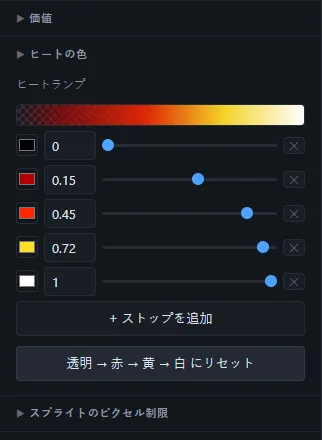

# 色と露出

これらの設定は、どれだけのヒートにどの色を付けるかを決めます。**飽和点**は、どれだけのヒートを白熱（白）とみなすかを決めます。

## 手早い修正 {#quick-fixes}

- すべてが白い: **飽和点**を上げるか、**フィールドから自動露出**を押します。
- 何も見えない: **飽和点**を下げるか、**フィールドから自動露出**を押します。
- 点がいくつかしか見えない: **最小ヒート**を上げます。

このページのすべての設定は、ヒートを色に変えるときに働きます。そのため、どれをドラッグしても即座に再描画され、**累積は決して再開しません**。

## 飽和点 {#saturation-point}

**飽和点**（ヒートの形状セクション）: カラーランプの最上部に対応する累積ヒートの値です（*リニア*応答の場合。他の応答は後述）。対数スライダーは0.1〜4000で、ハンドルは10,000,000まで動かせます。累積ヒートは行数に応じて増えるためです。既定値は24です。読み込みのたびに、まず**解析的な推定値**を使い、その後、画像から**計測**します。

これを誤ると、ヒートマップになるか、真っ白（または空白）の画面になるかが分かれます。しかも、確実に導き出すことはできません。テレメトリは非常に集中します（スポーン地点、ドア、狭い通路など）。そのため、ピークと平均の密度の比は、データセットやカメラの角度によって1桁ほど変わります。

## 自動露出 {#auto-exposure}

**フィールドから自動露出**は、シェーダーが実際に作ったフィールドを計測します。空のピクセルは無視し、光っているピクセルの98パーセンタイル値を取り、それを飽和点までの85%の位置に置きます。そのため、ランプの最上部は実際のピークのために残されます。

パネルには *フレームの X% を計測; 98パーセンタイル R をランプの上部付近に配置* と表示されます。*飽和*応答では、飽和点の85%の値は、ランプの85%ではなく約57%の位置になります。

自動露出は**自動的にも**実行されます。

- データセットの読み込み後、描画された8フレーム後;
- [フィルター](filters.md)の変更後8フレーム（すべての位置を100件のイベントまでフィルターすると、密度が桁違いに変わります）;
- ポイントヒートと[ラインヒート](line-heat.md)を切り替えた後、またはラインヒートが描く経路を変更した後8フレーム。ラインは、1サンプルあたりのヒートがスプライトよりずっと少ないためです。

何も光っていない場合、自動実行は飽和値を変えません。ボタンは解析的推定値に戻り、*計測する光がないため、解析的推定値を使用* と表示します。

### ビューに追従 {#follow-the-view}

**ビューに追従**（ヒートの形状セクション、既定でオン）は、カメラが静止するたびに再計測します。そのため、入り込んだ領域は、マップ全体の計測値ではなく、カラーランプ全体を使います。小さな変化は無視され、スケールは飛ぶのではなく滑らかに変わります。4つのヒートモードで動作し、フィギュアオーバーレイでは動作しません。

オフにすると、スケールが固定され、場所を同じスケールで比べられます。**飽和点**を手でドラッグしても固定されます。

## 密度の応答 {#density-response}

**密度の応答**は、*k*（ヒート ÷ 飽和点）がランプへどう対応するかを決めます。

| 応答 | 式 | 用途 |
|---|---|---|
| **飽和**（既定） | t = 1 - e^(-k) | 重なった半透明のスプライトのように、ランプの最上部へ漸近します。平らな白に切り取られることは決してないため、不慣れなデータでは安全な既定値です。 |
| **リニア** | t = k | 同じ色が同じ件数を意味する、唯一の対応です。2つのデータセットや2つの時間帯を比べるときに使います。 |
| **対数** | t = log₂(1 + 7k) / 3 | 長い裾を圧縮するので、1つの極端なホットスポットが、ほかのすべてをランプの底へ押し潰すことがなくなります。まばらな領域を持ち上げます。 |

## 最小ヒート {#minimum-heat}

**最小ヒート**（既定はオフ、0〜100%）: ヒートを持つすべてのピクセルは、少なくともこの割合のランプ位置まで持ち上げられます。この値を上げ、スプライトの半径を下げると、*どこで何かが起きたか*が見えます。1つだけのデータ点も、透明のすぐ上に埋もれるのではなく、はっきり見えるようになります。密度を判断するときはオフにしてください。設計上、ランプの底が平らになるためです。しきい値（k > 0.0001）により、本当に空のピクセルは空のままになります。

## ランプの編集 {#the-ramp-editor}

**ヒートの色**セクションにあります。そのラベルは、ランプが何に使われるかを示します。ヒートとラインでは *ヒートランプ*、差分では *正（加法チーム）*、[チームヒート](team-heat.md)では *不透明度ランプ（色はグループから取得）* です。チームヒートでは、アルファ値だけが使われます。



上部のバーはランプをプレビューします。その下に、停止点ごとに1行あります。

| 項目 | 意味 |
|---|---|
| 色の見本 | 停止点の色（ブラウザーの色選択）。 |
| 数字 | 停止点のランプ上の位置。0から1まで（0 = ヒートなし）。 |
| スライダー | 停止点の不透明度。0〜100%。 |
| ✕ | 停止点を削除します。残りが2つだけの場合は無効です。 |

**+ ストップを追加**は、最後の2つの停止点の中間に、最後の停止点の色と不透明度で停止点を追加します。**透明 → 赤 → 黄 → 白 にリセット**は既定値に戻します。

停止点は、どの順序で指定しても構いません。ランプを作るときに並べ替えられます。**アルファ**は、ヒートをシーンに重ねるときの混ぜ具合を決めます。そのため、既定のランプの0側の端は完全に透明です。

### 既定のランプ {#the-default-ramps}

| 位置 | 正（ヒート、ライン、差分 +） | 負（差分 −） |
|---|---|---|
| 0.00 | 黒、アルファ 0 | 黒、アルファ 0 |
| 0.15 | rgb(180, 0, 0)、アルファ 0.55 | rgb(0, 170, 60)、アルファ 0.55 |
| 0.45 | rgb(255, 40, 0)、アルファ 0.85 | rgb(0, 190, 200)、アルファ 0.85 |
| 0.72 | rgb(255, 220, 40)、アルファ 0.95 | rgb(40, 80, 255)、アルファ 0.95 |
| 1.00 | 白、アルファ 1 | rgb(170, 60, 255)、アルファ 1 |

## カメラの移動中 {#while-the-camera-moves}

カメラが動くと、累積は毎フレーム再開します。**毎フレームすべての行を描画**がオン（既定）の場合、動いている各フレームは今も正確です。オフの場合、動いているフレームは1つのサンプリングされた推定値を示します。重みで明るさが変わった塊が見えます。カメラが止まると、より滑らかな真の画像へ収束します。これは想定どおりです。[累積](accumulation.md)を参照してください。

## 開発者向け {#for-developers}

### 合成パス {#the-composite-pass}

ヒートが累積された後、各ピクセルの値は、1つの合成パス（[`COMPOSITE_FS`](https://github.com/Holdi601/3DHeat/blob/main/src/render/webgl2/shaders.ts)）で色に変換されます。手順は次のとおりです。

```
k = |heat| / saturation point
t = response(k)                         clamped to 0..1
if minimum heat > 0 and k > 0.0001:  t = minimum + (1 - minimum) × t
colour, alpha = ramp(t)                  (the negative ramp when heat < 0, Difference only)
pixel = mix(scene, colour, alpha)
```

### 解析的推定 {#the-analytic-estimate}

**解析的推定**（[`estimateSaturation`](https://github.com/Holdi601/3DHeat/blob/main/src/data/calibrate.ts)）は、行がデータのX-Z範囲に広がっていると仮定します。平均ヒート = 行数 × (π r² / 範囲の面積) × 1/3 × 中心の強度です（1/3は線形ランプの円盤平均）。これに、想定されるピーク対平均比の25を掛け、0.1〜1,000,000に制限します。桁が合っていれば十分です。

### 計測 {#metering}

[`exposure.ts`](https://github.com/Holdi601/3DHeat/blob/main/src/render/exposure.ts):

1. ヒートの目標値をGPUから読み戻し、最大40,000値に間引きます;
2. 空のピクセル（ヒート ≤ 0.0001）は捨てます。ヒートフィールドの大部分は空であり、それらを平均に入れると全体が露出不足になるためです。黒い背景に向けたカメラの露出計と同じです;
3. 光っているピクセルの98パーセンタイル値が基準になります;
4. 飽和点は 基準 / 0.85 になります。そのため、基準は飽和点までの85%の位置に置かれ、ランプの最上部は実際のピークのために残ります。

### 色テーブル {#the-colour-table}

ランプは256 × 2のRGBAテーブルに焼き込まれます（1行目が正のランプ、2行目が負のランプ）（[`buildColorLut`](https://github.com/Holdi601/3DHeat/blob/main/src/render/colors.ts)）。色は線形光で補間され、sRGBとして保存されます。不透明度は線形に補間されます。
