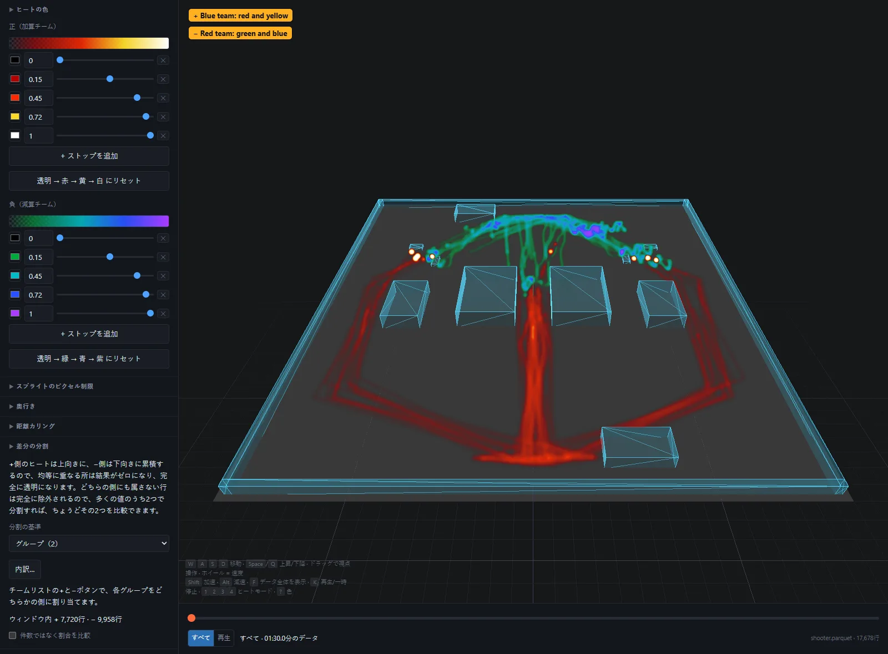

# 差分

チーム A の方が多かった場所は赤、チーム B の方が多かった場所は緑と青、同じだった場所は何もありません。

**差分** (キー 2) は符号付きのヒートです。ある集団の行はヒートを加え、別の集団の行はそれを引きます。2 つが均等に重なる場所では結果はゼロになり、完全に透明です。一方が優勢な場所では、その側の色で示されます。既定では、**+** 側は暖色 (透明 → 赤 → 黄 → 白)、**−** 側は寒色 (透明 → 緑 → 青 → 紫) です。

## 使い方 {#how-to-use-it}

1. `2` を押します (またはモードバーで **差分** を選びます)。
2. サイドバーの **差分の分割** を開きます。
3. **分割の基準** を選びます。通常は *グループ*。
4. 1 つのグループ (または値) を **+** に、別のものを **−** に置きます。
5. 色を読みます。暖色は + 側、寒色は − 側を意味します。どちらかの側に行がなければ、パネルが警告します ([表示されるかもしれないメッセージ](#messages-you-may-see) を参照)。

*どの 2 つの集団か* がこの問題のすべてなので、分割は、グループだけでなく、残しておいた任意の列でできます。**どちらの側にも入らない** 行は **除かれ**、ゼロとして数えられません。それによって、多くの値のうち 2 つにわたる分割は、まさにその 2 つを比べます。また、[フィルター](filters.md) と組み合わせられます。1 つのマップに絞り込み、それをビルドで分割する、というふうにです。

このモードには 2 つの側が必要です。2 つ以上のグループのあるグループの列、またはフィルター用に残した列での分割です。グループが 2 つ未満のデータでは、読み込みは列の分割で始まります。複数のファイルの読み込みでは、まず *Source file* 列、なければ 2 つの値を持つ最初のカテゴリの列、なければ幅のある最初の数値の列です。そのため、*2 つの読み込みを比べる* は、グループのないデータでも働きます。どちらもないデータだけがこのモードを使えなくします。片側に何もなくなった列の分割も、同じく使えません。

## 差分の分割のパネル {#the-difference-split-panel}

差分モードで、ヒートのパネルの下に表示されます。

**分割の基準** には次の選択肢があります。

| 選択肢 | 表示 | 分割の規則 |
|---|---|---|
| グループ | *グループ (N)* (グループの列があるとき) | [チーム一覧](teams-list.md) で設定された各グループが、+、−、またはどちらでもない |
| カテゴリの列 | *列 (N 個の値)* | 値が +、−、またはどちらでもない |
| 数値の列 | *列 (数値)* | 各側の値の範囲 |
| 元のファイル | *Source file - 2 つの読み込みを比べる* (複数のファイルを読み込んだとき) | ファイルが +、−、またはどちらでもない |

選べるのは、読み込み時に *フィルター用に保持* の下で残された列だけです。

### 件数ではなく割合を比べる {#compare-shares-not-counts}

**件数ではなく割合を比較** (既定ではオフ) は、各側を、その行数の逆数で重みづけします。そのため、行が 5 倍ある側が、数だけで勝つことはありません。色は、各側がもう一方と比べて、割合としてどこで多いかを示します。2 つの側のデータ量がとても違うとき、たとえば長さの違う 2 つのセッションに使ってください。

### 表示されるかもしれないメッセージ {#messages-you-may-see}

絵が本当の差分ではないとき、パネルは警告します。

| メッセージ | 意味 |
|---|---|
| *N 個 + / M 個 −* (または *N 個 + / M 個 − / K 個は未使用*) | 各側 (とどちらでもない側) にある値の数。 |
| 表示範囲に **+** 側の行がない | **−** 側だけが描かれます。タイムラインの範囲を動かすか、分割を変えてください。 |
| 表示範囲に **−** 側の行がない | **+** 側だけが描かれます。 |
| どちらの側にも値がない | 差分は何も描きません。少なくとも 1 つの値を **+** または **−** に置いてください。 |
| *列* はこの方法では分割できない | 選んだ列が、この分割に合いません。列を選び直してください。 |
| 分割の列が、N / M チャンクについて GPU のメモリに収まらなかった | それらの行は描かれません。パフォーマンス → リソースの予算で GPU の予算を上げるか、読み込む行を減らしてください。 |

### グループごと {#by-group}

パネルは、[チーム一覧](teams-list.md) を指すだけです。そこでは各グループに **+** と **−** のボタンがあります。読み込むたびに、グループの前半 (切り上げ) が + に、残りが − に置かれます。チーム一覧の **均等に分割** も、同じことをもう一度行います。どちらの側にもないグループ、またはチェックボックスで隠されたグループは、何にも寄与しません。

### カテゴリの値ごと {#by-category-values}

| 部分 | 意味 |
|---|---|
| `a 個 + / b 個 − / c 個は未使用` | 各側と、どちらでもない側にある値の数。 |
| **クリア** | すべての値を、どちらの側でもない状態にします。 |
| 値の一覧 | 各値に **+** と **−** のボタン (有効なものをもう一度クリックすると、その側から外れます)。空の値は *(欠損)* と一覧されます。 |
| 上限の注記 | 最初の 200 の値だけが一覧されます: *N 個の値のうち最初の 200 個を表示しています。これほど幅の広い列は、まずフィルターで絞り込むか、値が順序づいているなら範囲で分割するほうがよいです。* |

列を選ぶと、その最初の値が + に、2 番目の値が − に置かれます。どちらの側にも値がないときは、空の枠を表示する代わりに、分割はグループに戻ります。*Source file* は同じように、ファイルごとに 1 つの値として働きます。2 つの書き出し、2 つのテストの実行、2 つのビルドを比べるとき、これを使います。

### 範囲ごと {#by-range}

| 部分 | 意味 |
|---|---|
| ヒント | 列の最小値と最大値。 |
| **正の範囲（+）**、**下限** / **上限** | この範囲の値を持つ行が加わります。両端を含みます。 |
| **負の範囲（−）**、**下限** / **上限** | この範囲の行が引かれます。 |
| **中点で分割** | + を [最小値, 中央] に、− を [中央, 最大値] に設定します。列を選んだときにも、同じことが起きます。 |

両方の範囲にある値は + として数えられます。範囲は列を覆う必要はありません。どちらの範囲にもない値は除かれます。*最初の 2 分と最後の 2 分* は、時刻のような列での範囲による分割です。

## 色 {#colours}

**ヒートの色** の節には、このモードでは 2 つのランプの編集欄が表示されます。**正（加算チーム）** と **負（減算チーム）** で、それぞれに独自のリセットボタンがあります (*透明 → 赤 → 黄 → 白 にリセット*、*透明 → 緑 → 青 → 紫 にリセット*)。合成は、正味のヒートの絶対値を [飽和点と応答](colour-and-exposure.md) に通し、正味が 0 未満のところで負のランプを選びます。[色と露出](colour-and-exposure.md#the-ramp-editor) を参照してください。

差分の大きさが重要なときは、*線形* の密度の応答を使ってください。同じ色が同じ件数を意味する、唯一の応答だからです。

## 開発者向け {#for-developers}

すべての行は、頂点シェーダーで +1、-1、または 0 の符号を得ます ([`POINT_HEAT_VS`](https://github.com/Holdi601/3DHeat/blob/main/src/render/webgl2/shaders.ts))。0 の行は、どのフラグメントも描かれる前に拒否されます。

- グループごとでは、符号は、行のグループ ID で索引される 4,096 項目のグループの表から来ます (グループ ID は、行の位置テクセルの 4 番目のチャンネルに乗ります)。
- カテゴリごとでは、符号は、カテゴリの値ごとに埋められる 2 つ目の 4,096 項目の表から来ます。行の値は、列のフィルター用のテクスチャから読まれます。表の末尾を超える値は、両方のバックエンドで拒否されます。
- 範囲ごとでは、行の値が 2 つの範囲と比べられます。

分割を変えると、累積が最初からやり直されます。

**隠されたグループは、どの分割でも隠されたままです。** 列による分割の下では、グループの表はもう符号を持ちません。表示されているグループには 1、隠されているグループには 0 を保持します ([`frameSignTables`](https://github.com/Holdi601/3DHeat/blob/main/src/render/filterTables.ts))。両方の表は、一緒にシェーダーに届きます。WebGL2 では 1 つの符号のテクスチャの 2 行、WebGPU では 1 つのストレージバッファの 2 つの半分です。行は、そのグループが表示されていて *かつ* その列の値がどちらかの側にあるときだけ描かれます。そのため、[チーム一覧](teams-list.md) でチェックを外されたグループや、試合タブの側のフォーカスで除かれたグループは、差分がどう分割されても何にも寄与しません。
