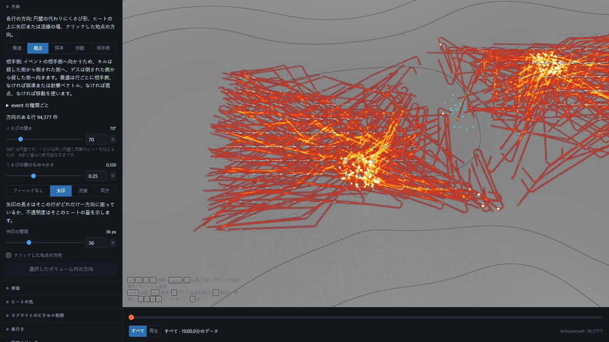

# 方向ヒート

通常のヒートは、物事が**どこで**起きたかを示します。方向ヒートは、**どちらの向きに**も示します。人々がどちらを見ていたか、どちらを狙っていたか、どちらへ動いていたか、または戦闘の相手側がどこにいたかです。

通常のスプライトは、完全な円盤（360 度）です。**くさびの開き**を 70 度にすると、同じスプライトは、その行が向いていた方向を指す細いくさびになり、同じ合計のヒートを加えます。

## 使い方 {#how-to-use-it}

1. 方向を含むデータを読み込みます（[行に方向を与えるもの](#what-gives-a-row-a-direction)を参照）。
2. モードバーで **ヒート**、**差分**、または **チームヒート** を選びます。
3. サイドバーの **方向** のセクションを開きます。
4. **ソース**（どの方向を使うか）を選び、描画をオンにします:
   - **くさびの開き** を 360° より小さくすると、各行を円盤ではなく、その向きを指すくさびとして描きます。
   - **場**を選ぶと、ヒートの上に矢印または流線を描きます。
   - **クリックした地点の方向** にチェックを入れてヒートをクリックすると、その地点の極座標グラフが得られます。

状態の行には、選んだソースから方向を持つ行が何行あるかが表示されます。

## 設定 {#settings}

| 設定 | 既定値 | 何をするか |
|---|---|---|
| ソース: **最良**、**ビュー**、**照準**、**移動**、**相手側** | 最良 | 各行がどの方向を得るか。*最良* は、行ごとに、相手側があればそれ、なければ照準、なければビュー、なければ移動を取ります。 |
| **イベントの種類ごと** | 上と同じ | イベントの種類ごとに異なるソース。例: キルには *相手側*、位置には *ビュー*。データに、値が 40 以下のイベントの列があるときに表示されます。 |
| **くさびの開き** | 360° | 360° が通常の円盤（オフ）です。小さくすると、くさびは細くなります。くさびは、その円盤と同じだけのヒートを加えるため、合計と差分は比較できる状態のままです。 |
| **くさびの縁のなめらかさ** | 0.35 | 0 は縁の鋭いくさび、1 は柔らかい扇です。 |
| **場**: 場なし、矢印、流線、両方 | 場なし | 矢印: 矢印の長さは、そこの行がどれだけ一方向で一致しているかを示し、不透明度は、そこにどれだけヒートがあるかを示します。矢印は、ヒートがあるところだけに表示されます。 |
| **矢印の間隔** | 28 px | 画面上の矢印の間の距離。 |
| **流線をアニメーション** | オン | オンの間、流線が流れます。 |
| **クリックした地点の方向** | オフ | ヒートをクリックすると、そこの方向が見えます（下記）。 |
| **選択したボリューム内の方向** | | 選択した[ボリューム](volumes.md)内のすべてについて、同じグラフ。 |

## 地点の極座標グラフ {#the-polar-chart-at-a-spot}

**クリックした地点の方向**がオンのとき、ヒートをクリックします。その点に近い行（スプライトの半径 1.5 個以内）が集められ、15° の 24 区分の放射状のグラフになります:

- **オレンジ**の花びら: 出ていく方向（行が指している先）;
- **青**の花びら: 入ってくる方向（行がどこから来たか）;
- 花びらの**面積**は、その件数とともに大きくなります。矢印は主な方向を示します;
- グラフの下の線は、主な方位、行がどれだけ一致しているか（R、0 から 1）、度での広がり、そして行の数を示します。

グラフの 0° は上で、ワールドの −Z です（Tacview の記録では北）。その地点は、3D ビューでも矢印とリングで示されます。

## 行に方向を与えるもの {#what-gives-a-row-a-direction}

| ソース | データに必要なもの |
|---|---|
| ビュー | ヨーの列（見ている方向として対応づけられる）: `yaw`、`heading`、`azimuth`、`view_yaw`、`rot_z` |
| 照準 | `aim_x`/`aim_y`、`shot_x`/`shot_y`、`fire_x`/`fire_y`、`hit_dir_x`/`hit_dir_y` のような数字の組（任意の `…_z`） |
| 移動 | 追加のものは不要です。同じ人の前のサンプルからの変位（10 秒以内、同じセッション） |
| 相手側 | イベントの相手側を示す列（`other`、`victim`、`target`、`killer`、`attacker`、`shooter`、`other_player` など）。その値は人の名前であること。キルは killer から victim へ、死亡は victim から killer へ向きます |

## ヒント {#tips}

- くさびは画面上である程度の大きさが必要です。数ピクセルを下回ると、再び円盤として描かれます。
- キルの行で *相手側* を使うと、戦闘が**どこから**勝たれたかが分かります。位置の行で *ビュー* を使うと、人々が**どこを見ていたか**が分かります。
- **差分**では、2つの側のくさびがそれぞれの方向を指すため、争われている射線が目立ちます。
