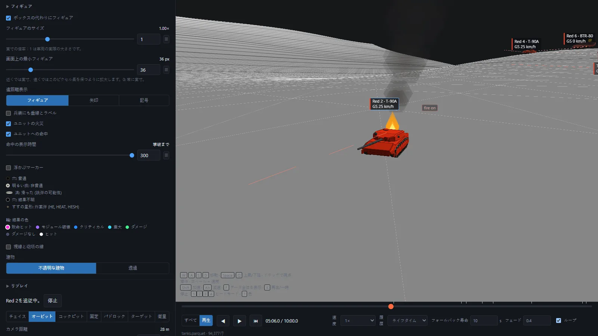

# フィギュア

**フィギュア** は、ユニットの実際の姿を表す小さな 3D モデルです。戦車、ジェット機、船、兵士などです。[再生](match-replay.md)は、すべてのユニットを、ただの箱ではなく、実物の大きさのフィギュアとして描きます。

名前の付いた車両、航空機、船、兵器、兵士は、約 2,000 種類あります。すべてビューアー自身が作ったものです。

## カタログの中身 {#what-is-in-the-catalogue}

| 分野 | 例 |
|---|---|
| 人 | 立っている、しゃがんでいる、伏せている兵士。狙撃兵、対戦車兵、衛生兵、乗員 |
| 地上 | 戦車、歩兵戦闘車、防空、火砲、トラックと乗用車、列車と路面電車 |
| 空 | 戦闘機、攻撃機、爆撃機、輸送機、ヘリコプター。複葉機から現代のジェット機まで |
| 海 | 艦級ごとの軍艦、空母、潜水艦、ボート、商船 |
| 兵器 | ミサイル、ロケット、爆弾、魚雷、フレア、チャフ |
| マーカー | 煙、閃光、火炎の手榴弾、設置された爆弾、旗、出現地点、経路点 |
| 近接戦闘 | プレートキャリアを着て、アサルトライフル、SMG、ショットガン、DMR、LMG、ハンドガン、または盾を持つ兵士。ドローン、カメラ、有刺鉄線、盾、壁の補強、バリケード、破壊用爆薬、罠、窓、手榴弾、解除装置 |

## フィギュアの作り方 {#how-the-figures-are-made}

- **公開された寸法から作ります。** ほとんどのフィギュアは、ビューアー自身のフィギュア作成ツールで、公開された数値から作られます。長さ、幅、高さ、転輪、砲塔と砲、翼と尾翼です。その後、形を公開された写真、図面、公表された寸法と照らし合わせて調整します。どのゲームのモデルも使っていません。
- **無料のモデル。** 一部のフィギュアは、より正確な場合に、無料の 3D モデル（CC0 または CC BY）を使います。作った車体と組み合わせることもあります。CC BY の作品の作者は [フィギュアのクレジット](figure-credits.md) に載せています。CC0 の作品はクレジットが不要なので、そこには載せていません。
- すべてのフィギュアには、完全版、粗い版、遠くの版（詳細度、LOD）があります。そのため、何千体でも一度に描けます。

## ユニットが受け取るフィギュア {#which-figure-a-unit-gets}

ビューアーは、データ自身の列を見ます。

1. **名前** - *Name*、*Vehicle*、*Unit*、*Unit type*、*Model*、*Aircraft*、*Plane*、*Tank*、*Ship*、*Craft*、*Loadout*、*Kit*、*Figure* という名前の列を、カタログと照合します。完全に一致するもの、約 4,000 の別名（いくつかのゲームのユニット ID）を通したもの、既知の最も長い先頭の一致（`F-16C_50` は F-16C）、またはそれで始まる最も短いフィギュア名を使います。
2. ユニットの**種類**に合わないフィギュアの名前は使いません（*Typhoon* という名前のトラックは、戦闘機ではありません）。
3. **種類** - *Type*、*Class*、*Kind*、*Category*、*Icon*、*Role*、*Domain* という名前の列は、クラスのフィギュアを決めます。Tacview のタグ（`Air+FixedWing`、`Ground+Heavy+Armor+Vehicle+Tank`、`Sea+Watercraft+Warship`、`Weapon+Missile`）、地図のアイコン、または普通の言葉（tank、helicopter、infantry など）です。
4. どちらもないデータは、人のデータとして扱われます。全員が兵士になります。

そのため、正しいフィギュアを得る最も簡単な方法は、実際の名前が入った `vehicle` 列を用意することです。または、Tacview のタグが入った `type` 列を用意することです。

**自分のユニットが箱や兵士として表示される。** 実際の名前が入った `vehicle` 列か、Tacview のタグが入った `type` 列を追加してください。ユニットの上にマウスを置くと、どの名前が一致したかがわかります。そのような列はあるのに、ユニットについて何も書かれていないデータでは、そのユニットは箱のままです。どちらの列もないデータは、兵士として描かれます。

## 近接戦闘のフィギュア（Rainbow Six Siege） {#close-quarters-figures-rainbow-six-siege}

Rainbow Six Siege のリプレイ読み取りツールと同じ形の表（`operator`、`pawn`、`primaryClass`、`side` の列）には、専用のフィギュアが付きます。

- **プレイヤー**は、そのオペレーターの姿になります。78 人のオペレーターはそれぞれ専用のフィギュアを持ちます。身長は約 1.8 m で、自分の服を着ています。ジャケット、ズボン、装備は、よく知られた公開の姿に合わせた 2～3 色です（黒、オリーブ、タン、アーバングレー、白、ネイビーに、赤、オレンジ、ティールの装備）。形もそれぞれ違い、上から見えなければならない部分は実物より 3 分の 1 大きくしています。頭のもの（ヘルメット、バイザーや重いヘルメット、キャップ、ニット帽、ベレー帽、つばの広いブーニーハットや毛皮の帽子、フード、スカーフ、髪）、顔（ゴーグル、ガスマスク、メガネ、マスク、ひげ、3 つレンズのゴーグル）、軽い・中くらい・重い体格（重い体格は幅が広く、大きな肩のプレートと襟が付きます）、長いコートやスーツ、ギリースーツ、背中に背負うもの（ハンマー、爆薬、ドローン、ボンベ、燃料タンク、発射筒、クロスボウ、パネル、ジャマー、盾）や腕に付けるもの（発射機、金属の腕）、自分の盾（背の高い盾、暴徒鎮圧用の盾、ライト付きの盾）、そして肩のアクセントカラーです。手には主武器のクラスを持ちます。ビューアーが知らないオペレーターは、チームの色のプレートキャリアを着た普通の兵士になります。
- **陣営**は服とは別に表示されます。各オペレーターの足元の地面に輪があり、**攻撃は琥珀色、防衛は淡いシアン**で、その内側にチームの色が入ります。腕と頭のバンドも同じ色です。`stance` 列（stand、crouch、prone）があると、その姿勢になります。ない場合は立っています。
- **リプレイの距離で見分けられます。** 上からと斜め 4 分の 3 の角度から高さ 48 ピクセルで描いたとき、同じ陣営のどの 2 人のオペレーターも、はっきりした色の差か、違う形で区別できます（ビューアーのテストで確認しています）。
- **ラベル**には、プレイヤーの名前と、その時点で使っているオペレーターが表示されます。オペレーターの役割は記号で示します。✸ ハードブリーチャー、⚒ ソフトブリーチャー、➤ エントリー、✦ フラッガー、✚ サポート、⬟ 盾、◉ 情報収集、◇ フレックス、↺ 側面の見張り、⚓ アンカー、✕ トラッパー、⇄ ローマー、↯ アンチガジェット、▣ アンチブリーチ。
- **ドローン**は、投げられる 2 輪のドローンで、幅は約 30 cm です。それぞれが独自のトラックになり、持ち主の名前が付きます（"Ash · drone 2"）。
- **設置されたガジェット**は、置かれた場所にその時からラウンド終了まで残ります。それぞれ、その働きを表すフィギュアになります。カメラ、有刺鉄線、展開式の盾、破壊用爆薬、ハードブリーチ用爆薬、小さな粘着爆薬、床の罠、作動用レーザー付きのクレイモア、マジックミラーの窓、装甲パネル、手榴弾、ガスボンベ、ジャマー、センサー、レーザーゲート、補給箱です。同じ働きをするガジェットには、すべて同じ 1 つのフィギュアを使います。データに種類が書かれていないガジェットは、ライト付きの小さな装置になります。
- **解除装置**は、設置された場所に 45 秒間残ります。

ファイルを読み込むと、ドローンとガジェットはそれぞれ独自のトラックになります。そのため、プレイヤー自身のフィギュアは本人の体の位置に残ります。オペレーターは、公開された説明や絵（着ているもの、能力となる装置）に基づく簡略化した形です。ガジェットは、その働きから形を決めています。これらはすべてビューアー独自のデザインで、実物の大きさで作られています（クレイモアは幅約 22 cm、ドアほどのパネルは 1 m × 2.1 m）。ゲームのモデルではありません。

## 設定 {#settings}

再生のサイドバーの **フィギュア** のセクションで、大きさ、画面上の最小の大きさ、遠いユニットが何になるか（フィギュア、矢印、記号）、そしてその上に描かれる効果を設定します。[マッチの再生](match-replay.md#figures)を参照してください。煙、火、そのほか時間で変わる効果は、[フィギュアオーバーレイのフィギュア](figure-replay.md)にあります。

## 任意のローカルのフィギュアパック {#an-optional-local-figure-pack}

自分のフィギュアの任意のパックを、自分のコンピューターに置いておけます。そのフィギュアは、同じ名前のカタログのフィギュアの代わりに使われます。リポジトリや公開されるビルドに含まれることは決してありません。パックがなくても、何も変わりません。
