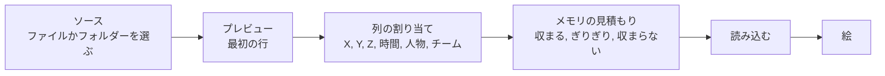

# データの取り込み

3DHeat が何かを描くには、まず表が必要です。どの行も、何がどこにあったかを表します。わかっていれば、いつ、誰がも表します。このセクションでは、ファイルがどのようにして絵になるかを説明します。まだデータがありませんか。[デモデータ](demo-data.md)を試してください。

**今すぐやること:**

1. ヒートマップのサイドバーで **ソース** を開き、**ファイル…** を押します（または、ファイルかフォルダーをドロップゾーンにドロップします）。
2. **列の割り当て** を見ます。ボックスは通常すでに埋まっています。
3. **メモリの見積もり** が *収まる* になっているか確認します。
4. **読み込む** を押します。

ヒートマップのタブに表示されるものはすべて、1つの**データセット**から来ています。データセットとは行の表のことで、どの行も位置を持ち、任意で時間、人物、グループ、セッション、見る方向、そしてフィルター用に残した任意の数の追加の列を持ちます。このセクションでは、データセットがどのように作られるかを説明します。

## ファイルから絵までの道のり {#the-path-from-files-to-picture}

1. **ソース** パネルで**ファイルを選びます**。1つのファイル、複数、フォルダーの木、またはドロップのどれでも構いません。Parquet、CSV、Tacview、GPS の軌跡などを受け付けます。すべての完全な一覧は[データ形式](data-formats.md#files)にあります。[ファイルの読み込み](loading-files.md)を参照してください。
2. **プレビュー。** 選んだファイルの最初のものが開かれます。その列の名前、最初の50行、数値に見える列、そして（Parquet の場合）各列の論理型と、ファイル自身の読み方の指示である `heat3d` のフッターの項目を表示します。
3. **自動の割り当て。** 列が役割に割り当てられます：X、Y、Z、時間、人物、セッション、グループ、見る方向。いくつかはフィルター用に残します。どの推測も**列の割り当て**パネルに表示され、変更できます。[列の割り当て](column-mapping.md)と[軸、単位、時間](axes-units-and-time.md)を参照してください。
4. **集計。** 各ファイルの行数を読みます（Parquet のフッターからは正確に、CSV では推定で）。そのため、パネルは何かを読み込む前に、読み込みに必要なメモリ量と、それが収まるかどうかを示せます。収まらない場合は、*N* 行に1行を読み込むことを提案します。[メモリと予算](memory-and-budgets.md)を参照してください。
5. **読み込む。** バックグラウンドのワーカーが、すべてのファイルのうち割り当てた列だけを解析します。複数のファイルを同時に、[パーサースレッド](memory-and-budgets.md#parser-threads)の予算まで処理します。そして選択の順に、1つのデータセットへまとめます。すべてのファイルで共有する、人物、グループ、セッションの辞書は1つ。共通の時間の起点も1つ。すべての行は時間順に並べます。[セッション、人物、グループ](sessions-persons-groups.md)を参照してください。
6. **アップロード。** メインスレッドは1フレームの間「N 行を GPU にアップロード中」と表示し、GPU の予算の中で行を GPU メモリに詰めます。[GPU メモリの常駐](gpu-memory.md)を参照してください。
7. **最初の絵。** カメラがデータに合わせられます。スプライトの半径と彩度は、データの広がりと行数から設定されます。描画された8フレームの後、彩度は絵そのものから測られます（[色と露出](colour-and-exposure.md)）。

## 読み込みの前に確認される条件 {#requirements-checked-before-a-load}

| 必要なもの | ない場合に起きること |
|---|---|
| **X / Y / Z のうち少なくとも2つ** | 読み込みは拒否されます。ちょうど2つの場合、3つ目の軸は 0 になり、データは 3D シーンの平らな面として描かれます。これは、真上から見た地図のヒートマップが必要とするものです。 |
| 時間の列 | 任意です。ない場合、タイムラインは使えなくなり、表示は **すべて** のモードのままになります。サイドバーにもそう表示されます。 |
| 人物の列 | 任意です。[フィギュアオーバーレイ](box-replay.md)（人物ごとのフィギュア）、[線のヒート](line-heat.md)（各人物が歩いた経路）、補間、軌跡、**ライフタイム** の履歴に必要です。 |
| グループの列 | 任意です。[チームヒート](team-heat.md)と[差分](difference.md)モード（少なくとも2つのグループ）に必要です。 |

読み込んだデータが対応できないモードは、モードバーでグレーになります。その上にマウスを置くと、理由が表示されます。

## 自分のデータがない場合 {#without-your-own-data}

**データセット**パネル（**ソース** の下）には、[合成ジェネレーター](synthetic-generator.md)があります。これは任意の大きさのバトルロイヤル型のデータセットを作ります。ビューアーを試すことや、マシンがどこまで扱えるかを確かめるのに役立ちます。

## このセクションのページ {#pages-in-this-section}

- [ファイルの読み込み](loading-files.md) - ファイルを選ぶ画面、フォルダー、ドラッグ＆ドロップ、複数ファイルの結合、移動ファイルのルール、進行状況と中止
- [列の割り当て](column-mapping.md) - 割り当てパネルのすべての項目、自動の割り当ての推測、`heat3d` のヒント
- [軸、単位、時間](axes-units-and-time.md) - 上向きの軸、反転、単位の縮尺、時間の単位、見る方向
- [セッション、人物、グループ](sessions-persons-groups.md) - それぞれの役割、制限、共有の名前、エンティティの大きさ、データセットパネル
- [合成ジェネレーター](synthetic-generator.md)
- [メモリと予算](memory-and-budgets.md) - フットプリントのモデル、収まるかの確認、間引き、並べ替えの上限、リソースの予算
