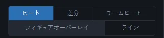

# ヒートモード

どの点も少しずつ光を足し、光が重なり、その重なりを色で塗ります。モードは、それを塗る5つの方法です。それぞれ1つの問いに答えます。

ヒートマップタブのサイドバーの上にあるモードバーで、[データセット](glossary.md)をどのように描くかを選びます。キー 1-4 で、ヒート、差分、チームヒート、ラインを選びます。フィギュアオーバーレイにはキーがありません。

| モード | 答える問い |
|---|---|
| **ヒート** | どこで、どれだけ起きたか？ |
| **差分** | どちらの側がより多くしたか？ |
| **チームヒート** | 誰のものか？ |
| **ライン** | 人々はどの方向へ行ったか？ |
| **フィギュアオーバーレイ** | 誰がいつ、どこにいたか？ |

| モード（バーのラベル） | キー | 描くもの | 必要なもの |
|---|---|---|---|
| **ヒート** | 1 | 加算の密度。表示される行はどれも、カメラの方を向いた放射状のスプライトを1つ足します。[ヒート](heat.md) | データセット |
| **差分** | 2 | 符号付きの密度。一方の集団は足し、もう一方は引きます。[差分](difference.md) | 2つの側：少なくとも2つのグループ、または保持した列で分割 |
| **チームヒート** | 3 | グループごとに色をつけた密度。グループごとに色相を持ち、グループが重なる場所では混ざります。[チームヒート](team-heat.md) | グループの列 |
| **フィギュアオーバーレイ** | - | 人物ごとのフィギュア（またはボックス）。タイムラインに沿って動きます。リプレイです。[フィギュアオーバーレイ](box-replay.md)、[試合のリプレイ](match-replay.md) | 人物の列 |
| **ライン** | 4 | 線のヒート。人物のそれぞれのサンプルから、次のサンプルへの線を引きます。ヒートは横に向かって減っていきます。[線のヒート](line-heat.md) | 人物と時間の列 |

データが対応できないモードはグレーになり、そのツールチップが理由を示します。例：*利用不可 - 差分モードには、分割するための2つのグループか保持した列が必要です。このデータにはグループが1つしかありません。* 新しいデータセットが現在のモードに対応できない場合、表示は **ヒート** に戻ります。

キー 1-4 も、同じようにデータと照らし合わせて確認されます。グレーになったモードのキーを押しても何も起きません。

## 各モードが表示するパネル {#which-panels-each-mode-shows}

| パネル | ヒート | 差分 | チームヒート | フィギュアオーバーレイ | ライン |
|---|---|---|---|---|---|
| 経路（[線のヒート](line-heat.md)） | | | | | はい |
| ヒートの形状（**ビューに追従** と **ズームに関係なく同じ密度** を含む）、ヒートの色、スプライトのピクセル上限、奥行き、距離のカリング | はい | はい | はい | | はい |
| 方向（[方向ヒート](directional-heat.md)）、値（[価値の重み付け](value-weighting.md)） | はい | はい | はい | | はい |
| チームビューアー（[フィギュアオーバーレイ](box-replay.md)） | | | | はい | |
| 差分の分割（[差分](difference.md)） | | はい | | | |
| [チーム](teams-list.md)、[エンティティ](entities.md)、[フィルター](filters.md)、背景/レベル、[スライス](slice.md)、[計測](measure.md)、カメラの経路と描画、パフォーマンス、カメラとシーン | はい | はい | はい | はい | はい |

## すべてのヒートモードが共有するもの {#what-every-heat-mode-shares}

4つのヒートモード（フィギュアオーバーレイ以外のすべて）は、入力が違うだけの同じ仕組みです（[`engine.ts`](https://github.com/Holdi601/3DHeat/blob/main/src/render/engine.ts)）：

1. **どの行か。** [タイムライン](timeline.md)の範囲が、時間順に並んだ行の連続した範囲を選びます。[フィルター](filters.md)、グループの表示、差分の分割、[距離のカリング](depth-and-culling.md#distance-culling)、[スライス](slice.md)が、頂点シェーダーの中で、各行が寄与するかどうか、どれだけ寄与するかを行ごとに決めます。
2. **スプラッティング。** 寄与する行はそれぞれ、スプライト（線のモードではセグメント）として、浮動小数点の**ヒートターゲット**に描かれ、そのランプの値を足します。フレームが処理できる量より行が多い場合は、行の層化サンプルを描き、補正のために重み付けします。[サンプリングと予算](sampling-and-budgets.md)を参照してください。
3. **累積。** 何も変わらない間は、すべての行がちょうど1回ずつ寄与するまで、フレームを統合します。[累積](accumulation.md)を参照してください。
4. **合成。** 各ピクセルで累積された値は、**飽和点**で割られ、**密度の応答**で形を整えられ、**最小ヒート**で持ち上げられ、**色のランプ**で色を引きます。そのアルファ値で、シーンの上に混ぜます。[色と露出](colour-and-exposure.md)を参照してください。

ステップ4のすべては合成の時点で適用されます。そのため、それらの操作をドラッグしても、累積は最初からやり直しになりません。ステップ1-2の操作はやり直しになります。

## このセクションのページ {#pages-in-this-section}

- [ヒート](heat.md) - 通常のヒートモードと、そのパネルの概要
  - [スプライトの形](sprite-shape.md) - 半径、強さ、減衰、曲線エディター、ピクセルの上限、平坦化
  - [色と露出](colour-and-exposure.md) - ランプエディター、飽和点、自動露出、最小ヒート、密度の応答
  - [深度とカリング](depth-and-culling.md) - レベルによる遮蔽、地形の裏に隠す、距離のカリング
- [差分](difference.md) - 差分の分割
- [チームヒート](team-heat.md)
- [線のヒート](line-heat.md) - 経路
- [フィギュアオーバーレイ](box-replay.md) - リプレイのモード（ファイル名はまだ box replay です）
- [方向ヒート](directional-heat.md)
- [価値の重み付け](value-weighting.md)
