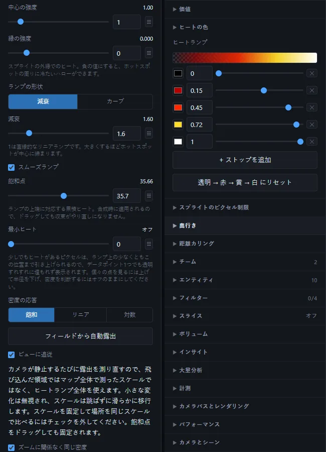

# ヒート

ヒートは、たくさんのことが起きた場所を塗ります。少し起きた場所は赤、たくさん起きた場所は白熱の色です。問いに答えます：「これはどこで、どれだけ起きるか」。

**ヒート**（キー 1）はデフォルトのモードです。表示される各[行](glossary.md)は、カメラの方を向いた丸い[スプライト](glossary.md)を1つ寄与します。重なったスプライトは浮動小数点のバッファーで足し合わされます。その合計は色のランプ（デフォルトでは 透明 → 赤 → 黄 → 白）に通され、シーンの上に描かれます。

この画像は、建物のあるレベルでのシューターのラウンドのヒートです。ホットスポットは地面だけでなく、部屋の中や階段の上にもあります。

## 使い方 {#how-to-use-it}

1. データを読み込み、`1` を押します（またはモードバーで **ヒート** を選びます）。
2. すべてが白か、空白になる場合は、**ヒートの形状** のセクションで **フィールドから自動露出** を押します。
3. 隣り合う点がまとまって帯になるまで **スプライト半径** を変えます。小さくすると単独の点が見え、大きくすると面が見えます。
4. **ヒートの色** を開けば色を変えられます。**奥行き** を開けば、丘や壁の裏のヒートを隠せます。

同じパネルが[差分](difference.md)、[チームヒート](team-heat.md)、[線のヒート](line-heat.md)の形も決めます。違うのは何を足すか（符号付き、色付き、線に沿って）であって、やり方ではありません。

## パネルとその既定値 {#the-panels-and-their-defaults}

以下のすべての項目は、シェーダーのパラメーターに対応しています。そのため、変えても再描画の分しか費用はかかりません。スライダーには、横に数値を入力する欄と、ドラッグ用のつまみ（右側の小さな取っ手。上下にドラッグします。大きく動かすほど速く、Shift を押すと細かく動きます）があります。スライダーの目盛りが実際の上限より手前で終わる場合、つまみはここに書かれた *ジョグの上限* まで押し出せます。*読み込み時* と書かれた値は、新しいデータセットごとに計算し直されます。

### ヒートの形状（開いている） {#heat-shape-open}

| 項目 | 既定値 | 範囲（ジョグの上限） | 詳細 |
|---|---|---|---|
| **スプライト半径** | 6 m。読み込み時は広がり / 120 | 0.05-2000 m、対数（50,000） | [スプライトの形](sprite-shape.md#sprite-radius) |
| **中心の強度** | 1 | 0-10（1000） | [スプライトの形](sprite-shape.md#centre-and-edge-intensity) |
| **縁の強度** | 0 | -2-10（1000） | [スプライトの形](sprite-shape.md#centre-and-edge-intensity) |
| **ランプの形状** | *減衰* | *減衰* / *カーブ* | [スプライトの形](sprite-shape.md#ramp-shape-falloff-or-curve) |
| **減衰**（減衰のときだけ） | 1.6 | 0.1-8（64） | [スプライトの形](sprite-shape.md#falloff) |
| **スムーズランプ**（減衰のときだけ） | オン | | [スプライトの形](sprite-shape.md#falloff) |
| 曲線エディター（カーブのときだけ） | *スムーズ* プリセット | | [スプライトの形](sprite-shape.md#the-curve-editor) |
| **飽和点** | 24。読み込み時は推定値、その後は測定値 | 0.1-4000、対数（10,000,000） | [色と露出](colour-and-exposure.md#saturation-point) |
| **最小ヒート** | オフ（0） | 0-100% | [色と露出](colour-and-exposure.md#minimum-heat) |
| **密度の応答** | *飽和* | *飽和* / *線形* / *対数* | [色と露出](colour-and-exposure.md#density-response) |
| **フィールドから自動露出** | | ボタン | [色と露出](colour-and-exposure.md#auto-exposure) |
| **ビューに追従** | オン | | カメラが止まるたびに露出を測り直します。そのため、飛び込んだ領域は色のランプ全体を使います。小さな変化は無視され、目盛りはゆっくり動きます。オフにするか、**飽和点** をドラッグすると、目盛りを固定して、場所を1つの目盛りで比べられます。[色と露出](colour-and-exposure.md#follow-the-view) |
| **ズームに関係なく同じ密度** | オン | | 色は、どれだけ近づいても、地面の面積あたりの行数が同じ数を意味します。ピクセルの上限によって（遠くでは）大きくされたり、（近くでは）小さくされたりするスプライトは、本来の大きさで足されるはずのヒートを保ちます。そのため、遠くから露出した絵は、飛び込んでも薄くなりません。オフにすると、上限で止められたスプライトは、上限の大きさでその全重みを足します。[スプライトの形](sprite-shape.md#pixel-clamps) |
| **地面に平坦化** | オフ | | [スプライトの形](sprite-shape.md#flatten-onto-ground-plane) |

### ヒートの色（閉じている） {#heat-colours-closed}

| 項目 | 既定値 | 詳細 |
|---|---|---|
| グループの見本と **色の分離**（チームヒートのみ） | 1.4 | [チームヒート](team-heat.md) |
| **ヒートランプ** エディター（差分では *正（加算チーム）*、チームヒートでは *不透明度ランプ*） | 透明 → 赤 → 黄 → 白 | [色と露出](colour-and-exposure.md#the-ramp-editor) |
| **透明 → 赤 → 黄 → 白 にリセット** | | |
| **負（減算チーム）** のランプ（差分のみ） | 透明 → 緑 → 青 → 紫 | [差分](difference.md#colours) |

### スプライトのピクセル上限（閉じている） {#sprite-pixel-clamps-closed}

| 項目 | 既定値 | 範囲（ジョグの上限） | 詳細 |
|---|---|---|---|
| **最小ピクセル半径** | 1 px | 0-16（512） | [スプライトの形](sprite-shape.md#pixel-clamps) |
| **最大ピクセル半径** | 96 px | 2-1024、対数（8192） | [スプライトの形](sprite-shape.md#pixel-clamps) |

### 奥行き（開いている） {#depth-open}

| 項目 | 既定値 | 詳細 |
|---|---|---|
| **地形の裏を隠す** | オン | [深度とカリング](depth-and-culling.md#hide-behind-terrain) |
| **ジオメトリの裏** | 0.8（*80% 暗く*） | [深度とカリング](depth-and-culling.md#hidden-behind-geometry) |

### 距離のカリング（閉じている） {#distance-culling-closed}

| 項目 | 既定値 | 範囲（ジョグの上限） | 詳細 |
|---|---|---|---|
| **近方** | オフ（0） | 0.5-5000 m、対数。トラックの下端 = オフ（200,000） | [深度とカリング](depth-and-culling.md#distance-culling) |
| **遠方** | オフ（0） | 1-200,000 m、対数。下端 = オフ（10,000,000） | [深度とカリング](depth-and-culling.md#distance-culling) |
| **平面でカット** | オン | | [深度とカリング](depth-and-culling.md#distance-culling) |
| **レベルもカット** | オン | | [深度とカリング](depth-and-culling.md#distance-culling) |

キー：`[` と `]` は遠方の境界を内側と外側に動かします。`\` で切り替えます（[深度とカリング](depth-and-culling.md#keyboard)）。

### 方向と値 {#direction-and-value}

ヒートの形状の下に、さらに2つのセクションがあります。**方向** は、各行を扇形で描き、矢印を加えます。[方向ヒート](directional-heat.md)を参照してください。**値** は、各行がかかった、または稼いだものでヒートに重み付けします。[価値の重み付け](value-weighting.md)を参照してください。

## 保存される内容 {#what-is-saved}

上の熱の設定は、セッションをまたいで保存されません。ページを再読み込みすると既定値に戻ります。ブラウザーに保存されるものは2つあります。最後に使った再生速度（`heat3d.speed`。[タイムライン](timeline.md)を参照）と、[フィギュアオーバーレイ](box-replay.md)の遠くのフィギュアの設定（記号の形、大きさ、命中マークなど）です。言語、[反転した世界の軸](camera.md#invert-world-axis)、レース分析タブが覚えている車の名前、[レベルライブラリ](level-library.md)も保存されます。全一覧は[保存された設定](ref-settings-storage.md)にあります。
