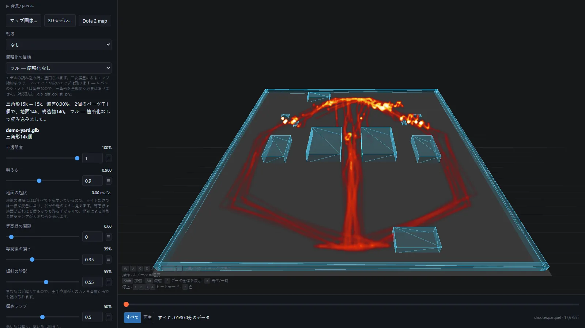

# ヒート

ヒートは、多くのことが起きた場所を塗ります。少しだけ起きた場所は赤、たくさん起きた場所は白熱の白です。「これはどこで、どれだけ起きるか」に答えます。

**ヒート**（キー 1）が既定のモードです。表示されている各[行](glossary.md)は、カメラを向いた丸い[スプライト](glossary.md)を1つ寄与します。重なったスプライトは浮動小数点のバッファーで足し合わされます。その合計は、カラーランプ（既定では 透明 → 赤 → 黄 → 白）を通して対応づけられ、シーンの上に描かれます。

この画像は、建物のあるレベル上のシューターのラウンドのヒートを示しています。ホットスポットは地面だけでなく、部屋や階段にもあります。

## 使い方 {#how-to-use-it}

1. データを読み込み、`1` を押します（またはモードバーで **ヒート** を選びます）。
2. すべてが白い、または空白の場合は、**ヒートの形状**セクションの **フィールドから自動露出** を押します。
3. 隣り合う点が帯として混ざるまで **スプライトの半径** を変えます。小さくすると1つの点が見え、大きくすると領域が見えます。
4. **ヒートの色**を開くと色を変えられます。**奥行き**を開くと、丘や壁が裏のヒートを隠すようにできます。

同じパネルが、[差分](difference.md)、[チームヒート](team-heat.md)、[ライン](line-heat.md)の形も決めます。違いは、加えられるもの（符号付き、色付き、または線に沿って）であり、形づくり方ではありません。

## パネルと既定値 {#the-panels-and-their-defaults}

各設定は、それぞれのページで説明されています。詳細の列はそのページへリンクしています。スライダーの横には入力ボックスと、ドラッグのハンドルがあります（右側の小さなつまみ: 上下にドラッグします。遠くまでドラッグするほど速く、細かく調整するには Shift）。スライダーの目盛りが実際の限界より前で終わる場合は、ハンドルはここに示された*ジョグの上限*まで進められます。*読み込み時に* と書かれた値は、新しいデータセットごとに計算し直されます。

### ヒートの形状（開いている） {#heat-shape-open}

| 設定 | 既定値 | 範囲（ジョグの上限） | 詳細 |
|---|---|---|---|
| **スプライトの半径** | 6 m。読み込み時は範囲 / 120 | 0.05〜2000 m、対数（50,000） | [スプライトの形](sprite-shape.md#sprite-radius) |
| **中心の強度** | 1 | 0〜10（1000） | [スプライトの形](sprite-shape.md#centre-and-edge-intensity) |
| **縁の強度** | 0 | -2〜10（1000） | [スプライトの形](sprite-shape.md#centre-and-edge-intensity) |
| **ランプの形** | *減衰* | *減衰* / *カーブ* | [スプライトの形](sprite-shape.md#ramp-shape-falloff-or-curve) |
| **減衰**（減衰のみ） | 1.6 | 0.1〜8（64） | [スプライトの形](sprite-shape.md#falloff) |
| **スムーズランプ**（減衰のみ） | オン | | [スプライトの形](sprite-shape.md#falloff) |
| カーブエディター（カーブのみ） | *スムーズ*のプリセット | | [スプライトの形](sprite-shape.md#the-curve-editor) |
| **飽和点** | 24。読み込み時は推定値、その後は計測 | 0.1〜4000、対数（10,000,000） | [色と露出](colour-and-exposure.md#saturation-point) |
| **最小ヒート** | オフ（0） | 0〜100% | [色と露出](colour-and-exposure.md#minimum-heat) |
| **密度の応答** | *飽和* | *飽和* / *リニア* / *対数* | [色と露出](colour-and-exposure.md#density-response) |
| **フィールドから自動露出** | | ボタン | [色と露出](colour-and-exposure.md#auto-exposure) |
| **ビューに追従** | オン | | カメラが静止するたびに露出を計測し直すため、入り込んだ領域はカラーランプ全体を使います。小さな変化は無視され、スケールは滑らかに変わります。オフにする、または **飽和点** をドラッグすると、スケールを固定して、場所を同じスケールで比べられます。[色と露出](colour-and-exposure.md#follow-the-view) |
| **ズームに関係なく同じ密度** | オン | | 色は、どれだけ近づいても、地面の単位面積あたりの同じ行数を意味します。ピクセルの制限で大きく（遠くで）または小さく（近くで）された スプライトは、本来の大きさが加えるヒートを保つため、遠くから露出した絵は、近づいてもフェードしません。オフにすると、制限されたスプライトは、制限された大きさで全重みを加えます。[スプライトの形](sprite-shape.md#pixel-clamps) |
| **地面に平坦化** | オフ | | [スプライトの形](sprite-shape.md#flatten-onto-ground-plane) |

### ヒートの色（閉じている） {#heat-colours-closed}

| 設定 | 既定値 | 詳細 |
|---|---|---|
| 組の色見本と **色の分離**（チームヒートのみ） | 1.4 | [チームヒート](team-heat.md) |
| **ヒートランプ**の編集（差分では *正（加法チーム）*、チームヒートでは *不透明度ランプ*） | 透明 → 赤 → 黄 → 白 | [色と露出](colour-and-exposure.md#the-ramp-editor) |
| **透明 → 赤 → 黄 → 白 にリセット** | | |
| **負（減算チーム）**のランプ（差分のみ） | 透明 → 緑 → 青 → 紫 | [差分](difference.md#colours) |

### スプライトのピクセル制限（閉じている） {#sprite-pixel-clamps-closed}

| 設定 | 既定値 | 範囲（ジョグの上限） | 詳細 |
|---|---|---|---|
| **最小ピクセル半径** | 1 px | 0〜16（512） | [スプライトの形](sprite-shape.md#pixel-clamps) |
| **最大ピクセル半径** | 96 px | 2〜1024、対数（8192） | [スプライトの形](sprite-shape.md#pixel-clamps) |

### 奥行き（開いている） {#depth-open}

| 設定 | 既定値 | 詳細 |
|---|---|---|
| **地形の裏を隠す** | オン | [深度とカリング](depth-and-culling.md#hide-behind-terrain) |
| **ジオメトリの裏** | 0.8（*80% 薄く*） | [深度とカリング](depth-and-culling.md#hidden-behind-geometry) |

### 距離カリング（閉じている） {#distance-culling-closed}

| 設定 | 既定値 | 範囲（ジョグの上限） | 詳細 |
|---|---|---|---|
| **近方** | オフ（0） | 0.5〜5000 m、対数。トラックの下端 = オフ（200,000） | [深度とカリング](depth-and-culling.md#distance-culling) |
| **遠方** | オフ（0） | 1〜200,000 m、対数。下端 = オフ（10,000,000） | [深度とカリング](depth-and-culling.md#distance-culling) |
| **平面でカット** | オン | | [深度とカリング](depth-and-culling.md#distance-culling) |
| **レベルもカット** | オン | | [深度とカリング](depth-and-culling.md#distance-culling) |

キー: `[` と `]` は遠方の境界を内と外へ動かし、`\` は切り替えます（[深度とカリング](depth-and-culling.md#keyboard)）。

### 方向と値 {#direction-and-value}

ヒートの形状の下には、さらに2つのセクションがあります。**方向**は、各行をくさびとして描き、矢印を加えます。[方向ヒート](directional-heat.md)を参照してください。**値**は、各行が費やした、または得たものでヒートに重みを付けます。[値の重み付け](value-weighting.md)を参照してください。

## 保存されるもの {#what-is-saved}

上のヒートの設定は、セッションをまたいでは保存されません。ページを再読み込みすると、既定値に戻ります。ブラウザーに保存されるものは2つあります。最後の再生速度（`heat3d.speed`、[タイムライン](timeline.md)を参照）と、[フィギュアオーバーレイ](box-replay.md)の遠方のフィギュアの設定（記号の形、サイズ、被弾の印など）です。言語、[反転したワールドの軸](camera.md#invert-world-axis)、レースタブが覚えている車の名前、[レベルライブラリ](level-library.md)も保存されます。全一覧は [保存された設定](ref-settings-storage.md) にあります。
