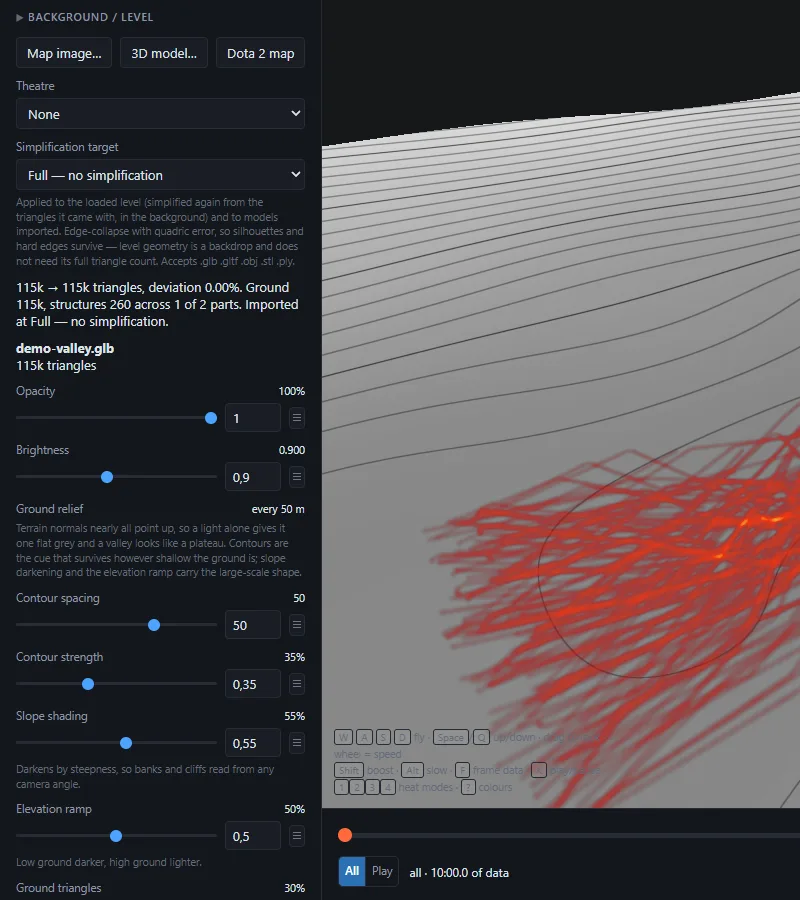

# 3DHeat

3DHeat は、ゲームの中で何がどこで起きたかを見せます。プレイヤーがどこへ行き、どこで戦い、どこで倒れたかを、飛び回れる光る色のヒートとして、または試合を再現する小さな3Dのフィギュアとして見ることができます。

CSV、Parquet、Tacview の記録、変換したリプレイ、1つのファイル、フォルダー、何千もの試合のいずれでも位置データを読み込めます。そして、それを**飛び回れるヒートマップ**、**試合を再現するフィギュア**、プレイヤーが通った経路に沿った線、または1つの集団と別の集団の比較として見ることができます。自動で目立つ点を見つけ、根拠と一緒に順位をつけます。すべてあなたのブラウザーの中で動きます。どこにもアップロードされません。


**初めての方へ**: [デモデータ](demo-data.md)を作って、その7つの手順に従ってください。このサイトのすべての画像は、このデータを使って撮影されています。

## 機能の概要 {#what-it-does}

| | |
|---|---|
|  | **[ヒートモード](heat-modes.md)** - ヒート、[差分](difference.md)（一方が多かった場所は赤、もう一方が多かった場所は緑から青）、[チームヒート](team-heat.md)、[線のヒート](line-heat.md)。矢印や扇形、極座標図を使う[方向ヒート](directional-heat.md)。[価値で重み付けしたヒート](value-weighting.md)：武器、車両、燃料がどれだけの価値を持つかを反映します。 |
|  | **[試合のリプレイ](match-replay.md)** - 各ユニットを、それが何であるかを表す[フィギュア](figures.md)として表示します。遠くの NATO またはロシアの記号、ミサイルと曳光弾、命中マーク、残骸、火災、砲塔、目標、Tacview 風のカメラ、戦術表示。[多数の試合を一度に](many-matches.md)も表示できます。 |
|  | **[インサイト](insights.md)** - 有利な位置、危険な地形、スポーンの罠、チョークポイント、目立つプレイヤーを、根拠と順位付きで見つけます。書かれたまとめを、選んだ AI が作ることもできます。1試合の実況モードや、[ナレッジレンズ](knowledge.md)もあります。 |
|  | **[ボリューム](volumes.md)** - ボックス、角柱、円柱、球を描き、その中に絞り込み、その中で起きたことを数え、書き出し、場所を並べて比べます。その場所で誰が、何が最もよく機能しているかの[内訳](breakdown.md)も見られます。 |
|  | **[フィルター](filters.md)** - イベントの種類、プレイヤーまたは AI、車両クラス、値、任意の列で絞り込みます。データの大きさに関係なく、グラフィックスカードで処理します。 |
|  | **[レベル](levels.md)** - マップ画像、[データツール](#related-repositories)で作った3Dレベル、簡略化、飛行データのための実際の地形を持つ[現実世界の背景](world-backdrop.md)。 |

ほかにも、ゲームのラップを扱う[レース分析](race-analysis.md)タブ、Counter-Strike 2 の要約を扱う[試合分析](match-analysis.md)タブ、レベル上の計画を扱う[作戦ボード](tactics-board.md)、車両ごとの[被弾分析](hit-analysis.md)、何千もの試合の[大量分析](mass-analysis.md)、[カメラの経路と動画](camera-path-and-video.md)、[40 の言語](languages.md)、[メートル法またはヤード・ポンド法の単位](settings.md)があります。

## タブ {#the-tabs}

タブはサイドバーの上部にあります。名前、単位、言語メニューの下にあります。

| タブ | 用途 |
|---|---|
| **ヒートマップ** | 位置を表すあらゆる表。ヒートモード、フィギュアオーバーレイ、フィルター、ボリューム、インサイト、レベル、計測、動画。 |
| **レース分析** | 同じコースの2つ以上のラップ。どこで時間を失ったか、なぜか、何を変えるべきか。 |
| **マッチ** | 試合のフィギュアリプレイと、Counter-Strike 2 の試合の要約。 |
| **作戦** | レベル上の計画。フィギュア、経路、投擲する道具、エリア、再生できる手順のメモ。 |
| **車両** | 各ユニットがどこで、誰に、何で被弾したか。 |

## インストールと実行 {#install-and-run}

### Windows の簡単な方法 {#windows-the-easy-way}

リポジトリのルートには3つのバッチファイルがあります。

| ファイル | 役割 |
|---|---|
| `start.bat` | ビューアーを起動します。Node.js が `PATH` にない場合でも探します（`%ProgramFiles%\nodejs`、`%ProgramFiles(x86)%\nodejs`、`%LOCALAPPDATA%\Programs\nodejs` を見ます）。Node.js がない場合は、`winget install -e --id OpenJS.NodeJS.LTS` で LTS 版のインストールを提案します。初回の実行では、依存関係をダウンロードする前に確認します（フォルダー内の `node_modules\` に約 300 MB。システム全体には入れません）。ポート 5273 ですでに何かが待ち受けている場合は起動を拒否し、代わりに `restart.bat` を案内します。フォルダーがローカルの変更のない git のチェックアウトで、新しい版がある場合は、更新するか尋ねます（Y/N。60 秒以内に答えがなければ、この版のまま続けます。[更新](updates.md)を参照）。その後、開発サーバーを `http://127.0.0.1:5273/` で起動し、ブラウザーを開きます。**このウィンドウがサーバーです**。開いたままにしてください。閉じるか Ctrl+C を押すと止まります。 |
| `restart.bat` | `stop.bat quiet` を実行してから `start.bat` を実行します。`vite.config.ts` を変えた後、依存関係を追加した後、またはサーバーが止まったときにだけ必要です。ソースの編集は、すぐに反映されます。 |
| `stop.bat` | ポート 5273 で待ち受けているものを止めます。プロセス ID は `netstat` で探し、イメージ名では探しません。そのため、同じマシン上の他の Node.js のプロセスには影響しません。ソケットが解放されるまで約2秒待ちます。引数 `quiet` を付けると、最後に一時停止しません。 |

### 手作業で（どの OS でも） {#by-hand-any-os}

```bash
git clone --recursive https://github.com/Holdi601/3DHeat.git
cd 3DHeat
npm install
npm run dev      # http://127.0.0.1:5273
```

`exporters/` フォルダーには、別のデータツールが git のサブモジュールとして入っています。それぞれ独自のリポジトリです。ふつうに clone した後は `git submodule update --init` を実行してください。ビューアー自体は、動かすためにこれらを必要としません。`exporters/ext/` には、任意の変換ツールが入っています（War Thunder、World of Tanks、World of Warships、Squad のリプレイ、DCS と IL-2 のマップ）。1つに問題があっても、ほかに影響しないよう、別にしてあります。

これらのどれにも、ゲームのデータは含まれていません。レベル、マップ、記録は、あなたが持っているゲームから、ツールを使ってご自身のマシン上で作ります。

### npm のスクリプト {#npm-scripts}

| スクリプト | 実行する内容 |
|---|---|
| `npm run dev` | ポート 5273 の Vite 開発サーバー。`127.0.0.1` に限定。 |
| `npm run build` | 型チェック（`tsc --noEmit`）と、`dist/` への本番用バンドル作成。 |
| `npm run preview` | 本番用バンドルを配信します。 |
| `npm run typecheck` | 型チェックだけを実行します。 |
| `npm test` / `npm run test:watch` | 単体テストと結合テスト（vitest）。 |
| `npm run smoke` | ヘッドレスの Chromium で実際のアプリを操作し、キャンバスに色のついたピクセルがあるかを確認します。スクリーンショットは `tools/.smoke/` に保存されます。開発サーバーが動いている必要があります。 |
| `npm run smoke:f16` | `?heat=f16` を付けた同じテスト。half-float 累積の経路を強制します（[Half-float 累積](half-float-accumulation.md)を参照）。 |
| `npm run bench` | 取り込みのベンチマーク。`tools/.smoke/ingest-bench.json` に書き出します。 |
| `npm run test:heavy` | 大きな実データのファイルを必要とするテスト。ファイルがない場合は自分でスキップします。 |
| `npm run inspect -- <file.parquet>` | Parquet ファイルのスキーマと、いくつかの行を表示します（`tools/inspect-parquet.mjs`）。 |

### 開発サーバーが追加するもの {#what-the-dev-server-adds}

ビューアーは静的な Web ページですが、開発サーバー（`vite.config.ts` を参照）は、`dist/` の静的な配信にはない2つのローカルのルートを追加します。

- `/__host/memory` は、マシンに搭載された RAM と空き容量、読み取れる場合はグラフィックスカードのメモリを報告します（`nvidia-smi` から、Windows ではディスプレイアダプターのレジストリの項目から）。これにより、[メモリの予算](memory-and-budgets.md)はブラウザーの上限付きの推定値ではなく、実際の数値を使えます。
- `/__heat3d/update` は、チェックアウトが遅れていないかを確認し、早送りで更新できます（[更新](updates.md)）。

サーバーは `127.0.0.1` だけに結び付きます。そのため、どちらのルートもネットワークからは届きません。`http://127.0.0.1:5273` と開いてください。`localhost` は IPv6 のループバック `::1` に解決されることがあり、そこでは何も待ち受けていません。オリジン間の分離ヘッダー（COOP/COEP）は送りません。ビューアーでは何も `SharedArrayBuffer` を使わず、ワーカーはデータを転送で受け渡すため、これらは不要です。

## ブラウザーと GPU の要件 {#browser-and-gpu-requirements}

- **WebGPU か WebGL2 のあるブラウザー。** まず WebGPU を試します（Chrome と Edge は対応しています）。WebGPU がなければ WebGL2 のバックエンドを使います。WebGL2 は `EXT_color_buffer_float`（浮動小数点テクスチャへの描画）を提供している必要があります。提供していない場合、ビューアーは「レンダラーを初期化できません。」と表示します。[2つのバックエンド](backends.md)を参照してください。ビューアーは Chromium で開発し、テストしています。他のブラウザーでは確認していません。
- **ハードウェアアクセラレーションが有効であること。** ブラウザーが CPU で描画している場合（SwiftShader、llvmpipe、Microsoft Basic Render Driver など）、サイドバーの上部に赤いバナーが出て、その状況と直し方を示します。[ソフトウェアレンダリングの検出](software-rendering.md)を参照してください。
- **個別の GPU があると助かりますが、必須ではありません。** どちらのバックエンドも高性能なアダプターを要求します。GPU に保持できるデータ量は予算として見えるもので、変更もできます（[メモリと予算](memory-and-budgets.md)）。
- **任意の機能**は、さらなるブラウザーの API を使います。動画の描画には、VP9 または VP8 の WebCodecs `VideoEncoder` が必要です（[カメラの経路と動画](camera-path-and-video.md)）。レベルのメッシュの簡略化には WebAssembly が必要です。フォルダーのドロップには File and Directory Entries API を使います。レベルライブラリは IndexedDB を使います。ゲームパッドは Gamepad API を使います。

## ドキュメントの地図 {#documentation-map}

**はじめに**: [デモデータ](demo-data.md) · [データの取り込み](getting-data-in.md)（[ファイルの読み込み](loading-files.md)、[列マッピング](column-mapping.md)、[軸、単位、時間](axes-units-and-time.md)、[セッション、人物、グループ](sessions-persons-groups.md)、[Tacview](tacview-acmi.md)、[変換ツール](converters.md)、[.3dheat](container.md)、[メモリと予算](memory-and-budgets.md)）

**見る**: [ヒートモード](heat-modes.md)（[ヒート](heat.md)、[スプライトの形](sprite-shape.md)、[色と露出](colour-and-exposure.md)、[深度とカリング](depth-and-culling.md)、[差分](difference.md)、[チームヒート](team-heat.md)、[線のヒート](line-heat.md)、[ボックスのリプレイ](box-replay.md)、[方向ヒート](directional-heat.md)、[価値の重み付け](value-weighting.md)） · [タイムライン](timeline.md) · [レベル](levels.md)（[マップ画像](map-images.md)、[3Dレベル](model-levels.md)、[見た目](level-appearance.md)、[ライブラリ](level-library.md)、[現実世界の背景](world-backdrop.md)、[その出典](world-backdrop-sources.md)） · [カメラ](camera.md)（[ゲームパッド](gamepad.md)、[キー](keyboard-reference.md)） · [カメラの経路と動画](camera-path-and-video.md)

**分析する**: [フィルターとツール](filters-and-tools.md)（[フィルター](filters.md)、[チーム](teams-list.md)、[エンティティ](entities.md)、[スライス](slice.md)、[計測](measure.md)、[ボリューム](volumes.md)、[内訳](breakdown.md)） · [インサイト](insights.md)（[ナレッジレンズ](knowledge.md)） · [大量分析](mass-analysis.md)

**リプレイ**: [試合のリプレイ](match-replay.md) · [多数の試合を一度に](many-matches.md) · [フィギュア](figures.md)（[フィギュアオーバーレイ内](figure-replay.md)、[クレジット](figure-credits.md)） · [Tacview との同等性](tacview-parity.md) · [被弾分析](hit-analysis.md)

**ほかのタブ**: [レース分析](race-analysis.md)（[方法](race-analytics.md)、[他のゲーム](other-games.md)） · [試合分析](match-analysis.md) · [作戦ボード](tactics-board.md)（[速度](tactics-speeds.md)）

**ビューアー**: [用語集](glossary.md) · [設定、単位、キー](settings.md) · [言語](languages.md) · [更新](updates.md) · [レンダリングの内部](rendering-internals.md)（[バックエンド](backends.md)、[累積](accumulation.md)、[サンプリングと予算](sampling-and-budgets.md)、[half-float](half-float-accumulation.md)、[GPU メモリ](gpu-memory.md)、[ソフトウェアレンダリング](software-rendering.md)、[パフォーマンスと統計](performance-and-stats.md)） · [データ形式](data-formats.md) · [リファレンス](reference.md) · [ドキュメントの保守](maintaining.md)

## 関連リポジトリ {#related-repositories}

ビューアーはデータを読みます。これらのツールがデータを作ります。それぞれが独自の公開リポジトリ（MIT）で、独自のドキュメントを持ちます。どれもゲームのデータは同梱していません。レベル、マップ、記録は、あなたが持っているゲームから、ご自身のマシン上で作ります。

| リポジトリ | 役割 | 用途 |
|---|---|---|
| [3DHeat-GameFiles](https://github.com/Holdi601/3DHeat-GameFiles) | ゲームが同梱するアーカイブ（Forza Horizon、BeamNG、Assetto Corsa Rally。Unreal、Unity、Frostbite、Source 2 の読み取り）からコースとレベルを読み出し、glTF にします | ヒートやリプレイの下に置く3Dレベル |
| [3DHeat-GameCapture](https://github.com/Holdi601/3DHeat-GameCapture) | レーシングゲームが公開するインターフェースからラップのテレメトリを記録し、ゲームプレイの動画からレベルを再構築します | レース分析用のラップ。ファイルを読めないときのレベル |
| [3DHeat-UnrealExporter](https://github.com/Holdi601/3DHeat-UnrealExporter) | レベルを1つの glTF ファイルとして書き出す Unreal Editor のプラグイン | ご自身の Unreal プロジェクトのレベル |
| [3DHeat-CS2](https://github.com/Holdi601/3DHeat-CS2) | Counter-Strike 2 のデモをヒートの表と試合の要約に、CS2 のマップをジオメトリに変換します | CS2 のヒート、リプレイ、試合タブ |
| [3DHeat-Watcher](https://github.com/Holdi601/3DHeat-Watcher) | ゲームが公開する情報（テレメトリ、ゲーム状態の連携、ログ、リプレイ）から、バックグラウンドでプレイを記録します | 手作業なしのご自身の統計 |
| [3DHeat-Ext-WarThunder](https://github.com/Holdi601/3DHeat-Ext-WarThunder) | War Thunder のリプレイ（`.wrpl`）を表にします。空中と地上の軌跡、射撃、命中、撃墜、砲塔、目標 | War Thunder のリプレイ、命中マーク、インサイト |
| [3DHeat-Ext-WoT](https://github.com/Holdi601/3DHeat-Ext-WoT) | World of Tanks のリプレイを表にします。すべての車両の位置、撃破、撃墜 | World of Tanks のヒートとリプレイ |
| [3DHeat-Ext-WoWs](https://github.com/Holdi601/3DHeat-Ext-WoWs) | World of Warships のリプレイを表にします。すべての艦の位置と撃沈 | World of Warships のヒートとリプレイ |
| [3DHeat-Ext-Squad](https://github.com/Holdi601/3DHeat-Ext-Squad) | Squad のサーバーのデモを表にします。すべてのプレイヤーの位置、チーム、分隊 | Squad のヒートとリプレイ |
| [3DHeat-Ext-DCS](https://github.com/Holdi601/3DHeat-Ext-DCS) | ご自身のインストールにある DCS World の地形を、地上、道路、町、飛行場、畑、水域のあるレベルにします | DCS と Tacview の記録を実際の地形の上で |
| [3DHeat-Ext-IL2](https://github.com/Holdi601/3DHeat-Ext-IL2) | IL-2 Great Battles のマップをレベルにします | IL-2 の記録をそのマップの上で |

## ソースの構成（概要） {#source-layout-briefly}

| フォルダー | 内容 |
|---|---|
| [`src/data/`](https://github.com/Holdi601/3DHeat/tree/main/src/data) | ファイルの選択、CSV と Parquet の取り込み、自動の割り当て、検証、メモリモデル、データセットの作成、モデルの読み取り、分類、簡略化、レベルライブラリ |
| [`src/render/`](https://github.com/Holdi601/3DHeat/tree/main/src/render) | フレームのループ（`engine.ts`）、サンプリング、両方のバックエンド、カメラ、ゲームパッド、計測、カメラの経路、動画の録画 |
| [`src/state/`](https://github.com/Holdi601/3DHeat/tree/main/src/state) | すべての既定値を持つアプリケーションの状態（`store.ts`）、ドメインの型（`types.ts`）、スプライトの曲線 |
| [`src/ui/`](https://github.com/Holdi601/3DHeat/tree/main/src/ui) | サイドバーのパネル、タイムライン、オーバーレイ |
| [`src/race/`](https://github.com/Holdi601/3DHeat/tree/main/src/race)、[`src/match/`](https://github.com/Holdi601/3DHeat/tree/main/src/match) | レース分析タブと試合タブ |
| [`src/i18n/`](https://github.com/Holdi601/3DHeat/tree/main/src/i18n) | 翻訳 |
| [`src/insights/`](https://github.com/Holdi601/3DHeat/tree/main/src/insights) | インサイト：検出器、まとめ、実況、AI プロバイダー、ナレッジレンズ |
| [`src/mass/`](https://github.com/Holdi601/3DHeat/tree/main/src/mass) | 多数の試合の大量分析 |
| [`src/volumes/`](https://github.com/Holdi601/3DHeat/tree/main/src/volumes) | ボリュームとその統計、書き出し、比較 |
| [`src/breakdown/`](https://github.com/Holdi601/3DHeat/tree/main/src/breakdown) | 内訳と要因 |
| [`src/overlay/`](https://github.com/Holdi601/3DHeat/tree/main/src/overlay) | 多数の試合のオーバーレイ |
| [`src/figures/`](https://github.com/Holdi601/3DHeat/tree/main/src/figures) | フィギュアのカタログとその作成ツール |
| [`src/vehicle/`](https://github.com/Holdi601/3DHeat/tree/main/src/vehicle) | 被弾分析（車両タブ） |
| [`src/tactics/`](https://github.com/Holdi601/3DHeat/tree/main/src/tactics) | 作戦ボード |
| [`src/world/`](https://github.com/Holdi601/3DHeat/tree/main/src/world) | 現実世界の背景 |
| [`src/units/`](https://github.com/Holdi601/3DHeat/tree/main/src/units) | 計測単位 |
