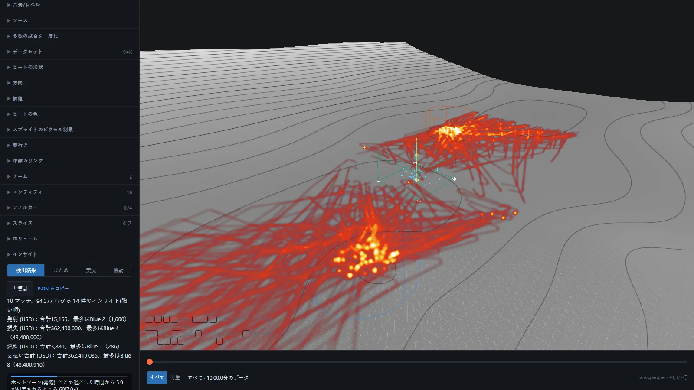
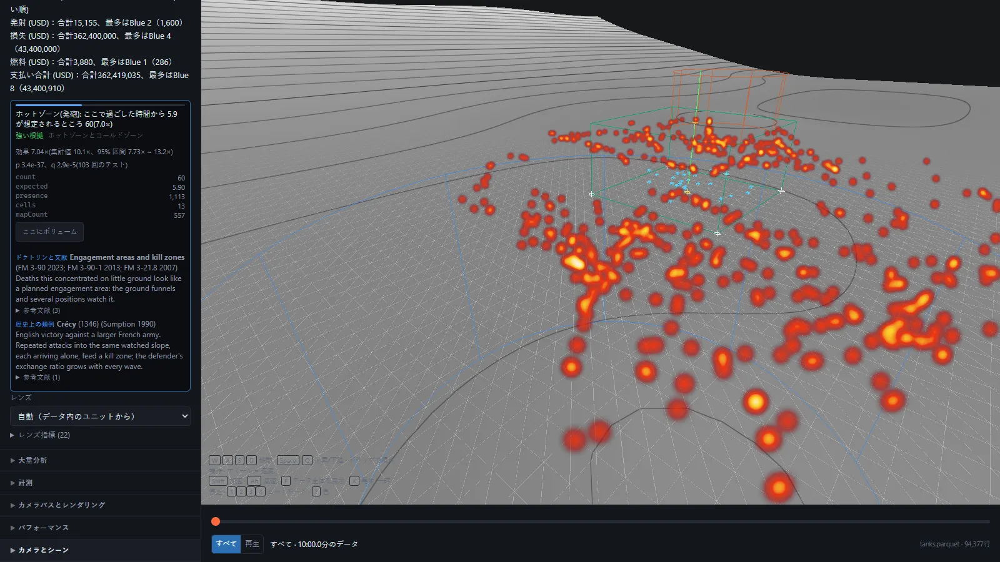
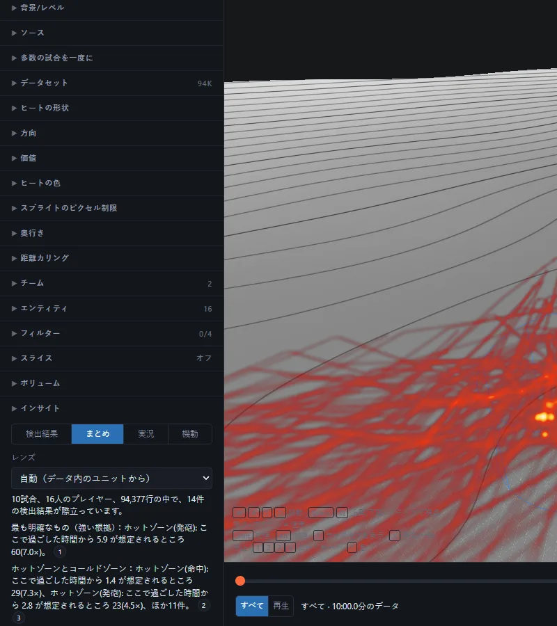
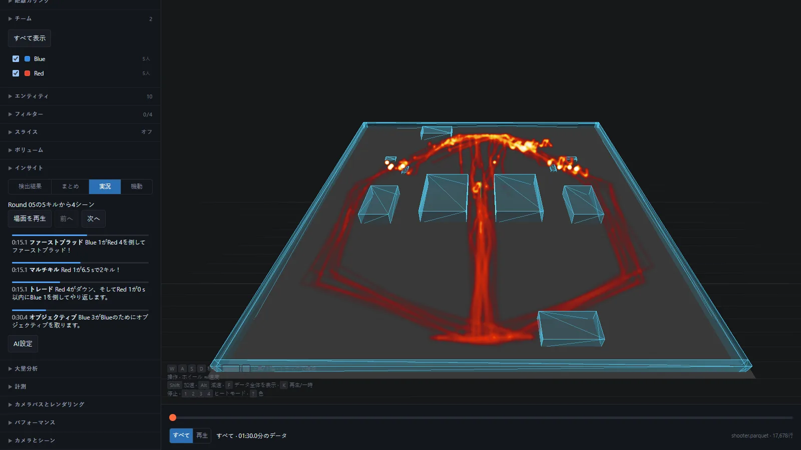

# インサイト

**インサイト** は、読み込んだデータの中から目立つものを探します。有利な位置、危険な地形、スポーンの罠、チョークポイント、仲間より抜きん出ているプレイヤーなどです。根拠と一緒に、最も強いものから順に伝えます。1分で、試合がどこで勝ち、どこで負けたかを知るために使ってください。その後、まとめを書くことができます。1つのリプレイでは、大きな瞬間へ飛ぶ実況役としても働きます。

すべてはあなたのブラウザーの中で数えられます。外部の AI を有効にしない限り、何もあなたのコンピューターの外へ出ません（[外部の AI](#external-ai)を参照）。

**インサイト** の領域は、ヒートマップタブとマッチタブのサイドバーにあります。タブは3つあります：**検出結果**、**まとめ**、**実況**。

## 検出結果 {#findings}

1. データを読み込み、**インサイト** を開きます。**インサイトを探す** を押します（「集計中… n%」で進み具合を表示します）。
2. 一覧を読みます。各発見には、強さのバー、1文の説明、根拠の強さ（*強い根拠*、*良い根拠*、*いくらかの根拠*）、それを見つけた検出器、そして重要な場合は車両クラスがあります。
3. **発見をクリックする**と、ビューアはその絞り込みを適用し、カメラをその場所へ飛ばし、その時刻へ移動し、詳細を開きます。詳細には、95% の区間付きの効果、p 値と q 値、数えた根拠、そして **ここにボリューム** があります。これは、その場所の周りに[ボリューム](volumes.md)を描きます。
4. **フィルターを戻す** で、あなたのフィルターを元に戻します。**JSON をコピー** は、報告全体をコピーします。

数えるときは、現在のフィルター、隠したグループ、選んだマッチを、時間の範囲全体に対して使います。その後でフィルターを変えると、そのことが注記で示されます。**再集計** を押してください。

一覧の一番上の行（たとえば金額の合計）は、発見の前に、データ全体の要約を示します。

### 検出器 {#the-detectors}

| 検出器 | 見つけるもの | データに必要なもの |
|---|---|---|
| **有利な位置** | 地図の残りより、撃破と被撃破の比がずっとよい場所。そして、そこにいた時間に対して、死ぬ人がほとんどいない*安全な地面* | 撃破と死亡のイベント |
| **ホットゾーンとコールドゾーン** | そこにいた時間から予測されるよりも、イベントの種類（射撃、命中、占領など）がずっと多い、または少ない場所 | イベントの列 |
| **開けた場所と遮蔽物** | 近くのレベルのジオメトリに対して、開けた場所での死亡。速い動きに対して遅い動き | 死亡。ジオメトリの部分には3Dレベル |
| **スポーン** | 強いスポーン、スポーンの罠、安全なスポーン、最初の接触までの時間 | 時間と人物 |
| **場所別のクラス** | ある領域で、ずっとよい、または悪い結果を出している車両クラス、またはプレイヤー対 AI | 撃破と、車両クラスまたはプレイヤー/AI の列 |
| **プレイヤー** | 同じクラスのほかの人と比べて、ずっと多く、またはずっと少なく撃破または死亡しているプレイヤー | 人物と撃破 |
| **チョークポイントと側面** | チョークポイント（周りの地面よりずっと多く通過される場所）と、側面の経路（めったに使われないが、撃破につながる） | 人物 |
| **値** | *コストのかかる地面* と *稼ぐ地面* | [値の列](value-weighting.md) |
| **ラウンドを決めたもの** | 勝ったラウンドと負けたラウンドを分けたもの、そして勝利確率を最も増やした、または最も減らしたプレイヤー（[誰が勝ったか](#who-won-what-decided-the-rounds) を参照） | ラウンド、キルとデス、そして [結果の列](data-formats.md#outcome-columns)（`won`） |

データで実行できない検出器は、理由と一緒に一番下に一覧されます。

### 発見の順位付け {#how-findings-are-ranked}

すべての場所またはグループは、地図の残りと比べて検定されます（正確な二項検定または率の検定）。誤発見率は 5% に保たれます（Benjamini-Hochberg）。偶然がパターンに見えることはあります。これは誤報を少なく保ちます。表示された発見のうち、偶然であるものは、約 20 件に 1 件と見込まれます。少ないイベントからの効果は、順位付けの前に「効果なし」へ引き寄せられます。最大 60 件の発見を一覧し、どの検出器も上位の数か所を得ます。

### 誰が勝ったか：ラウンドを決めたもの {#who-won-what-decided-the-rounds}

各ラウンドの勝者がデータに書かれている場合（`won` の [結果の列](data-formats.md#outcome-columns)：CS2、Rainbow Six Siege、War Thunder など）、インサイトの中心はその結果です。各サイドについて、ラウンドを中で起きたことで分け、勝率を比べます。

| 要因 | そのサイドの、それがあったラウンド | ……なかったラウンド |
|---|---|---|
| 先制デュエル | 最初のキルを取った | 先に倒された |
| 購入 | 相手サイドより良い購入だった | 悪かった |
| 最初のデスのトレード | 最初のデスが 5 秒以内にトレードされた | されなかった |
| 設置 | 設置した | 設置なし |
| ユーティリティ | いつものラウンドよりグレネードが多い | 少ない |
| 早い接触 | 最初のデュエルが試合の中央値の時刻より前 | 後 |
| 場所の保持 | プレイヤーがその場所に 5 秒以上いた | 誰もいなかった |
| 場所への早い到達 | プレイヤーが最初の 25 秒でそこに着いた（ルート） | 誰も着かなかった |

どの比較も、2つの勝率の差です。95% の区間（Newcombe）、Fisher の正確な p、試したすべての要因にわたる q（Benjamini-Hochberg）が付きます。8 ラウンド未満の側には *ラウンド少* と印が付きます。偽発見率 5% を下回ったものが発見になります。最も強いものは、ほかの検出器の発見より上に並びます（結果の発見は、同じ効果と根拠を持つ発見の 1.35 倍の重みを持ちます）。

40 ラウンドの架空の例：

> **T** は **Mid** を押さえた 19 ラウンドの 79% を取り、押さえなかった 21 ラウンドでは 24%（55 ポイント、95%：26～74）- q 0.004。

さらに、ラウンドの **勝利確率** も追います。生きている人数、設置、時計から求めた、各瞬間の各サイドの勝つ見込みです。ラウンドが 30 以上あればそれに当てはめ、なければ固定の事前モデルを使います（どちらかは文章に書かれます）。ここから **転換点**（見込みを最も動かしたキルと設置）と、各プレイヤーの **勝利確率への貢献** が出てきます。そのプレイヤーのキルと設置はプラス、デスはマイナスに数え、試合全体でのラウンド何個分かで表し、1ラウンドあたりの平均と区間を付け、ゼロに対して検定します。場所にも同じ収支が付きます。そこで戦われたデュエルで、どのサイドが最も得をしたかです。

データには、両サイドのラウンド、キル、デスと、`won` の列が必要です。場所の保持には名前付きの場所（`place`）が、購入には `buy` の列が必要です。

## まとめ {#debrief}

**まとめ** タブは、発見を短い文章にまとめます。導入、最も明確な発見、戦術についての発見、バランスについての発見、次に（勝者がデータにある場合）ラウンドを決めたもの、残りを検出器ごとにまとめたもの、そしてどれだけが弱い根拠に基づくかです。

ラウンドを決めたものは 4 つの段落で書かれます。スコアと勝利確率の出どころ。最も強い要因とその数字、区間、q（偽発見率を通るものがない場合は *まだ確実なものはありません* と書き、それでも最も強いものを挙げます）。最も大きな 3 つの転換点。勝利確率を最も増やしたプレイヤーと最も減らしたプレイヤー、そして最も得をした場所です。架空の例：

> 既知の結果がある 40 ラウンドのうち、T が 23、CT が 17 で勝利（T：58%、95%：42%～72%）。勝利確率はこれらのラウンドに当てはめたモデルによるものです。
>
> 勝ったラウンドと負けたラウンドを分けたもの：T は Mid を押さえた 19 ラウンドの 79% を取り、押さえなかった 21 ラウンドでは 24%（55 ポイント、95%：26～74）（q 0.004）、……
>
> 転換点：ラウンド 17 の 48 秒、B サイトでの CT のキルで勝率が 31% から 58% に動いた。そのラウンドを取った、……

各段落には、その発見を表示する番号付きのボタンがあります。**テキストをコピー** でコピーします。

組み込みのナレーターは、オフラインで、あなたの言語で動きます。その上にある **レンズ** の選択（[ナレッジレンズ](knowledge.md)を参照）が、段落がどの文献を引用するかを決めます。

### 外部の AI {#external-ai}

**AI設定** では、代わりに、あなたが選んだ AI モデルにまとめを書かせられます：

| 設定 | 意味 |
|---|---|
| **プロバイダー** | Anthropic（Claude）、OpenAI（ChatGPT）、OpenRouter、Ollama（ローカル）、LM Studio（ローカル）、llama.cpp サーバー（ローカル）、または任意の OpenAI 互換のエンドポイント |
| **ベースURL**、**モデル** | プロバイダーが入力します。**モデルを一覧表示** は、サーバーに問い合わせます。 |
| **APIキー** | ベースURL にだけ送られます。記録されず、表示、書き出し、`.3dheat` ファイルに保存されることもありません。ほとんどのローカルサーバーでは不要です。 |
| **このブラウザーにキーを保存** | 既定ではオフ。ページを閉じるとキーは忘れられます。 |
| **外部AIを使う** | 既定ではオフ。 |
| **プレイヤー名を送信** | 既定ではオフ。プレイヤーは P1、P2 … として送られます。 |

その後、任意の質問を入力し、**AIで書く** を押します。送られるのは発見とその数字だけです。データの行は決して送られません。回答は少しずつ流れ込み、引用された発見はボタンになります。勝者がデータにある場合、モデルには、ラウンドを決めたものから書き始め、どの数字にも区間と q を付け、要因が少ないラウンドに基づくときや、勝利確率が事前モデルによるときはそう書くように伝えます。

## 実況 {#caster}

**1つのマッチ**（複数読み込んでいる場合は1つを選びます）について、**実況** は見る価値のある瞬間を見つけます。最初の血、マルチキル、トレード、クラッチ、目標の流れの変化、逆転、目立つプレイヤー、長距離の射撃、そして **転換点** です。転換点とは、あるサイドのラウンド勝利の見込みを最も動かしたキルです（各サイドの生き残りの人数による。リスポーンのないラウンドで）。

各ラウンドの勝者がデータにある場合、どの瞬間もそれを伝えます：*「Anna が Ben を倒す：T のラウンド勝利確率が 38% から 62% に変わる - そしてそのラウンドを取る。」* 実況がどの瞬間を残すかを選ぶとき、最終的に勝ったサイドの瞬間はより重く数えます。逆転は取ったラウンドの数で数えます。

- 瞬間をクリックします。表示はリプレイに切り替わり、その直前へ移動し、そこへ飛んで、プレイヤーを追います。
- **場面を再生** は、各場面を最後まで再生して次へ進みます。**前へ** / **次へ** で順に移動します。
- 外部の AI が有効なら、**AIによる実況** が、瞬間の一覧（種類、時刻、名前または仮名、チーム、クラス、距離）から実況を書きます。

人物と、撃破または死亡（または占領）のイベントが必要です。`other` / `victim` の列があると、トレードと長距離の射撃が可能になります。

## ナレッジレンズ {#knowledge-lens}

発見は、確立した知識の**レンズ**を通して読むことができます。軍事教義、空戦と海戦、市街地での作戦、ゲームデザインとエスポーツです（または *自動*。データのユニットによって選ばれます）。開いた発見は、最も近い**教義と文献**の項目と、**歴史上の類似例**を、参考文献付きで表示します。そして **レンズ指標** は、その文献からの指標をデータ上で計算します（ランチェスター適合、交換比、戦力比、射界、重要地形、トレード、主導権）。まとめと AI の指示文にも、それらが含まれます。詳細はすべて：[ナレッジレンズ](knowledge.md)。

レンズ指標は、プレイヤーが群衆として、また集団として、どう振る舞うかも測ります。整列とうろつき、経路の誘導、レーンと軌跡、混雑、リーダーとフォロワー、落伍者、損失の下での崩壊点、命を失った後のリスク、連続、購入の一致、飛来する射撃への反応です。それぞれ、独自の帰無モデルと比べられます：[集団の動き](collective-behaviour.md)。

## インサイトを機能させるデータ {#data-that-makes-insights-work}

- **時間**、**人物**、**チーム**の列を持つ位置；
- 撃破と死亡（`kill`、`death`）、そのほか（`hit`、`fire`、`capture` など）を含む**イベント**の列；
- トレードと向きのための**相手**の列（`other`、`victim`）；
- クラスのための**車両**または**種類**の列。AI に対するプレイヤーのための `ai` の列；
- 複数のマッチがあるときの**セッション** / **マッチ** / **ラウンド**の列。

[デモデータ](demo-data.md)には、これらがすべてあります。
