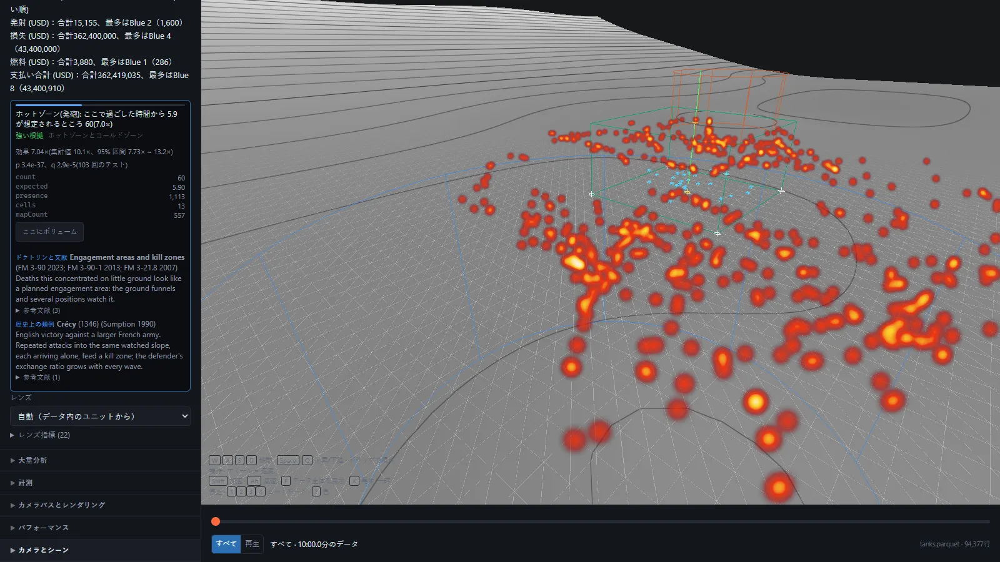

# ナレッジレンズ

[インサイト](insights.md) が何かを見つけると、このパートは、軍事史、ゲームデザイン、スポーツ分析の考えを使ってそれを説明し、その出典となる本や論文を挙げます。パターンが存在することだけでなく、それが *なぜ* 重要かを学ぶために使ってください。

## 試してみる {#try-it}

1. データを読み込み、**インサイト** を開いてから、**インサイトを探す** を押します。
2. 発見をクリックして開きます。
3. **ドクトリンと文献** と **歴史上の類例** を読みます。完全な出典は、その下に折りたたまれています。
4. **レンズ** を変えると (たとえば *軍事ドクトリン*)、同じ発見を別の文献群を通して読めます。

## 仕組み {#how-it-works}

インサイトのパネルは、その発見を、プロのアナリストがするように判断します。軍事ドクトリンと作戦研究、歴史上の交戦、そしてゲームデザイン、レベルデザイン、分析の文献を通してです。これはオフラインで、ビューアの中にある厳選された知識ベースから行われます。まとめを書くのが外部のモデルのときは、同じ材料をそのモデルに渡します。

## パネルが示すもの {#what-the-panel-shows}

- **レンズ** は、発見を読む文献群を選びます。*自動* (データの中のユニットの種類で選ばれる: 航空機、艦船、地上車両、歩兵)、*軍事ドクトリン*、*空中戦*、*海軍*、*市街戦*、*ゲームデザインとバランス*、*eスポーツ*。選ばれたレンズの外にある項目は除かれます。
- 開かれた発見ごとに、最も近い **ドクトリンと文献** の項目と、最も近い **歴史上の類例** が、その完全な出典とともに、その下に折りたたまれて表示されます。
- **レンズ指標** は、同じ行に対して計算された作戦分析の測定を一覧します (下を参照)。それぞれ、その意味と文献が付きます。
- **まとめ** には、主要な発見とレンズ指標の行が加えられます。「ドクトリンと文献: ...」と「歴史上の類例: ...」で、それぞれ著者と年の引用が付き、その下に出典が折りたたまれます。
- **AIで書く** は、最も関連する項目 (要約、教訓、それが関係する発見、完全な出典) をレポートとともに送り、モデルにそれらを ID で引用するよう求めます (`{concept.lanchester-square}`)。ほかの出典は使わないように求めます。

ラベルは翻訳されています。知識そのものは英語です。

## レンズ指標 {#lens-metrics}

インサイトのワーカーで、検出器と同じ、行の 1 回の走査の中で計算されます (`src/insights/lensMetrics.ts`)。データがそれを運べない場合は、その指標は除かれます。

| 指標 | 測るもの | 必要なもの |
|---|---|---|
| ランチェスターの当てはめ | 各陣営の 20 秒ごとの損失を、両陣営の生きている戦力に回帰させたもの (ポアソン、準尤度の誤差)。敵と自陣営の戦力にかかる指数を、二乗の法則 (照準射撃) と線形の法則 (面制圧) に対して検定 | 時刻、チーム、撃破と死亡 |
| 交換比 | 陣営ごと、場所ごとの、撃破あたりの死亡。時間の 5% を占める最も致命的な地上での死亡の割合。その数の死亡があるときに偶然だけで得られる割合と比べたもの。時間に対する死亡のジニ係数。死亡率の Moran の I | 撃破と死亡 |
| 局所的な戦力比 | 各撃破の交戦距離内にいる、味方と敵の生きているユニット (距離はデータから設定: 最も近い敵までの中央値の 2 倍)。局所的に優勢な陣営が取った撃破の割合と、人数だけで予測されるものを超える分 | 時刻、チーム、人物 |
| 射界 | 最も忙しい撃破の場所からの見通し。2.5D の遮蔽面 (壁の高さまでのレベルのジオメトリ、または歩いた地面) で、平均の場所と比べる。また、見通しと撃破の割合の順位相関。読み込まれたレベルがあると、より鋭くなります。空中には使わない | 位置。読み込まれたレベルはより鋭くする |
| エネルギー状態 | 空中の撃破者と被撃破者の比エネルギー (高度と、速度が買える高度を足したもの)。Mann-Whitney 統計量で比べる | 航空機の種類、時刻、高度 |
| 要地 | 各場所が、ある試合の最も忙しい 3 つの撃破の場所に入る頻度 | 複数の試合 |
| 相互支援 (交換) | 交戦距離と 5 秒以内で、味方の撃破によって返された死亡 | 時刻、チーム |
| 先制 | 交戦 (試合ごとに、20 秒の静けさごとに、3 つの交戦距離の間隔ごとにまとめた撃破)。最初に得点した陣営が勝つ | 時刻、チーム |
| 斉射モデル | 接触している艦船の 20 秒の期間に当てはめた Hughes の斉射方程式。攻撃する艦 1 隻あたりに戦闘不能にされた艦、防御する艦 1 隻あたりに救われた艦。艦だけのランチェスターの当てはめ | 艦の種類、時刻、チーム |
| 戦闘効率 | 各陣営の、交戦中のユニット時間あたりの撃破と、上位 2 つの比 (Dupuy の意味での戦闘効率の値)。その 95% 区間。各陣営の、同数の局所戦力での撃破の割合 | 時刻、チーム |
| 交戦距離 | 撃破時、発射時、そして各生涯の最初の射撃 (発見から交戦まで) での、最も近い敵までの距離。ユニットの種類ごと | 時刻、チーム。データにあれば発射 |
| 撃破の連鎖 | 撃破者の最後の発射から撃破までの秒数、そして戦闘の最初の射撃から撃破までの秒数 | 時刻。発射またはイベント |
| 集中または分散 | 20 秒の各期間で、上位 2 つの陣営の広がり、そして、より固まっている方が取った撃破の割合 | 時刻、チーム |
| 出撃 | 陣営ごと: 出撃 (離陸、または航空機の出現)、着陸、失った航空機、航空機による撃破。損失率と、出撃ごとの撃破 | 航空機の種類。離陸または出現 |

ラウンドのあるデータは、近接戦とeスポーツの測定を加えます。ラウンド勝率、行動の価値、最初の一騎打ち、交換、角に出る者 対 待つ者、照準、十字砲火、道具、人数の優位、1 対多、設置、設置の後、致命的な漏斗、プレイヤーの影響です。[近接戦とラウンド](close-quarters.md) を参照してください。

トラックとチームは、群衆の科学、集団の動き、行動経済学、軍事心理学の集団行動の測定を加えます。配置と旋回、経路の群れ、レーンと航跡、混雑、リーダーとフォロワー、落伍者、崩壊点、損失の後のリスク、連勝、購入の一致と抑制などで、それぞれ独自の帰無モデルと比べます。[集団行動](collective-behaviour.md) を参照してください。

武器、囮、建物はユニットとして数えられません。武器の行が発射するユニットを指定している場合 (Tacview 由来のデータにある `Shooter` または `Launcher` の列)、その発射は、名前または物体 ID で一致したそのユニットに帰せられます。

## 発見は文献とどう出会うか {#how-findings-meet-the-literature}

項目と発見は、**パターンの分類** (`src/insights/knowledge/patterns.ts`) を通して出会います。集中、局所的な優勢、照準射撃と面制圧、チョークポイント、キルゾーン、射界、逆斜面、側面攻撃、相互支援、エネルギーの優位、出現の圧力、バランスなどです。各検出器の種類と各レンズ指標は、その数字がどのパターンを示すかを言います (`src/insights/lens.ts`)。各知識の項目は、どのパターンを扱うかを、重みとともに言います。発見に対する項目の関連性は、重みつきの重なりで、項目の領域 (陸、空、海、市街) がデータにどれだけ合うかと、発見自身の強さで調整されます。示される理由は、発見の数字を一文にしたものと、項目の教訓です。

## 目録 {#catalogue}

すべてのパターン、概念、方法、歴史上の事例、デザインの原則、研究を、その文献目録とともに。[ナレッジカタログ](knowledge-catalogue.md) を参照してください。

## 開発者向け {#for-developers}

### 項目を追加する {#adding-entries}

1. 種類によってファイルを選びます。`src/insights/knowledge/` の `concepts.ts` と `concepts-more.ts`、`methods.ts`、`cases.ts`、`cases-land.ts`、`cases-air-sea.ts`、`cases-esports.ts`、`design.ts` (デザインの原則)、または `studies.ts`。
2. 新しい ID `<種類>.<スラッグ>` を与えます (決して再利用しない)。そのレンズ、領域、そして重み 0..1 つきで扱うパターン。パターンは、発見がそれを示せる場合にだけ `patterns.ts` に加え、発見または指標から `lens.ts` で対応づけます。
3. 要約と教訓は **自分の言葉で** 書きます。引用は、パブリックドメインの作品からだけ (出典の `pd: true`)、そして短く。
4. 出典を示します。新しい作品は、著者、年、題名、出版社 (雑誌なら巻とページ) とともに `refs.ts` に加えます。公開された記録があれば、URL または DOI を付けます。
5. `npx vitest run src/insights/lens.test.ts` (ID の一意性、既知のパターン、解決される出典、パブリックドメインの引用、日付と結果のある事例) と、`node tools/knowledge-doc.mjs` を実行して、[目録](knowledge-catalogue.md) を更新します。
