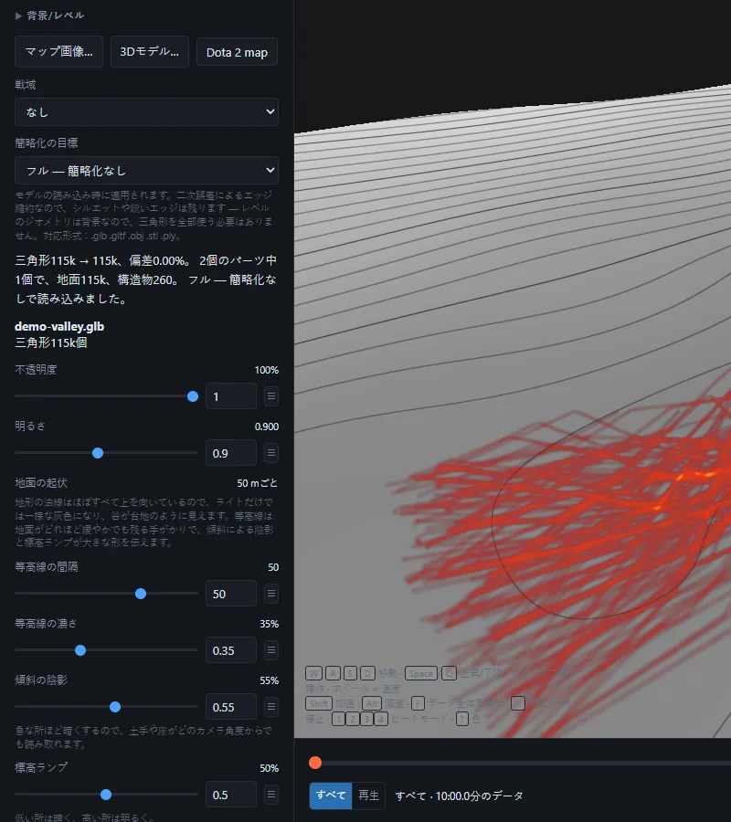

# レベルと背景のジオメトリ

レベルとは、ゲームが行われた3Dの場所です。マップ、町、コースなどです。データの後ろにレベルを置くと、ヒートが*どこ*にあるかが見えます。**背景/レベル**パネル（「レベル」の意味は[用語集](glossary.md)を参照）は、3種類の文脈を与えます:

- **マップ画像**。2つのアンカーで地理的に位置づけられます。[マップ画像](map-images.md)を参照してください;
- **3D レベル**。`.glb`、`.gltf`、`.obj`、`.stl`、`.ply`。地面、構造物、水に分けられ、取り込み時に簡略化されます。[3D レベル](model-levels.md)と[レベルの見た目](level-appearance.md)を参照してください;
- **現実世界の背景**。記録が地球上のどこにあるかを示す場合（Tacview ACMI のファイル）に、実際の地形、道路、水、飛行場、建物を、オープンデータからダウンロードします。[現実世界の背景](world-backdrop.md)を参照してください。

何も読み込まれていないと、シーンは暗く、グリッドと色付きの軸が表示されます（[カメラとシーン](camera.md)の **グリッド** と **軸**）。パネルには *何も読み込まれていません - シーンにはグリッドと軸が表示されます。マップ画像またはレベルのメッシュを追加すると、ヒートに文脈が加わります。* と表示されます。

レベルは3つのタブすべてで共有されます。レース分析タブで読み込んだコースは、ヒートマップが示すのと同じレベルです。

## データの後ろにレベルを置く {#put-a-level-behind-your-data}

1. まずデータを読み込みます（[データの取り込み](getting-data-in.md)）。レベルがそれに合わせられます。
2. サイドバーの **背景/レベル** を開きます。
3. 絵には **マップ画像…**、3D レベルには **3Dモデル…** を押し、ファイルを選びます。実在の世界の記録には、代わりに **現実世界の背景** または **戦域** を使います。
4. 進行状況の行が終わるまで待ちます。大きなモデルは、先に簡略化されます（下の **簡略化の目標** を参照）。
5. ビューで **F** を押して、すべてを表示します。**不透明度** と **明るさ** を使い、ヒートがレベルから浮き上がるまで調整します。
6. そのレベルを再び使うなら **ライブラリに保存** を押します（[レベルライブラリ](level-library.md)）。

## レベルがヒートに与えること {#what-a-level-does-for-the-heat}

- **遮蔽する。** その後ろにあるデータ点は、面ごとに薄くされ、地形の裏にあるデータ点は隠されます（[深度とカリング](depth-and-culling.md)）。レベルがなければ、遮蔽は起きません。
- [スライス](slice.md)と、*レベルもカット*がオンのときの[距離カリング](depth-and-culling.md#distance-culling)によって、ヒートと一緒に**切り取られます**。
- [被写界深度](camera.md#depth-of-field)がぼかす対象は、グリッドとボックスを除くと、レベルだけです。
- 3D レベルは、データより大きいとき、**カメラの遠方の面を広げます**。近方と遠方の面はデータセットから校正されます。数キロメートルにわたる書き出しのマップは、そうしないと遠方の面の後ろにすべて入ってしまい、空のビューになってしまいます。レベルの水平方向の広がりが大きい場合、遠方の面はその 3 倍になります。近方の面もそれに合わせて動きます（遠方 / 100,000 以上）。これは、遮蔽が依存する深度の精度を保つためです。飛行速度は、少なくとも広がり / 12 まで上げられます。広げられるだけで、狭められることは決してありません。

## パネル、上から下へ {#the-panel-top-to-bottom}

| 部分 | 詳細 |
|---|---|
| **マップ画像…**、**3Dモデル…** | 1つを読み込みます。現在のレベルと置き換わります。 |
| **現実世界の背景**、**地図タイルを消去** | 地理的な基準があるデータセットだけ: その下の実在の場所を、レベルとして作るか、ダウンロードしたタイルを削除します。[現実世界の背景](world-backdrop.md) |
| **簡略化の目標** | 次のモデルの取り込みの三角形の予算: *完全 - 簡略化なし*（既定）、*高 - 800万*、*中 - 300万*、*低 - 80万*、*シルエット - 10万*。[3D レベル](model-levels.md#simplification) |
| 進行状況と **キャンセル** | デコードまたは取り込みの間。 |
| 取り込みの注 | 前と後の三角形、地面 / 構造物 / 水の分割、使われた詳細度。 |
| 名前とサイズ | 画像は `幅×高さ px · x × z m/px`、モデルは `N 個の三角形（元は M）`。 |
| **不透明度**、**明るさ** | どちらの種類にも。 |
| 画像の設定 | **彩度を下げる**、**南北を反転**、**配置**（2つのアンカー）、**データの範囲に合わせる**、**高さ**。[マップ画像](map-images.md) |
| モデルの設定 | 地面の起伏、水、地面の三角形、ワイヤーフレーム、テクスチャ、取得した色、構造物、部分の分類。[レベルの見た目](level-appearance.md) |
| **ライブラリに保存**、**削除** | [レベルライブラリ](level-library.md)。削除はレベルを外します。 |
| **ライブラリ** | このブラウザーに保存されたレベル。[レベルライブラリ](level-library.md) |

## このセクションのページ {#pages-in-this-section}

- [マップ画像](map-images.md)
- [3D レベル](model-levels.md)。形式、部分、分類、簡略化、テクスチャ
- [レベルの見た目](level-appearance.md)。3D レベルのすべての設定
- [レベルライブラリ](level-library.md)
- [現実世界の背景](world-backdrop.md)。記録の下の実世界を、オープンデータから

ゲームやエンジンからレベルを取り出す方法は、別の書き出しツールの役目です（リポジトリの [README](https://github.com/Holdi601/3DHeat/blob/main/README.md) を参照）。それらが書き出す規約は、[3D レベル](model-levels.md#the-exporter-contract)にまとめられています。
