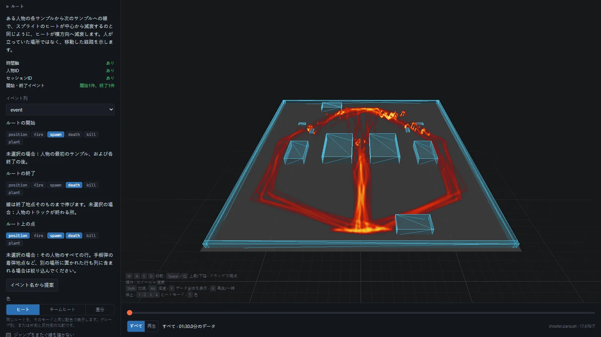

# 線のヒート

ヒートは、人がどこに立っていたかを示します。ラインは、人が歩いた経路を示します。

**ライン** (キー 4) は線のヒートです。[人物](glossary.md) の各サンプルから次のサンプルへの線を引き、[スプライト](glossary.md) と同じ減衰で広げます。点の周りではなく、線を横切る形です。人がどこに *行ったか* を示し、どこに *とどまったか* ではありません。1 度だけ通った廊下も、そこで陣取った部屋と同じくらい見えます。速いプレイヤーのまばらなサンプルは、点線の跡ではなく、途切れのないルートにつながります。人物の列と時刻の列が必要です。

## 使い方 {#how-to-use-it}

1. `4` を押します (または、モードバーで **ライン** を選びます)。
2. **ルート** を開き、緑のチェックリストを確かめます。時間軸と人物 ID がなければなりません。
3. **イベント名から提案** を押して、ルートの開始と終了を埋めます。
4. 統計の行を読みます: 「N 本のルート、そのうち M 本が終わりに届く」。
5. 線がマップをまたいで飛ぶなら、**最長ステップ** を調整します ([ジャンプの上限](#the-jump-limit) を参照)。

線は、始まりと終わりの間でのみ意味を持つので、**ルート** パネルは、ルートを何で区切るかを示します。[ルートの規則](#the-rules-of-a-route) からあとは、読み飛ばしてもかまわない詳細です。

## ルートパネル {#the-routes-panel}

ライン モードでは、ヒートのパネルの上に表示されます。

### データにあるもの {#what-the-data-has}

チェックリストです。あれば緑、なければ琥珀色になります。

| 項目 | 状態 |
|---|---|
| **時間軸** | *あり* / *ありません - 必要* |
| **人物 ID** | *あり* / *ありません - 必要* |
| **セッション ID** | *あり* / *なし - すべての行が 1 つのセッション* |
| **開始と終了のイベント** | *N 個の開始、M 個の終了* / *選ばれていない - 全体の軌跡* (イベントの列があり、開始と終了が少なくとも 1 つずつあるときだけ緑) |

### 操作 {#controls}

| 操作 | 意味 |
|---|---|
| **イベントの列** | 値がイベント (出現、死亡、位置など) であるカテゴリの列。*なし - 全体の軌跡*: 各セッションの各人物の軌跡が 1 本のルートになり、軌跡に隙間があるところで切れます。読み込み時にフィルター用に残した列だけが候補になります。 |
| **ルートの開始** | ルートを始める値 (出現、リスポーン、降下)。何も選ばれていなければ、ルートは人物の最初のサンプルから始まり、各終了の後にまた始まります。 |
| **ルートの終了** | ルートを終わらせる値 (死亡、脱出、テレポート)。線は終わりの行そのものまで伸びます。何も選ばれていなければ、ルートは人物の軌跡が終わるところで終わります。 |
| **ルート上の点** | 行がルートに沿って並ぶ値。何も選ばれていなければ、その人物のすべての行です。同じ列に、ほかの場所に置かれた行 (手榴弾が落ちた場所など) も入っている場合は、絞り込んでください。 |
| **イベント名から提案** | 値の名前から、3 つの一覧を埋めます (下を参照)。 |
| **色** | *ヒート*、*チームのヒート*、または *差分*。同じルートを、そのモードの色分けで描きます。各グループは独自の色相で、または一方を他方と比べて、グループの一覧、分割、色の範囲は、それらのモードと同じように働きます。既定は *ヒート*。チームのヒートと差分にはグループの列が必要です。 |
| **ジャンプをまたぐ線を描かない** / **最長ステップ** | ある人物の次のサンプルが、これより遠いと、それはリスポーン、テレポート、落下であり、人物が行った場所ではありません。そのため、2 点を結ぶ線は引かれません。データに明確な隙間があれば読み込み時に設定され、なければ off です (下を参照)。イベントの列の有無にかかわらず働きます。 |
| 統計の行 | `N 本のルート、そのうち M 本が終わりに届く、K 個のセグメント`。1 秒に数回更新されます。 |

各一覧は、値ごとに 1 つのトグルチップの並びです。最も頻繁なものが先頭です。チップにカーソルを合わせると、その行数が出ます。表示されるのは最大 120 の値です (*ほか N 個の値は表示されていません*)。

別のイベントの列を選ぶと、提案がその同じ列を選んでいる場合は、その提案が適用されます。そうでない場合は、一覧が空の状態で始まります。

### 提案 {#the-suggestion}

読み込みのたびに、また **イベント名から提案** を押すと ([`suggestLineSettings`](https://github.com/Holdi601/3DHeat/blob/main/src/data/lines.ts))、次のようになります。

- **イベントの列:** フィルター用に残されたカテゴリ列のうち、最初に `event`、`eventname`、`eventtype` という名前のもの。なければ `kind`、`type`、`action`。それもなければ、*event*、*kind*、*action*、*type* を含む名前のもの。
- **開始:** *spawn、deploy、join、enter、start、begin、respawn、revive、land/landed/landing、drop* を含む値。ただし、終わりの語も含むものは除きます。
- **終了:** *death、died、dead、kill/killed、eliminat…、extract、evac、teleport、leave、left、disconnect、quit、exit、end、finish、downed* を含む値。ただし、値 `kill` と `kills` は除きます (撃破は、撃破者が行うことであって、そのルートの終わりではありません)。
- **点:** ちょうど *position、location、player location、move、movement、tick、sample* または *pos* である値。見つかった場合、開始と終了も点に加えられます。何も見つからなければ、点は空のままです (すべての行)。

### ジャンプの上限 {#the-jump-limit}

人がジャンプするところでは、歩幅の長さは 2 つの群に分かれ、その間にはほとんど何もありません。1 つは、2 つのサンプルの間に人物が進む距離、もう 1 つは地図の幅です。読み込み時 ([`suggestMaxJump`](https://github.com/Holdi601/3DHeat/blob/main/src/data/lines.ts))、歩幅は二乗した長さの倍ごとに数えられます (最大 1,600 万)。上限は、中央値より上にあり、長さが少なくとも 1 倍の幅を持ち、ビンごとに歩幅の 0.02% 未満しか含まず、その先に歩幅がある最初の範囲の真ん中に置かれます。そのような範囲がなければ、何も切られません。ジャンプと速い車の区別がつかないからです。そのとき手で上限をオンにすると、データの対角線の 10 分の 1 から始まります。

上限の上にあるグラフは、歩幅が実際にどれくらい長いかを示し、上限に線が引かれます。その右にあるバーは描かれません。ジャンプは歩幅の 100 分の 1 ほどの数で、長さは 1,000 倍にもなりうるので、両方の軸は対数です。バーにカーソルを合わせると、その範囲と割合が出ます。グラフをクリックすると、上限をそこに置きます。その下には、上限を超える歩幅の割合が出ます。

## ルートの規則 {#the-rules-of-a-route}

行は、人物ごとに、時刻順にたどられます ([`buildLines`](https://github.com/Holdi601/3DHeat/blob/main/src/data/lines.ts))。

1. [共有された名前](sessions-persons-groups.md#names-worn-by-several-things-at-once) の行は、完全に飛ばされます。
2. 点が選ばれているとき、開始でも終了でも点でもない行は飛ばされます。
3. 行は、人物ごと、セッションごとにたどられます。そのため、セッションが時刻順に入り組んでいる人物は、それぞれのセッションに 1 本のルートを持ちます。前の行に後続がなかったとき (その [生存期間](sessions-persons-groups.md#person) が「なし」) にルートは閉じられます。ルートは、セッションの境界や、読み込みが次のサンプルがないと判断した隙間をまたぐことは決してありません。ある行がどのルートに属するかは一度だけ計算されて保たれます (行あたり 4 バイト)。そのため、最長ステップを変えても、その部分は繰り返されません。
4. **開始** の行は、開いているルートをすべて閉じ、そこで新しいルートを開きます。
5. 開始が選ばれているとき、ルートの外の行は無視されます。開始が選ばれていなければ、ルートの外にある終了でない行は、どれもルートを開きます。
6. ルート内の、ほかの行は、そのルートの前の行からこの行までの **セグメント** を加えます。
7. ルートを延長する **終了** の行は、そのセグメントの後にルートを閉じます。そのルートは *終わりに届いた* として数えられます。
8. **最長ステップ** より長い歩幅は、ルートをそこで閉じます。新しいルートは遠い端で始まります。ただし、その行が終了の場合は別です。その間には線は描かれず、統計の行はそれを数えます。

各セグメントは、その *終わり* の行に保存されます。そのためセグメントは時刻順のままで、[タイムライン](timeline.md) の窓、サンプラー、[フィルター](filters.md)、グループの表示、差分の符号は、点と同じようにセグメントを扱います。したがって、フィルターはセグメントが終わる行に適用されます。

## 再生 {#playback}

**すべて** モードでは、各ルートがまるごと描かれます。**再生** モードでは、各人物は、そのサンプルの間を動く点で、その背後にルートを描きます。

- 再生ヘッドの後で始まるセグメントは描かれません。
- 人物がその途中にいるセグメントは、補間された位置まで描かれ、先頭に端のキャップが付きます。
- ヒートは **尾** にかけて薄れます。*累積* の履歴では尾は無制限で、それまでのルート全体が残ります。*窓* では *範囲* (既定では 30 秒) にわたって消えていきます。*生存期間* では、尾も *範囲* であり、ライン モードではタイムラインが、その履歴のために *範囲* の箱を表示します (線のヒートが使わない *予備の寿命* と *フェード* の代わりです)。

再生中は、各フレームが蓄積されずに、そのまま描かれます。先頭が毎フレーム動くので、移動平均では、それぞれが線状に滲んでしまうからです。

## 開発者向け {#for-developers}

### メモリ {#memory}

ルートは、ライン モードに入ったとき (またはルートの設定が変わったとき) にメインスレッドで作られ、そこを離れたときに解放されます。メモリでは行あたり 5 バイト、GPU では行あたり 8 バイトです (各セグメントの開始位置。データの境界ボックス内で軸ごとに 16 ビットに量子化され、そのフラグ)。

### 線の描き方 {#how-a-line-is-drawn}

どちらのバックエンドも、各セグメントを、その終わりの行から **18 個の頂点** として描きます ([`lineHeatVs`](https://github.com/Holdi601/3DHeat/blob/main/src/render/webgl2/shaders.ts) と、その WGSL の対応物)。

- 各端の半幅は、その端の距離での [スプライトの半径](sprite-shape.md#sprite-radius) であり、ピクセルの制限が適用されます。2.5 px より細い線は、2.5 px の幅で描かれ、その熱はそれに合わせて小さくされます。そのため、細い線が消えることも、明るくなりすぎることもありません。
- 熱は、線を横切る **方向に** 減衰します。スプライトと同じ傾斜を使います。中心と端の強さも同じです。
- 丸いキャップは、ルートが始まる、または終わる場所 **だけ** に描かれます。そのため、連続するセグメントのつなぎ目が、数珠のような連なりにはなりません。
- ジオメトリは画面空間で作られ、そこで線形に補間されます。そのため、減衰は、奥行きにどう入っていくかに関わらず、線の上で中心に保たれます。近い面をまたぐセグメントは、捨てられるのではなく、そこで切られます。

点のヒートとラインのヒートは、行ごとに置く熱の量がまったく違います。そのため、それらを切り替えるたびに、飽和度は改めて測られます ([色と露出](colour-and-exposure.md#auto-exposure) を参照)。
