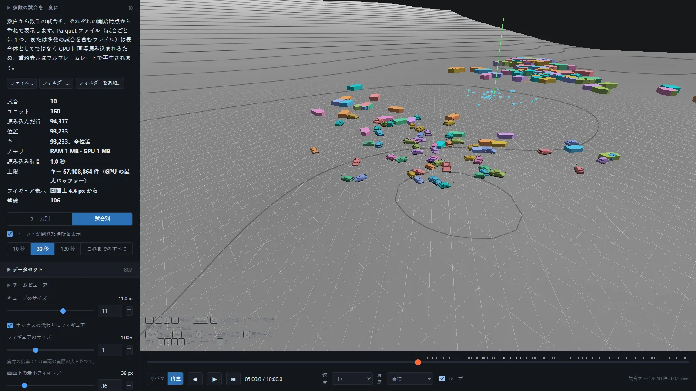

# 多数の試合を一度に

**多数の試合を一度に** は、たくさんの試合を重ねて再生するので、どの試合のプレイヤーも普段どこへ行くかが見えます。数百や数千の試合を 1 つの絵で比べるのに使ってください。

各試合は、それぞれの始まりから始まり、ユニットはフィギュアとして動きます。ファイルはグラフィックカードへ直接送られ、全体の表は作られません。そのため、普通の読み込みではメモリが足りなくなるような場合でも、なめらかに再生できます。

## 使い方 {#how-to-use-it}

1. ヒートのサイドバーで **多数の試合を一度に** を開きます。
2. **ファイル…**（多数のファイルを選ぶ）、**フォルダー…**（フォルダーとそのサブフォルダー）、または **フォルダーを追加…**（読み込み済みのものに追加する）を押します。
3. ビューアーはフィギュアのオーバーレイに切り替わり、始まりから始まります。**再生** を押します。

各ファイルは 1 試合です（または複数の試合を含みます）。Parquet ファイルと [`.3dheat`](container.md) のコンテナーが使えます。ファイルには、位置、時間、ユニットの列が必要です。名前、種類、陣営の列は残されます。ほかのファイル、そして変換ツールの付随ファイル（飛行、メッセージ、イベント、チャット、目標）は読み飛ばされます。通常の表については、[データの取り込み](getting-data-in.md)を参照してください。

## 設定 {#settings}

| 設定 | 働き |
|---|---|
| **チーム別** / **試合別** | 陣営ごとに色を付けるか、試合ごとに色を付けます。 |
| **ユニットが倒れた場所を表示** | ユニットが倒れた場所に印を付けます。10 秒、30 秒、120 秒、またはここまでのすべてを表示できます。 |

パネルには、読み取られた試合、ユニット、行、位置の数、使用したメモリ、読み込みにかかった時間が表示されます。*空き* は、グラフィックカードがあとどれだけの位置を受け入れられるかです。*フィギュアに切り替わる大きさ* は、これより画面上で小さいユニットは、フィギュアではなく小さな矢印で描かれる、その大きさです。

フィギュアの見た目には、[マッチの再生](match-replay.md#figures)と同じ設定を使います。**フィギュアのサイズ**、**画面上の最小フィギュア**、**遠距離表示** です。

## ヒント {#tips}

- すべてをメモリに収められない場合、位置は間引かれます（数メートルごとの位置だけが残ります）。パネルにはそのことが表示されます。
- ヒートのモードは、オーバーレイのデータでも動きます。
- 描かずに、何千もの試合にわたる統計を見たい場合は、[大量分析](mass-analysis.md)を参照してください。
