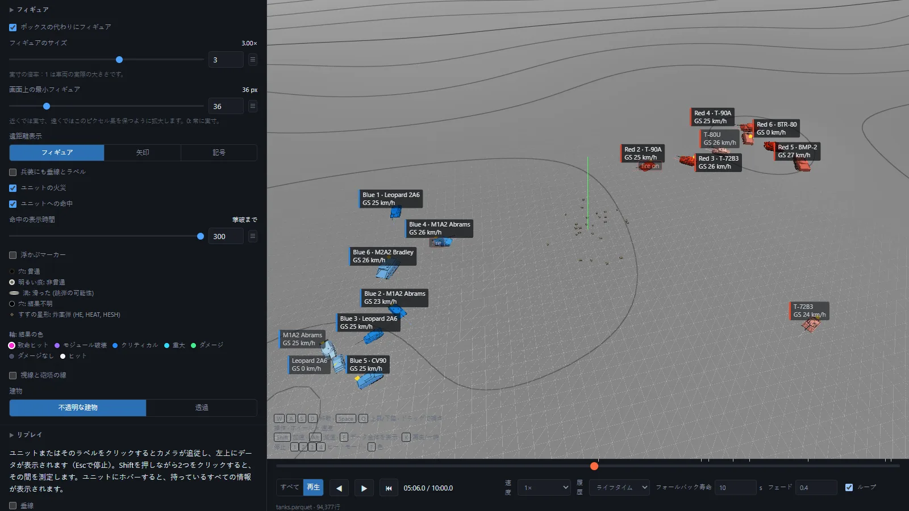
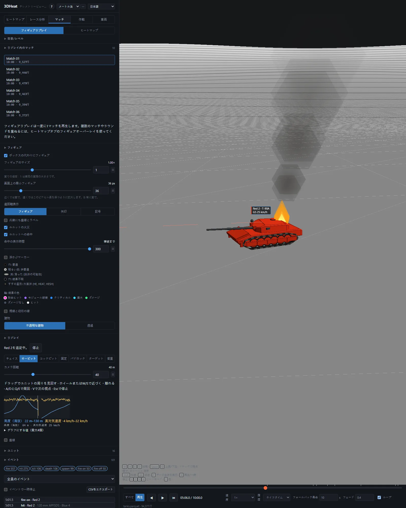
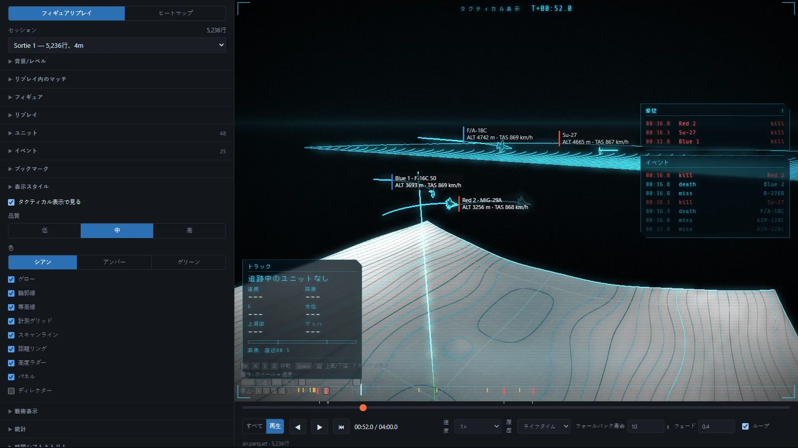
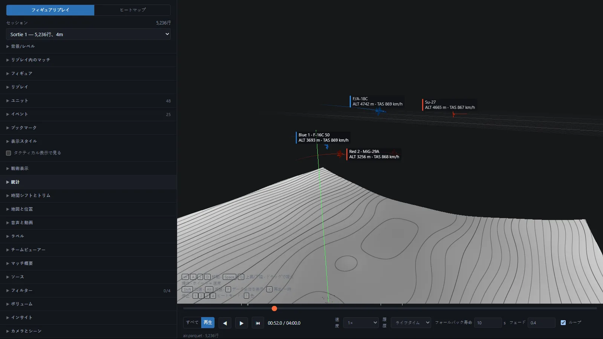

# 試合のリプレイ

リプレイは、試合の映画です。すべてのプレイヤーが、操縦していたものとして描かれます。戦いをもう一度見たり、1つのユニットを追ったり、誰が誰に当てたかを見たりするために使います。

射撃、命中、火災、残骸は、レベル上のユニットと目標に描かれます。カメラ、ラベル、戦術表示が、戦いを読むのに役立ちます。Tacview をご存じですか？ [Tacview との同等性](tacview-parity.md)に、そのツールの各機能がどこにあるかが示されています。

## リプレイを始める {#start-a-replay}

1. **ソース → ファイル…** で記録を読み込むか、ソースパネルへドロップします（**人物**と**時間**の列を持つ任意の表、Tacview のファイル、変換されたリプレイ、[`.3dheat`](container.md) のマッチ）。[データの取り込み](getting-data-in.md)を参照してください。
2. **マッチ** タブを開き、**フィギュアリプレイ** を選ぶか、ヒートマップタブのモードバーで **フィギュアオーバーレイ** を選びます。
3. **リプレイ内のマッチ** で、1つのマッチ、すべて一度に、または複数を選びます。
4. タイムラインの **再生** を押します（または `K`）。タイムラインをドラッグすると飛べます。

名前または種類がわかっているユニットには、箱の代わりにフィギュアが使われます（[フィギュア](figures.md)を参照）。名前や種類の列がないデータは、兵士として描かれます。

## フィギュア {#figures}

| 設定（**フィギュア** のセクション） | 既定値 | 働き |
|---|---|---|
| **箱の代わりにフィギュア** | オン | オフにすると、単純な箱を描きます。 |
| **フィギュアのサイズ**（実際の大きさの倍率） | 1 | 1 は実際の大きさ。0.25 から 20 倍まで（対数の目盛り）。遠くから見るときに大きくすると役立ちます。 |
| **画面上の最小フィギュア** | 36 px | 遠くのフィギュアは、この大きさまで大きくなります。0 から 200 px。0 にすると実際の大きさのままです。 |
| **遠距離表示**：フィギュア、矢印、記号 | フィギュア | 遠くのユニットが何になるか。 |
| **記号体系** | NATO（APP-6） | NATO（APP-6）、ロシアの戦術記号、**ゲームマップ風** のアイコン、または **形のみ（色覚に配慮）**。 |
| **記号サイズ**、**自陣営**、**敵 / 中立**、**針路の線** | 28 px（12 から 64）、自動、敵、オン | 記号の見た目と、どの側が味方かを決めます。 |
| **垂線** | オン | 各ユニットから真下の地面への線。3D で高さが読めるようにします。 |
| **兵装にも垂線とラベル** | オフ | 地面への線と、ミサイルや爆弾のラベル。 |
| **ユニットの火災** | オン | ユニットが燃え始めてから消えるまでの炎。 |
| **ユニットへの命中** | オン | 射撃が当たった場所の印（下を参照）。**命中の表示時間**：1 から 300 秒、または **撃破まで**。**浮かぶマーカー**：表面の上に描かれる印。 |
| **視線と砲塔の線** | オフ | 破線：プレイヤーが見ている方向。実線：砲が向いている方向。 |
| **建物** | 実線 | レベルが描いている場合の、実線または透けた建物。 |

### 遠くの記号 {#symbols-at-a-distance}

ユニットが**画面上の最小フィギュア**より小さくなるとき、読み取れるままの記号になることがあります。形が種類を示し（たとえば、装甲を示す履帯の印の付いた角の丸い箱）、色が側を示します。**記号体系** メニューを開くと、その様式を変えられます。

### 命中の印、残骸、火災 {#hit-marks-wrecks-and-fires}

- **命中の印** は、射撃が当たった表面に、フィギュアの縮尺で置かれます。見た目が何が起きたかを示します。穴（貫通した）、明るい飛沫（貫通しなかった）、えぐれ（かすった）、すすの星（爆発性の弾）。色のついたリングは、何をしたかを示します。撃破の射撃、モジュール破壊、致命的、重大、ダメージ、ダメージなし、命中。印の上にマウスを置くと、弾の名前が出ます。
- 破壊されたユニットは、撃破された時点から、リスポーンするか取り除かれるまで、**焦げた**残骸として描かれます。その記号には×印が付きます。
- **火災** は、ユニットが燃え始めてから消えるまで燃えます。
- **砲塔** は、データが砲の向きとして示す方向へ回ります（そのデータがなければ、プレイヤーが見ている方向へ）。

### 兵装、デコイ、曳光弾 {#weapons-decoys-and-tracers}

（チームビューアーのセクションの）**武器・射撃・命中** がオンのとき、ミサイル、ロケット、爆弾、魚雷は、煙の軌跡を伴う独自のフィギュアとして飛びます。弾丸と砲弾は曳光弾です。着弾と爆発は閃光を放ちます。**破線**で描かれた曳光弾は、データに射撃がなかったため、命中から推定されたものです。フレアとチャフはデコイとして描かれます。*デコイと砲弾* にチェックが入っていない限り、ユニットの一覧からは隠されています。

## カメラ {#cameras}

ユニットまたはそのラベルをクリックすると、それを**追跡**します。**リプレイ** のセクションには、**チェイス**、**オービット**、**コックピット**（ヘッドアップディスプレイ付き、`H`）、**固定**、**パドロック**、**ターゲット**、**衛星** があります。`V` で順に切り替えます。**カメラ距離** は、どれだけ離れるかを設定します。Esc で止まります。

- **2ユニットの表示**：**ターゲット** を選ぶ（または Ctrl / Alt を押しながらユニットをクリックする）と、追跡しているユニットからそれを見られます。**入れ替え** は両者を入れ替えます。
- **計測**：Shift を押しながら2つのユニットをクリックすると、その間の方位、距離、高度の差がわかります。
- **2Dマップ**（`M`）：隅または全体の表示。軌跡と名前付き。
- **ブックマーク**（`B`）：その瞬間とカメラを保存します。記録自身の撃破、死亡、印も一覧されます。
- **イベント**：時間順のすべてのイベント。クリックするとそこへ飛びます。`Page Up` / `Page Down` でイベント間を移動します。**イベントで一時停止** は、各イベントで止まります。

## 戦術表示 {#tactical-display}

**戦術表示** のセクションは、ユニットに関係なく、選んだもの、すべて、または1種類（航空機、地上、艦船、兵装）について描きます。速度ベクトルと先の経路、機首と揚力の線、レーダーの円錐、ロック、データリンク、交戦の範囲と線、見通し線、プレイヤーが見ている方向（視界の円錐）、砲塔の照準、記録されたカメラです。

### 表示の様式 {#display-style}

`T`（または **タクティカル表示で見る** のスイッチ）で、見た目はレーダー画面の様式に切り替わります。光彩、輪郭、等高線、計測の格子、走査線、距離の輪、高度の目盛り、撃破とイベントのパネル、そして、自分でイベントへカメラを動かす**ディレクター**があります。

## 目標 {#objectives}

マッチに目標が付いてくる場合、**目標** のセクションが、それらをレベル上に描きます。占領地点（所有者と占領の進み具合付き）、スポーン、飛行場、エリア、爆撃の目標です。各レイヤーは切り替えられ、ラベルが付きます。それらは地面を通して見えます。複数のゲームモードを読み込んでいる場合、**モード** でマッチをモード別に絞り込めます。目標は、記録の横にある変換ツールのマッチのファイル、または [`.3dheat`](container.md) の中から来ます。

## ラベルと統計 {#labels-and-statistics}

- **ラベル**：種類ごとの規則（**選択中**、**航空機**、**地上**、**艦船**、**兵装**、**AI**）。表示するかどうか、どの値か、ラベルが重なったときに誰がその場所を得るかの **優先度**。**ラベルを重ねない** は、ラベルが別のものを覆う場合に、ユニットの横へ動かし、場所がない場合は省きます。**ラベルサイズ** は 60 から 250 %。**名前、機体・車両、高度、速度に戻す** は規則をリセットします。
  - 地上ユニットは、名前、車両、速度から始まります。
  - 航空機は、名前、車両、高度、速度から始まります。
  - 艦船は、名前、車両、速度、針路から始まります。
  - ユニットの上にマウスを置くと、そのすべての値が見られます。
- **統計**：チームとユニットごと：撃破、死亡、射撃、命中、命中率、離陸、着陸、空中にいた時間、最高速度、高度と G、距離。CSV 書き出し。
- **グラフ**：ユニットの値の時間変化、2つのユニットの比較、または1つの値と別の値の比較。

## 多数の試合を一度に {#many-matches-at-once}

何百、何千ものマッチを重ねるには、[多数の試合を一度に](many-matches.md)を参照してください。フィギュアの詳細（煙、火災、その他の時間のあるエフェクト）：[フィギュアオーバーレイ内のフィギュア](figure-replay.md)。Tacview の機能一覧：[Tacview との同等性](tacview-parity.md)。このページの下位ページです。
