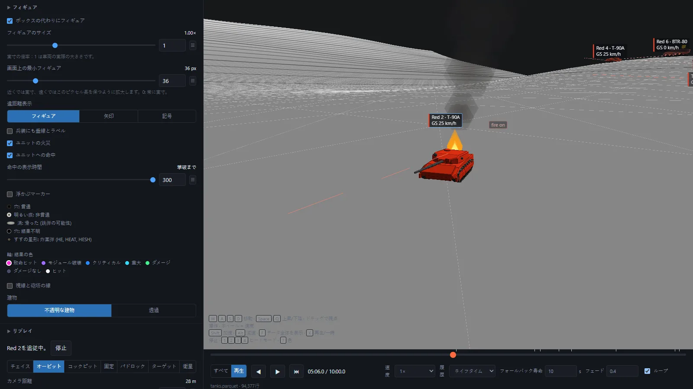
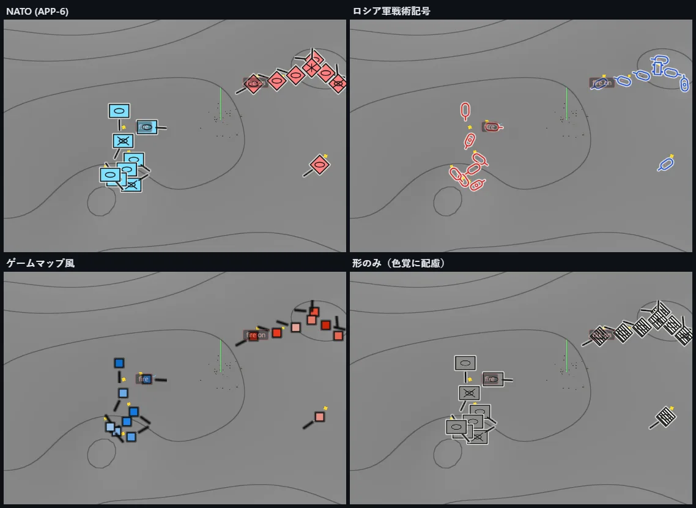

# 試合のリプレイ

リプレイは、試合の映画です。すべてのプレイヤーが、操縦していたもののフィギュアとして描かれます。戦闘をもう一度見たり、1つのユニットを追ったり、誰が誰に命中させたかを見たりするのに使います。

射撃、命中、発火、撃破は、レベル上のユニットと目標の上に描かれます。カメラ、ラベル、戦術表示が、戦闘を読むのを助けます。Tacview をご存じですか？ [Tacview との同等性](tacview-parity.md)では、そのツールのそれぞれがどこにあるかを示しています。

## リプレイを始める {#start-a-replay}

1. **ソース → ファイル…** で記録を読み込むか、ソースのパネルにドロップします（**人物** と **時間** の列を持つ任意の表、Tacview のファイル、変換されたリプレイ、[`.3dheat`](container.md) の試合）。[データの取り込み](getting-data-in.md)を参照してください。
2. **マッチ** タブを開き、**フィギュアリプレイ** を選ぶか、ヒートタブのモードバーで **フィギュアオーバーレイ** を選びます。
3. **リプレイ内のマッチ** で、1つのマッチを選ぶか、すべてを一度に選ぶか、いくつかを選びます。
4. タイムラインの **再生**（または `K`）を押します。タイムラインをドラッグすると飛べます。

名前または種類が分かっているすべてのユニットは、ボックスの代わりにフィギュアになります（[フィギュア](figures.md)を参照）。名前や種類の列がないデータは、兵士として描かれます。

## フィギュア {#figures}

| 設定（**フィギュア**のセクション） | 既定値 | 働き |
|---|---|---|
| **ボックスの代わりにフィギュア** | オン | オフにすると、単純なボックスを描きます。 |
| **フィギュアのサイズ**（実物大の倍率） | 1 | 1 は実物大です。0.25〜20 倍（対数）。遠くからは大きい方が見やすいです。 |
| **画面上の最小フィギュア** | 36 px | 遠くのフィギュアは、この長さを保つように大きくなります。0〜200 px。0 は実物大を保ちます。 |
| **遠距離表示**: フィギュア、矢印、記号 | フィギュア | 遠いユニットが何になるか。 |
| **記号体系** | NATO (APP-6) | NATO (APP-6)、ロシアの戦術記号、**ゲームマップ風** のアイコン、または **形のみ（色覚に配慮）**。 |
| **記号サイズ**、**自陣営**、**敵 / 中立**、**針路の線** | 28 px（12〜64）、自動、敵、オン | 記号の見た目と、どちらの側が味方か。 |
| **垂線** | オン | 各ユニットから地面まで真下に伸びる線。高さが3Dで読めます。 |
| **兵装にも垂線とラベル** | オフ | 地面への線と、ミサイルや爆弾のラベル。 |
| **ユニットの火災** | オン | ユニットが燃え始めてから消えるまでの炎。 |
| **ユニットへの命中** | オン | 射撃が命中した場所の印（下記）。**命中の表示時間**: 1〜300 秒、または **撃破まで**。**浮かぶマーカー**: 表面より上に描かれる印。 |
| **視線と砲塔の線** | オフ | 破線: プレイヤーが見ている先。実線: 砲が向いている先。 |
| **建物** | 実体 | レベルが描く場合、建物を実体にするか、透けて見えるようにするか。 |

### 遠距離の記号 {#symbols-at-a-distance}

ユニットが**画面上の最小フィギュア**より小さくなる場合、読みやすいまま残る記号に変わることがあります。形が種類を示します（例: 装甲車には履帯の印が付いた角の丸いボックス）。色が陣営を示します。**記号体系**のメニューを開くと、スタイルを変えられます。

### 命中の印、撃破、火災 {#hit-marks-wrecks-and-fires}

- **ヒットマーク**は、射撃が当たった表面の上に、フィギュアの縮尺で置かれます。その見た目が何が起きたかを示します: 穴（貫通した）、明るい飛沫（貫通しなかった）、削れた跡（滑った）、すす の星（爆発性の弾）。色の付いたリングが、その効果を示します: とどめ、モジュール破壊、致命的、重大、ダメージ、ダメージなし、命中。印にポイントすると、そのラウンドの名前が表示されます。
- 破壊されたユニットは、死亡からリスポーンまたは削除までの間、残骸として**焦げた**状態で描かれます。その記号には斜線が入ります。
- **火災**は、ユニットが燃え始めてから消えるまで燃えます。
- **砲塔**は、データが示す砲の向きに回ります（その情報がなければ、プレイヤーが見ている方向に回ります）。

### 武器、囮、曳光弾 {#weapons-decoys-and-tracers}

**武器・射撃・命中**がオン（チームビューアーのセクション）の場合: ミサイル、ロケット、爆弾、魚雷は、煙の軌跡を伴う独自のフィギュアとして飛びます。弾丸と砲弾は曳光弾になります。着弾と爆発は閃光を放ちます。命中から推定された曳光弾は**破線**で描かれます。データに射撃がなかったためです。フレアとチャフは囮として描かれます。*囮と砲弾* にチェックが入っていない限り、ユニット一覧からは隠されます。

## カメラ {#cameras}

ユニットまたはそのラベルをクリックして**追従**させます。**リプレイ**のセクションには、**チェイス**、**オービット**、**コックピット**（ヘッドアップディスプレイ付き、`H`）、**固定**、**パドロック**、**ターゲット**、**衛星** があります。`V` で順番に切り替え、**カメラ距離** で距離を設定します。Esc で止まります。

- **2ユニット表示**: **ターゲット** を選ぶ（または Ctrl/Alt を押しながらユニットをクリック）と、追従しているユニットから見ます。**入れ替え** で互いを入れ替えます。
- **指標**: 2つのユニットを Shift+クリックすると、その間の方位、距離、高度差が分かります。
- **2Dマップ**（`M`）: 隅または全体表示。軌跡と名前付き。
- **ブックマーク**（`B`）: その瞬間とカメラを保存します。記録自身のキル、死亡、印も一覧に入ります。
- **イベント**: すべてのイベントを時間順に表示します。クリックするとそこへ飛びます。`Page Up` / `Page Down` でイベント間を移動します。**イベントで一時停止**を使うと、各イベントで止まります。

## 戦術表示 {#tactical-display}

**戦術表示**のセクションは、ユニットを1つも選ばないか、選んだもの、すべて、または1つの種類（航空機、地上、艦船、兵装）について、次のものを描きます: 速度ベクトルと先の経路、機首とリフトの線、レーダーの円錐、ロック、データリンク、交戦区域と交戦線、見通し線、プレイヤーが見ている先（視界の円錐）、砲塔の照準、記録されたカメラ。

### 表示のスタイル {#display-style}

`T`（または **タクティカル表示で見る** の切り替え）で、見た目をレーダー画面のスタイルに切り替えます。光彩、輪郭、等高線、計測グリッド、走査線、距離のリング、高度のはしご、キルとイベントのパネル、そして、自分でイベントへカメラを動かす**ディレクター**があります。

## 目標 {#objectives}

試合に目標が付いてくる場合、**目標**のセクションがそれらをレベル上に描きます: 占拠エリア（所有者と占拠の進行状況付き）、スポーン、飛行場、エリア、爆撃目標。各レイヤーは切り替えられ、ラベルが付きます。目標は地面を通して見えます。複数のゲームモードが読み込まれている場合、**モード**でマッチをモードごとに絞り込みます。目標は、記録の横にあるコンバーターのマッチファイル、または [`.3dheat`](container.md) コンテナーの中から来ます。

## ラベルと統計 {#labels-and-statistics}

- **ラベル**: 種類ごとのルール（**選択中**、**航空機**、**地上**、**艦船**、**兵装**、**AI**）: 表示するかどうか、どの値か、そしてラベルが重なったときに、誰が場所を得るかの**優先度**。**ラベルを重ねない**は、ラベルが別のものを覆う場合に、そのユニットの横へ移動させ、場所がない場合は省きます。**ラベルサイズ**は 60〜250%。**名前、機体・車両、高度、速度に戻す**は、ルールを既定に戻します。
  - 地上ユニットは、名前、車両、速度で始まります。
  - 航空機は、名前、機体、高度、速度で始まります。
  - 艦船は、名前、艦種、速度、針路で始まります。
  - ユニットにポイントすると、その持つすべての値が見えます。
- **統計**: 組とユニットごとに、キル、死亡、射撃、命中、命中率、離陸、着陸、空中にいた時間、最高速度、高度と G、距離。CSV の書き出し。
- **グラフ**: ユニットの値の時間変化、2つのユニットの比較、または1つの値と別の値の比較。

## 多数のマッチを一度に {#many-matches-at-once}

何百、何千のマッチを重ねるには、[多数のマッチを一度に](many-matches.md)を参照してください。フィギュアの詳細（煙、火災、その他の時間のある効果）は、[フィギュアオーバーレイ内のフィギュア](figure-replay.md)を参照してください。Tacview の機能一覧は、このページの下位ページである [Tacview との同等性](tacview-parity.md)にあります。
