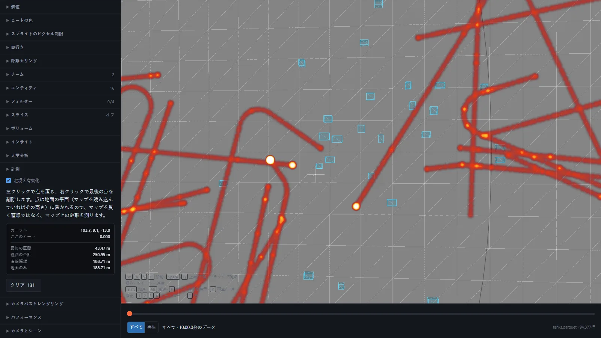

# 指標

**指標** は、マウスを定規に変え、カーソルの下の場所がどれだけ混み合っているかを教えます。2 つの場所がどれだけ離れているか、または 1 か所にどれだけ交通があったかを知るのに使ってください。

## 試してみる {#try-it}

1. サイドバーで **指標** を開き、**定規を有効化** にチェックを入れます。
2. 地図の 3 か所を左クリックします。クリックするたびに点が置かれます。
3. **経路の合計**（経路全体の長さ）と **最後の区間**（最後の区間）を読みます。
4. 右クリックすると最後の点が消えます。**クリア (3)** を押すと、すべて消えます。

| 操作 | 効果 |
|---|---|
| 左クリック | カーソルが地面の平面と交わる場所に点を置きます。押してから離すまでに 4 ピクセルより大きく動いたクリックは、点ではなくカメラのドラッグとして扱われます。 |
| 右クリック | 最後の点を消します。 |
| 移動 | カーソルの位置と、その下のヒートが、リアルタイムで更新されます。 |

定規が有効な間も、カメラは動きます。ドラッグで見回せますし、キーで飛べます。定規が有効な間は、すべてのクリックを定規が受け取るので、[クリックして選ぶ](camera.md#click-to-pick)は、定規を無効にするまで待ちます。

**地面の平面** は、[地図画像](map-images.md)が読み込まれている場合はその標高です。そうでなければ、データセットの最も低い Y になります（地図画像がない場合は 0）。点はその平面に置かれるので、定規は地図を横切る距離を測ります。地図の中を通る線に沿った距離ではありません。3D のレベルの場合も、平面はデータセットの最も低い Y のままで、レベルの表面ではありません。実際の表面上の点が欲しい場合は、定規をオフにしてそこをクリックします（[クリックして選ぶ](camera.md#click-to-pick)）。これは、レベル自身の三角形から座標を読み取ります。

## 表示値 {#readouts}

| 行 | 意味 |
|---|---|
| **カーソル** | 平面上で、カーソルの下の点のワールドの X、Y、Z。 |
| **ここのヒート** | カーソルのピクセルにあるヒートの量。数字が大きいほど、その場所の交通が多いことを示します。飽和点で割られる前に、カラーランプに渡される値です。そのため、[飽和点](colour-and-exposure.md#saturation-point)と比べられます。 |
| **最後の区間** | 最後の点からカーソルまでの距離（または最後の 2 点の間の距離）。 |
| **経路の合計** | すべての点とカーソルを通る折れ線の長さ。 |
| **直線距離** | 最初の点からカーソル（または最後の点）までの 3D の距離。 |
| **地面のみ** | 同じ値を、X と Z だけで計算したもの。 |
| **クリア (N)** | すべての点を消します。 |

距離は、1 単位未満ではセンチメートル、1,000 未満ではメートル、それ以上ではキロメートルで表示されます。ワールドの 1 単位が 1 メートルであると仮定しています（[軸、単位、時間](axes-units-and-time.md#unit-scale)）。座標はワールドの座標です。軸が[表示用に反転](camera.md#invert-world-axis)されている場合も同じです。

点と、その間の線は、ビューの上にオーバーレイとして描かれます。大きさはグリッドの間隔から決まります。定規の点はビューに保存されません。ほかのデータを読み込んでも残ります。

## 開発者向け {#for-developers}

**ここのヒート** は、GPU から最大で 120 ミリ秒ごとに読み取られます。1 ピクセルの読み戻しはパイプラインを止めるからです。`engine.readHeatProbe()` と同じ経路を使います。フレームを書き込んだときのゲインで割るので、半精度浮動小数点の累積の経路（`?heat=f16`）でも、32 ビットのターゲットと同じ単位になります（[半精度浮動小数点の累積](half-float-accumulation.md)）。
