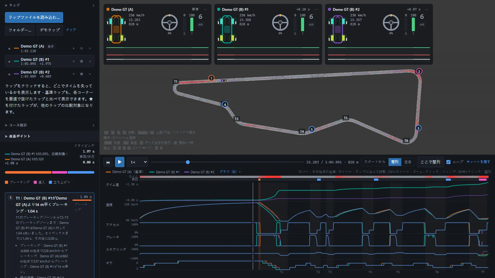

# レース分析

同じコースを 2 回走りました。**レース分析** タブは、両方の走行を一緒に 3D で再生し、どのラップがどこで遅かったかを示し、その理由を教えます。まだラップがありませんか? **デモラップ** を押してください。

このタブは、1 つのコースの 2 つ以上のラップを比べます。キャンバス、カメラ、読み込まれたコースのモデル (**背景/レベル**) は、ヒートマップと共有します。それ以外はすべて独自です。独自のサイドバーと、ビューの下の独自のバーがあります。*ラップ*、*基準*、*頂点* のような言葉は、[用語集](glossary.md) にあります。

このページは、タブの地図です。各部分には、それぞれ独自のページがあります。

| ページ | 扱う内容 |
|---|---|
| [ラップの読み込み](race-loading-laps.md) | すべてのファイル形式、フォルダーとコース、車の名前、デモラップ、ラップの一覧、基準とフォーカス |
| [リプレイとシーン](race-replay-and-scene.md) | 再生のバー、3 つのリプレイモード、車をそろえる、追跡カメラ、線、マップ、車、ラベル、鏡像の世界 |
| [グラフと HUD](race-charts-and-hud.md) | 距離のグラフ、グラフのピッカー、ホバーとズーム、車のカード、チャンネルの表 |
| [車両コントロールのイベント](race-control-events.md) | ロックアップ、ホイールスピン、オーバーステア、スピン、アンダーステア、衝突、クラッシュ、ABS/TC、ハンドブレーキ、空中。それぞれの検出方法と、すべてのしきい値 |
| [コーナーごとの解析](race-corner-analysis.md) | 距離による位置合わせ、コーナーとセグメント、コーナーの時間の内訳、すべての原因と、試される順序、ラインの形、助言 |
| [車両のプロファイルと比較](race-car-profiles.md) | 各車が何ができるか。そのラップから測られる。*車両比較*。各コーナーで車が決めること |
| [コース統計](race-course-statistics.md) | 1 つのコースの多くのラップ: コーナーごと、種類ごとのミス、ミスのマップ、ヒートマップへの書き出し、性能の限界 |
| [レース分析: 方法](race-analytics.md) | ルールの背後にある研究。出典付き |
| [ほかのレースゲーム](other-games.md) | ビューアが各ゲームのラップで何をするか。ゲームが送らないスリップとドリフトの計算、鏡像の世界、追加のチャンネル |

## 画面 {#the-screen}

**サイドバー**、上から下へ (節は折りたためます):

1. **ラップ** - 読み込み、一覧、表示/非表示、基準、フォーカス、追跡。
   [ラップの読み込み](race-loading-laps.md) を参照してください。
2. **コース統計** - 3 つのラップが読み込まれてから表示されます。
   [コース統計](race-course-statistics.md) を参照してください。
3. **改善ポイント** - フォーカスされたラップの発見を、コーナーごとに。
   [コーナーごとの解析](race-corner-analysis.md) を参照してください。
4. **コーナー別** (または、複数のクラスがあるときは *コーナー別 - クラス X*) - 各コーナーで最速のラップとそのライン。2 つ以上のラップで表示されます。
5. **車両コントロール** - フォーカスされたラップのロック、スライド、押し出し、接触。
   [車両コントロールのイベント](race-control-events.md) を参照してください。
6. **車両比較** (または、1 台のときは **車両**) - [車両のプロファイルと比較](race-car-profiles.md) を参照してください。
7. **ビュー** - コースに描かれるマップと、描かれるもの。
   [リプレイとシーン](race-replay-and-scene.md) を参照してください。
8. 共有の **レベル** と **カメラとシーン** のパネル (コースのモデル、軸の反転、カメラ) - ヒートマップと [カメラ](camera.md) で説明しています。

**ビュー** には、コース、走行したライン、マップ、車、コースに留められたラベル、そして左上に最大 6 枚の車のカードが表示されます ([グラフと HUD](race-charts-and-hud.md) を参照)。ラップが読み込まれていないときは、「ラップが読み込まれていません - ここに 2 つ以上のラップのファイルをドロップするか、サイドバーからデモラップを読み込んでください」と表示されます。

**ビューの下のバー** には、リプレイの操作と、隠されていなければ距離のグラフがあります。

## クイックスタート {#quick-start}

1. **レース分析** タブを開きます (サイドバーの上端の **ヒートマップ** の隣)。
2. ラップを入れます。**デモラップ** を押すと、このタブが 3 つの作られたラップで何をするかを見られます。自分のラップの場合は、まず記録します ([ファイル形式と記録ツール](race-loading-laps.md#file-formats))。それから **ラップファイルを読み込む…** または **フォルダー…** を押すか、ビューにファイルやフォルダーをドロップします。
3. 最速の完走ラップが基準になり、ほかの中で最も遅いラップがフォーカスされます。一覧の任意のラップをクリックするとフォーカスされ、★ を押すとそのラップが基準になります。
4. **改善ポイント** を読みます。発見をクリックします。その 40 m 前で車がそろえられ、カメラがそれを囲み、リプレイがそこを通って再生され、測定値が開きます。
5. グラフにホバーすると、すべての車がそのメートルへ動きます。Shift+クリックでその場所にそろえます。

## キー {#keyboard}

レースのタブが開いている間:

| キー | 働き |
|---|---|
| **K** | リプレイの再生と一時停止 |
| **Home** | リプレイの先頭へ戻る |
| 数字キー | 何もしない (ヒートマップではモードを切り替えます) |

テキスト欄やドロップダウンに入力したキーは無視されます。カメラのキーはヒートマップと同じように働きます (**W A S D**、**Space** で上、**Q** で下、**Shift** で速く、**Alt** で遅く、マウスで見回す。すべて [カメラ](camera.md) にあります)。**F** は読み込まれたラップに合わせます (ラップの読み込みと同じように)。

## 多くのラップ {#many-laps}

- 読み込まれたすべてのラップが解析され、数えられます。数十なら 1、2 秒かかります。
- **8** を超えるラップ (`SHOW_ALL_UP_TO`) では、追加されたラップは、基準、フォーカスされたラップ、またはフォーカスされたラップのクラスで最良のラップのときだけ描かれます。*すべて表示* と *注目中のみ* で切り替えます。
- **10** を超える表示された車 (`PLAIN_PAST`) では、注目されていないラップ (フォーカス、追いかけている車、基準ではないもの) は、1.5 m ごとではなく 6 m ごとに点まで細くした線で、車は素のまま描かれます。
- グラフは最大 **8** のラップを描き、HUD は最大 **6** のカードを表示します。
- コース統計は **3** ラップから表示されます。

詳しくは: [コース統計](race-course-statistics.md#performance-with-many-laps)。

## 既定のビューの設定 {#default-view-settings}

| 設定 | 既定 |
|---|---|
| マップ | 時間のマップ |
| 走行したライン、車、タイヤとサスペンション、ラベル、ラップからのトラック | オン |
| カードのすべての値 | オフ |
| 車の大きさ | 1 倍 |
| グラフ | 表示 |
| リプレイモード | ラインから |
| リプレイの速度 | 1 倍 |
| ループ | オン |

これらはどれも保存されません。再読み込みすると、既定から始まります。ブラウザに覚えられるのは、言語と、ラップのファイルから覚えた車の名前です ([ラップの読み込み](race-loading-laps.md#car-names) を参照)。

## 開発者向け {#for-developers}

### ラップが読み込まれたときに起きること {#what-happens-when-laps-are-loaded}

ラップの集合、基準、または言語が変わるたびに、解析全体がやり直されます ([`src/race/analysis.ts`](https://github.com/Holdi601/3DHeat/blob/main/src/race/analysis.ts) の `analyse`)。

1. ゲームが送らない場所では、派生のチャンネルが各ラップに加えられます。ドリフト角、車輪の速度からのホイールのスリップ、空中、ゆるい地面、ヨー角速度です ([`derive.ts`](https://github.com/Holdi601/3DHeat/blob/main/src/race/derive.ts))。
2. 基準が選ばれ、すべてのラップがその経路に投影され、2 m ごとに再サンプリングされます ([`align.ts`](https://github.com/Holdi601/3DHeat/blob/main/src/race/align.ts))。
3. ゲームの世界が鏡像かどうかは、ラップから割り出されます ([`handedness.ts`](https://github.com/Holdi601/3DHeat/blob/main/src/race/handedness.ts))。
4. コーナーは基準の上で見つけられ、ある制動区間から次までのセグメントにまとめられます ([`segments.ts`](https://github.com/Holdi601/3DHeat/blob/main/src/race/segments.ts))。
5. 車ごとに: その包絡線 (速度ごとのグリップ、制動、加速)、そのプロファイル、そのタイヤの曲線 ([`envelope.ts`](https://github.com/Holdi601/3DHeat/blob/main/src/race/envelope.ts)、[`profile.ts`](https://github.com/Holdi601/3DHeat/blob/main/src/race/profile.ts)、[`control.ts`](https://github.com/Holdi601/3DHeat/blob/main/src/race/control.ts))。
6. ラップとセグメントごとに: 何をしたか (ブレーキ地点、最も遅い点、全開など) と、走ったライン ([`line.ts`](https://github.com/Holdi601/3DHeat/blob/main/src/race/line.ts))。
7. ラップごとに: その車両コントロールのイベント。それぞれ、そこで比べられるラップに重ねられます。
8. ラップとセグメントごとに: 比較するラップに対する時間の内訳と、言葉での発見。
9. ラップごとの時間のマップと原因のマップ。

テキストは現在の言語で作られます。言語を切り替えると解析がもう一度走ります (そしてデモラップの名前も変わります)。解析の失敗は、**ラップ** のボタンの下にエラーとして表示され、ラップは読み込まれたままです。

### ソースファイル {#source-files}

| ファイル | 役割 |
|---|---|
| `src/race/adapters.ts`、`ibt.ts` | ラップのファイルの読み込み |
| `src/race/lap.ts`、`carNames.ts`、`synthetic.ts` | ラップの型、名付け、デモラップ |
| `src/race/derive.ts`、`handedness.ts` | 派生のチャンネル、鏡像の世界 |
| `src/race/align.ts`、`segments.ts`、`line.ts` | 距離の軸、コーナー、ライン |
| `src/race/analysis.ts` | 比べられたコーナー、原因、発見 |
| `src/race/envelope.ts`、`profile.ts` | 車が何をできるか |
| `src/race/control.ts`、`impacts.ts` | 車両コントロール、衝突とクラッシュ |
| `src/race/stats.ts` | 多くのラップ |
| `src/race/replay.ts`、`scene.ts`、`glyph.ts`、`geometry.ts` | リプレイと描画 |
| `src/race/schema.ts`、`graphs.ts` | チャンネルの表、グラフの行 |
| `src/ui/race/*` | サイドバー、グラフ、HUD、ラベル |
| `src/state/raceStore.ts` | タブの状態とリプレイの時計 |
