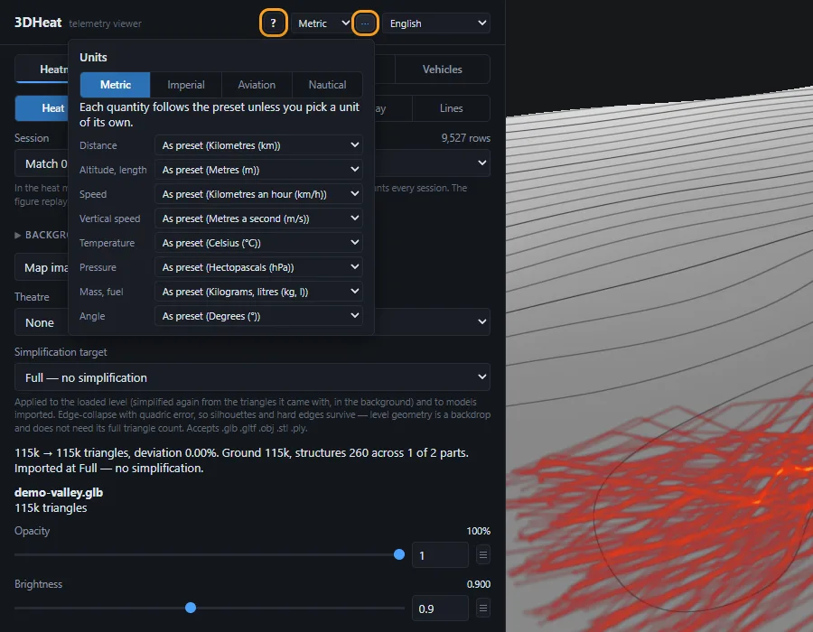

# 設定、単位、キー

サイドバーの上部にある小さな操作は、ビューアがあなたへの話し方を変えます。言語、単位（メートルまたはフィート、km/h またはノット）、そして色の意味を説明するヘルプモードです。選んだものは、あなたのブラウザーに覚えられます。

## ヘッダー {#the-header}

サイドバーの上部：

| 操作 | 働き |
|---|---|
| **?** | ヘルプモード：すべての色が何を意味するか（`?` または `F1` でも） |
| **単位** のメニュー | メートル法、ヤード・ポンド法、航空、または海里 |
| **単位** の横の **...** ボタン | 「各量の単位を選ぶ」を開きます。量ごとに1つのドロップダウン |
| **言語** のメニュー | ビューアの言語：[40 の言語](languages.md)、またはブラウザーの言語 |

欄に入力する数字は、小数点もカンマも使えます（`0.35` または `0,35`）。ビューアは両方を読み、ビューアの言語の書き方で数字を表示します。

## 単位 {#units}

1. **単位** のメニューでプリセットを選びます。すべての量がいっしょに切り替わります。
2. 1つの量だけを変えるには、その横の **...** ボタンをクリックし、その量の単位を選びます。すると、メニューはプリセットの後ろに `*` を表示します。
3. 設定しなかった量は、プリセットに従います。元に戻すには「プリセットどおり」を選びます。

| 量 | メートル法（既定） | ヤード・ポンド法 | 航空 | 海里 |
|---|---|---|---|---|
| 距離 | km | mi | NM | NM |
| 高度、長さ | m | ft | ft | m |
| 速さ | km/h | mph | kt | kt |
| 垂直の速さ | m/s | ft/min | ft/min | m/s |
| 気温 | °C | °F | °C | °C |
| 気圧 | hPa | inHg | hPa | hPa |
| 質量、燃料 | kg、l | lb、gal | lb、gal | t、m³ |
| 角度 | 度 | 度 | 度 | 度 |

1つの量について選べるほかの単位：距離は km、mi、NM。速さは km/h、m/s、kt、mph。垂直の速さは m/s、ft/min、m/min。気温は °C、°F、K。気圧は hPa、inHg、mmHg、psi。質量は kg、lb、t。角度は度、または NATO のミル（円の一周が 6400）。単位はビューアのどこでも同じです。ラベル、カード、グラフ、統計のすべてです。

## ヘルプモード {#help-mode}

`?` または `F1` を押すか、**?** ボタンをクリックします。**色の意味** が表示されます。3D ビューの凡例、ヒートのランプ、チームの色、レベルの色、パネルの状態の色、マッチのパネル、レースのビューです。オフにするまで続きます。マッチタブでは、マッチのパネルの色も説明します。

## ブラウザーが覚えること {#what-the-browser-remembers}

これらの設定は、訪問をまたいでブラウザーに保存されます（どこにも送られません）：

- 言語、単位、ヘルプモード。
- リプレイのフィギュア、記号、ラベル、カメラ、戦術表示の設定。
- 再生の速さと鏡写し。
- 記録ごとのブックマーク、データセットごとのボリューム、目標のレイヤー。
- 外部 AI の設定（*覚える* にチェックを入れた場合だけキー）。

ヒートの設定、フィルター、モードは、読み込むたびに新しく始まります。生成された全一覧は[保存された設定](ref-settings-storage.md)にあります。

## ビューアがブラウザーから保持するキー {#keys-the-viewer-keeps-from-the-browser}

データの多いセッションは読み込みに時間がかかるので、ビューアは、ブラウザーがうっかり捨ててしまうことを防ぎます：

- 印刷、保存、開く、再読み込み、閉じる、新しいウィンドウを開くような `Ctrl`/`Cmd` + 文字は、テキスト欄の外では何もしません。`F1`、`F3`、`F5`、`F6`、`F7` も何もしません。
- データまたはレベルを読み込んだ状態でタブを閉じたり再読み込みしたりすると、先に確認されます。
- 全画面では、ビューアが使うキー（W、T、N、S、R、P、Q、Esc）をロックするので、ブラウザーがそれらを取ることはありません。

正確な一覧：[ブラウザーのキー](ref-browser-keys.md)。ビューア自身のすべてのキー：[キーボードとマウスのリファレンス](keyboard-reference.md)。
