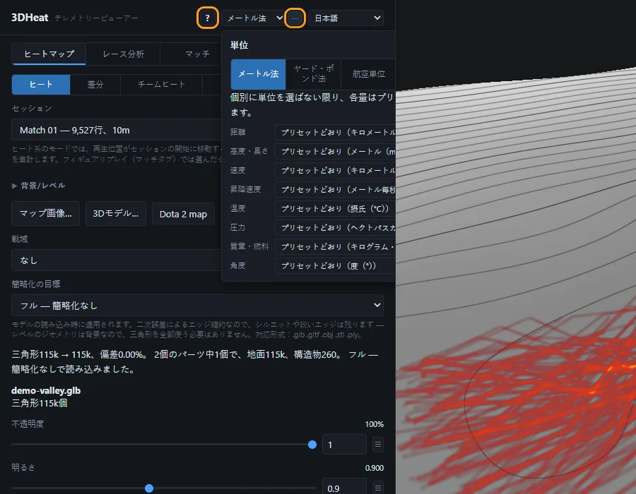
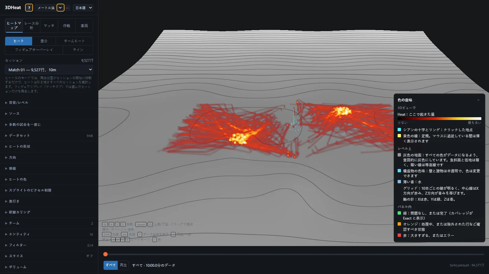
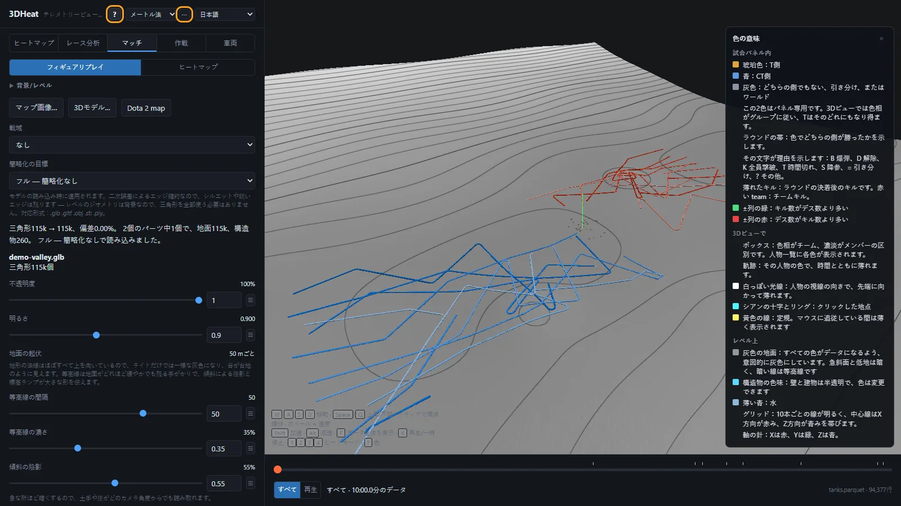

# 設定、単位、キー

サイドバーの上にある小さな操作項目で、ビューアーが話す言葉と単位を変えられます。言語、単位（メートルかフィート、km/h かノット）、色の意味を説明するヘルプモードです。選んだ内容は、ブラウザに記憶されます。

## ヘッダー {#the-header}

サイドバーの上にあります。

| 項目 | 働き |
|---|---|
| **?** | ヘルプモード: どの色が何を意味するか（`?` または `F1` でも開けます） |
| **単位** メニュー | メートル法、ヤードポンド法、航空、海里 |
| **単位** の横の **...** ボタン | 「量ごとに単位を選ぶ」を開きます。量ごとにドロップダウンが1つあります。 |
| **言語** メニュー | ビューアーの言語: [40 の言語](languages.md)、またはブラウザの言語 |

ボックスに入力する数字は、小数点でもカンマでも構いません（`0.35` でも `0,35` でも可）。ビューアーは両方を読み、ビューアーの言語の書き方で数字を表示します。

## 単位 {#units}

1. **単位** メニューでプリセットを選びます。すべての量が一緒に切り替わります。
2. 1つの量だけを変えるには、その横の **...** ボタンを押して、その量の単位を選びます。すると、メニューのプリセットの後ろに `*` が付きます。
3. 設定していない量は、プリセットに従います。元に戻すには「プリセットどおり」を選びます。

| 量 | メートル法（既定） | ヤードポンド法 | 航空 | 海里 |
|---|---|---|---|---|
| 距離 | km | mi | NM | NM |
| 高度、長さ | m | ft | ft | m |
| 速度 | km/h | mph | kt | kt |
| 上昇率 | m/s | ft/min | ft/min | m/s |
| 温度 | °C | °F | °C | °C |
| 気圧 | hPa | inHg | hPa | hPa |
| 質量、燃料 | kg、l | lb、gal | lb、gal | t、m³ |
| 角度 | 度 | 度 | 度 | 度 |

1つの量だけに選べるほかの単位: 距離は km、mi、NM。速度は km/h、m/s、kt、mph。上昇率は m/s、ft/min、m/min。温度は °C、°F、K。気圧は hPa、inHg、mmHg、psi。質量は kg、lb、t。角度は度、または NATO ミル（円の 6400 分の 1）。単位はビューアーのどこでも同じです。ラベル、カード、グラフ、統計がすべて対象です。

## ヘルプモード {#help-mode}

`?` または `F1` を押すか、**?** ボタンを押します。*色の意味* が表示されます。3D ビューの凡例、ヒートのランプ、チームの色、レベルの色、パネルの状態の色、マッチのパネル、レース表示の凡例です。オフにするまで表示されたままです。マッチのタブでは、マッチのパネルの色も説明します。

## ブラウザが覚えること {#what-the-browser-remembers}

次の設定は、訪問の間もブラウザに保存されます（どこにも送信されません）。

- 言語、単位、ヘルプモード
- 再生の表示の設定: フィギュア、記号、ラベル、カメラ、戦術表示
- 再生の速さと反転
- 記録ごとのブックマーク、データセットごとの音量、目標のレイヤー
- 外部の AI の設定（キーは、*覚える* にチェックを入れた場合だけ）

ヒートの設定、フィルター、モードは、読み込むたびに最初から始まります。すべての項目の一覧（自動生成）: [保存される設定](ref-settings-storage.md)。

## ビューアーがブラウザから守るキー {#keys-the-viewer-keeps-from-the-browser}

大きなデータのセッションは読み込みに時間がかかるため、ビューアーはブラウザがそれを誤って捨てないようにします。

- テキストボックスの外では、`Ctrl`/`Cmd` と文字の組み合わせのうち、印刷、保存、開く、再読み込み、閉じる、新しいウィンドウを開く操作は何もしません。`F1`、`F3`、`F5`、`F6`、`F7` も何もしません。
- データやレベルを読み込んだままタブを閉じたり再読み込みしたりすると、確認を求めます。
- 全画面表示では、ビューアーが使うキー（W、T、N、S、R、P、Q、Esc）をロックするため、ブラウザがそれを取ることはありません。

キーの正確な一覧: [ブラウザのキー](ref-browser-keys.md)。ビューアーの操作キーすべて: [キーボードとマウスの一覧](keyboard-reference.md)。
