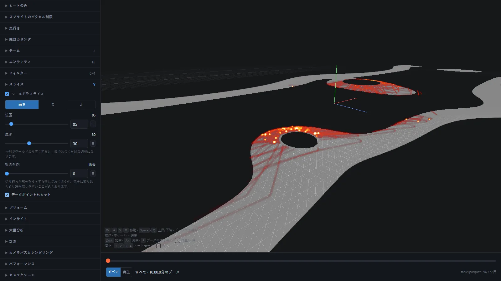

# スライス

**スライス** は、ケーキを切るように、ワールドを切ります。建物の中を見られます。壁が面白いヒートを隠しているときに使ってください。たとえば、建物の 1 つの階を見る場合です。

## 試してみる {#try-it}

1. レベルといくつかのデータを読み込み、**スライス** を開きます。
2. **ワールドをスライス** にチェックを入れます。軸は **高さ** です。
3. **位置** を上下にドラッグします。板がレベルの中を動きます。
4. 間取り図にしたいときは **厚さ** を薄くします。「ここより下のすべて」にしたいときは厚くします。
5. 残りを消すには **板の外側** を 0 のままにします。かすかに残したいときは、値を上げます。



板は **レベルのジオメトリとデータポイントを一緒に** 切ります。レベルだけを切ると、建物があった場所にヒートが浮いたままになってしまいます。これは[奥行きの遮蔽](depth-and-culling.md)の対になる機能です。レベルが後ろにあるものを正しく隠すと、建物の内側も隠れます。切るものがあるとき（データセットか 3D のレベル）にパネルが表示されます。ヘッダーには、オンのときは軸が、オフのときは *off* と表示されます。

```
side view         Position = where the slab is
 ----------       Thickness = how tall the slab is
 | floor 3 |
 |=========|  <--- slab (kept)
 | floor 2 |  <--- outside: removed (or faint)
 | floor 1 |
 ----------
```

## 操作 {#controls}

| 項目 | 既定値 | 意味 |
|---|---|---|
| **ワールドをスライス** | オフ | 板をオンにします。位置が初期値の 0、厚さが初期値の 500 のままのとき、オンにすると、位置は軸の中央に、厚さは軸の範囲の 15% に動きます。 |
| 軸 | **高さ** | *高さ*（Y）、*X*、または *Z*。軸を切り替えると、板は新しい軸の中央に動きます。 |
| **位置** | 中央 | 軸の範囲にわたる板の中心。ワールドの単位で、500 段階です。 |
| **厚さ** | 範囲の 15% | 範囲の 1/500 から範囲の 2 倍まで、対数の段階です。範囲と同じ幅になると、*ワールドの外* と表示されます。片側がワールドの外まで届き、板ではなく単純な切断になります。 |
| **板の外側** | 0、*消す* | 外側にあるものが、どれだけ見えたままになるか。0-100%。切り取られたものをかすかに残すほうが、完全に消すより読みやすいことがよくあります。 |
| **データポイントもカット** | オン | オフにすると、ヒートは全体のまま残るので、切断面を通して見えます。板の上と下にあるものを見るのに便利です。 |

軸の範囲は、3D のレベルが読み込まれていればそのレベルの範囲です。そうでなければ、データセットの範囲です。

スライスは、[距離のカリング](depth-and-culling.md#distance-culling)とは独立しています。距離のカリングはワールドの軸ではなく、視線の方向に沿って切ります。2 つは組み合わさります。スライスの設定を変えると、ヒートの累積がやり直されます。

## 開発者向け {#for-developers}

板は、頂点シェーダーで各行のワールドの位置に対して判定されます。板の外にある行は、その寄与が *外側* の値で掛けられます。そのため、0 のときは、フラグメントが描かれる前に除かれます。レベルのシェーダーは、地面、構造物、水のすべてのフラグメントに、同じ判定を適用します。
