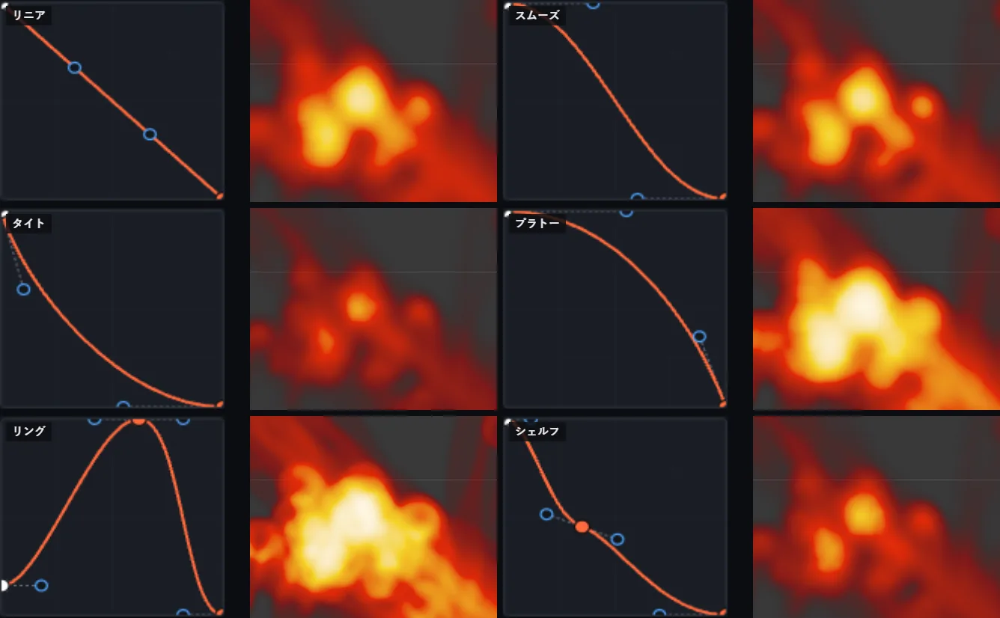

# スプライトの形

各行は、常にカメラを向く丸いスプライトとして描かれます。その大きさと、中心から縁までの輪郭（**ランプ**）によって、ホットスポットが細かい点に見えるか、柔らかい雲、円盤、リングに見えるかが決まります。これらの設定は、サイドバーの **ヒートの形状** と **スプライトのピクセル制限** のセクションにあり、[ヒート](heat.md)、[差分](difference.md)、[チームヒート](team-heat.md)に適用されます。線の半分の幅として[ライン](line-heat.md)にも適用されます。

どれかを変えると、累積は再開します（新しい形でフィールドを描き直す必要があるためです）。

各点は、柔らかい光の塊だと考えてください。小さな塊は1つの点を示します。大きな塊は隣り合うものを混ぜて雲にします。形によって、縁がどれだけ柔らかいかが決まります。



## スプライトの半径 {#sprite-radius}

スプライトの半径は、**ワールドの単位**（メートルと表記）です。既定は6で、読み込むたびに、データの水平方向の広がり ÷ 120 に設定されます。これは、経路に沿った隣り合うサンプルが、細い線ではなく帯として混ざるのに十分な大きさです。対数スライダーは0.05〜2000、ドラッグのハンドルは50,000まで動かせます。


遠くにあるものは小さく見えるため、スプライトは距離とともに画面上で小さくなります。平行投影では、どこでも同じ大きさになります。これは、ホットスポットを比べるのに平行視点が適している理由の一部です（[カメラ](camera.md#projection)）。

## ピクセルの制限 {#pixel-clamps}

**スプライトのピクセル制限**（既定では閉じている）は、上の変換のあとで画面上の半径に上下の限界を設けます。

| 設定 | 既定値 | 範囲（ジョグ） | 理由 |
|---|---|---|---|
| **最小ピクセル半径** | 1 px | 0〜16（512） | 遠くのデータが1ピクセル未満で消えないようにします。 |
| **最大ピクセル半径** | 96 px | 2〜1024、対数（8192） | 過描画の防止です。N ピクセルを覆うスプライトは N 回のブレンド処理を要するため、カメラに近い制限のない半径は、速いフレームを遅いフレームに変えてしまいます。ビューポートの高さを超えると、何も制限しなくなります。 |

**ズームに関係なく同じ密度**（ヒートの形状セクション、既定はオン）は、制限と組み合わせて働きます。制限によって大きく（遠くで）または小さく（近くで）された スプライトは、本来の大きさが加えるはずのヒートを保ちます。そのため、どのズームでも、色は地面の単位面積あたりの行数として同じ意味になります。オフにすると、制限されたスプライトは、制限された大きさのまま全重みを加えるため、カメラを寄せると画像が変わります。

## 中心と縁の強度 {#centre-and-edge-intensity}

スプライトが正確な中心に加えるヒート（**中心の強度**、既定は 1、0〜10、ジョグ 1000）と、縁に加えるヒート（**縁の強度**、既定は 0、-2〜10、ジョグ 1000）です。ランプの値 *t*（中心では 1、縁では 0。下の減衰またはカーブで形づくられます）が、この2つの間を混ぜます（式は[開発者向け](#for-developers)にあります）。

**負の縁の強度**にすると、縁が差し引かれ、各ホットスポットの周りに冷たいハロー（光輪）が刻まれ、クラスター同士がくっきり分かれます。可視性には[遮蔽](depth-and-culling.md)と[スライス](slice.md)が含まれます。フェードは[ライフタイム](timeline.md#history)のフェードです。符号は[差分](difference.md)では ±1 になります。

## ランプの形: 減衰またはカーブ {#ramp-shape-falloff-or-curve}

**ランプの形**は、*t* をスプライトの上でどう形づくるかを、2つの方法の間で切り替えます。*d* を中心（0）から縁（1）までの距離とします。

### 減衰 {#falloff}

*減衰* が選ばれているときに表示されます（既定）。

- **減衰**（既定 1.6、0.1〜8、ジョグ 64）: `t = (1 - d) ^ falloff`。1 は直線的なリニアランプです。大きくすると、ヒートが中心に寄り、ホットスポットが引き締まります。1 より小さくすると、平らにして円盤にします。
- **スムーズランプ**（既定はオン）: *t* にスムーズステップの S 字カーブを適用するため、スプライトは見える縁で終わるのではなく、縁でフェードインします。

### カーブエディター {#the-curve-editor}

*カーブ* が選ばれているときに表示されます。スプライトの断面をそのまま示します。中心からの距離を横に（左が*中心*、右が*縁*）、ヒートを縦に示します。カーブは、制御点を通る区分三次ベジェ曲線で、それぞれの点に2つのハンドルがあります。

| 操作 | 効果 |
|---|---|
| グラフをダブルクリック | その距離に点を追加します（0.02〜0.98 の範囲に保たれます）。カーブの上に、そこでのカーブの傾きで置かれるため、ドラッグするまでは何も変わりません。 |
| 点をドラッグ | 移動する。高さは 0 と 1 の間に保たれる。 |
| 小さな円をドラッグ | 隣の区間を曲げる（そのハンドルを動かす）。 |
| 点を `Alt`+クリックまたは右クリック | 削除する。両端の点は削除できない。 |
| プリセットボタン | カーブをプリセットに置き換える。 |

両端は、中心と縁に固定されます。ただし、その高さは引き続き自由に変えられます。

**プリセット**（[`curve.ts`](https://github.com/Holdi601/3DHeat/blob/main/src/state/curve.ts)）:

| プリセット | 形 | 用途 |
|---|---|---|
| **リニア** | 1 から 0 まで直線 | 減衰が 1 でスムーズランプがオフのときと同じ。 |
| **スムーズ** | S 字カーブ | 既定のカーブ。減衰が 1 のとき、スムーズランプが与えるもの。 |
| **タイト** | 急な核と、長く薄い裾 | まばらなデータ。 |
| **プラトー** | 平らで、そのあと速く落ちる | 塊ではなく円盤に見える。 |
| **リング** | 中心で 0.15、半径の 62% で 1、縁で 0 | 中空のスプライト。止まった場所ではなく、経路が通った場所を示す。 |
| **シェルフ** | 2段階の減衰。35% の位置で 0.45 | 密な核をその周りから分ける。 |

## 地面に平坦化 {#flatten-onto-ground-plane}

**地面に平坦化**（既定はオフ）は、各行の高さを無視し、すべてのヒートを1つの高さで描きます。その高さは、データの最も低い Y です。これは古典的な2Dマップのヒートマップです。オンにすると、深度による遮蔽と*地形の裏を隠す*はオフになります（すべての点が、それを検査する面の上にちょうど乗ってしまうためです）。深度セクションにもそう書かれています。

## 開発者向け {#for-developers}

### 式 {#formulas}

画面上の半径（ピクセル）: `radius × P[1][1] / w × ビューポートの高さ / 2`。ここで `P` は投影行列、`w` は点のビューの深さです。

スプライトが加えるヒート:

```
heat added = mix(edge, centre, t) × sample weight × sign × fade × visibility
```

### カーブ {#the-curve}

ハンドルは、それぞれの区間の中で水平方向に制限されます。そのため、カーブは常に距離の関数になります。ハンドルを次の点より遠くへドラッグすると、カーブが折り返す代わりに、次の点に寄りかかって平らになります。折り返すと、ソルバーがどの解を見つけたかで結果が変わってしまうからです。

### カーブの描き方 {#how-the-curve-is-drawn}

カーブは、変わるたびに256項目のテーブルに焼き込まれ、16ビット浮動小数点のテクスチャとしてアップロードされます。そして、各フラグメントで線形フィルタリングと半テクセルの内側への補正を使ってサンプリングされるため、両端は正確なままです。x に対するベジェを解くには反復が必要ですが、それはプログラムで最も負荷の高いシェーダーには向きません。テーブルの参照は、減衰が使う `pow()` よりも安価でもあります。8ビットではなく16ビットにするのは、数千のスプライトが足し合わされると、8ビットでは帯状の縞が見えてしまうからです。16ビットの半精度浮動小数点は、コアの WebGL2 でフィルタリング可能ですが、32ビットには拡張機能が必要です。
