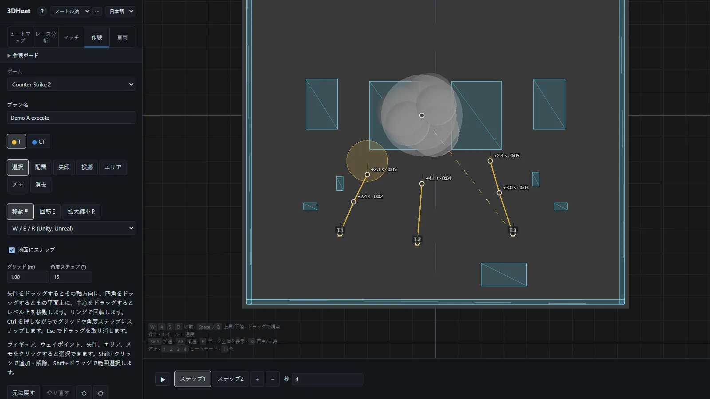

# 作戦ボード

**作戦** タブは、チームの計画のための製図板です。地図の上に小さなフィギュアを置き、それらが動く先を矢印で描き、再生を押して起きることを見ます。プレイの前にラウンドや攻撃を計画するために使ってください。キャンバス、カメラ、[レベル](levels.md)は他のタブと共有しますが、それ以外は共有しません。計画はデータではないので、ヒートは描きません。

## 最初の計画 {#your-first-plan}

1. **作戦** タブを開きます。**ゲーム**（たとえば Counter-Strike 2）を選びます。Valorant の場合は **Valorantのマップを読み込む** を押して、**マップ** を選びます。または、先に[レベル](levels.md)を読み込みます。
2. **陣営** を選び（色が決まります）、**上面図** を押します。
3. **場所** を選び、**フィギュア** からフィギュアを選び（**フィギュアを検索** で探せます）、地図をクリックします。2 つか 3 つ置きます。
4. **矢印** を選び、フィギュアをクリックし、進ませたい道筋に沿ってクリックし、**Enter** で矢印を終えます。
5. ビューの下の **+** を押して、手順 2 を加えます。各フィギュアは、矢印が終わった場所から始まります。そこでさらに矢印を描きます。
6. **▶**（または `K`）を押すと、表示中の手順から最後まで計画が再生されます。
7. **プラン名** で計画に名前を付け、**保存** を押します。

## 計画を始める {#starting-a-plan}

| 操作 | 働き |
|---|---|
| **ゲーム** | パレットが提供する陣営とフィギュアを選びます：Counter-Strike 2（T、CT。プレイヤーと補助道具）、Valorant（攻撃、防衛。プレイヤーと汎用の能力）、Battlefield、Squad、Arma（歩兵、地上車両、航空機、船）、DCS / War Thunder / IL-2（ジェット機、プロペラ機、ヘリコプター、防空、地上、艦船、兵器）、その他。すでにフィギュアがある計画は、ゲームを変えても陣営を保ちます。 |
| **プラン名** | 計画を保存するときの名前。 |
| **マップ**、**Valorantのマップを読み込む** | Valorant を選んだとき：**Valorantのマップを読み込む** は、[valorant-api.com](https://valorant-api.com) からマップの一覧を取得します。**マップ** は、選んだマップのミニマップを、上から見た形でレベルとして置きます。画像は選んだときに取得され、同梱されることはありません。画面に表示されている間は、Riot の通知が出ます（下を参照）。 |
| **陣営** | 次のフィギュア、矢印、またはエリアが属する陣営。その陣営の色になります。 |

レベルがなければ、ボードは平らな地面です。実際の地図で計画するには、**レベル** の下でレベルを読み込みます。CS2 のツールで書き出した CS2 のマップ、ライブラリのレベル、または地図の画像です。

## ツール {#tools}

| ツール | クリック | 注 |
|---|---|---|
| **選択** | フィギュア、経由点、矢印、エリア、またはメモをクリックすると、それを選びます。 | Shift+クリックで追加または削除。Shift+ドラッグで、追加するものを囲む枠を描きます。選択したものには変形のギズモが付きます（下を参照）。`Delete` または `Backspace` で削除します。`M` は、選んだフィギュアを次のクリックへ動かします。 |
| **配置** | 選んだフィギュアを置きます。 | フィギュアは **フィギュア** のパレット（**フィギュアを検索** 付き）で選びます。何も選ばれていないとき、`R` は次に置くフィギュアを 15° 回します（`Shift+R` は逆向き）。 |
| **矢印** | クリックするたびに点が加わります。Enter、ダブルクリック、または右クリックで終わり、Esc で捨てます。 | **移動**、**攻撃**（先が太い）、または **監視**（目の高さの細い線）。フィギュアの上から始めた矢印は、この手順でのそのフィギュアの経路です。再生すると、フィギュアはそれをたどり、次の手順はその矢印が終わった場所から始まります。 |
| **投擲** | 投げる側、次にどこに落ちるか。 | 一方から他方へ点線の弧が描かれ、選んだ道具（煙、フラッシュ、火炎瓶など）が落ちた場所に現れ、この手順からそこに残ります。 |
| **エリア** | 中心、次に縁。 | 陣営の色の円盤。 |
| **メモ** | メモを置く場所。そのテキストを求めます。 | ピンとして表示され、その上にテキストが出ます。 |
| **消去** | フィギュア、矢印、エリア、またはメモ。 | この手順以降から取り除きます。最初の手順では、それ自体を取り除きます。 |

**元に戻す** と **やり直す**（`Ctrl+Z`、`Ctrl+Y` または `Ctrl+Shift+Z`）は、すべての変更を一つずつ行き来します。計画の下の行には、フィギュア、矢印、手順がいくつあるかが示されます。**上面図** は真下を見ます（正射投影）。**3D表示** は透視投影に戻ります。**フレーム** は計画に合わせ、計画が空のときはレベルに合わせます。

**フィギュアのサイズ** は、ボード上のすべてのフィギュアの大きさを変えます。1 倍が実寸です。真上から見ると、人は数ピクセルになります。

## 移動、回転、拡大縮小 {#moving-turning-and-scaling}

ボード上のすべてのものは、3D エディターのように動かせます。フィギュア、道具、マーカー、個々の経由点、矢印全体、エリア、メモです。選ばれたものは、その中央にギズモが付きます。

| モード | キー | ハンドル |
|---|---|---|
| **移動** | W（または G） | 軸ごとの矢印（X は赤、Y は緑で上向き、Z は青）がその軸に沿って動かします。正方形はその面に沿って動かします。中心は、ポインターの下のレベルの上を動かします。 |
| **回転** | E（または R） | 軸ごとのリングが、その軸の周りに回します。1 つのフィギュアのリングは、その独自のヨー、ピッチ、ロールです。グループは、中央を中心に、ワールドの軸の周りに回ります。 |
| **拡大縮小** | R（または S） | 選択を中央から、軸に沿って、またはあらゆる方向へ広げたり集めたりします。エリアの半径も一緒に大きくなります。 |

**キー** は、W / E / R（Unity、Unreal）と G / R / S（Blender）を切り替えます。キーがモードを決めるのは、何かが選ばれているときだけです。それ以外のときは、キーがカメラを飛ばします。そのため、`R` は、W / E / R のキーでは何かが選ばれているとき **拡大縮小** を、G / R / S のキーでは **回転** を意味します。何も選ばれていないときは、配置する次のフィギュアを回します。ボードのすべてのキーは、[キーボードのリファレンス](keyboard-reference.md#tactics-board) に一覧されています。ドラッグ中に **Ctrl** を押すと、移動は **グリッド**（メートル）に、回転は **角度の刻み** にスナップします。**地面にスナップ**（既定でオン）は、動かした人、車両、マーカー、経由点、エリアをレベルの表面に置きます。航空機とヘリコプターは高さを保ちます。Y の矢印に沿ったドラッグは、決してスナップしません。ハンドルをドラッグしても、カメラは動きません。**Esc** はドラッグを取り消します。すべての変更は、元に戻すの 1 手順です。

経由点は、表示されている手順の矢印の上に点として表示されます。クリックすると選ばれ、ドラッグすると動き、Delete で取り除かれます。**選択中** の節には、選択の場所がメートルで、フィギュアのヨー、ピッチ、ロールが度で、エリアの半径が、それぞれ入力できる形で表示されます。

## タイミング {#timing}

フィギュアの経路には時間が付きます。各区間は、その長さをレベルの上で測った時間になります。表面を 2 メートルごとにサンプリングするので、2 点の間の丘や階段も数えられます。速度は、そのゲームでそのフィギュアの動きの **モード** の速度です。それに、経由点での **待ち** の時間が加わります。歩兵は這う、かがむ、歩く（静か）、走る、全力疾走。車両と船は、ゆっくり、慎重に、普通、急ぐ。航空機とヘリコプターは、低速、巡航、戦闘速度、最大速度で飛びます。そのゲームにないモード（CS2 には全力疾走がない）は、そのゲームにある最も近いモードを取ります。坂が速度をどう落とすかは、ゲームによって異なります。CS2 と Valorant では、ゲームと同じく水平距離だけが数えられます。軍事シミュレーションは、歩兵を上り坂で遅くし（トブラーのハイキング関数）、車両を勾配で遅くします。

速度は、ゲームごとの表から、その出典とともに来ています（[移動速度](tactics-speeds.md) を参照）。CS2 は持っている武器ごとに、ゲームの武器の定義から。Valorant は武器ごとに。Battlefield、Squad、Arma と航空ゲームは、車両の種類とクラスごとに。**移動の種類** は、フィギュアのプロファイル（武器、車両の種類）を選びます。**独自 (m/s)** は、そのフィギュアのモードを何でも上書きします。モードは、ボードに表示されるとおりに名付けられます。*這う*、*かがむ*、*歩く（静か）*、*走る*、*全力疾走*。*慎重*、*普通*、*急ぐ*。*低速*、*巡航*、*戦闘*、*最大*。

各経由点は、前の経由点からの時間と、計画の開始からの時間を表示します（「+3.9 s · 0:12」）。選ばれたフィギュアの経路には、すべての区間が、そのモード、長さ、時間、待ち、到着とともに一覧されます。**タイミング** の下の **到着** は、経路を持つすべてのフィギュアを 1 本の時間軸に置きます。最も早い到着が上です。**リアルタイムで再生**（既定でオン）では、手順は最も遅い経路が到着するまで続き、各フィギュアは独自の速度で動きます。そのとき **秒** は、その手順の最も短い長さになります。**1 メートルあたりのレベル単位** は、レベルが何の単位かを示します。CS2 の地図は 39.37（ゲームの単位）、メートルの地図は 1 です。

## 試合のデータと比べる {#compare-with-match-data}

**マッチファイルを読み込む…** は、その地図の CS2 の試合の表（CS2 のツールの Parquet ファイル。必要なだけ。必要な列だけを、背景で）を読みます。**読み込み済みデータを使う** は、ビューアに読み込まれたデータを使います。そして:

- **マップ上の最速到着** は、各場所に、プレイヤーが最初に到達したときのラウンド開始からの時間で、地図を色分けします。**最速** のボタンは、すべてのラウンドでの最も速いものを、**標準（中央値）** は中央のラウンドを示します。早いものは緑、遅いものは赤で、片方の陣営または両方について。それは、いつ何が可能だったかを示します。
- 選んだ経路は、その開始（またはラウンドの開始）から終わりまでに、プレイヤーが達成したことと比べられます。各終わりは、設定された半径の円盤です。「観測された最速 14.2 s、p10 15.0 s、中央値 18.3 s（41 回の走行）、あなたの計画 15.1 s」のように。
- プレイヤーが実際に動いた速度（走る、歩く、かがむ。表の歩きとしゃがみの列から）を、m/s で。

## 手順 {#steps}

ビューの下のバーには、手順が並びます。計画は 1 つから始まります。**+** は手順を 1 つ加えます。各フィギュアは、前の手順で経路が終わった場所から始まります。**−** は、表示されている手順を取り除きます。**秒** は、再生したとき表示中の手順がどれだけかかるかです。**▶**（K）は、表示中の手順から最後まで再生します。経路を持つフィギュアはそれをたどります。次の手順で新しい場所へ動かされたフィギュアは、そこへ滑ります。残りは立ったままです。手順が表示されている間、次の手順での各フィギュアの場所は薄いゴーストとして描かれ、前の手順の矢印は、この手順の下に薄く描かれます。

## 保存 {#saving}

**ファイル** の節には、**保存**、**開く**、**クリア** があります。**保存** は、計画を `<名前>.h3dplan.json` として書きます（素の JSON。陣営、手順、手順ごとに場所を持つフィギュア、矢印、エリア、メモ）。**開く** はそれを読み戻します。別のバージョンのファイル、または計画ではないファイルは、理由とともに拒否されます。**クリア** は計画を空にします。元に戻すで戻ります。

## フィギュア {#figures}

すべてのフィギュアは、ビューア自身が作ります。公表された種類のサイズに合わせた単純な形で、隣のものと区別する特徴を持ちます。戦車の転輪と砲塔、防空車両の砲、ミサイル、レーダー、航空機の翼の平面形、尾翼、エンジン、ヘリコプターのローターと短い翼です。ゲームから取られたものは何もありません。ゲームが考案したデザインは、その種類の一般的なフィギュアとして示されます。データがどうフィギュアを見つけるかは、[フィギュア](figures.md#which-figure-a-unit-gets) を参照してください。

## Riot の通知 {#riots-notice}

Valorant のマップは、Riot Games の「Legal Jibber Jabber」の方針の下で示されます。その方針は、無償のコミュニティのプロジェクトがそれを使うことを認め、それが現れるところでこの通知を求めています: *3DHeat は、Riot Games が所有するアセットを使い、Riot Games の「Legal Jibber Jabber」の方針の下で作られました。Riot Games は、このプロジェクトを支持も後援もしません。* ボード上の能力は、Riot の絵ではなく、一般的な形です。
