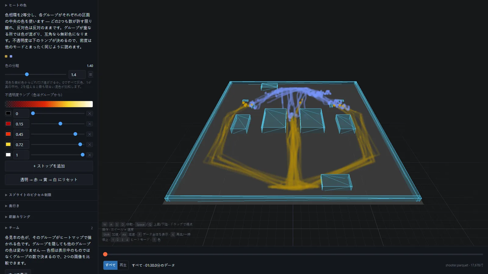

# チームヒート

チームヒートは、各チームがどこにいたかを、チームごとに自分の色で示します。チームが重なる場所では、色が混ざります。

**チームヒート**（キー 3）は、[ヒート](heat.md)の密度の場に、各[グループ](glossary.md)へ独自の色相を与えたものです。グループが重なると、その色相が混ざります。互角の戦いは無彩色になります。不透明度は、ほかのモードと同じく密度をそのまま運びます。そのため、絵は*どれだけ*と*誰の*を同時に答えます。グループの列が必要です。

これは[フィギュアオーバーレイ](box-replay.md)ではありません。フィギュアオーバーレイは人物ごとに1つのフィギュアを描きます。これは同じ列で色を付けたヒートの場です。

## 使い方 {#how-to-use-it}

1. `3` を押します（またはモードバーで **チームヒート** を選びます）。
2. **ヒートの色** を開きます。見本は各グループの色を示します。見本の上にマウスを置くと、チーム名が出ます。
3. すべてが灰色に見えるなら、**色の分離** を上げます。
4. [チーム一覧](teams-list.md)でグループのチェックを外すと、そのグループは外れます。ほかのグループの色はそのままです。

## 操作 {#controls}

**ヒートの色** のセクションにあるもの：

| 項目 | 既定値 | 意味 |
|---|---|---|
| 見本 | | 各グループの色。最初の 12 グループ分を表示し、その後は *+N 件* と表示されます。上にマウスを置くと、グループ名と色が出ます。 |
| **色の分離** | 1.4 | 混色が無彩色からどれだけ押し離されるか。0-4。0 にすると、すべてが灰色になります。1 は真の平均です。2 ほどを超えると、最も明るい混色は表示できる範囲を出て、チャンネルごとに切り詰められます。そのため色相がずれます。 |
| **不透明度ランプ（色はグループから）** | 既定のヒートのランプ | ここでは、ランプの**アルファ**だけが使われます。何もない場所では透明、上端では不透明です。ランプの色は無視されます。 |

ほかのすべてのヒートの項目（形、飽和、応答、最小ヒート、奥行き、カリング）は、[ヒート](heat.md)と同じように働きます。

[チーム一覧](teams-list.md)は、このモードでは各グループのチームヒートの色を見本として示します。あるグループを隠しても、ほかのグループの色はそのままです。色相は、オンになっているものではなく、グループの総数から決まります。そのため、2つの絵は比べられるままです。

## パレット {#the-palette}

[`colors.ts`](https://github.com/Holdi601/3DHeat/blob/main/src/render/colors.ts)より：

- 色は **Oklab** の色平面上に、固定の明度（0.7）と彩度（0.115）で置かれます。そのため、すべてのグループは同じ明るさになります。赤のグループが青のグループより熱く見えることはありません。
- *n* 個のグループがあると、色相の円は *n* 個の等しい部分に分けられ、グループ *i* は自分の部分の**中心**（一周の `(i + 0.5) / n`）を取ります。どの 2 つのグループも、数が許す限り離れています。反対側同士は、数に関係なく反対のままです。
- 使われる異なる色相は、最大 **16** 個です。グループがそれより多いと、ID は繰り返しの二分割で配置されます（ビットを反転した ID：0、½、¼、¾、⅛、…）。そのため、隣り合う ID は色相を共有しません。16 を超えるグループは、必ず色相を共有します。
- 「グループなし」を意味するラベル（`0`、空、`none`、`unknown`、`null`、`-1`。大文字と小文字は区別しません）を持つグループは、円の一部を取るのではなく、**無彩色の灰色**で描かれます。このように扱われるのは、グループの一覧で最初にそのラベルを持つものだけです。

既定の分離は 1 ではなく 1.4 です。1 だと、5 つの色相を均等に広げた混色は**灰色になる**からです。正しいですが、読めません。1 をわずかに上回る値は、同点を正直に保ちつつ、60/40 の分割を見えるようにします。

## 仕組み {#how-it-works}

このモードでは、ヒートのターゲットは 4 つのチャンネルを持ちます。各スプライトは、その密度 *v* を最初のチャンネルに足し、*v* × グループの Oklab の *a* と *b* の座標を、2 つ目と 3 つ目のチャンネルに足します。合成の時点で、ピクセルの混色は密度で重み付けされた平均になります。*a* = G / R、*b* = B / R です。これに色の分離を掛け、パレットの明度で sRGB に変換します。蓄積された密度で割るので、色相はデータの量に依存しません。そのため、どの密度の操作も、不透明度だけに作用し続けます。

4 チャンネルのターゲットは、同じ解像度で 1 チャンネルのヒートのターゲットの 4 倍の GPU メモリを使います。
