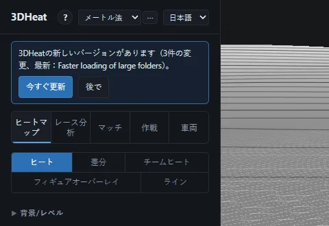

# 更新

ビューアは、新しいバージョンがあるとあなたに知らせます。そして、あなたが承諾したときだけ自分を更新します。あなたの答えがなければ、コンピューターの中で何も変わることはありません。

## ビューアを更新する {#update-the-viewer}

1. **ページの中で。** 新しいバージョンがあると、サイドバーの上端の名前の下に箱が出ます。「3DHeat の新しいバージョンがあります」。**今すぐ更新** をクリックします。終わるとページは自分で再読み込みされます。**後で** は、ページを再読み込みするまで箱を隠します。
2. **restart.bat を実行するように言われたら**、サーバーのウィンドウ (`start.bat` が開いた黒いウィンドウ) を閉じて、`restart.bat` をダブルクリックします。
3. **ビューアを起動するとき。** `start.bat` も確かめます。新しいバージョンがあれば、**今すぐ更新しますか? [Y/N]** と尋ねます。更新するには `Y` を押します。`N` を押すか、答えないまま 60 秒待つと、今のバージョンを起動します。



自分で変更を加えたコピーは、勝手に更新されることは決してありません。箱は、更新が待っていることを知らせるだけで、変更をコミットするか退避してから `git pull` を実行するように言います。git でインストールされていないコピー (たとえば zip ファイル) は、何も表示しません。

確認のしくみを、段階ごとに示します。

```
ページ ---(4 秒後、その後は 6 時間ごと)---> 開発サーバー ---> git fetch
   遅れている?  いいえ -> 何も表示しない
                はい   -> 自分の変更またはコミットがある?  はい -> 知らせるだけ
                                                          いいえ -> [今すぐ更新] -> git pull
                                                                 -> 再読み込み、または「restart.bat を実行」
```

## 安全の規則 {#the-safety-rules}

- **早送りのみ** (`git pull --ff-only`)。更新は、決して統合、リベース、何かの書き換えをしません。
- **ローカルの変更なし**。追跡されているファイルに、コミットされていない変更があるチェックアウト (`git status --porcelain --untracked-files=no` が空でない) は、決して自動では更新されません。誰かの作業を、更新が上書きする権利はありません。そのようなチェックアウトには、更新が待っていることだけを伝えます。追跡されていないファイル (データ、エクスポート) は、変更とは数えません。
- **ローカルのコミットなし**。上流にないコミットがあるチェックアウト (「分岐している」) は、更新されません。早送りでは追いつけず、統合は手作業の `git pull` の仕事だからです。ページと `start.bat` は、同じ言葉でそれを伝え、`start.bat` は、そこにあるバージョンを起動します。
- **ページ自身からだけ**。開発サーバーの更新の要求は、独自のヘッダーを持ち、ブラウザが `Origin` を送るときは、サーバー自身のホストから来なければなりません (下を参照)。
- 上流のブランチを持つ git のチェックアウトだけが、更新されることがあります。それ以外 (`.git` のないコピー、git がインストールされていない、静的なビルド) は、そのまま残され、何も言いません。

## start.bat が行うこと {#what-startbat-does}

`start.bat` (ダブルクリックします。ウィンドウがサーバーです) は、次の順に行います。

1. Node.js を探します。`PATH` 上、なければ `%ProgramFiles%\nodejs`、`%ProgramFiles(x86)%\nodejs`、`%LOCALAPPDATA%\Programs\nodejs` にあるものを探します。なければ、`winget install -e --id OpenJS.NodeJS.LTS` でのインストールを申し出ます (尋ねられ、Y/N。その後は、Windows が新しい `PATH` を読むように、ウィンドウを開き直す必要があります)。
2. git がインストールされていて、フォルダーに `.git` があるとき、**更新** を行います。
   - `git fetch --quiet` (ネットワークがない、または上流がない場合は、黙ってスキップ)。
   - `git rev-list --count HEAD..@{u}` を数えます。遅れがなければ、何も言いません。
   - ローカルの変更がある場合: 「3DHeat の新しいバージョンがあります (N 件の変更)。ただし、このコピーにはローカルの変更があるため、更新されません。コミットするか退避してから、git pull を実行してください。」と表示し、そこにあるバージョンを起動します。
   - 自分のコミットがある場合 (`git rev-list --count @{u}..HEAD` が 0 でない): 「3DHeat の新しいバージョンがあります (N 件の変更)。ただし、このコピーには、最新のバージョンにはない自分のコミットがあるため、更新されません。git pull で更新してください。」と表示し、そこにあるバージョンを起動します。
   - それ以外は「3DHeat の新しいバージョンがあります (N 件の変更)。」と、質問 **今すぐ更新しますか? [Y/N]**。`N`、または 60 秒答えがなければ、「更新していません。今のバージョンを起動します。」と表示し、そこにあるバージョンを起動します。`Y` の場合: 「更新しています...」と表示し、`package.json` または `package-lock.json` が変わるかを伝え、`git pull --ff-only` を実行します (それでも失敗した場合 (たとえばネットワーク): 「更新が完了しませんでした。今のバージョンを起動します。」)。その後 `git submodule update --init` (固定されたツール。[ドキュメントの保守](maintaining.md#the-tools-under-exporters) を参照)、パッケージのファイルが変わり `node_modules` があれば `npm install`、そして「更新しました。」と表示します。
3. 2 つ目のサーバーの起動を拒否します。ポート **5273** で、すでに何かが待ち受けている場合は、そう伝え、`restart.bat` / `stop.bat` を示します。
4. 初回の実行時 (`node_modules` がないとき)、依存関係をダウンロードする前に尋ねます (`node_modules\` に約 300 MB。システム全体には何もしません)。
5. 開発サーバーを `127.0.0.1:5273` (`--strictPort`) で起動し、準備ができたらブラウザを開きます。

`restart.bat` は (ポートで) サーバーを止め、`start.bat` をもう一度実行するので、同じ質問をします。`stop.bat` は止めるだけです。

## 開発者向け {#for-developers}

### 実行中: 更新のルート {#while-it-runs-the-update-route}

開発サーバー (`vite.config.ts` の Vite プラグイン `heat3d-self-update`) は、`/__heat3d/update` を提供します。これは開発サーバーにだけあり、静的なビルドにも `vite preview` にもありません。

**`GET /__heat3d/update`** は、チェックアウトが遅れているかを答えます。

```json
{ "checkout": true, "upstream": "origin/main", "behind": 3, "ahead": 0, "dirty": false, "latest": "最新のコミットの件名" }
```

- フォルダーが git のチェックアウトでないとき `checkout: false`。
- `git fetch --quiet` を、**最大で 30 分に 1 回** 実行します (その間の要求は、最後に取得したものから答えます)。
- `behind` / `ahead` は `git rev-list --count HEAD..@{u}` / `@{u}..HEAD` から、`dirty` は `git status --porcelain --untracked-files=no` から、`latest` は上流の最新のコミットの件名です。
- 上流のブランチがなければ、`upstream: null` と `behind: 0`。

**`POST /__heat3d/update/apply`** は、チェックアウトを最新にします。

1. 要求がヘッダー `X-Heat3d-Update: 1` を持ち、`Origin` を運ぶ場合はその origin のホストが要求の `Host` でなければ、`403 { ok: false, reason: "forbidden" }` で拒否されます。サイトをまたぐフォームは、CORS のプリフライトなしでは独自のヘッダーを送れません。このサーバーは、それを決して許しません。
2. することがない場合 (チェックアウトでない、上流がない、遅れていない): `{ ok: true, updated: false }`。
3. ローカルの変更がある場合: `{ ok: false, reason: "dirty" }`。ローカルのコミットがある場合: `{ ok: false, reason: "diverged" }`。
4. それ以外は、変わるファイルを記録し (`git diff --name-only HEAD @{u}`)、`git pull --ff-only` (2 分のタイムアウト)、`git submodule update --init` (失敗は無視)、`package.json` または `package-lock.json` が変わったときは `npm install` (15 分のタイムアウト) を実行し、`{ ok: true, updated: true, restart }` と答えます。`restart` は、実行中のサーバーが更新を取り込めない理由を示します。依存関係が入れ直されたときは `"dependencies"`、`vite.config` のファイルだけが変わったときは `"config"`、再起動が必要ないときは `false`。
5. 失敗した git または npm のコマンドは、`{ ok: false, reason: "<エラー、最大 300 文字>" }` と答えます。

応答は、`Cache-Control: no-store` の JSON です。サーバーは `127.0.0.1` だけで待ち受けるので、このルートはネットワークからは届きません。

### ページの中のお知らせ {#the-notice-in-the-page}

`UpdateBanner`。サイドバーの上端の名前の下にあります。

- ページの読み込みから **4 秒後** にルートに尋ねます (最初の数秒ではありません。ページは読み込むデータセットと、起動する GPU を持っているからです)。ページが開いている間は、**6 時間ごと** にもう一度尋ねます。
- そのようなルートがない (静的なビルド)、フォルダーがチェックアウトでない、または新しいものが何もない場合は、**何も** 表示しません。起動のたびにお知らせが出ると、人は無視することを覚えてしまうからです。
- 遅れていて、ローカルの変更がない場合: 「3DHeat の新しいバージョンがあります (N 件の変更、最新: <件名>)。」と、**今すぐ更新** と **後で** (*後で* はページを再読み込みするまで隠します)。
- 遅れていて、ローカルの変更がある場合: 同じ文と、「このコピーにはローカルの変更があるため、自動では更新されません。コミットするか退避してから、git pull を実行してください。」。ボタンはありません。
- **今すぐ更新** は `/apply` に送られます (「更新しています...」)。その後:
  - 「更新しました。ページを再読み込みします。」。1.5 秒後に再読み込みされます (サーバーはすでに新しいファイルを提供しています)。
  - 依存関係が入れ直された場合: 「更新しました。依存関係が変わったため、サーバーのウィンドウを閉じて **restart.bat** を実行して完了してください。」。
  - サーバーの設定だけが変わった場合: 「更新しました。サーバーの設定が変わったため、サーバーのウィンドウを閉じて **restart.bat** を実行して完了してください。」。
  - 結局、取り込むものがない場合 (`updated: false` - たとえば `start.bat` がその間にコピーを最新にした): 「更新するものはありません。このコピーは、すでに最新のバージョンです。」。再読み込みはしません。
  - 拒否された場合: 上の *dirty* の文、または「このコピーには、最新のバージョンにはない自分のコミットがあります。git pull で更新してください。」、または「更新が完了しませんでした: <理由>」。
