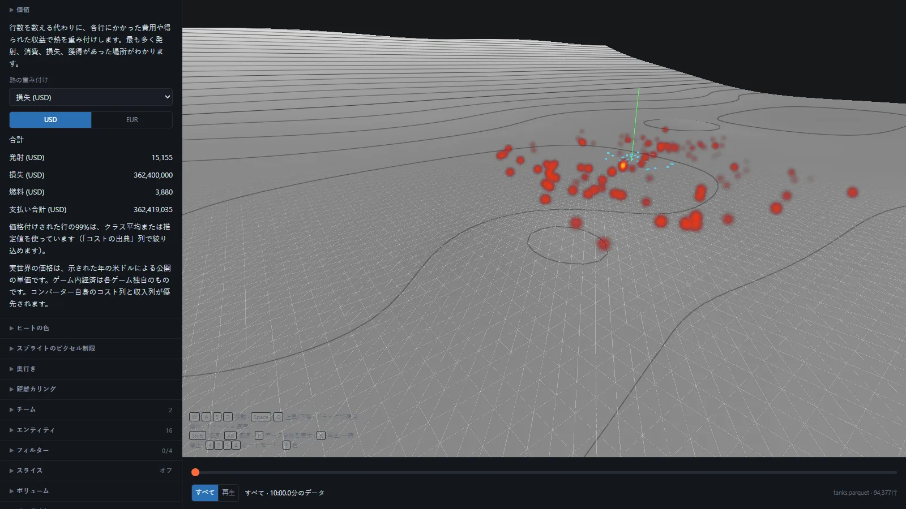

# 値による重み付け

すべての発射、弾薬、失われた車両、1 リットルの燃料には値段があります。ビューアーは、各行がいくら費やしたか、または獲得したかを計算し、それでヒートに重みを付けられます。そのため、地図は行がどこにあるかではなく、**お金がどこに使われたか**を示します。

## 使い方 {#how-to-use-it}

1. イベント（発射、撃破、死亡）と、車両や兵器の名前があるデータを読み込みます。
2. ヒートのサイドバーで **値** を開きます。
3. **熱の重み付け** を選びます。たとえば *損失 (USD)*。すると、ヒートは 1 ではなく、各行の値段を足します。
4. **合計** を読みます。表示されているものについて、すべての値の列の合計です（フィルターと時間のウィンドウが適用されます）。
5. 値段が実際のお金である場合、**USD / EUR** の切り替えが表示されます。

メニューの空の最初の項目を選ぶと、行を数え直します。

## 重み付けできるもの {#what-can-be-weighed}

値の列は、読み込み時に、種類と通貨ごとに 1 つずつ追加されます。

| 種類 | 対応する行 | 値段の付け方 |
|---|---|---|
| **発射** | 発射とロケット | 兵器。なければ、その弾薬の種類の平均 |
| **消費** | 購入、出現 | ゲームの金額の列（例: シューターの購入メニュー） |
| **損失** | 死亡、破壊 | 自分の車両。なければ、その分類の平均 |
| **破壊** | 撃破 | 撃破された車両 |
| **与ダメージ** | 命中 | 対象の値段の一部 |
| **燃料** | 位置 | 使われた燃料。燃料の列から、または分類と時間から推定 |
| **支払い合計** | | 発射 + 消費 + 損失 + 燃料 |
| **獲得** | 報酬 | ゲーム自身の報酬の列（`earn_…`） |
| **純額** | | 獲得から支払いを引いたもの。符号付きのヒートとして描かれます（より多く獲得した場所は正の色のランプ、より多く支払った場所は負の色のランプ） |

列の名前は `cost_<kind>_<currency>`、`earn_<currency>`、`net_<currency>` です。ゲーム自身の通貨を知っている変換ツール（たとえば、ゲーム内のクレジットで書き出すリプレイの変換ツール）の値は、組み込みの値段の表より優先されます。

## 値段の表 {#the-price-tables}

| 表 | 通貨 |
|---|---|
| 実在の軍事: ミサイル、爆弾、弾薬、妨害装置、航空機、ヘリコプター、地上車両、船、燃料 | USD（EUR = USD × 0.92。[`cost.ts`](https://github.com/Holdi601/3DHeat/blob/main/src/data/cost.ts) の固定値 `EUR_PER_USD`。リアルタイムのレートではありません） |
| シューターの購入メニューとキルの報酬 | ゲームのクレジット |
| 戦車と船のゲーム | ゲームのクレジット |
| 戦略ゲーム（複数の資源） | 資源ごとに 1 列、さらに合計の列 1 つ |
| ウォーゲーム | ポイント |

ゲームは、データの中の名前から認識されます。実在の値段は、公開された情報源（予算の資料、百科事典）から得たものか、見積もりとして印が付けられています。インフレ調整はされていません。表の生成された一覧は [値の表](ref-value-tables.md) にあります。

## 見積もり {#estimates}

追加の分類の列 **Cost source** は、各行がどのように値付けされたかを示します。`table`、`class average`、`estimate`、`none` のいずれかです。値セクションには、値段が付いた行のうち、どれだけの割合が平均または見積もりかが表示されます。正確に値付けされた行だけを残すには、[フィルター](filters.md)の **Cost source** で *estimate* と *class average* のチェックを外します。

## 値が表示されるほかの場所 {#where-else-value-shows}

- [インサイト](insights.md): *Costly ground* と *Earning ground* の発見
- [内訳](breakdown.md): チーム、プレイヤー、兵器ごとの獲得、損失、純額
- [ボリューム](volumes.md): 統計と比較の値の列
