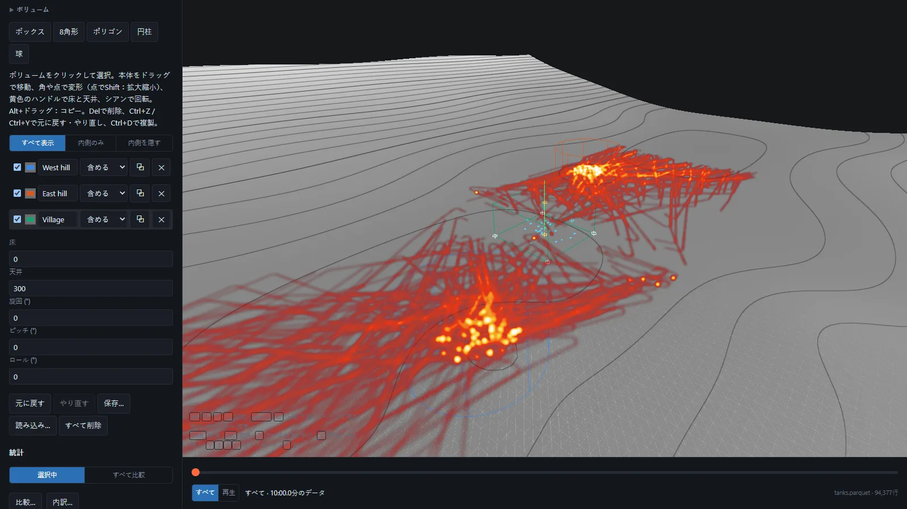
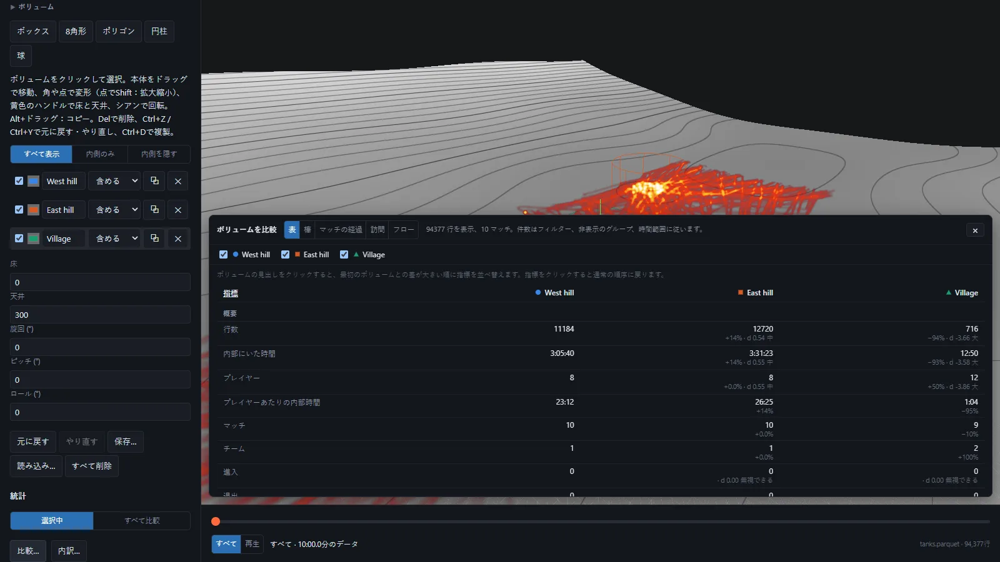
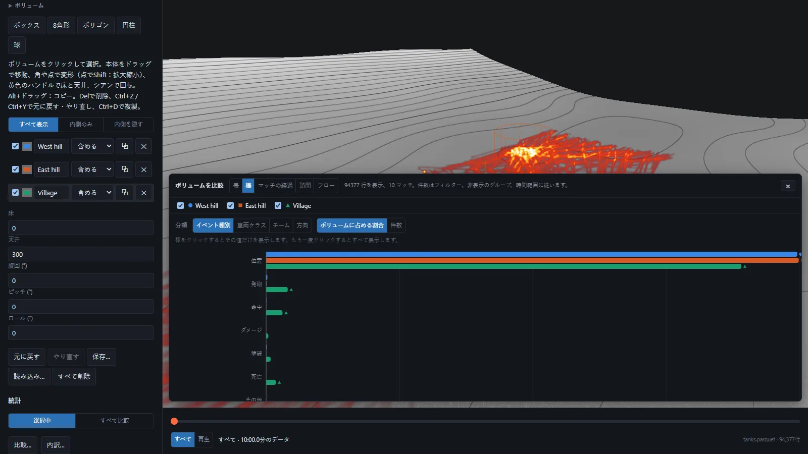

# ボリュームと比較

**ボリューム** とは、ある場所の周りに描く、目に見えない箱（または円柱、球）のことです。問いかけるためのものです：この中で何が起きたか？ 橋で撃破を数えたり、2つの丘を比べたり、1つのエリアの活動だけを表示したりするのに使います。

```
 上から見た図             形を描く  ->  ビューアは数える
 +------------+           中に入っているもの：
 |   ( A )    |            行、プレイヤー、撃破、時間 ...
 |        [B] |           A と B を並べて比べる。
 +------------+
```



ボリュームは、中で何が起きたかを計測し、表示をそこに絞り込み、その行を書き出し、並べて比べられます。行、人物、マッチの意味は[用語集](glossary.md)も参照してください。

## ボリュームを描く {#draw-a-volume}

1. サイドバーで **ボリューム** を開きます。
2. ツールを選び、3D ビューか 2D の地図で描きます。床と天井は、その下のデータから始まります。Esc で中止します。
3. ボリュームをクリックして選びます。その **統計** が表示されます。

| ツール | 描き方 |
|---|---|
| **箱** | 長方形をドラッグします（Shift で正方形）。クリックすると既定の箱が置かれます。 |
| **n 角形** | 中心からドラッグします（Shift で正多角形を保つ）。*角* で n を設定します。3 から 64 まで（既定は 8。そのためボタンは **8 角形** と表示されます）。 |
| **ポリゴン** | 角をクリックします。ダブルクリック、Enter、または最初の角のクリックで閉じます。Backspace で最後の角を削除します。 |
| **円柱** | 半径をドラッグします。 |
| **球** | 半径をドラッグします。地面に接します。 |

## 編集 {#edit}

- ボリュームをクリックして選びます。本体をドラッグすると動かせます。角をドラッグすると形を変えられます（角で Shift を押すと拡大縮小）。
- **黄色** のハンドルは床と天井を設定し、**水色** のハンドルは回転させます。
- Alt+ドラッグでコピー、Del で削除、Ctrl+Z / Ctrl+Y で元に戻す / やり直し、Ctrl+D で複製します。**すべて削除** は、すべてのボリュームを削除します。
- 正確な値：床、天井、回転 / ピッチ / ロール（箱）、半径（球、円柱）。

各ボリュームの行には、表示のチェックボックス、色、名前、**含める** または **除外**、複製、削除があります。ボリュームは、データセットごとにブラウザーに保存されます。**保存…** と **読み込む…** は、`volumes.json` ファイルを書き込み、読み込みます。

## 表示を絞り込む {#filter-the-view}

| フィルター | 効果 |
|---|---|
| **すべて表示**（既定） | ボリュームは計測するだけです。 |
| **内側のみ** | ヒート、リプレイ、[被弾分析](hit-analysis.md)は、含めたボリュームの内側で、除外したものの外側のものだけを描きます。 |
| **内側を隠す** | 逆です。 |

GPU のフィルターは、合計で 64 個の輪郭の点を持つボリュームを最大 8 個まで扱います。それを超えるボリュームには「!」が付きます。統計と書き出しは、それも数えます。

## 統計 {#statistics}

**統計** の領域は、フィルター、時間の窓、隠したグループに従います。*選択中* は選んだボリュームを表示し、*すべて比較* はすべてのボリュームを並べて表示します。表示されるもの：

- **内側の行（表示分）** と **内側の行（全データ）**、**プレイヤー**、**チーム**、**マッチ**、**内部にいた時間**、**出入り回数**、**ピーク熱量**、**平均熱量**、**体積 / 底面積**、そして **時期** のヒストグラム。
- 列ごと：**Lift**（内側の割合を、表示中の全データの割合で割ったもの）付きのカテゴリー、範囲、中央値、5 パーセンタイルから 95 パーセンタイルまでの数値。

**統計を CSV / JSON で保存** で保存します。**内側のデータをエクスポート** は、内側の行を CSV または Parquet で書き出します（既定で *表示されている行のみ* がオン）。1つのボリュームか全部を対象にでき、各行がどのボリュームに入っているかを示す列が付きます。

## ボリュームを比べる {#compare-volumes}

表示されているボリュームが2つ以上あるとき、**比較…** を押します。

1. 3つのボリューム、たとえば西の丘、東の丘、村を描きます。
2. 統計の下の **比較…** を押します。
3. **表** で、各値の最初のボリュームとの差を読みます。
4. **棒** に切り替えると、割合を棒で見られます。



| 表示 | 内容 |
|---|---|
| **表** | 行数、内部にいた時間、プレイヤー、マッチ、チーム、出入り、訪問、訪問の長さ、撃破、死亡、死亡あたりの撃破、分あたりの撃破、プレイヤーあたりの時間、値の列。イベント、車両クラス、プレイヤーか AI、チーム、向きごとにまとめられます。各値は最初のボリュームとの差と、効果の大きさ（ごくわずか、小、中、大）を示します。ボリュームの見出しをクリックすると、最初のものからの距離で並べ替えます。 |
| **棒** | イベント、クラス、行為者、チーム、向きごとの数または割合。棒をクリックすると、表示をその棒に絞り込みます。 |
| **マッチの経過** | ボリュームごとに1つのグラフを、マッチの分の経過で表示します。存在、行数、撃破。クリックするとそこへ飛びます。 |
| **訪問** | 訪問の長さの箱ひげ図とバイオリン図（対数目盛り）。 |
| **フロー** | 各ボリュームを出た後に、軌跡がどこへ行くか。推移の行列、またはフローのリボン。 |



## ヒント {#tips}

- 発見から始めます。[インサイト](insights.md)の **ここにボリューム** は、発見の場所の周りに円柱を追加します。
- **内訳…** は、選んだボリュームの[内訳](breakdown.md)を開きます。その中で誰と何が最もよいかを示します。
- [方向ヒート](directional-heat.md)は、選んだボリューム内の向きをグラフにできます。
- [車両タブ](hit-analysis.md#restrict-to-an-area)は、同じボリュームを領域フィルターとして使います。
