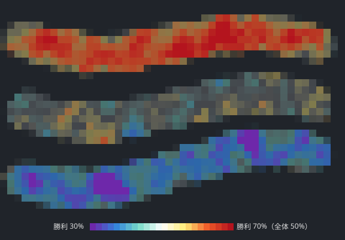

# 勝率: 場所、ルート、プレーがどれだけ勝つか

プレイヤーがどこに立つか、どちらへ進むか、どこにユーティリティを投げるか - そして、その後に自分の側がどれだけラウンドに勝つか。**勝率マップ**は、各場所を、そこにある行のうち行の側が勝ったラウンドに属する行の割合で色付けし、表示中のすべてでの割合と比べます。高いところは暖色、低いところは寒色、同じところは何も付きません。

*この画像は作り物のデータです。空のレベル上の 3 本のルートで、行のうち勝ったラウンドのものがそれぞれ 68%、50%、33% です。*

誰が勝ったかを示すデータが必要です。[結果の列](data-formats.md#outcome-columns)（`won`、`matchWon`、`roundEndReason`）です。CS2 と War Thunder のコンバーターがこれを書き出します。どのファイルでも持つことができます。

## 試してみる {#try-it}

1. 結果の列を持つ試合を読み込み、`2`（**差分**）を押します。
2. **差分の分割** で **ラウンド勝率**（または **試合勝率**）を押します。勝ったラウンドを **+** に、負けたラウンドを **−** に置き、パネルを **+ の割合** に切り替えます。
3. 色を読みます。パネルには全体の割合が出ます: *全体では 1,200,000 行のうち 52.0% が + です。*
4. [フィルター](filters.md)で絞り込みます。片方の側（T または CT）、1 つのイベント種類（人が立っていた場所なら *位置*、撃った・投げた場所なら *発砲* または *発射(ミサイル、ロケット、爆弾)*）、1 つの購入、1 つのマップ。

*位置* の行で暖色の場所は、そこを押さえた人がラウンドに勝つことが多かった場所です。*撃破* の行なら、そこで取った撃破が勝ったラウンドにつながった場所です。

## 設定 {#the-settings}

| 設定 | 何をするか | 既定値 |
|---|---|---|
| **差分** / **+ の割合** | 差分そのもの、または両側の行のうち + 側の割合 | 差分 |
| **最大色の差** | 全体の割合からどれだけ上または下で、場所を最大の色で表示するか（ポイント） | ± 20 ポイント |
| **場所を色付けする最少行数** | これより行が少ない場所は色付けしません。その半分から徐々に現れます | 12 |
| **全体の割合への引き寄せ (行)** | 各場所は、全体の割合でこの数の行がある状態から始まります。そのため、行が 3 つですべて勝ちの場所が 100% と表示されません | 12 |

3 つとも、仕上がった画像に働きます。ドラッグしても集計がやり直しになることはありません。

割合は勝ちだけでなく、どの分割のものでもかまいません。側で分割して *+ の割合* を使うと、T が存在の大きな部分を占めた場所がわかります。2 つのマップのファイルで分割すると、一方のファイルの行がもう一方より重い場所がわかります。

## ラウンドではなく行 {#rows-not-rounds}

このマップは行を数えます。1 か所に 20 秒立っているプレイヤーは、サンプルごとに 1 行を加えますが、すべて 1 つのラウンドのものです。ですから、ある場所の証拠はラウンドではなく、その近くの行です。最少行数と引き寄せが行で表され、1 ラウンド分より大きいのはそのためです。

ラウンドそのものについては:

- 地点、ビュー、ボリュームの **[内訳](breakdown.md)**: *勝率 %* は各プレイヤーのラウンドを 1 回ずつ数え、同じやり方でその場所の全体の率へ引き寄せます（4 ラウンド）。
- **[ボリューム](volumes.md)** の統計: *勝率* - ボリュームの中にプレイヤーがいたラウンドを 1 回ずつ数え、表示中のすべてでの率へ引き寄せたもので、件数も付きます。

## 結果のフィルター {#outcome-filters}

[フィルター](filters.md) パネルは、ビューア自身の列のすぐ後に結果の列を並べます: **ラウンドの結果** と **試合の結果**（*すべて*、*勝ち*、*負け*）、そして **ラウンドの終わり方**（全滅、爆弾爆発、爆弾解除、時間切れ、降参、引き分け、目標、ゾーン保持、チケット喪失、全車両喪失）。どれもビューアの言語で表示されます。

## 開発者向け {#for-developers}

ヒートパスは、チームヒートが使う 4 チャンネルのターゲットに 3 つの合計を書き込みます。ヒート `R = Σ|v|`、+ 側のヒート `P`、そして `S = Σ v²/w` です。`w` はパスの重み（サンプリングの重み × フレームゲイン）です。合成では割合 `P/R`（カーネルで重み付けした平均）と、それが基づく行数 `n = R²/S`（Kish の有効サンプルサイズ）を読み、割合を全体の割合へ引き寄せ `p = (n·P/R + m·r0)/(n + m)`、`p - r0` を範囲に対して差分のランプで色付けします。

`n` は、あるピクセルの行に共通するすべての係数 - フレームゲイン、サンプリングの重み、クランプされたスプライトの面積の重み - を打ち消します。そのため、どのズームでもどのサンプリング密度でも画像は同じで、k 行ごとのフレームは色が跳ねることなく全体へとまとまります。全体の割合は CPU 側の側ごとの件数から求め、0.1% 単位まで保ちます。GPU からは何も読み戻しません。計算とそのチェック: [`render/rateMap.ts`](https://github.com/Holdi601/3DHeat/blob/main/src/render/rateMap.ts) とそのテスト。

コストはチームヒートと同じです。4 チャンネルのターゲットはヒートパスのブレンド帯域を 4 倍にしますが、それは *+ の割合* がオンの間だけです。
