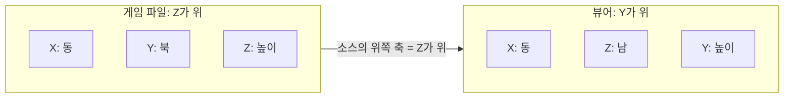

# 축, 단위, 시간

게임과 지도는 어느 쪽이 위인지, 단위 하나가 얼마나 긴지, 시간을 어떻게 적는지에 대해 서로 의견이 다릅니다. 이 페이지는 데이터가 올바른 방향으로 서고, 올바른 크기로 나오고, 올바르게 재생되게 하는 세 가지 설정을 보여 줍니다.

지도가 바닥처럼 누워 있지 않고 벽처럼 서 있다면 **소스의 위쪽 축**을 바꾸십시오.

**소스의 위쪽 축**이 틀리면 지도는 벽처럼 서고, 맞으면 바닥처럼 누워 있습니다.

## 뷰어가 그리는 세계 {#the-world-the-viewer-draws-in}

뷰어의 세계는 **Y가 위**입니다. X와 Z가 지면이고, Y가 높이입니다. 대부분의 게임 엔진은 **Z가 위**입니다. 그들에게는 X와 Y가 지면이고, Z가 높이입니다. 일부 엔진은 좌우가 뒤집혀 있기도 합니다(왼손 좌표계). 대응 설정은 파일의 축을 뷰어의 축으로 어떻게 바꿀지를 정합니다. (엄밀히는 뷰어는 오른손 좌표계입니다. three.js의 관례입니다.)

### 위쪽 축 {#up-axis}

[열 매핑](column-mapping.md)의 **소스의 위쪽 축**:

| 설정 | 파일 (x, y, z)이 세계 (X, Y, Z)가 됨 |
|---|---|
| *Z가 위(대부분의 게임 엔진)* - 기본값 | (x, **z**, **y**): 파일의 Z가 높이가 되고, 파일의 Y가 세계의 Z가 됨 |
| *Y가 위(그래픽 관례)* | (x, y, z) 그대로 |

Z가 위인 데이터에서는 세 배열을 복사하지 않고 이름만 바꿉니다([`remapAxesInPlace`](https://github.com/Holdi601/3DHeat/blob/main/src/data/ingest.ts)). 그래서 큰 데이터를 불러올 때 수백 MB를 아낍니다. 추측은 표본으로 합니다. Y 열과 Z 열 중 퍼짐이 작은 쪽이 위입니다.

### 뒤집기 {#flips}

**X 뒤집기**, **Y 뒤집기**, **Z 뒤집기**는 이름이 같은 *파일의* 축을 이름 바꾸기 전에 부호를 바꿉니다. 그래서 Z가 위일 때 *Y 뒤집기*는 결국 세계의 Z가 되는 값의 부호를 바꿉니다. 뒤집기는 불러온 데이터를 바꿉니다. [자](measure.md)가 보여 주는 좌표, 단면, 카메라 자세는 뒤집힌 값입니다.

데이터를 **바꾸지 않고** 좌우가 뒤집힌 세계를 제대로 그리려면, 대신 **카메라와 장면 → 월드 축 반전**을 쓰십시오([카메라와 조작](camera.md#invert-world-axis)). 세계가 왼손 좌표계인 게임에는 이것이 더 나은 선택입니다. 도구가 보여 주는 모든 좌표가 게임 고유의 값으로 남기 때문입니다.

### 단위 배율 {#unit-scale}

**단위 배율**은 모든 위치에 곱합니다. *1 (m)*은 1로, *0.01 (cm→m)*은 0.01로 맞춥니다(언리얼 엔진의 단위는 센티미터이므로 0.01을 쓰고, 소스 엔진의 단위는 인치이므로 0.0254를 씁니다. 둘 다 미터가 아닙니다). 상자는 어떤 값이든 받습니다. 입력한 0이나 숫자가 아닌 값은 1로 바뀝니다.

뷰어는 거리를 미터로 표시합니다(스프라이트 반경, 컬링 거리, 자, 비행 속도). 이것은 배율을 적용한 세계 단위가 미터일 때만 맞습니다. 그렇지 않아도 아무것도 깨지지 않습니다. 라벨이 그 단위가 무엇이든 "m"이라고 읽힐 뿐입니다.

## 시간 {#time}

### 시간 단위 {#time-units}

대략적인 규칙: 17000000000처럼 10자리 이상인 값은 Unix 타임스탬프입니다. 0, 0.25, 0.5처럼 시작부터 흐른 초 단위 값입니다.

| 시간 단위(메뉴 라벨) | 해석 | 벽시계 표시 |
|---|---|---|
| *초(상대)* | 값 × 1 s | 아니요 |
| *밀리초(상대)* | 값 × 0.001 s | 아니요 |
| *마이크로초(상대)* | 값 × 10^-6 s | 아니요 |
| *나노초(상대)* | 값 × 10^-9 s | 아니요 |
| *Unix 타임스탬프(초)* | 1970-01-01 UTC부터의 초 | 예 |
| *Unix 타임스탬프(밀리초)* | 1970-01-01 UTC부터의 밀리초 | 예 |
| *ISO-8601 날짜 문자열* | `2026-03-14T18:02:11.250Z` 같은 글, 브라우저의 `Date.parse`로 해석 | 예 |

절대 단위(마지막 세 가지)를 쓰면, 데이터셋은 가장 이른 행의 벽시계 시각을 보존하고, 타임라인은 재생 위치 옆에 현재 UTC 시각(`HH:MM:SSZ`)을 보여 줍니다.

**Parquet의 `TIMESTAMP`와 `DATE` 열**은 실제 시각으로 디코드되므로, 그 단위 설정은 무시되고 패널이 그렇게 알려 줍니다. `DATE` 열은 하루 전체입니다. 하루의 모든 행이 같은 시각을 공유하고, 재생은 하루씩 뜁니다. 패널이 이것을 경고합니다.

**ISO-8601 문자열은 CSV와 Parquet에서 똑같이 작동합니다.** ISO 단위를 쓴 글 시간 열은 서로 다른 문자열마다 한 번씩 해석됩니다. 하나도 해석되지 않으면 불러오기가 *매핑된 시간 열에 해석할 수 있는 ISO-8601 타임스탬프가 없습니다.*라는 말과 함께 실패합니다. 매핑은 표본 값 중 어느 것도 해석되지 않으면 이미 시작을 거부합니다. Parquet `TIMESTAMP` 열은 어떤 단위가 설정되어 있든 타임스탬프로 읽힙니다. ISO 단위가 설정된 숫자 Parquet 열은 Unix 밀리초로 읽힙니다. 숫자 단위가 설정된 글 시간 열은 불러오기 전에 거부됩니다. 모든 값이 NaN으로 읽히기 때문입니다.

### 시간이 저장되는 방식 {#how-time-is-stored}

파일을 합치는 동안 시간은 64비트 초입니다. 그래서 절대 에포크가 초 아래의 세부 값을 유지합니다. 모든 파일이 들어오면, 선택 전체에서 가장 이른 시간이 0이 되고, 모든 행은 그 시점부터의 32비트 초를 저장합니다. 32비트 부동소수점은 가수가 24비트입니다. 약 하루 반까지의 구간은 1/100 s보다 정밀하게 구분되고, 반년 구간은 약 1초까지 구분됩니다. 시간이 없거나 숫자가 아닌 행은 시작인 0에 놓입니다.

그다음 행은 시간순으로 정렬됩니다. 이것이 타임라인을 가볍게 만듭니다. 시간 창은 이진 탐색 두 번으로 찾습니다([샘플링과 예산](sampling-and-budgets.md)을 보십시오).

### 경과 시간과 벽시계 {#elapsed-time-versus-wall-clock}

`match_time`이나 `round_time` 같은 시간 열은 각 경기의 자기 시작부터 셉니다. 이것을 고르면 모든 경기가 하나의 공통 축 위에 놓입니다. 모든 경기의 3분째에 무슨 일이 일어나는지 비교하기에 좋습니다. 패널이 이것을 짚어 줍니다. 벽시계 열은 경기들을 실제로 일어난 순서대로 보여 주며, 겹쳤던 곳은 겹쳐 보입니다.

## 바라보는 방향 {#look-direction}

바라보는 방향은 [피규어 오버레이](box-replay.md)(각 상자에서 나가는 광선)에서만 씁니다. 방향은 두 각도, 즉 요(yaw)와 피치(pitch)로 라디안 단위로 저장됩니다.

- **요 / 피치 열**은 있는 그대로 읽힙니다. *도*를 고르면 도에서 바꿉니다. 위쪽 축이나 뒤집기에 맞춰 조정되지 않습니다.
- **방향 벡터 열**은 위치와 같은 이름 바꾸기와 뒤집기를 거친 뒤, 세계 축에서 yaw = atan2(x, -z), pitch = atan2(y, √(x² + z²))가 됩니다. 그래서 좌우가 뒤집힌 원본 세계에서도 광선이 상자가 향한 곳을 가리킵니다.

뒤집기, 방향 벡터, 또는 조정된 각도 뒤에 요/피치 열이 엉뚱한 방향을 가리키면, 해결책은 방향 벡터를 쓰는 것입니다.
