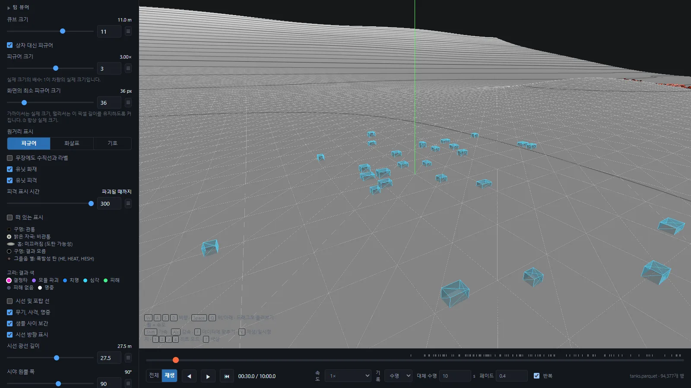

# 피규어 오버레이(상자 리플레이)

작은 영화입니다. 사람 한 명마다 피규어 하나가 있고, 시간이 흐르면서 움직이며, 뒤에는 자취가 남습니다.

모드 막대에서 이 모드의 이름은 **피규어 오버레이**입니다. 이 페이지는 전에는 "상자 리플레이"라고 불렸습니다. 피규어가 생기기 전에는 사람 한 명이 상자 하나였기 때문입니다. "피규어 리플레이"와 "상자 리플레이"는 같은 뜻입니다. **피규어 오버레이**에는 숫자 키가 없습니다. 모드 막대에서 고르십시오. [사람](glossary.md)마다 피규어(또는 상자) 하나를 그리고, 이것은 [타임라인](timeline.md)을 따라 움직입니다. 선택 사항인 시선 광선과 자취도 함께 그립니다. 이것은 밀도가 아니라 재생입니다. *누가, 언제, 어디에 있었는지*를 보여 줍니다. 사람 열이 필요합니다. 시간 열이 없으면 모든 표본이 한꺼번에 그려집니다.

## 사용하는 법 {#how-to-use-it}

1. 사람 열과 시간 열이 있는 데이터를 불러옵니다.
2. 모드 막대에서 **피규어 오버레이**를 고릅니다.
3. 타임라인을 **재생**으로 바꾸고 재생을 누릅니다(`K`).
4. **팀 뷰어**를 열어 **궤적 길이**, 피규어 크기, 시선 광선을 바꿉니다.

이 모드에서는 히트가 그려지지 않으며, 적응형 스프라이트 예산은 쉽니다.

기본적으로 각 사람은 상자가 아니라 그 사람이 무엇인지에 맞는 피규어로 그려집니다. 유닛이 어떤 피규어를 받는지는 [피규어](figures.md)를 보고, 라벨, 따라가기 카메라, 두 유닛 사이 측정, 이벤트 목록은 [경기 리플레이](match-replay.md)를 보십시오.

## 팀 뷰어 패널 {#the-team-viewer-panel}

이 모드에서는 히트 패널 대신 보입니다.

| 조절 | 기본값 | 범위(조그) | 뜻 |
|---|---|---|---|
| **상자 대신 피규어** | 켜짐 | | 각 사람을 그 사람이 무엇인지에 맞는 피규어로 그립니다. 걸어 다니는 병사, 데이터가 이름을 붙인 탱크나 항공기. 데이터가 아무것도 말하지 않는 것은 상자로 남습니다. |
| **피규어 크기** | 1× | | 1×는 실제 크기입니다. |
| **화면의 최소 피규어 크기** | 36 px | 0 = 항상 실제 크기 | 가까이에서는 실제 크기입니다. 멀리 있는 피규어는 이 픽셀 길이를 유지하도록 커집니다. |
| **무기, 사격, 명중** | 켜짐 | | 연기가 나는 날아가는 무기, 예광탄, 충돌, 명중과 격추. 명중에서 추정한 예광탄은 점선입니다. |
| **큐브 크기** | 불러올 때 사람의 크기, 또는 범위 / 500 | 0.05-200 m, 로그(5000) | 각 상자의 모서리 길이. [사람의 크기](sessions-persons-groups.md#entity-size)를 보십시오. |
| **샘플 사이 보간** | 켜짐 | | 같은 세션에서 같은 사람의 두 표본 사이에서는 상자를 그 사이에 비례하여 둡니다. 세션 경계를 넘지는 않습니다. |
| **시선 방향 표시** | 켜짐 | | 각 상자에서 그 사람의 시선 방향으로 나가는 광선입니다([시선 열](axes-units-and-time.md#look-direction)이 필요). |
| **시선 광선 길이** | 사람의 크기 × 4, 또는 범위 / 200 | 0.5-500 m, 로그(20,000) | 시선 방향이 켜져 있을 때 보입니다. |
| **궤적 길이** | 8 s | 0-300 s(86,400); 0 = 끄기 | 각 사람 뒤에 그려지는 과거의 초 단위 길이. |
| **모든 원본 샘플 그리기** | 꺼짐 | | 사람마다 보간된 상자 하나 대신, 창 안에 저장된 샘플마다 상자 하나를 그립니다. 반응성을 유지하도록 솎아 냅니다. |

패널의 힌트는 보간과 자취가 한 세션 안의 표본만 잇는다는 것, 그리고 불러온 데이터에 [이름 공유](sessions-persons-groups.md#names-worn-by-several-things-at-once)가 있으면 몇 개 이름이 단일 표본으로 그려지는지를 설명합니다.

## 재생 중인 세션 {#the-session-being-played}

세션 열이 있으면, 사이드바 위쪽의 **세션** 선택기([세션](sessions-persons-groups.md#the-session-picker))가 어느 경기를 재생할지 정합니다. 불러올 때 가장 바쁜 세션이 골라집니다. 그 세션의 행만 상자와 자취가 되며, 타임라인은 전체 데이터셋이 아니라 그 세션의 구간 위에서 돌아갑니다. **모든 세션**은 모든 세션을 한꺼번에 재생합니다. 그래도 세션들 사이에서는 표본을 잇지 않습니다.

## 언제 무엇이 그려지는가 {#what-is-drawn-when}

[`TrackCursor`](https://github.com/Holdi601/3DHeat/blob/main/src/data/tracks.ts)에서 가져왔습니다.

**실시간 상자**(재생 모드, 원본 샘플 꺼짐). 보이는 사람마다, 재생 위치에 있거나 그 이전의 가장 최근 표본입니다:

- 그 사람에게 다음 표본이 있고, 같은 세션이며, 이름이 공유되지 않았다면, 상자는 두 표본 사이에서 시간에 비례하여 놓입니다. 요는 짧은 쪽으로 보간되고, 피치는 선형으로 보간됩니다(*보간*이 켜져 있을 때).
- 그렇지 않으면 상자는 타임라인의 **대체 수명**(기본값 10 s) 동안 마지막 표본에 머물다가 사라집니다. 그래서 제거된 플레이어가 남아 있지 않습니다.

**모든 모드**는 재생 위치를 무시하고, 범위 안의 모든 표본을 상자로 그립니다.

**원본 샘플**은 창 안에 저장된 표본마다 상자 하나를 그립니다. *창* 기록에서는 *구간* 전체이고, 그 밖에서는 재생 위치까지 전부입니다. 최대 65,536개 상자입니다. 샘플이 더 많으면 *k*번째마다 하나를 그립니다.

**자취**(궤적 길이가 0보다 크고 원본 샘플을 그리지 않을 때): 재생 위치까지 최근 *궤적 길이* 초 안에서, 사람의 연속된 표본 쌍마다 선을 긋습니다. 나이에 따라 불투명도 80%에서 투명까지 사라집니다. 세션이 바뀌는 곳에서 자취는 멈추고, 공유된 이름에는 그려지지 않습니다. 최대 131,072개 정점입니다. 더 많으면 행을 고르게 건너뜁니다.

**누가 보이는가:** 사람은 [팀 목록](teams-list.md)에서 그룹이 체크 해제되었거나(그 그룹은 첫 행의 그룹), 그룹 필터가 제외했거나, [엔티티](entities.md) 패널에 선택이 있는데 그 사람이 포함되지 않았을 때 숨겨집니다. [열 필터](filters.md)는 상자에 적용되지 않습니다.

## 색 {#colours}

그룹마다 한 색조 계열, 구성원마다 명도 한 단계를 씁니다. 그래서 한눈에 누가 어느 편인지 알 수 있습니다([`teamMemberColor`](https://github.com/Holdi601/3DHeat/blob/main/src/render/colors.ts)). 그룹의 색조는 고정된 열 가지를 돌아갑니다. 파랑, 빨강, 초록, 호박색, 보라, 청록, 마젠타, 라임, 주황, 남색입니다. 그룹의 구성원들은 명도 42-76%, 채도 90-65%에 걸쳐 퍼집니다.

## 참고 {#notes}

- 피규어 오버레이는 무언가 바뀔 때만 피규어를 다시 만듭니다. 쉬고 있는 프레임은 마지막 피규어를 다시 그립니다.
- [통계 오버레이](performance-and-stats.md)의 *큐브* 줄은 화면의 상자 수를 셉니다.
- 피규어 오버레이는 레벨과 같은 장면에 그리므로, [피사계 심도](camera.md#depth-of-field)는 상자는 흐리게 하지만 히트는 절대 흐리게 하지 않습니다.
