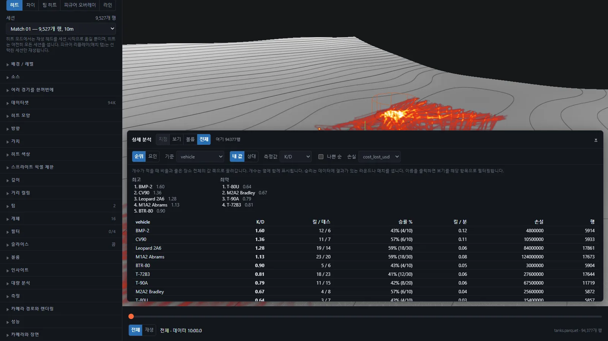
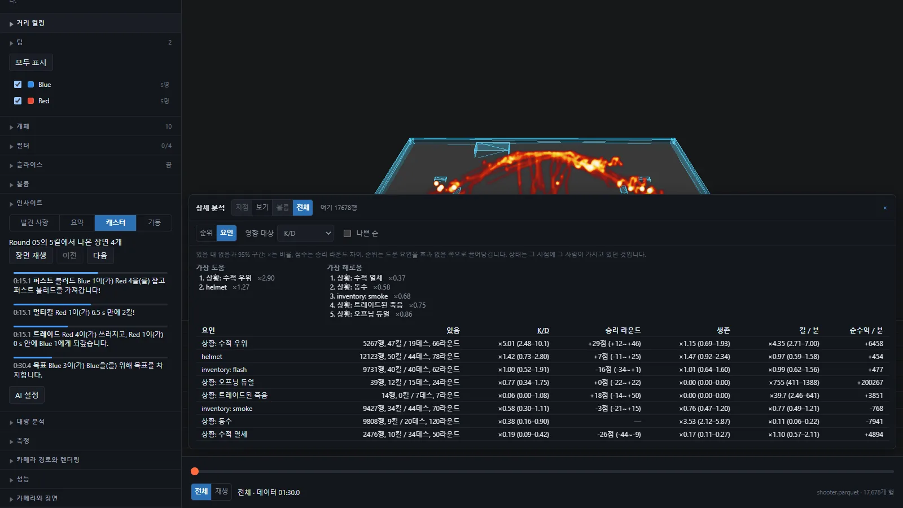

# 상세 분석: 어디서 누가, 무엇이 가장 잘하는가

**상세 분석**은 질문 하나에 답합니다. 이 장소에서 어느 차량, 플레이어, 무기가 가장 잘하는가? 다리에서 이기는 탱크를 찾거나, 헬멧이 정말 도움이 되는지 보는 데 쓰십시오.

한 장소(고른 지점, 뷰, 볼륨, 또는 보이는 전부)에서 일어난 일을 어떤 범주로든 순위 매기고, 모든 상태 요인을 있을 때와 없을 때로 나누어 잽니다.

## 해 보기 {#try-it}

1. 격추와 사망이 있는 경기를 불러오고, **볼륨**을 엽니다.
2. 관심 있는 장소 둘레에 볼륨을 그리고 선택합니다.
3. 통계 아래의 **상세 분석...**을 누릅니다.
4. **기준**에서 *차량*을 고르고, 측정으로 *K/D*(죽음당 격추)를 고릅니다.
5. 목록을 읽습니다. 가장 좋은 것이 위입니다. **나쁜 순**을 누르면 뒤집힙니다. 이름을 누르면 뷰가 그 이름으로 걸러집니다. 다시 누르면 풀립니다.

## 여는 법 {#open-it}

| 어디서 | 처음 잡는 영역 |
| --- | --- |
| [볼륨](volumes.md)(통계)의 **상세 분석...** | 고른 볼륨 |
| 지점을 클릭한 뒤 선택 카드의 **여기 상세 분석** | 그 지점 둘레의 구(**반경**, 기본값은 데이터 크기의 3%) |
| **차이** 분할 패널 | 뷰 |

머리말에서 영역을 바꿉니다. **지점**, **보기**(마지막 집계 때 카메라가 본 것. 움직인 뒤에는 **다시 집계**), **볼륨**(하나를 고름), **전체**입니다. 배경에서 집계하며, 상태 줄은 영역에 행이 몇 개 있는지 알려 줍니다.

## 순위 {#ranking}

무엇으로 순위를 매길지와 측정을 고릅니다:

| 측정 | 뜻 |
| --- | --- |
| A, B | 차이 지도의 각 쪽 행들. 히트가 나누는 방식대로 나뉩니다 |
| A / B, A - B, A / (A + B) | 두 층을 서로 비교 |
| K/D | 격추 대 사망 |
| 승률 % | 이긴 라운드(또는 경기). 데이터가 누가 이겼는지 말하는 경우 |
| 격추 / 분 | 있었던 분당 격추(움직임 표본 사이의 간격) |
| 번 돈, 잃은 돈, 순 돈 | `earn_*`와 `cost_*` 열의 합. 선택기로 통화를 고릅니다 |

격추, 사망, 존재, 승리, 돈은 뷰가 그 장소에서 보여 주는 모든 행을 셉니다. 분할의 어느 쪽에 있든, 또는 아무 쪽도 아니든 상관없습니다.

비율과 속도는 수가 적을 때 장소 전체의 값 쪽으로 끌어당겨집니다. 그래서 목숨 한 번에 2 격추는 목록 맨 위에 오르지 않습니다. 수는 옆에 표시됩니다.

순위는 그룹, 플레이어, 경기, 아무 범주 열(차량, 무기, 편, 구매 종류, 요원이나 장비 세트), 범위 안의 아무 숫자 열(방어구, 장비의 가치), 무기 열의 **클래스**(소총, 저격, 기관단총, 권총...), 그리고 `inventory` 같은 목록 열이 가진 **보조 장비**의 개수로 매길 수 있습니다.

**내 값**은 행 자신의 값으로 순위를 매깁니다. **상대**는 상대방의 값으로 순위를 매깁니다. 격추에서는 피해자의 무기, 사망에서는 격추자의 무기입니다(그들을 가리키는 `other` / `victim` 열이 필요합니다).

## 그 시점의 상태 {#state-at-the-time}

행의 값은 그 행이 기록하지 않았을 때(장비 없는 이벤트 행)를 빼고는 자기 값입니다. 사망의 경우(그 무기 열이 격추자의 무기를 가리킬 수 있음)에는, 같은 사람이 경기 중 더 앞서 마지막으로 가지고 있던 것입니다.

## 요인: 있을 때와 없을 때 {#factors-with-against-without}

**순위**에서 **요인**으로 바꾸고, **영향 대상**을 고른 뒤 *가장 도움 됨*과 *가장 해로움*을 읽으십시오:

각 요인이 K/D, 이긴 라운드, 생존(사망당 분), 분당 격추, 분당 순 돈에 주는 영향을 95% 구간과 함께 보여 줍니다. 비율은 x로, 이긴 라운드는 점수 차이로 나타냅니다. 순위는 각 추정치를 자기 불확실성만큼 영향 없음 쪽으로 끌어당기므로, 드문 요인은 높은 순위에 오르려면 분명한 영향이 있어야 합니다. 보이는 구간은 끌어당기지 않은 값입니다.

라운드가 있는 데이터는 근접전 **상황**을 더합니다([근접전과 라운드](close-quarters.md)). 데이터셋당 한 번 계산합니다. *눈이 멀음*(행의 `state_flashed`, 또는 지난 3초 동안 15 m 안의 적 섬광), *사망 교환*, *선제 결투*, 그리고 *인원 우위*, *동수* 또는 *인원 열세*(행의 편과 적 쪽에서 살아 있는 플레이어)입니다. 사망은 피해자가 죽기 직전에 있던 상황으로 셉니다.

한 번의 계산에서 측정하는 요인은 최대 256개입니다.

## 개발자용 {#for-developers}

### 작은 표본 끌어당기기 {#pulling-small-samples}

순위 값은 `(n + m*r0) / (d + m)`입니다. `n`과 `d`는 수이고, `r0`는 장소 전체의 비율이고, `m`은 그 사전 확률의 무게입니다.

### 변환기 작성자용: 요인 열 이름 짓기 {#for-converter-authors-naming-factor-columns}

변환기는 열 이름으로 요인을 더합니다:

| 열 | 요인 |
| --- | --- |
| `state_<name>` 숫자 | 0이 아닌 동안 켜짐(`state_scoped`, `state_suppressor`) |
| `state_<name>` 범주 | 값마다 요인 하나(`state_ammo` = AP, HE...) |
| `active_<name>` | 같은 방식. 최근에 켜졌거나 사용한 것에 대해: 능력, 궁극기, 장비, 버프(`active_ult`, `active_stim`) |
| 목록 열(`inventory`, `loadout`, `perks`, `abilities`, `attachments`, `modules`, `buffs`, `debuffs`, `upgrades`, 또는 `s`로 끝나는 `state_`/`active_` 이름) | `a\|b\|c` 값의 항목마다 요인 하나 |
| 이미 흔한 장비 플래그(`helmet`, `defuser`, `armor`, `scoped`, `airborne`, `duck`, `flashed`...) | 0이 아닌 동안 켜짐 |
| `ammoType`, `shellType`, `ammoName` | 마지막으로 발사한 탄 |

결과: 0/1 `won` 열(행의 편이 라운드나 경기를 이겼는지)과 `round` 열 - 이것이 [결과 열](data-formats.md#outcome-columns)입니다. 파일에 `won`과 `matchWon`이 모두 있으면 *승률 %*는 라운드를 셉니다. 돈: `earn_<currency>`와 `cost_<kind>_<currency>`. 종류별 수입만(`earn_round_cs2`, 변환기의 정확한 라운드 보상) 주면, 그 종류의 수입만 비용 모형의 수입을 대체합니다(`round`는 설치와 해체도 포함). 나머지는 모형이 계산합니다.

매핑은 파일 자체의 목록과 나란히, 이 열들을 스스로 불러옵니다. 모든 `state_*`, `active_*`, `won`, `round`와 목록 열입니다. 다만 Parquet 파일의 통계가 전 구간에서 값 하나만 가진다고 보여 주는 열은 제외합니다(불러온 열 하나는 행당 4바이트입니다).
