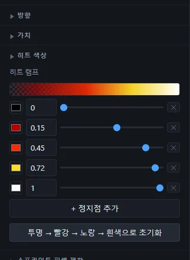

# 색과 노출

이 조절들은 어느 양의 히트가 어떤 색을 받을지 정합니다. **포화점**은 히트가 얼마나 되어야 흰색으로 뜨거워 보이는지를 정합니다.

## 빠른 해결 {#quick-fixes}

- 모든 것이 하얗습니다: **포화점**을 올리거나 **화면에서 자동 노출**을 누릅니다.
- 아무것도 보이지 않습니다: **포화점**을 내리거나 **화면에서 자동 노출**을 누릅니다.
- 점 몇 개만 보입니다: **최소 히트**를 올립니다.

이 페이지의 모든 조절은 히트를 색으로 바꿀 때 작동합니다. 그래서 어느 것을 끌어도 바로 다시 그려지고, **누적을 다시 시작하지 않습니다**.

## 포화점 {#saturation-point}

**포화점**(히트 모양 섹션): 색 램프의 맨 위에 대응하는 누적 히트입니다(*선형* 응답일 때. 다른 응답은 아래를 보십시오). 로그 슬라이더는 0.1-4000이고, 손잡이는 10,000,000까지 끌 수 있습니다. 누적 히트는 행 수에 따라 커지기 때문입니다. 기본값은 24입니다. 불러올 때마다 먼저 **분석적 추정**을 하고, 그다음 그림에서 **측정**합니다.

이 값을 잘못 잡으면 히트맵이 빈 화면이나 흰 화면이 됩니다. 이 값은 믿을 만하게 계산할 수 없습니다. 텔레메트리는 한곳에 아주 몰리기 때문입니다. 출현 지점, 문, 좁은 길목에 몰려서, 최고 밀도와 평균 밀도의 비율이 데이터셋마다, 그리고 카메라 각도마다 열 배 가까이 달라집니다.

## 자동 노출 {#auto-exposure}

**화면에서 자동 노출**은 셰이더가 실제로 만든 화면을 측정합니다. 빈 픽셀은 무시하고, 빛이 든 픽셀의 98번째 백분위수를 취해 포화점의 85% 자리에 둡니다. 그래서 램프의 맨 위는 실제 최고점을 위해 남겨집니다.

패널에는 *프레임의 X%를 측정; 98번째 백분위수 R을 램프 맨 위 근처에 둠*이라고 나타납니다. *포화* 응답에서는 포화점의 85% 값이 램프의 85%가 아니라 약 69%에 놓입니다.

이 기능은 **자동으로**도 작동합니다:

- 데이터셋을 불러온 뒤 그려진 프레임 8개 후;
- [필터](filters.md)가 바뀐 뒤 8프레임 후(모든 위치를 백 개의 이벤트까지 거르면 밀도가 몇 자릿수씩 바뀝니다);
- 점 히트와 [선 히트](line-heat.md) 사이를 바꾼 뒤, 또는 선 히트가 그리는 경로를 바꾼 뒤 8프레임 후. 선은 샘플 하나당 점 스프라이트보다 훨씬 적은 히트를 깔기 때문입니다.

아무것도 빛나지 않으면 자동 실행은 포화를 그대로 둡니다. 버튼은 분석적 추정으로 돌아가고 *측정할 빛이 없음 - 분석적 추정을 사용함*이라고 말합니다.

### 뷰 따라가기 {#follow-the-view}

**뷰 따라가기**(히트 모양 섹션, 기본값은 켜짐)는 카메라가 멈출 때마다 다시 측정합니다. 그래서 들어간 지역은 전체 지도에서 잰 눈금이 아니라 색 램프 전체를 씁니다. 작은 변화는 무시하고, 값은 뛰지 않고 미끄러지듯 바뀝니다. 네 가지 히트 모드에서 작동하며, 그림 오버레이에서는 작동하지 않습니다.

끄면 눈금이 고정되어, 여러 곳을 같은 눈금으로 비교할 수 있습니다. **포화점**을 손으로 끌어도 고정됩니다.

## 밀도 응답 {#density-response}

**밀도 응답** - *k*(히트 / 포화)가 램프에 어떻게 대응하는지:

| 응답 | 공식 | 쓰임 |
|---|---|---|
| **포화**(기본값) | t = 1 - e^(-k) | 쌓인 반투명 스프라이트처럼 램프 맨 위에 점근적으로 다가갑니다. 아무것도 평평한 흰색으로 잘리지 않으므로, 익숙하지 않은 데이터에 가장 안전한 기본값입니다. |
| **선형** | t = k | 같은 색이 같은 개수를 뜻하는 유일한 대응입니다. 두 데이터셋이나 두 시간대를 비교할 때 쓰십시오. |
| **로그** | t = log₂(1 + 7k) / 3 | 긴 꼬리를 압축하므로, 극단적인 핫스팟 하나가 나머지를 램프 바닥으로 눌러 버리지 않습니다. 드문 지역을 밝게 합니다. |

## 최소 히트 {#minimum-heat}

**최소 히트**(기본값은 꺼짐, 0-100%): 히트를 조금이라도 가진 모든 픽셀은 램프의 이 비율 이상으로 올라갑니다. 이 값을 올리고 스프라이트 반경을 내리면, *어디서든 무언가 일어난 적이 있었는지*를 볼 수 있습니다. 한 개의 데이터점이 투명 바로 위에 묻히지 않고 뚜렷하게 보입니다. 밀도를 판단할 때는 끄십시오. 설계상 램프 바닥을 평평하게 만들기 때문입니다. 임계값(k > 0.0001)은 정말 빈 픽셀을 빈 채로 둡니다.

## 색 램프 편집기 {#the-ramp-editor}

**히트 색상** 섹션에 있습니다. 이름이 램프의 용도를 말합니다. 히트와 선에서는 *히트 램프*, 차이에서는 *양수(더하기 팀)*, [팀 히트](team-heat.md)에서는 *불투명도 램프(색은 그룹에서 옴)*입니다. 팀 히트에서는 알파만 씁니다.



맨 위 막대가 램프를 미리 보여 줍니다. 그 아래에는 정지점마다 한 줄이 있습니다:

| 부분 | 뜻 |
|---|---|
| 색 견본 | 정지점의 색(브라우저의 색 고르개). |
| 숫자 | 램프를 따라 정지점의 위치, 0에서 1까지(0 = 히트 없음). |
| 슬라이더 | 정지점의 불투명도, 0-100%. |
| ✕ | 정지점을 지웁니다. 두 개만 남으면 비활성화됩니다. |

**+ 정지점 추가**는 마지막 두 정지점 사이 한가운데에 정지점을 하나 더합니다. 색과 불투명도는 마지막 정지점의 것을 씁니다. **투명 → 빨강 → 노랑 → 흰색으로 초기화**는 기본값을 되돌립니다.

정지점은 어떤 순서로 줘도 됩니다. 램프를 만들 때 정렬됩니다. **알파**는 히트를 장면 위에 섞는 값입니다. 그래서 기본 램프의 0 끝은 완전히 투명합니다.

### 기본 램프 {#the-default-ramps}

| 위치 | 양수(히트, 선, 차이 +) | 음수(차이 −) |
|---|---|---|
| 0.00 | 검정, 알파 0 | 검정, 알파 0 |
| 0.15 | rgb(180, 0, 0), 알파 0.55 | rgb(0, 170, 60), 알파 0.55 |
| 0.45 | rgb(255, 40, 0), 알파 0.85 | rgb(0, 190, 200), 알파 0.85 |
| 0.72 | rgb(255, 220, 40), 알파 0.95 | rgb(40, 80, 255), 알파 0.95 |
| 1.00 | 흰색, 알파 1 | rgb(170, 60, 255), 알파 1 |

## 카메라가 움직일 때 {#while-the-camera-moves}

카메라가 움직이면 누적이 매 프레임 다시 시작됩니다. **매 프레임 모든 행 그리기**가 켜져 있으면(기본값), 움직이는 프레임마다 여전히 정확합니다. 꺼져 있으면, 움직이는 프레임은 표본 하나로 추정한 결과를 보여 줍니다. 가중치에 따라 크기가 달라진 밝은 덩어리들입니다. 멈추면 더 매끄러운 참 그림으로 수렴합니다. 이는 예상된 동작입니다. [누적](accumulation.md)을 보십시오.

## 개발자용 {#for-developers}

### 합성 단계 {#the-composite-pass}

히트가 누적된 뒤, 각 픽셀의 값은 한 번의 합성 단계([`COMPOSITE_FS`](https://github.com/Holdi601/3DHeat/blob/main/src/render/webgl2/shaders.ts))에서 색으로 바뀝니다. 단계는 이렇습니다:

```
k = |heat| / saturation point
t = response(k)                         clamped to 0..1
if minimum heat > 0 and k > 0.0001:  t = minimum + (1 - minimum) × t
colour, alpha = ramp(t)                  (the negative ramp when heat < 0, Difference only)
pixel = mix(scene, colour, alpha)
```

### 분석적 추정 {#the-analytic-estimate}

**분석적 추정**([`estimateSaturation`](https://github.com/Holdi601/3DHeat/blob/main/src/data/calibrate.ts))은 행들이 데이터의 X-Z 발자국 위에 퍼져 있다고 가정합니다. 평균 히트 = 행 수 × (π r² / 발자국 면적) × 1/3 × 중심 세기(1/3은 선형 램프의 원판 평균)이고, 여기에 가정된 최고-평균 비율 25를 곱합니다. 값은 0.1-1,000,000으로 제한됩니다. 대략 한 자릿수 안에서 맞으면 충분합니다.

### 측정 {#metering}

[`exposure.ts`](https://github.com/Holdi601/3DHeat/blob/main/src/render/exposure.ts):

1. 히트 대상을 GPU에서 다시 읽고, 최대 40,000개 값으로 솎아 냅니다;
2. 빈 픽셀(히트 ≤ 0.0001)은 버립니다. 히트 필드는 대부분 비어 있고, 그것을 평균에 넣으면 카메라 노출계가 검은 배경을 가리킬 때처럼 전부 노출 부족이 되기 때문입니다;
3. 빛이 든 픽셀의 98번째 백분위수가 기준입니다;
4. 포화점은 기준 / 0.85가 됩니다. 그래서 기준은 포화점까지 가는 길의 85% 자리에 놓이고, 램프 맨 위는 실제 최고점을 위해 남겨집니다.

### 색 표 {#the-colour-table}

램프는 256 × 2 RGBA 표로 구워집니다(양수 램프는 첫 줄, 음수 램프는 둘째 줄)([`buildColorLut`](https://github.com/Holdi601/3DHeat/blob/main/src/render/colors.ts)). 색은 선형 빛에서 보간되고 sRGB로 저장됩니다. 불투명도는 선형으로 보간됩니다.
