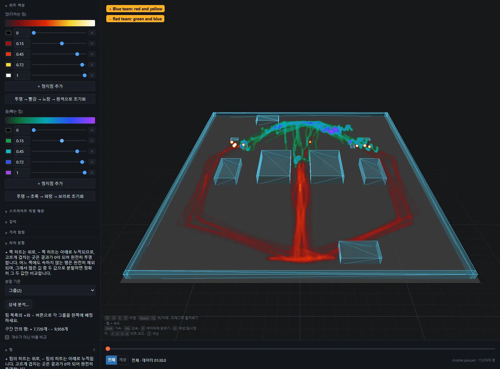

# 차이

팀 A가 더 많았던 곳은 빨강, 팀 B가 더 많았던 곳은 초록-파랑, 두 팀이 같았던 곳은 아무것도 없습니다.

**차이**(키 2)는 부호가 있는 히트입니다. 한 집단의 행은 히트를 더하고, 다른 집단의 행은 히트를 뺍니다. 두 집단이 고르게 겹치는 곳의 결과는 0이고 완전히 투명합니다. 한쪽이 우세한 곳은 그쪽 색으로 보입니다. 기본값은 **+** 쪽이 따뜻한 색(투명 → 빨강 → 노랑 → 흰색), **−** 쪽이 차가운 색(투명 → 초록 → 파랑 → 보라)입니다.

## 사용하는 법 {#how-to-use-it}

1. `2`를 누릅니다(또는 모드 막대에서 **차이**를 고릅니다).
2. 사이드바에서 **차이 분할**을 엽니다.
3. **분할 기준**을 고릅니다. 보통은 *그룹*입니다.
4. 한 그룹(또는 값)을 **+**에, 다른 그룹을 **−**에 둡니다.
5. 색을 읽습니다. 따뜻한 색은 + 쪽, 차가운 색은 − 쪽입니다. 한쪽에 행이 하나도 없으면 패널이 경고합니다([표시될 수 있는 메시지](#messages-you-may-see)를 보세요).

*어느* 두 집단인지가 질문의 전부이므로, 분할은 그룹만이 아니라 보관된 어떤 열로도 할 수 있습니다. **어느 쪽에도** 속하지 않는 행은 0으로 세지 않고 **제외합니다**. 이것이 여러 값 중 두 값만 정확히 비교하게 해 주고, [필터](filters.md)와도 함께 씁니다. 예를 들어 한 맵으로 필터를 좁힌 다음, 그것을 빌드별로 나눌 수 있습니다.

이 모드는 두 쪽이 필요합니다. 그룹 열에 그룹이 두 개 이상 있거나, 필터링용으로 보관한 열로 나눠야 합니다. 그룹이 두 개 미만인 데이터는 불러올 때 열 분할로 시작합니다. 여러 파일을 불러왔다면 *소스 파일* 열이 먼저이고, 그다음은 값이 두 개인 첫 범주 열, 그다음은 범위가 있는 첫 숫자 열입니다. 그래서 그룹이 없는 데이터에서도 *두 불러오기 비교*가 됩니다. 그룹도 나눌 열도 없는 데이터에서만 이 모드를 쓸 수 없습니다. 한쪽에 아무것도 남지 않는 열 분할도 마찬가지입니다.

## 차이 분할 패널 {#the-difference-split-panel}

차이 모드에서 히트 패널 아래에 나타납니다.

**분할 기준**의 선택지:

| 선택지 | 표시 | 분할 규칙 |
|---|---|---|
| 그룹 | *그룹 (N)* (그룹 열이 있을 때) | 각 그룹을 +, −, 또는 없음으로. [팀 목록](teams-list.md)에서 정합니다 |
| 범주 열 | *열 (N개 값)* | 값을 +, −, 또는 없음으로 |
| 숫자 열 | *열 (숫자)* | 각 쪽의 값 범위 |
| 원본 파일 | *소스 파일 - 두 불러오기 비교* (파일을 여러 개 불러왔을 때) | 파일을 +, −, 또는 없음으로 |

불러올 때 *필터링용 보관*에 들어간 열만 선택지로 나옵니다.

### 개수가 아닌 비율 비교 {#compare-shares-not-counts}

**개수가 아닌 비율 비교**(기본값 꺼짐)는 각 쪽을 그 쪽 행 수의 역수로 가중합니다. 그래서 행이 다섯 배 많은 쪽이 수 때문에 이기지 않습니다. 색은 한쪽이 다른 쪽보다 비율로 얼마나 더 흔한지를 보여 줍니다. 두 쪽의 데이터 양이 크게 다를 때 쓰세요. 예를 들어 길이가 다른 두 세션을 비교할 때입니다.

### 표시될 수 있는 메시지 {#messages-you-may-see}

패널은 그림이 진짜 차이가 아닐 때 경고합니다.

| 메시지 | 뜻 |
|---|---|
| *N + / M −* (또는 *N + / M − / K 미사용*) | 각 쪽(그리고 어느 쪽에도 없는 것)에 값이 몇 개 있는지. |
| 구간의 행 중 **+** 쪽은 없습니다 | **−** 쪽만 그립니다. 타임라인 구간을 옮기거나 분할을 바꾸세요. |
| 구간의 행 중 **−** 쪽은 없습니다 | **+** 쪽만 그립니다. |
| 어느 쪽에도 값이 없습니다 | 차이는 아무것도 그리지 않습니다. 값을 최소 하나 **+** 또는 **−**에 두세요. |
| *열*은 이 방식으로 나눌 수 없습니다 | 고른 열이 분할에 맞지 않습니다. 열을 다시 고르세요. |
| 분할 열이 N/M 청크에 GPU 메모리로 들어가지 않았습니다 | 그 행들은 그려지지 않습니다. 성능 → 자원 예산에서 GPU 예산을 올리거나, 행을 더 적게 불러오세요. |

### 그룹별 {#by-group}

이 패널은 [팀 목록](teams-list.md)을 가리킬 뿐입니다. 거기서 각 그룹에 **+**와 **−** 버튼이 있습니다. 불러올 때마다 그룹의 앞쪽 절반(올림)은 +에, 나머지는 −에 놓입니다. 팀 목록의 **고르게 나누기**는 같은 일을 한 번 더 합니다. 어느 쪽에도 없는 그룹이나, 체크박스로 숨긴 그룹은 아무것도 기여하지 않습니다.

### 범주 값별 {#by-category-values}

| 부분 | 뜻 |
|---|---|
| `a + / b − / c 미사용` | 각 쪽(그리고 어느 쪽에도 없는 것)에 값이 몇 개 있는지. |
| **지우기** | 모든 값을 어느 쪽에도 두지 않습니다. |
| 값 목록 | 각 값에 **+**와 **−** 버튼이 있습니다. 활성 버튼을 다시 누르면 그 쪽에서 뺍니다. 빈 값은 *(없음)*으로 나옵니다. |
| 개수 제한 메모 | 처음 200개 값만 나열합니다: *N개 값 중 처음 200개를 보여 줍니다. 이렇게 넓은 열은 먼저 필터로 좁히거나, 값이 순서가 있다면 범위로 나누는 편이 낫습니다.* |

열을 고르면 첫 값은 +에, 두 번째 값은 −에 놓입니다. 어느 쪽에도 값이 없으면, 분할은 빈 화면 대신 그룹으로 되돌아갑니다. **소스 파일**도 같은 방식으로 작동하며, 파일 하나에 값 하나입니다. 이렇게 두 내보내기, 두 시험 실행, 또는 두 빌드를 비교합니다.

### 범위별 {#by-range}

| 부분 | 뜻 |
|---|---|
| 힌트 | 열의 최소값과 최대값. |
| **양의 범위(+)**, **부터** / **까지** | 이 범위 안의 값을 가진 행이 더해집니다. 양 끝을 포함합니다. |
| **음의 범위(−)**, **부터** / **까지** | 이 범위의 행은 뺍니다. |
| **중간값에서 분할** | +를 [최소, 중간]으로, −를 [중간, 최대]로 맞춥니다. 열을 고르면 하는 일도 이것입니다. |

두 범위에 모두 든 값은 +로 칩니다. 범위가 열 전체를 덮을 필요는 없습니다. 어느 범위에도 없는 값은 제외됩니다. *처음 2분 대 마지막 2분*은 시간처럼 생긴 열에 대한 범위 분할입니다.

## 색 {#colours}

**히트 색상** 섹션은 이 모드에서 두 개의 램프 편집기를 보여 줍니다. **양(더하는 팀)**과 **음(빼는 팀)**이며, 각각 자기 초기화 버튼이 있습니다(*투명 → 빨강 → 노랑 → 흰색으로 초기화*, *투명 → 초록 → 파랑 → 보라로 초기화*). 합성은 순 히트의 절댓값을 [포화점과 응답](colour-and-exposure.md)을 거쳐 쓰고, 순 히트가 0보다 작은 곳에서는 음의 램프를 고릅니다. [색과 노출](colour-and-exposure.md#the-ramp-editor)을 보세요.

차이의 크기가 중요할 때는 *선형* 밀도 응답을 쓰세요. 같은 색이 같은 개수를 뜻하는 유일한 응답입니다.

## 작동 원리 {#how-it-works}

모든 행은 버텍스 셰이더에서 +1, -1 또는 0의 부호를 받습니다([`POINT_HEAT_VS`](https://github.com/Holdi601/3DHeat/blob/main/src/render/webgl2/shaders.ts)). 0이면 어떤 프래그먼트도 그려지기 전에 그 행을 버립니다.

- 그룹별 분할에서는 부호가 4,096칸짜리 그룹 표에서 옵니다. 행의 그룹 id로 찾습니다(그룹 id는 행 위치 텍셀의 네 번째 채널에 실려 있습니다).
- 범주별 분할에서는 부호가 두 번째 4,096칸짜리 표에서 옵니다. 이 표는 범주 값마다 채워지고, 행의 값은 열의 필터 텍스처에서 읽습니다. 표의 끝을 넘는 값은 두 백엔드 모두에서 거부됩니다.
- 범위별 분할에서는 행의 값을 두 범위와 비교합니다.

분할을 바꾸면 누적이 다시 시작됩니다.

**숨긴 그룹은 어떤 분할에서도 계속 숨겨집니다.** 열로 나눌 때 그룹 표는 더 이상 부호를 담지 않습니다. 보이는 그룹에는 1을, 숨긴 그룹에는 0을 담습니다([`frameSignTables`](https://github.com/Holdi601/3DHeat/blob/main/src/render/filterTables.ts)). 두 표는 함께 셰이더에 전달됩니다. WebGL2에서는 하나의 부호 텍스처의 두 행으로, WebGPU에서는 하나의 저장 버퍼의 두 절반으로 전달합니다. 행은 그 그룹이 보이고 *그리고* 열 값이 한쪽에 있을 때만 그려집니다. 따라서 [팀 목록](teams-list.md)에서 체크를 해제한 그룹이나, 매치 탭의 쪽 초점에서 빠진 그룹은 차이를 어떻게 나누든 아무것도 기여하지 않습니다.
