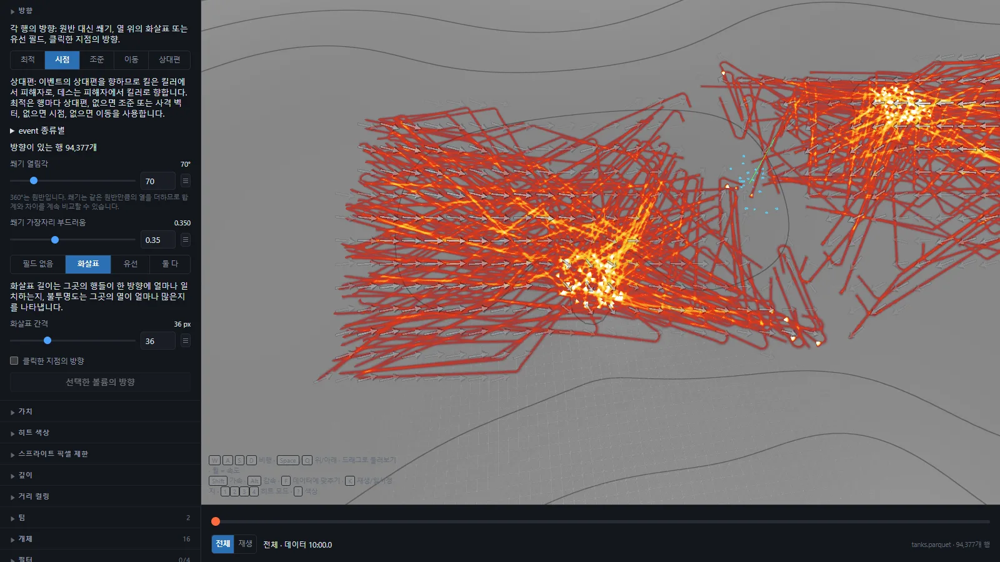

# 방향별 히트

보통의 히트는 일이 **어디에서** 일어나는지 말합니다. 방향별 히트는 **어느 쪽으로**도 말합니다. 사람들이 어느 쪽을 보고 있었는지, 조준하고 있었는지, 움직이고 있었는지, 또는 싸움의 상대편이 어디에 있었는지입니다.

보통의 스프라이트는 완전한 원판(360도)입니다. **쐐기 열림각**을 70도로 하면 같은 스프라이트가, 행이 향한 방향을 가리키는 좁은 쐐기가 되고, 더하는 총 히트는 같습니다.

## 사용하는 법 {#how-to-use-it}

1. 방향이 들어 있는 데이터를 불러옵니다([행에 방향을 주는 것](#what-gives-a-row-a-direction)을 보십시오).
2. 모드 막대에서 **히트**, **차이**, 또는 **팀 히트**를 고릅니다.
3. 사이드바에서 **방향** 섹션을 엽니다.
4. **원천**(어느 방향을 쓸지)을 고른 뒤, 그리기를 켭니다.
   - **쐐기 열림각**을 360° 아래로 낮추어, 각 행을 원판이 아니라 그 방향을 가리키는 쐐기로 그립니다.
   - **장**을 고르면 히트 위에 화살표나 유선을 그립니다.
   - **클릭한 지점의 방향**을 체크하고 히트를 클릭하면, 그 지점의 극좌표 차트가 나옵니다.

상태 줄은 고른 원천에서 방향을 가진 행이 몇 개인지 알려 줍니다.

## 설정 {#settings}

| 설정 | 기본값 | 하는 일 |
|---|---|---|
| 원천: **최고**, **보기**, **조준**, **이동**, **상대편** | 최고 | 각 행이 받는 방향. *최고*는 행마다 상대편, 없으면 조준, 없으면 보기, 없으면 이동을 취합니다. |
| **이벤트 종류별** | 위와 같음 | 이벤트 종류마다 다른 원천입니다. 예를 들어 격추에는 *상대편*, 위치에는 *보기*. 데이터에 값이 40개 이하인 이벤트 열이 있을 때 보입니다. |
| **쐐기 열림각** | 360° | 360°는 보통의 원판(꺼짐)입니다. 작을수록 좁은 쐐기입니다. 쐐기는 원판과 같은 양의 히트를 더하므로, 총합과 차이를 계속 비교할 수 있습니다. |
| **쐐기 가장자리 부드러움** | 0.35 | 0은 날카로운 가장자리의 쐐기, 1은 부드러운 부채꼴입니다. |
| **장**: 장 없음, 화살표, 유선, 둘 다 | 장 없음 | 화살표: 화살표의 길이는 그곳의 행들이 한쪽 방향에 얼마나 합의하는지이고, 불투명도는 그곳에 히트가 얼마나 있는지입니다. 화살표는 히트가 있는 곳에만 보입니다. |
| **화살표 간격** | 28 px | 화면에서 화살표 사이의 거리. |
| **유선 애니메이션** | 켜짐 | 켜져 있으면 유선이 흐릅니다. |
| **클릭한 지점의 방향** | 꺼짐 | 히트를 클릭하면 그곳의 방향을 봅니다(아래). |
| **선택한 볼륨의 방향** | | 선택한 [볼륨](volumes.md) 안의 모든 것에 대한 같은 차트. |

## 지점의 극좌표 차트 {#the-polar-chart-at-a-spot}

**클릭한 지점의 방향**을 켜고 히트를 클릭합니다. 그 점에 가까운 행들(스프라이트 반경의 1.5배 안)이 15°씩 24칸으로 된 장미꽃 그림에 모입니다:

- **주황색** 꽃잎: 나가는 방향(행들이 가리키는 곳);
- **파란색** 꽃잎: 들어오는 방향(행들이 온 곳);
- 꽃잎의 **넓이**는 그 수에 따라 커집니다. 화살표는 주된 방향을 보여 줍니다;
- 차트 아래의 줄은 주된 방위, 행들이 얼마나 강하게 합의하는지(R, 0에서 1), 도 단위의 퍼짐, 그리고 행 수를 줍니다.

차트에서 0°는 위이며, 이는 세계 −Z입니다(Tacview 기록에서는 북). 그 지점은 3D 뷰에도 화살표와 고리로 표시됩니다.

## 행에 방향을 주는 것 {#what-gives-a-row-a-direction}

| 원천 | 데이터에 필요한 것 |
|---|---|
| 보기 | 요 열(보는 방향으로 매핑됨): `yaw`, `heading`, `azimuth`, `view_yaw`, `rot_z` |
| 조준 | `aim_x`/`aim_y`, `shot_x`/`shot_y`, `fire_x`/`fire_y`, `hit_dir_x`/`hit_dir_y` 같은 숫자 쌍(선택 사항인 `…_z`) |
| 이동 | 추가로 필요한 것 없음. 같은 사람의 이전 표본에서 가는 한 걸음(10 s 이내, 같은 세션) |
| 상대편 | 이벤트의 상대쪽을 말하는 열(`other`, `victim`, `target`, `killer`, `attacker`, `shooter`, `other_player` 등). 값은 사람 이름입니다. 격추는 격추자에서 피해자로, 사망은 피해자에서 격추자로 가리킵니다 |

## 팁 {#tips}

- 쐐기는 화면에서 어느 정도 크기가 있어야 합니다. 몇 픽셀 아래면 다시 원판으로 그려집니다.
- 격추 행에 *상대편*을 쓰면 싸움을 **어디서부터** 이겼는지 볼 수 있고, 위치 행에 *보기*를 쓰면 사람들이 **어디를 지켜보는지** 볼 수 있습니다.
- **차이**에서는 두 쪽의 쐐기가 각자의 방향을 가리키므로, 다투는 사격선이 두드러집니다.
