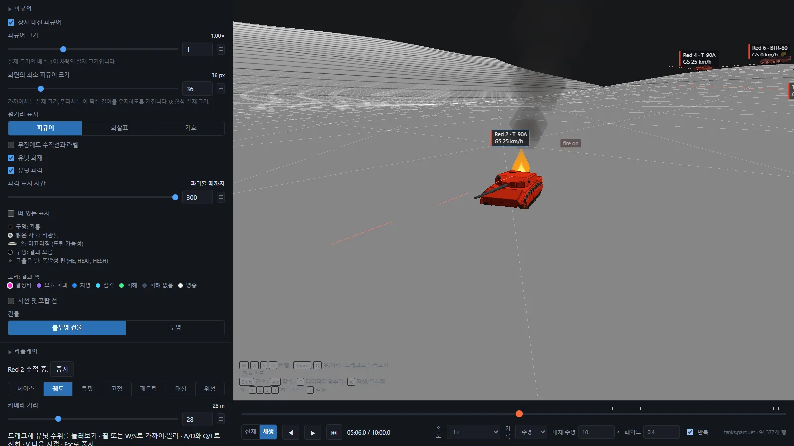

# 피규어

**피규어**는 유닛이 실제로 무엇인지 보여 주는 작은 3D 모델입니다. 탱크, 제트기, 배, 병사 같은 것입니다. [재생](match-replay.md)은 평범한 상자 대신, 모든 유닛을 실제 크기의 피규어로 그립니다.

약 2,000개의 이름 있는 차량, 항공기, 선박, 무기, 병사가 있으며, 모두 뷰어가 직접 만듭니다.

## 카탈로그에 무엇이 있나요 {#what-is-in-the-catalogue}

| 영역 | 예 |
|---|---|
| 사람 | 선 병사, 웅크린 병사, 엎드린 병사; 저격수, 대전차, 위생병, 승무원 |
| 지상 | 탱크, 보병전투차량, 방공, 포병, 트럭과 승용차, 기차와 전차 |
| 공중 | 전투기, 공격기, 폭격기, 수송기, 헬리콥터, 복엽기부터 현대 제트기까지 |
| 해상 | 등급별 군함, 항공모함, 잠수함, 보트, 상선 |
| 무기 | 미사일, 로켓, 폭탄, 어뢰, 조명탄과 디코이 |
| 표식 | 연막, 섬광과 화염 수류탄, 설치된 폭탄, 깃발, 생성 지점, 경유지 |
| 근접 전투 | 플레이트 캐리어를 입고 돌격소총, SMG, 산탄총, DMR, LMG, 권총 또는 방패를 든 병사; 드론, 카메라, 철조망, 방패, 벽 보강, 바리케이드, 돌파용 폭약, 함정, 창문, 수류탄, 해체기 |

## 피규어는 어떻게 만들어지나요 {#how-the-figures-are-made}

- **공개된 치수로 만듭니다.** 대부분의 피규어는 뷰어 자체의 피규어 빌더가 공개된 수치(길이, 너비, 높이, 도로 바퀴, 포탑과 포, 날개와 꼬리)로 만듭니다. 그다음 형상을 공개된 사진, 도면, 공개 치수에 맞춰 조정합니다. 어떤 게임의 모델도 쓰지 않습니다.
- **무료 모델.** 일부 피규어는 더 실물에 가까울 때 무료 3D 모델(CC0 또는 CC BY)을 쓰며, 때로는 만든 차체와 합치기도 합니다. CC BY 작품의 작가는 [피규어 출처](figure-credits.md)에 표시됩니다. CC0 작품은 표시가 필요 없으므로 거기에 나열하지 않습니다.
- 모든 피규어는 전체, 간략, 원거리 버전(세부 수준, LOD)을 가지므로, 수천 개를 한꺼번에 그릴 수 있습니다.

## 유닛이 어떤 피규어를 받나요 {#which-figure-a-unit-gets}

뷰어는 데이터 자체의 열을 봅니다.

1. **이름** - *Name*, *Vehicle*, *Unit*, *Unit type*, *Model*, *Aircraft*, *Plane*, *Tank*, *Ship*, *Craft*, *Loadout*, *Kit*, *Figure*라는 열 - 은 카탈로그와 대조합니다. 정확히 일치하거나, 약 4,000개의 별칭(여러 게임의 유닛 id)을 거치거나, 가장 긴 알려진 시작 부분(`F-16C_50`은 F-16C)으로, 또는 그것으로 시작하는 가장 짧은 피규어 이름으로 맞춥니다.
2. 이름이 맞는 피규어가 유닛의 **종류**와 맞지 않으면 쓰지 않습니다 (*Typhoon*이라는 트럭은 전투기가 아닙니다).
3. **종류** - *Type*, *Class*, *Kind*, *Category*, *Icon*, *Role*, *Domain*이라는 열 - 은 등급 피규어를 줍니다. Tacview 태그(`Air+FixedWing`, `Ground+Heavy+Armor+Vehicle+Tank`, `Sea+Watercraft+Warship`, `Weapon+Missile`), 지도 아이콘, 또는 평범한 단어(tank, helicopter, infantry)입니다.
4. 둘 다 없는 데이터는 사람의 데이터입니다. 모두 병사입니다.

그래서 올바른 피규어를 얻는 가장 쉬운 방법은 실제 이름이 담긴 `vehicle` 열이나, Tacview 태그가 담긴 `type` 열입니다.

**내 유닛이 상자나 병사로 보입니다.** 실제 이름이 담긴 `vehicle` 열이나 Tacview 태그가 담긴 `type` 열을 추가하세요. 유닛 위에 마우스를 올리면 어떤 이름이 맞았는지 볼 수 있습니다. 그런 열이 있지만 유닛에 대해 아무것도 말하지 않는 데이터는 유닛을 상자로 둡니다. 둘 다 없는 데이터는 병사로 그려집니다.

## 근접 전투 피규어 (Rainbow Six Siege) {#close-quarters-figures-rainbow-six-siege}

Rainbow Six Siege 리플레이 리더의 표처럼 쓰인 표(`operator`, `pawn`, `primaryClass`, `side` 열)는 전용 피규어를 받습니다.

- **플레이어**는 자신의 오퍼레이터 모습입니다. 78명의 오퍼레이터는 저마다 전용 피규어가 있습니다. 키는 약 1.8 m이고, 자기 옷을 입습니다. 재킷, 바지, 장비는 널리 알려진 공개된 모습에 맞춘 두세 가지 색입니다(검정, 올리브, 황갈색, 도시 회색, 흰색, 네이비에 빨강, 주황 또는 청록 장비). 모양도 저마다 다르며, 위에서 보여야 하는 부분은 실제보다 3분의 1 더 크게 만듭니다. 머리에 쓰는 것(헬멧, 바이저나 무거운 헬멧, 모자, 비니, 베레모, 챙이 넓은 부니햇이나 털모자, 후드, 스카프, 머리카락), 얼굴(고글, 방독면, 안경, 마스크, 수염, 렌즈 세 개짜리 고글), 가벼운·중간·무거운 체격(무거운 체격은 어깨가 넓고 큰 어깨 판과 목 보호대가 있음), 긴 코트나 정장, 길리슈트, 등에 메는 것(망치, 폭약, 드론, 통, 연료 탱크, 발사관, 석궁, 패널, 재머, 방패)이나 팔에 단 것(발사기, 금속 팔), 자기 방패(키가 큰 방패, 진압용 방패, 조명이 달린 방패), 어깨의 강조색이 있습니다. 손에는 주무기의 등급을 듭니다. 뷰어가 모르는 오퍼레이터는 팀 색의 플레이트 캐리어를 입은 평범한 병사입니다.
- **진영**은 옷과 따로 보입니다. 각 오퍼레이터 아래 땅에 고리가 있고, **공격은 호박색, 수비는 옅은 청록색**이며, 그 안쪽에 팀 색이 들어갑니다. 팔과 머리의 띠도 같은 색입니다. `stance` 열(stand, crouch, prone)이 있으면 그 자세를 취하고, 없으면 서 있습니다.
- **리플레이 거리에서 구별됩니다.** 위에서, 그리고 4분의 3 각도에서 높이 48픽셀로 그리면, 같은 진영의 어느 두 오퍼레이터도 뚜렷한 색 차이나 다른 모양으로 구별됩니다(뷰어의 테스트로 확인함).
- **라벨**은 플레이어와 그 순간 플레이하는 오퍼레이터의 이름을 보여 주고, 오퍼레이터의 역할을 기호로 보여 줍니다. ✸ 하드 브리처, ⚒ 소프트 브리처, ➤ 진입, ✦ 프래거, ✚ 지원, ⬟ 방패, ◉ 정보, ◇ 유연, ↺ 측면 감시, ⚓ 앵커, ✕ 트래퍼, ⇄ 로머, ↯ 가젯 파괴, ▣ 돌파 방지.
- **드론**은 던질 수 있는 바퀴 두 개짜리 드론으로, 폭은 약 30 cm입니다. 각각 자기 트랙이 되며, 주인의 이름이 붙습니다("Ash · drone 2").
- **설치된 가젯**은 놓인 자리에 그때부터 라운드가 끝날 때까지 서 있습니다. 각각 하는 일을 나타내는 피규어입니다. 카메라, 철조망, 설치형 방패, 돌파용 폭약, 하드 브리치용 폭약, 작은 접착 폭약, 바닥 함정, 작동 레이저가 달린 클레이모어, 단방향 창문, 장갑 패널, 수류탄, 가스통, 재머, 센서, 레이저 게이트, 보급 상자입니다. 같은 일을 하는 가젯은 모두 피규어 하나를 함께 씁니다. 데이터에 종류가 없는 가젯은 불빛이 달린 작은 장치입니다.
- **해체기**는 설치된 자리에 45초 동안 서 있습니다.

파일을 불러오면 드론과 가젯은 각각 자기 트랙이 됩니다. 그래서 플레이어 자신의 피규어는 몸 위치에 그대로 남습니다. 오퍼레이터는 공개된 설명과 그림(입는 것, 능력이 되는 장치)을 바탕으로 단순하게 만든 모양이고, 가젯은 하는 일에 맞춰 모양을 만듭니다. 이 모두는 실제 크기로 만든 뷰어 자체의 디자인이며(클레이모어는 폭 약 22 cm, 문 크기의 패널은 1 m × 2.1 m), 게임의 모델이 아닙니다.

## 설정 {#settings}

재생 사이드바의 **피규어** 절은 크기, 화면의 최소 크기, 먼 유닛이 무엇이 되는지(피규어, 화살표, 기호), 그리고 그 위에 그려지는 효과를 정합니다. [매치 재생](match-replay.md#figures)을 보세요. 연기, 불, 그 밖의 시간 제한 효과: [피규어 오버레이의 피규어](figure-replay.md).

## 선택 사항인 로컬 피규어 묶음 {#an-optional-local-figure-pack}

자신의 컴퓨터에 자신만의 선택 사항인 피규어 묶음을 둘 수 있습니다. 그 피규어는 같은 이름의 카탈로그 피규어를 대신합니다. 저장소나 공개 빌드에는 절대 들어가지 않습니다. 묶음이 없으면 아무것도 바뀌지 않습니다.
