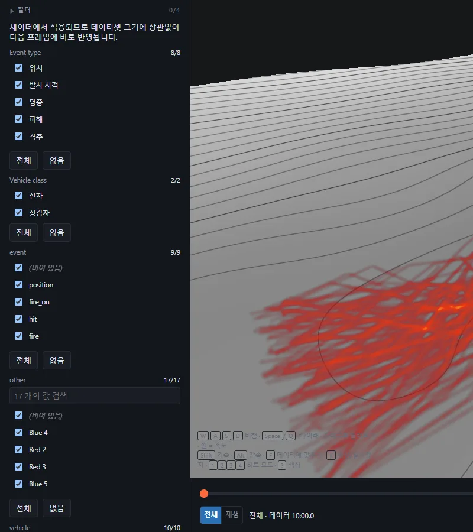
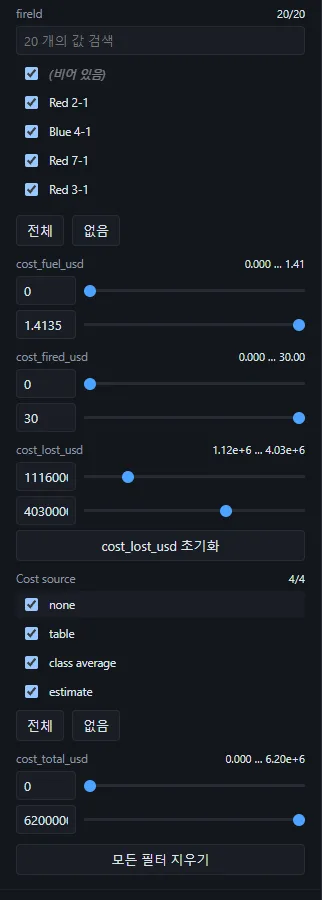

# 필터

**필터**는 신경 쓰지 않는 행을 숨깁니다. 예를 들어 차량 등급 하나나 이벤트 종류 하나이며, 그림은 즉시 갱신됩니다. 패널은 *필터링용 보관*([열 매핑](column-mapping.md)) 아래에서 불러올 때 보관한 열들을 나열합니다. 여러 파일을 불러왔다면 *원본 파일*도 함께 나옵니다.

## 해 보기 {#try-it}

1. 데이터셋을 불러오고 사이드바에서 **필터**를 엽니다.
2. **차량 등급** 아래에서 *전차*를 해제합니다. 그림이 즉시 바뀝니다.
3. **모든 필터 지우기**를 눌러 되돌립니다.

처음 나오는 행들은 뷰어 자체의 열입니다(아래 참고). 그 뒤의 행들은 파일에서 왔습니다.

## 뷰어가 더하는 열 {#columns-the-viewer-adds}

불러올 때 뷰어는 자체 열 네 개를 계산하고, 이를 **맨 앞에** 나열합니다. 이름과 값은 여러분의 언어로 표시됩니다. 그래서 같은 필터가 모든 게임과 데이터 출처에서 똑같이 작동합니다.

| 열 | 값 | 계산 근거 |
|---|---|---|
| **이벤트 유형** | 23가지: 위치, 발사, 발사체(미사일, 로켓, 폭탄), 명중, 빗나감(목표 근처에서 끝난 무기), 폭발, 피해, 격추, 사망, 파괴, 추락, 사출 / 탈출, 출현, 소멸, 이륙, 착륙, 지면 접촉, 지면 정지, 재무장 / 재급유, 점령 / 목표, 기만, 메시지, 기타 | `event`, `events`, `event_type` 또는 `event_name`이라는 열. 각 게임의 고유한 말(`shot`, `burst`, `fired`, `struck`, `flare`, `plant` ...)을 이 종류들에 대응시킵니다. 전체 표: [이벤트 종류와 분류](ref-event-types.md). |
| **플레이어 또는 AI** | 플레이어, AI | `ai`, `is_ai`, `bot` 또는 `actor` 열. 없으면 `is_player` / `human`. 그것도 없으면 계정 id(`user_id`, `steam_id`, 비어 있거나 0이면 AI). Tacview 기록은 그 객체에 조종사가 있는지 봅니다. |
| **차량 등급** | 17가지: 전투기, 공격기, 폭격기, 기타 항공기, 헬리콥터, 전차, 장갑차, 대공, 포병, 트럭 / 차, 함선, 잠수함, 보병, 무기, 기만, 구조물, 기타 | 차량 또는 유닛 이름([피규어 카탈로그](figures.md)와 대조)과 종류 열. |
| **목표 등급** | 같은 등급 | 상대 쪽 차량(`other_vehicle`, `target_vehicle`, `victim_type` ...). |

그 바로 뒤에는 데이터에 있다면 [결과 열](data-formats.md#outcome-columns)이 옵니다: **라운드 결과**와 **경기 결과**(*전체*, *승리*, *패배*), 그리고 **라운드 종료 방식**이며, 값은 여러분의 언어로 표시됩니다. 이 열로 필터하거나, 이 열로 히트를 나누어 [승률 지도](win-rate.md)로 볼 수 있습니다.

실제로 나타난 종류만 나열합니다. 값 열(`cost_*`, `earn_*`, `net_*`와 *비용 출처*, [값 가중치](value-weighting.md) 참고)도 다른 숫자 열과 같게 필터링할 수 있습니다. 예를 들어 *비용 출처*에서 *추정*을 해제하면 가격이 매겨진 행만 남습니다.

범주 목록의 값이 12개를 넘으면 검색 상자(*값 n개 검색*)와 **이것만** 버튼이 나타납니다. **이것만**은 일치하는 값만 정확히 허용합니다.

어떤 열을 필터링할 수 있는지는 불러올 때 정해집니다. 그때 읽어야 하기 때문입니다. 보관된 열이 없으면 패널이 그렇다고 알리고 *필터링용 보관*을 가리킵니다.

## 숫자 열(범위) {#numeric-columns-range}

| 부분 | 뜻 |
|---|---|
| 이름과 `최소 ... 최대` | 열, 그리고 현재 범위(필터가 없는 동안에는 열 전체 범위). |
| 첫 줄: 숫자 상자와 슬라이더 | 하한. 슬라이더를 상한 위로 끌면 상한도 함께 밀립니다. |
| 둘째 줄: 숫자 상자와 슬라이더 | 상한. 하한 아래로 끌면 하한도 함께 밀립니다. |
| **열 *이름* 초기화** | 이 필터를 제거합니다. |

슬라이더는 열의 최소부터 최대까지를 1,000단계로 나눕니다. 숫자 상자는 아무 값이나 받습니다. 행은 값이 범위 안에 있을 때 통과하며, 양 끝도 포함합니다. 큰 값은 지수 형식(`1.23e6`)으로 보입니다.

## 범주 열 {#category-columns}

| 부분 | 뜻 |
|---|---|
| 이름과 `허용/전체` | 열, 그리고 허용된 값의 개수. |
| 값 목록 | 값마다 체크 상자가 하나씩 있습니다. 빈 값은 *(비어 있음)*으로 보입니다. |
| **전부** / **없음** | 모든 값을 허용 / 아무 값도 허용하지 않음. |

모든 값을 허용하면 필터가 제거됩니다.

## 규칙 {#rules}

- **필터는 한 번에 네 개.** 머리글에 `활성/4`가 나옵니다. 다섯 번째 필터는 적용되지 않으며, 패널이 그렇게 알립니다. [개체](entities.md)에서 고른 것(또는 매치 탭의 플레이어 초점)도 네 개 중 하나를 씁니다. 열 전체를 덮는 필터는 아무 칸도 쓰지 않습니다.
- **범주 열은 값을 최대 4,096개**까지 가질 수 있습니다. 그보다 넓은 열은 불러올 때 보관되지 않습니다.
- **필터는 AND로 결합되며**, 팀 보임 여부, 차이 분할, 시간 구간, 거리 컬링, [단면](slice.md)과도 함께 작동합니다.
- **필터를 바꾸면 누적이 다시 시작되고**, 몇 프레임 뒤에 노출을 다시 측정합니다. 필터링은 밀도를 크게 바꿀 수 있기 때문입니다([색과 노출](colour-and-exposure.md#auto-exposure)).
- **모든 필터 지우기**는 모든 열 필터를 제거합니다. 팀 보임 여부와 다른 곳에서 정한 플레이어 선택은 그대로 둡니다.
- 열 필터는 히트 모드를 바꿉니다. 그러나 [피규어 리플레이](box-replay.md)의 피규어는 바꾸지 않습니다. 피규어는 팀 보임 여부와 개체 선택을 따릅니다. 개체 선택은 둘 다 바꿉니다.
- [선 히트](line-heat.md)에서는 각 구간이 *끝나는* 행에서 필터를 검사합니다.
- 새 데이터셋을 불러올 때마다 모든 필터가 지워집니다.

## 개발자용 {#for-developers}

**슬롯.** 활성화된 필터마다 GPU 슬롯 네 개 중 하나를 씁니다([`MAX_FILTER_SLOTS`](https://github.com/Holdi601/3DHeat/blob/main/src/render/types.ts)). 행마다 4바이트 텍스처입니다. 슬롯은 마지막으로 바뀐 순서대로 필터에 배정됩니다([`filterSlots`](https://github.com/Holdi601/3DHeat/blob/main/src/render/filterTables.ts), 셰이더와 두 패널이 함께 씁니다). 네 개를 넘으면 *처음 필터 4개만 적용됩니다. 하나를 지우세요 — 나머지는 조용히 합쳐지는 것이 아니라 무시되고 있습니다.* 라는 메시지가 나오고, 추가 필터의 이름은 *열 (적용 안 됨)*으로 나타납니다. 필터는 버텍스 셰이더에서 행마다 실행되므로, 임계값을 바꿔도 다시 파싱하거나 다시 업로드할 필요가 없습니다.

**패널에 나타나지 않는 필터.** 애플리케이션 상태에는 두 종류의 필터가 더 있습니다([`FilterSpec`](https://github.com/Holdi601/3DHeat/blob/main/src/state/types.ts)):

- **그룹** 필터. 매치 탭이 한쪽에 초점을 맞출 때 설정됩니다. 모든 모드에서 다른 그룹을 숨기며, 열로 나눈 [차이](difference.md)도 포함합니다.
- **사람** 필터. [개체](entities.md) 패널과, 매치 탭이 한 플레이어에 초점을 맞출 때 설정됩니다. 피규어 리플레이와 히트 모드를 제한합니다. 히트에서는 사람 id에 대한 범주 필터이며 네 슬롯 중 하나를 차지합니다. 마스크는 65,536개의 id를 담습니다([`FILTER_MASK_CAPACITY`](https://github.com/Holdi601/3DHeat/blob/main/src/render/types.ts)). 그보다 큰 id의 사람은 필터가 활성인 동안에는 선택되어 있어도 히트에 그려지지 않습니다. 피규어 리플레이에는 여전히 나타납니다.
