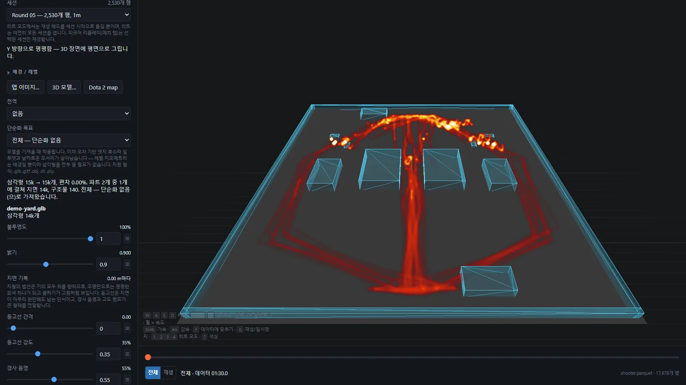
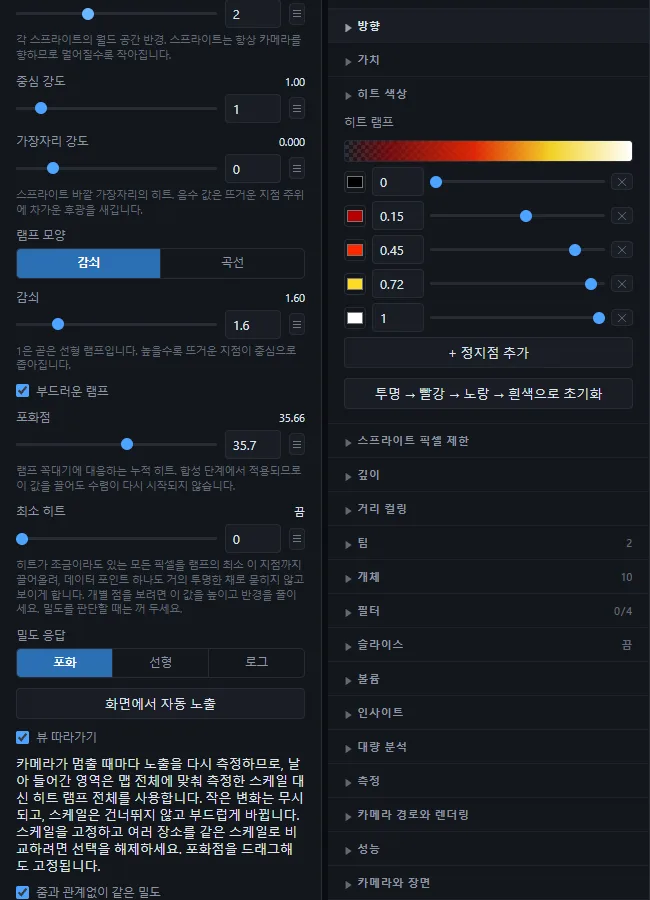

# 히트

히트는 많은 일이 일어난 곳을 칠합니다. 조금 일어난 곳은 빨갛고, 많이 일어난 곳은 하얗게 뜨겁습니다. "여기서 무슨 일이 일어나고, 얼마나 되나"에 답합니다.

**히트**(키 1)가 기본 모드입니다. 보이는 각 [행](glossary.md)은 카메라를 향한 둥근 [스프라이트](glossary.md)를 하나씩 더합니다. 겹친 스프라이트들은 부동소수점 버퍼에서 더해집니다. 그 합은 색 램프(기본값은 투명 → 빨강 → 노랑 → 흰색)를 거쳐 장면 위에 그려집니다.

그림은 건물이 있는 레벨에서 슈터 라운드의 히트를 보여 줍니다. 뜨거운 곳은 지면뿐 아니라 방 안과 계단 위에도 있습니다.

## 사용하는 법 {#how-to-use-it}

1. 데이터를 불러오고 `1`을 누릅니다(또는 모드 막대에서 **히트**를 고릅니다).
2. 모든 것이 하얗거나 비어 보이면, **히트 모양** 섹션에서 **화면에서 자동 노출**을 누릅니다.
3. **스프라이트 반경**을 바꿔서 이웃한 점들이 띠로 합쳐지게 합니다. 작게 하면 한 점 한 점이 보이고, 크게 하면 영역이 보입니다.
4. **히트 색상**을 열어 색을 바꾸거나, **깊이**를 열어 언덕과 벽이 뒤의 히트를 가리게 합니다.

같은 패널들이 [차이](difference.md), [팀 히트](team-heat.md), [선 히트](line-heat.md)의 모양도 정합니다. 이들이 다른 것은 무엇을 더하는가(부호가 있거나, 색이 있거나, 선을 따라서)이지, 어떻게 더하는가가 아닙니다.

## 패널과 기본값 {#the-panels-and-their-defaults}

모든 조절은 자기 페이지에서 설명합니다. 자세히 보기 열에 그 링크가 있습니다. 슬라이더 옆에는 값을 직접 입력하는 상자와 손잡이가 있습니다(오른쪽의 작은 손잡이. 위나 아래로 끌고, 더 멀리 끌수록 빠르고, Shift를 누르면 세밀하게 조절합니다). 슬라이더의 트랙이 실제 한계보다 먼저 끝나면, 손잡이는 여기 적힌 *조그 상한*까지 넘어갈 수 있습니다. *불러올 때*라고 표시된 값은 새 데이터셋마다 다시 계산됩니다.

### 히트 모양(열림) {#heat-shape-open}

| 조절 | 기본값 | 범위(조그 상한) | 자세히 |
|---|---|---|---|
| **스프라이트 반경** | 6 m. 불러올 때 범위 / 120 | 0.05-2000 m, 로그(50,000) | [스프라이트 모양](sprite-shape.md#sprite-radius) |
| **중심 강도** | 1 | 0-10(1000) | [스프라이트 모양](sprite-shape.md#centre-and-edge-intensity) |
| **가장자리 강도** | 0 | -2-10(1000) | [스프라이트 모양](sprite-shape.md#centre-and-edge-intensity) |
| **램프 모양** | *감쇠* | *감쇠* / *곡선* | [스프라이트 모양](sprite-shape.md#ramp-shape-falloff-or-curve) |
| **감쇠**(감쇠일 때만) | 1.6 | 0.1-8(64) | [스프라이트 모양](sprite-shape.md#falloff) |
| **부드러운 램프**(감쇠일 때만) | 켜짐 | | [스프라이트 모양](sprite-shape.md#falloff) |
| 곡선 편집기(곡선일 때만) | *부드럽게* 프리셋 | | [스프라이트 모양](sprite-shape.md#the-curve-editor) |
| **포화점** | 24. 불러올 때 추정값, 그다음 측정값 | 0.1-4000, 로그(10,000,000) | [색과 노출](colour-and-exposure.md#saturation-point) |
| **최소 히트** | 꺼짐(0) | 0-100% | [색과 노출](colour-and-exposure.md#minimum-heat) |
| **밀도 응답** | *포화* | *포화* / *선형* / *로그* | [색과 노출](colour-and-exposure.md#density-response) |
| **화면에서 자동 노출** | | 버튼 | [색과 노출](colour-and-exposure.md#auto-exposure) |
| **뷰 따라가기** | 켜짐 | | 카메라가 멈출 때마다 노출을 다시 측정하므로, 비행해 들어간 지역은 색 램프 전체를 씁니다. 작은 변화는 무시하고 눈금은 미끄러지듯 바뀝니다. 끄거나, **포화점**을 끌면 눈금이 고정되어 한 눈금으로 여러 곳을 비교할 수 있습니다. [색과 노출](colour-and-exposure.md#follow-the-view) |
| **줌과 관계없이 같은 밀도** | 켜짐 | | 어느 거리에서든 색은 땅 면적당 같은 행 수를 뜻합니다. 픽셀 제한이 키운(멀리) 또는 줄인(가까이) 스프라이트는 실제 크기였다면 더했을 히트를 그대로 더합니다. 그래서 멀리서 노출한 그림은 비행해 들어가도 흐려지지 않습니다. 끄면, 제한된 스프라이트는 제한된 크기에서 전체 가중치를 더합니다. [스프라이트 모양](sprite-shape.md#pixel-clamps) |
| **지면 평면에 평탄화** | 꺼짐 | | [스프라이트 모양](sprite-shape.md#flatten-onto-ground-plane) |

### 히트 색상(닫힘) {#heat-colours-closed}

| 조절 | 기본값 | 자세히 |
|---|---|---|
| 그룹 견본과 **색 분리**(팀 히트 전용) | 1.4 | [팀 히트](team-heat.md) |
| **히트 램프** 편집기(차이에서는 *양수(더하기 팀)*, 팀 히트에서는 *불투명도 램프*) | 투명 → 빨강 → 노랑 → 흰색 | [색과 노출](colour-and-exposure.md#the-ramp-editor) |
| **투명 → 빨강 → 노랑 → 흰색으로 초기화** | | |
| **음(빼는 팀)** 램프(차이 전용) | 투명 → 초록 → 파랑 → 보라 | [차이](difference.md#colours) |

### 스프라이트 픽셀 제한(닫힘) {#sprite-pixel-clamps-closed}

| 조절 | 기본값 | 범위(조그 상한) | 자세히 |
|---|---|---|---|
| **최소 픽셀 반경** | 1 px | 0-16(512) | [스프라이트 모양](sprite-shape.md#pixel-clamps) |
| **최대 픽셀 반경** | 96 px | 2-1024, 로그(8192) | [스프라이트 모양](sprite-shape.md#pixel-clamps) |

### 깊이(열림) {#depth-open}

| 조절 | 기본값 | 자세히 |
|---|---|---|
| **지형 뒤 숨기기** | 켜짐 | [깊이와 컬링](depth-and-culling.md#hide-behind-terrain) |
| **지오메트리 뒤에 가려짐** | 0.8(*80% 더 어둡게*) | [깊이와 컬링](depth-and-culling.md#hidden-behind-geometry) |

### 거리 컬링(닫힘) {#distance-culling-closed}

| 조절 | 기본값 | 범위(조그 상한) | 자세히 |
|---|---|---|---|
| **가까이** | 꺼짐(0) | 0.5-5000 m, 로그, 트랙 아래쪽 = 꺼짐(200,000) | [깊이와 컬링](depth-and-culling.md#distance-culling) |
| **멀리** | 꺼짐(0) | 1-200,000 m, 로그, 아래쪽 = 꺼짐(10,000,000) | [깊이와 컬링](depth-and-culling.md#distance-culling) |
| **평면으로 자르기** | 켜짐 | | [깊이와 컬링](depth-and-culling.md#distance-culling) |
| **레벨도 자르기** | 켜짐 | | [깊이와 컬링](depth-and-culling.md#distance-culling) |

키: `[`와 `]`는 먼 경계를 안팎으로 밀고, `\`는 켜고 끕니다([깊이와 컬링](depth-and-culling.md#keyboard)).

### 방향과 값 {#direction-and-value}

히트 모양 아래에 두 섹션이 더 있습니다. **방향**은 각 행을 쐐기꼴로 그리고 화살표를 더합니다. [방향별 히트](directional-heat.md)를 보십시오. **값**은 각 행이 얼마의 비용을 들였거나 얻었는지로 히트에 무게를 둡니다. [값 가중치](value-weighting.md)를 보십시오.

## 저장되는 것 {#what-is-saved}

위의 히트 설정은 세션 사이에 저장되지 않습니다. 페이지를 새로 고치면 기본값으로 돌아갑니다. 브라우저에 남는 것은 둘입니다. 마지막 재생 속도(`heat3d.speed`, [타임라인](timeline.md)을 보십시오)와, [피규어 오버레이](box-replay.md)의 먼 피규어 설정(기호 모양, 크기, 명중 표시 등)입니다. 언어, [뒤집힌 세계 축](camera.md#invert-world-axis), 레이스 탭이 기억하는 차량 이름, [레벨 라이브러리](level-library.md)도 남습니다. 전체 목록은 [저장된 설정](ref-settings-storage.md)에 있습니다.
