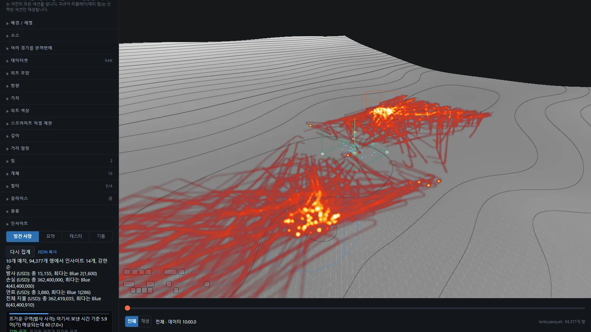
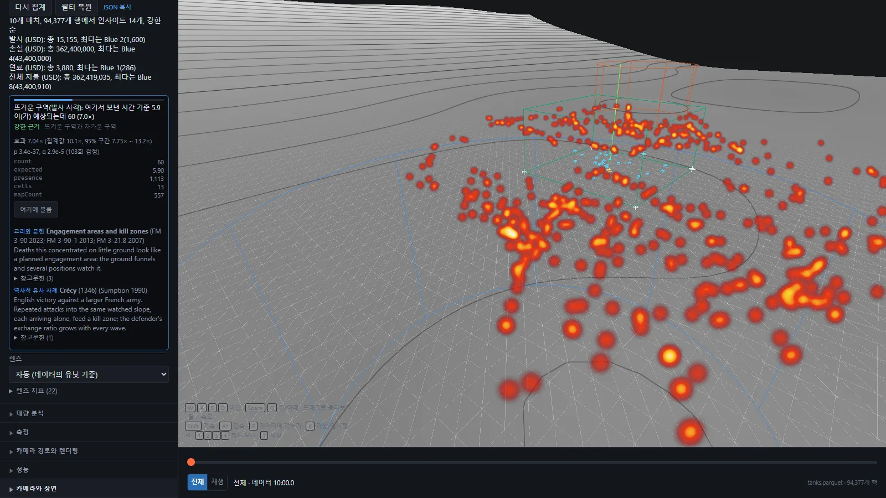
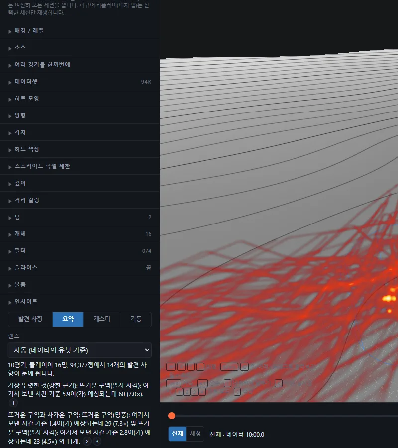
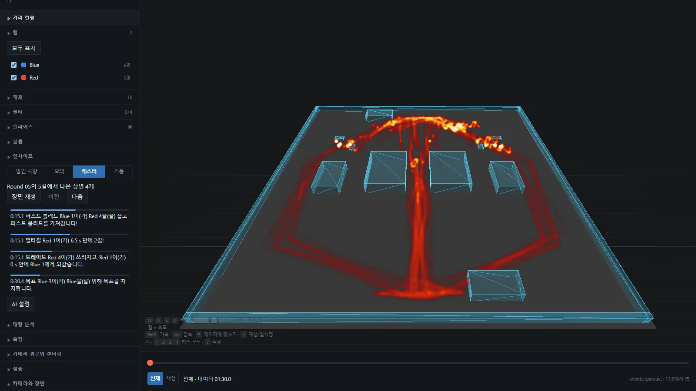

# 인사이트

**인사이트**는 불러온 데이터에서 두드러진 것을 찾습니다. 강한 위치, 치명적인 지형, 리스폰 함정, 병목 지점, 또래보다 훨씬 앞서는 플레이어 등입니다. 그리고 가장 강한 것부터 근거와 함께 알려 줍니다. 1분 안에 어느 경기가 어디서 이겨지고 졌는지 배우는 데 씁니다. 그다음 요약을 쓸 수 있고, 리플레이 하나에서는 큰 순간으로 뛰어가는 캐스터 역할도 합니다.

모든 계산은 여러분의 브라우저 안에서 이루어집니다. 외부 AI를 켜지 않는 한 아무것도 여러분의 컴퓨터를 떠나지 않습니다([외부 AI](#external-ai) 참고).

**인사이트** 섹션은 히트맵 탭과 매치 탭의 사이드바에 있습니다. 탭이 세 개 있습니다. **발견 사항**, **요약**, **캐스터**입니다.

## 발견 사항 {#findings}

1. 데이터를 불러오고 **인사이트**를 엽니다. **인사이트 찾기**를 누릅니다("집계 중… n%"가 진행 상황을 보여 줍니다).
2. 목록을 읽습니다. 각 발견 사항에는 강도 막대, 한 문장, 근거가 얼마나 좋은지(*강한 근거*, *좋은 근거*, *약간의 근거*), 그것을 찾은 탐지기, 그리고 중요한 경우에는 차량 등급이 붙어 있습니다.
3. **발견 사항을 클릭하세요**. 뷰어가 그 필터를 적용하고, 카메라를 그 장소로 날리고, 그 시간으로 뜁니다. 그리고 세부 정보를 엽니다. 95% 구간이 있는 효과, p와 q 값, 세어 낸 근거, 그리고 **여기에 볼륨**(장소 둘레에 [볼륨](volumes.md)을 그립니다)이 있습니다.
4. **필터 복원**은 여러분의 필터를 되돌립니다. **JSON 복사**는 보고서 전체를 복사합니다.

집계는 현재 필터, 숨긴 그룹, 고른 매치를 전체 시간 범위에 적용합니다. 나중에 필터를 바꾸면 그렇다고 알려 주며, 그때는 **다시 집계**를 누르세요.

목록 맨 위의 줄(예: 돈 합계)은 발견 사항보다 먼저 전체 데이터를 요약합니다.

### 탐지기 {#the-detectors}

| 탐지기 | 찾는 것 | 데이터에 필요한 것 |
|---|---|---|
| **파워 포지션** | 지도의 나머지보다 격추 대 사망 비율이 훨씬 좋은 곳, 그리고 그곳에 머문 시간 대비 죽는 사람이 적은 *안전한 땅* | 격추와 사망 이벤트 |
| **뜨거운 구역과 차가운 구역** | 이벤트 종류(사격, 명중, 점령 등)가 그곳에 머문 시간으로 예측되는 것보다 훨씬 많거나 적게 일어나는 곳 | 이벤트 열 |
| **개활지와 엄폐물** | 가까운 레벨 지오메트리에 비해 개활지에서 죽은 경우, 그리고 빠른 움직임에 비해 느린 경우 | 사망; 지오메트리 부분은 3D 레벨 |
| **스폰** | 강한 스폰, 스폰 함정, 안전한 스폰, 첫 접촉까지의 시간 | 시간과 사람 |
| **장소별 클래스** | 한 구역에서 차량 등급, 또는 플레이어 대 AI가 훨씬 더 잘하거나 못하는 것 | 격추와 차량 등급 또는 플레이어/AI 열 |
| **플레이어** | 같은 등급의 다른 이보다 훨씬 많이 또는 적게 격추하거나 죽는 플레이어 | 사람과 격추 |
| **병목과 측면** | 병목 지점(주변 땅보다 훨씬 많은 통과)과 측면 경로(드물게 쓰이지만 격추로 이어짐) | 사람 |
| **값** | *비싼 땅*과 *벌이가 되는 땅* | [값 열](value-weighting.md) |
| **라운드를 결정한 요인** | 이긴 라운드와 진 라운드를 가른 것, 그리고 승리 확률을 가장 많이 더하거나 잃게 한 플레이어([누가 이겼나](#who-won-what-decided-the-rounds) 참고) | 라운드, 킬과 사망, 그리고 [결과 열](data-formats.md#outcome-columns)(`won`) |

데이터에서 실행할 수 없는 탐지기는 이유와 함께 맨 아래에 나열됩니다.

### 발견 사항의 순위 {#how-findings-are-ranked}

모든 장소나 그룹은 지도의 나머지와 비교해 검정합니다(정확한 이항 검정 또는 비율 검정). 거짓 발견율은 5%(Benjamini-Hochberg)로 유지합니다. 우연도 패턴처럼 보일 수 있으므로, 이렇게 해서 잘못된 경보를 줄입니다. 보이는 발견 사항 중 우연인 것은 대략 20분의 1 이하로 기대합니다. 사건이 적은 효과는 순위를 매기기 전에 "효과 없음" 쪽으로 끌어당깁니다. 최대 60개의 발견 사항을 나열하며, 탐지기마다 상위 근처의 몇 개 장소를 보장합니다.

### 누가 이겼나: 라운드를 결정한 요인 {#who-won-what-decided-the-rounds}

데이터에 각 라운드의 승자가 있으면(`won` [결과 열](data-formats.md#outcome-columns): CS2, Rainbow Six Siege, War Thunder ...), 인사이트의 중심은 그 결과입니다. 각 사이드마다 라운드를 그 안에서 일어난 일로 나누고 승률을 비교합니다.

| 요인 | 그것이 있었던 사이드의 라운드 | ... 없었던 라운드 |
|---|---|---|
| 첫 교전 | 첫 킬을 냈다 | 먼저 죽었다 |
| 구매 | 구매가 상대 사이드보다 좋았다 | 나빴다 |
| 첫 사망 트레이드 | 첫 사망이 5초 안에 트레이드되었다 | 트레이드되지 않았다 |
| 설치 | 설치했다 | 설치 없음 |
| 유틸리티 | 평소 라운드보다 수류탄이 많다 | 적다 |
| 이른 접촉 | 첫 교전이 경기의 중앙값 시간보다 일렀다 | 늦었다 |
| 장소 유지 | 플레이어가 그 장소에 5초 이상 있었다 | 아무도 없었다 |
| 장소에 일찍 도착 | 플레이어가 처음 25초 안에 도착했다(경로) | 아무도 없었다 |

각 비교는 두 승률의 차이이며, 95% 구간(Newcombe), Fisher의 정확한 p, 시도한 모든 요인에 걸친 q(Benjamini-Hochberg)가 붙습니다. 라운드가 8개보다 적은 쪽에는 *라운드 적음* 표시가 붙습니다. 거짓 발견율 5% 아래에 드는 것이 발견 사항이 됩니다. 가장 강한 것은 다른 탐지기의 발견보다 위에 놓입니다(결과 발견은 같은 효과와 근거를 가진 발견보다 1.35배 무겁습니다).

40라운드에 대한 지어낸 예:

> **T**는 **Mid**를 지킨 19라운드의 79%를 이겼고, 지키지 않은 21라운드에서는 24%를 이겼습니다(55포인트, 95%: 26~74) - q 0.004.

라운드의 **승리 확률**도 따라갑니다. 살아 있는 인원, 설치, 시계로 구한, 매 순간 각 사이드가 가진 가능성입니다. 라운드가 30개 이상이면 그 라운드들에 맞추고, 아니면 고정된 사전 모델을 씁니다(어느 쪽인지 글에 나옵니다). 여기서 **전환점**(가능성을 가장 크게 움직인 킬과 설치)과 각 플레이어의 **더한 승리 확률**이 나옵니다. 플레이어가 낸 킬과 설치는 그 플레이어에게 플러스, 사망은 마이너스로 세며, 경기 전체에서 라운드 몇 개 분량인지로 나타내고, 라운드당 평균과 구간을 붙여 0과 비교해 검정합니다. 장소도 같은 수지를 받습니다. 그곳에서 벌어진 교전에서 어느 사이드가 가장 많이 얻었는지입니다.

데이터에는 양쪽 사이드의 라운드, 킬, 사망과 `won` 열이 필요합니다. 장소 유지에는 이름 붙은 장소(`place`)가, 구매에는 `buy` 열이 필요합니다.

## 요약 {#debrief}

**요약** 탭은 발견 사항을 짧은 글로 씁니다. 도입부, 가장 분명한 발견 사항, 전술에 대한 것 하나, 균형에 대한 것 하나, 그다음 - 데이터에 승자가 있으면 - 라운드를 결정한 요인, 나머지는 탐지기별로 묶고, 얼마나 많은 것이 더 약한 근거에 기대는지 씁니다.

라운드를 결정한 요인은 네 문단으로 나옵니다. 점수와 승리 확률의 출처, 가장 강한 요인과 그 수치·구간·q(거짓 발견율을 통과한 것이 없으면 글에 *아직 확실한 것은 없음*이라고 쓰고, 그래도 가장 강한 것을 말합니다), 가장 큰 전환점 세 개, 그리고 승리 확률을 가장 많이 더한 플레이어와 가장 많이 잃게 한 플레이어, 가장 많이 얻은 장소입니다. 지어낸 예:

> 결과가 알려진 40라운드 중 T가 23, CT가 17을 이겼습니다(T: 58%, 95%: 42%~72%). 승리 확률은 이 라운드들에 맞춘 모델에서 나옵니다.
>
> 이긴 라운드와 진 라운드를 가른 요인: T는 Mid를 지킨 19라운드의 79%를 이겼고, 지키지 않은 21라운드에서는 24%를 이겼습니다(55포인트, 95%: 26~74)(q 0.004), ...
>
> 전환점: 라운드 17, 48초: B 사이트에서 CT의 킬로 확률이 31%에서 58%로 움직였고, 그 라운드를 이겼습니다, ... 각 문단에는 발견 사항을 보여 주는 번호 버튼이 있습니다. **텍스트 복사**는 그것을 복사합니다.

내장 해설자는 오프라인으로, 여러분의 언어로 작동합니다. 그 위의 **렌즈** 선택기([지식 렌즈](knowledge.md) 참고)가 문단이 어떤 문헌을 인용할지 정합니다.

### 외부 AI {#external-ai}

**AI 설정**에서 여러분이 고른 AI 모델이 대신 요약을 쓰게 할 수 있습니다.

| 설정 | 뜻 |
|---|---|
| **제공자** | Anthropic(Claude), OpenAI(ChatGPT), OpenRouter, Ollama(로컬), LM Studio(로컬), llama.cpp 서버(로컬), 또는 OpenAI 호환 엔드포인트 |
| **기본 URL**, **모델** | 제공자가 채웁니다. **모델 목록 보기**는 서버에 묻습니다 |
| **API 키** | 기본 URL로만 보냅니다. 기록하지 않고, 보기, 내보내기, `.3dheat` 파일에 저장하지 않습니다. 대부분의 로컬 서버는 키가 필요 없습니다. |
| **이 브라우저에 키 기억** | 기본값은 꺼짐입니다. 페이지를 닫으면 키를 잊습니다 |
| **외부 AI 사용** | 기본값은 꺼짐입니다 |
| **플레이어 이름 전송** | 기본값은 꺼짐입니다. 플레이어는 P1, P2 ...로 보냅니다 |

그다음 선택 사항인 질문을 입력하고 **AI로 작성**을 누릅니다. 발견 사항과 그 수치만 보냅니다. 여러분 데이터의 행은 절대 보내지 않습니다. 답은 흘러 들어오며, 인용된 발견 사항은 버튼이 됩니다. 데이터에 승자가 있으면, 모델에게 라운드를 결정한 요인부터 쓰고, 모든 수치에 구간과 q를 붙이며, 요인이 적은 라운드에 기대거나 승리 확률이 사전 모델에서 나올 때는 그렇다고 말하라고 알려 줍니다.

## 캐스터 {#caster}

**한 경기**에 대해(여러 개가 불러와졌다면 하나를 고르세요), **캐스터**는 볼 가치가 있는 순간을 찾습니다. 첫 피 흘림, 다중 격추, 트레이드, 클러치, 목표 역전, 역전승, 두드러진 플레이어, 장거리 사격, 그리고 **전환점**입니다. 전환점은 한 사이드가 라운드를 이길 가능성을 가장 크게 움직인 킬입니다(각 사이드에 살아 남은 플레이어 수 기준, 리스폰이 없는 라운드에서).

데이터에 각 라운드의 승자가 있으면, 모든 순간이 그것을 말합니다: *"Anna가 Ben을 쓰러뜨립니다: T의 라운드 승리 확률이 38%에서 62%로 바뀝니다 - 그리고 그 라운드를 이깁니다."* 캐스터가 어떤 순간을 남길지 고를 때, 결국 이긴 사이드의 순간이 더 많이 셉니다. 역전은 이긴 라운드로 셉니다.

- 순간을 클릭하세요. 보기가 리플레이로 바뀌고, 그 직전으로 뛰고, 그곳으로 날아가 플레이어를 따라갑니다.
- **장면 재생**은 각 순간을 끝까지 재생하고 다음으로 넘어갑니다. **이전** / **다음**으로 하나씩 넘길 수 있습니다.
- 외부 AI를 켜면, **AI 해설**이 순간 목록(종류, 시간, 이름 또는 가명, 팀, 등급, 거리)으로 해설을 씁니다.

사람과 격추/사망(또는 점령) 이벤트가 필요합니다. `other`/`victim` 열이 있으면 트레이드와 장거리 사격이 가능합니다.

## 지식 렌즈 {#knowledge-lens}

발견 사항은 확립된 지식의 **렌즈**를 통해 읽을 수 있습니다. 군사 교리, 공중과 해상 전투, 도시 작전, 게임 디자인, e스포츠(또는 *자동*, 데이터의 유닛을 보고 고릅니다)입니다. 열린 발견 사항은 가장 가까운 **교리와 문헌** 항목과 **역사적 유사 사례**를 참고문헌과 함께 보여 줍니다. **렌즈 지표**는 그 문헌의 척도를 데이터에 적용해 계산합니다(란체스터 적합, 교환비, 전력비, 사격 시야, 핵심 지형, 트레이드, 주도권). 요약과 AI 프롬프트에도 이것이 들어갑니다. 전부 알아보려면: [지식 렌즈](knowledge.md).

렌즈 지표는 플레이어가 군중으로서, 그리고 집단으로서 어떻게 행동하는지도 측정합니다. 정렬과 배회, 경로 몰이, 차선과 자취, 밀집, 지도자와 추종자, 낙오자, 손실 아래에서의 붕괴 지점, 목숨을 잃은 뒤의 위험, 연속 기록, 구매 합의, 들어오는 사격에 대한 반응입니다. 각각은 자기만의 귀무 모델과 비교합니다. [집단 행동](collective-behaviour.md)을 보세요.

## 인사이트가 작동하게 하는 데이터 {#data-that-makes-insights-work}

- **시간**, **사람**, **팀** 열이 있는 위치;
- 격추와 사망(`kill`, `death`), 그리고 다른 것(`hit`, `fire`, `capture` ...)이 있는 **이벤트** 열;
- 트레이드와 방향을 위한 **상대** 열(`other`, `victim`);
- 등급을 위한 **차량** 또는 **종류** 열. AI 대 플레이어를 위한 `ai` 열;
- 경기가 여럿이면 **세션** / **매치** / **라운드** 열.

[데모 데이터](demo-data.md)에는 이 모든 것이 있습니다.
