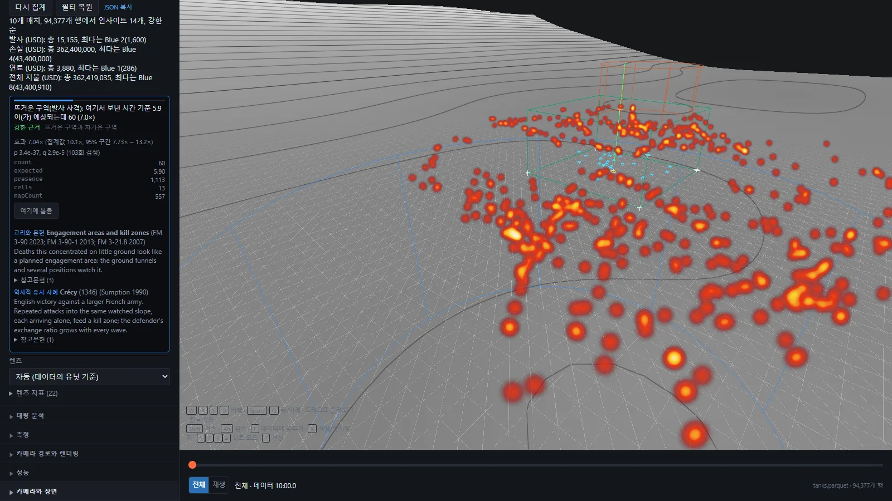

# 지식 렌즈

[인사이트](insights.md)가 무엇인가를 찾으면, 이 부분은 군사사, 게임 설계, 스포츠 분석의 생각으로 그것을 설명하고, 그 출처가 되는 책이나 논문의 이름을 댑니다. 패턴이 있다는 것만이 아니라 *왜* 중요한지 배울 때 쓰세요.

## 직접 해 보기 {#try-it}

1. 데이터를 불러오고 **인사이트**를 연 다음, **인사이트 찾기**를 누르세요.
2. 발견 항목을 클릭해서 여세요.
3. **교리와 문헌**과 **역사적 유사 사례**를 읽으세요. 전체 참고문헌은 그 아래에 접혀 있습니다.
4. **렌즈**를 바꾸세요(예: *군사 교리*). 같은 발견을 다른 문헌 묶음으로 읽을 수 있습니다.

## 작동 방식 {#how-it-works}

인사이트 패널은 발견 항목을 전문 분석가가 판단하듯 판단합니다. 군사 교리와 작전 연구, 역사 속 전투, 그리고 게임 설계, 레벨 설계, 분석 문헌을 통해서입니다. 이것은 오프라인으로, 뷰어 안에 있는 엄선된 지식 기반에서 작동합니다. 외부 모델이 요약을 쓸 때는 같은 자료를 그 모델에 넘깁니다.

## 패널이 보여 주는 것 {#what-the-panel-shows}

- **렌즈**는 발견 항목을 어떤 문헌 묶음으로 읽을지 고릅니다. *자동*(데이터의 유닛 종류, 즉 항공기, 함선, 지상 차량, 보병에 따라 고름), *군사 교리*, *공중전*, *해전*, *시가전*, *게임 설계와 밸런스*, *e스포츠*가 있습니다. 고른 렌즈 밖의 항목은 빠집니다.
- 열어 본 발견 항목마다 가장 가까운 **교리와 문헌** 항목과 가장 가까운 **역사적 유사 사례**가 나오고, 전체 참고문헌은 그 아래 접혀 있습니다.
- **렌즈 지표**는 (아래의) 같은 행들에서 계산한 작전 분석의 척도들을 나열합니다. 각각 그것이 무엇을 뜻하는지와 관련 문헌을 함께 보여 줍니다.
- **요약**은 가장 중요한 발견 항목과 렌즈 지표에 대한 줄을 덧붙입니다. "교리와 문헌: ..."과 "역사적 유사 사례: ..."이며, 각각 저자와 연도 인용이 붙고, 그 아래에 참고문헌이 접혀 있습니다.
- **AI로 작성**은 가장 관련 있는 항목(요약, 교훈, 그것과 관련된 발견 항목, 전체 참고문헌)을 보고서와 함께 보내고, 모델에게 id로 인용하라고 요청합니다. 예: `{concept.lanchester-square}`. 그리고 다른 출처는 쓰지 말라고 요청합니다.

레이블은 번역되어 있지만, 지식 자체는 영어입니다.

## 렌즈 지표 {#lens-metrics}

인사이트 워커에서, 탐지기와 같은 행 순회에서 계산합니다(`src/insights/lensMetrics.ts`). 데이터가 그것을 담을 수 없으면 그 지표는 빠집니다.

| 지표 | 무엇을 재는가 | 필요한 것 |
|---|---|---|
| 란체스터 적합 | 양측의 손실을 20초당 집계해, 양측의 생존 전력에 회귀(포아송, 준가능도 오차). 적과 자기 전력에 대한 지수를, 제곱 법칙(조준 사격)과 선형 법칙(면 사격)에 대해 검정 | 시간, 팀, 격파와 사망 |
| 교환비 | 진영별, 장소별 사망 대비 격파. 시간의 5%를 차지하는 가장 치명적인 지상의 사망 점유율을, 그 수만큼의 사망이 우연으로 줄 점유율과 비교. 사망의 시간에 대한 지니 계수. 사망률의 모란의 I | 격파와 사망 |
| 지역 전력비 | 각 격파마다 교전 거리 안에 살아 있는 아군과 적군 유닛(데이터에서 정한 거리: 가장 가까운 적까지 중앙 거리의 두 배). 지역적으로 우세한 쪽이 낸 격파의 비율, 그리고 숫자만으로 예측되는 것을 넘는 초과분 | 시간, 팀, 사람 |
| 사격 시야 | 가장 바쁜 격파 장소들의 시야 영역을, 2.5D 장애물 표면(벽 높이까지의 레벨 기하, 또는 걸어간 지면) 위에서 평균 장소와 비교. 시야와 격파 비율의 순위 상관 | 위치. 레벨을 불러오면 더 선명함. 공중에는 쓰지 않음 |
| 에너지 상태 | 공중 킬러와 공중 피격 대상의 비에너지(고도와 속도가 살 수 있는 높이를 더한 값), 맨-휘트니 통계량으로 비교 | 항공기 등급, 시간, 고도 |
| 핵심 지형 | 장소가 한 매치에서 가장 바쁜 격파 장소 세 곳 안에 드는 빈도 | 여러 매치 |
| 상호 지원(교환) | 교전 거리와 5초 안에서, 팀원의 격파로 응답받은 사망 | 시간, 팀 |
| 선제 타격 | 교전 - 매치별로, 20초의 고요함으로, 그리고 세 교전 거리의 간격으로 묶은 격파 - 를 먼저 득점한 쪽이 이긴 것 | 시간, 팀 |
| 일제 사격 모델 | 접촉 중인 함선의 20초 구간에 휴즈의 일제 사격 방정식을 맞춤. 공격하는 함선 하나당 전투 불능이 된 함선 수, 방어하는 함선 하나당 구한 함선 수. 함선만으로 한 란체스터 적합 | 함선 등급, 시간, 팀 |
| 전투 효율 | 각 진영의 행동 중 유닛 시간당 격파, 그리고 두 최대 진영의 비율(뒤퓌의 의미의 전투 효율 값), 95% 구간과 함께. 각 진영이 동등한 지역 수일 때 얻은 격파 비율 | 시간, 팀 |
| 교전 거리 | 격파, 발사, 각 생명의 첫 사격 때 가장 가까운 적까지의 거리(탐지에서 교전까지), 유닛 종류별 | 시간, 팀. 데이터에 있으면 발사 |
| 격파 사슬 | 킬러의 마지막 발사에서 격파까지의 초, 그리고 교전의 첫 사격에서 격파까지의 초 | 시간. 발사 또는 사격 이벤트 |
| 집중 또는 분산 | 20초 구간마다, 가장 큰 두 진영의 퍼짐과, 더 조밀한 쪽이 가져간 격파 비율 | 시간, 팀 |
| 출격 | 진영별: 출격(이륙 또는 항공기 스폰), 착륙, 잃은 항공기, 항공기가 낸 격파. 손실률과 출격당 격파 | 항공기 등급. 이륙 또는 스폰 |

라운드가 있는 데이터는 근접전과 e스포츠 척도를 더합니다. 라운드 승리 확률, 행동의 가치, 오프닝 듀얼, 교환, 나서는 자 대 막는 자, 조준, 교차 사격, 유틸리티, 인원 우위, 클러치, 셋업, 설치 후, 치명적 깔때기, 플레이어 영향이 있습니다. [근접전과 라운드](close-quarters.md)를 보세요.

트랙과 팀은 군중 과학, 집단 운동, 행동 경제학, 군사 심리학의 집단 행동 척도를 더합니다. 정렬과 우왕좌왕, 경로 몰이, 차선과 흔적, 밀집, 리더와 추종자, 낙오자, 붕괴점, 손실 뒤의 위험, 연속 기록, 구매 합의와 억제가 있습니다. 각각 자기만의 귀무 모델과 비교합니다. [집단 행동](collective-behaviour.md)을 보세요.

무기, 미끼, 건물은 유닛으로 세지 않습니다. 무기 행이 발사한 유닛을 적고 있다면(Tacview에서 얻은 데이터처럼 `Shooter` 또는 `Launcher` 열이 있다면), 그 발사는 그 유닛의 이름이나 객체 id로 맞춰서 그 유닛에 돌립니다.

## 발견 항목이 문헌과 만나는 방법 {#how-findings-meet-the-literature}

항목과 발견 항목은 **패턴 분류**(`src/insights/knowledge/patterns.ts`)를 통해 만납니다. 집중, 지역 우세, 조준 사격과 면 사격, 병목, 킬 존, 사격 시야, 역사면, 측면 공격, 상호 지원, 에너지 우위, 스폰 압박, 밸런스 등입니다. 각 탐지기 종류와 각 렌즈 지표는 자기 숫자가 어떤 패턴을 보여 주는지 말합니다(`src/insights/lens.ts`). 각 지식 항목은 자기가 다루는 패턴을 가중치와 함께 말합니다. 항목이 발견 항목과 관련 있는지는 가중 중첩으로 정하며, 항목의 영역(육지, 공중, 해상, 시가지)이 데이터에 얼마나 맞는지와 발견 항목 자체의 강도로 조정합니다. 보이는 근거는 발견 항목의 숫자를 한 문장으로 쓴 것 뒤에, 항목의 교훈을 붙인 것입니다.

## 목록 {#catalogue}

모든 패턴, 개념, 방법, 역사적 사례, 설계 원칙, 연구와 참고 목록: [지식 목록](knowledge-catalogue.md)을 보세요.

## 개발자용 {#for-developers}

### 항목 추가하기 {#adding-entries}

1. 종류에 따라 파일을 고르세요. `src/insights/knowledge/`의 `concepts.ts`와 `concepts-more.ts`, `methods.ts`, `cases.ts`, `cases-land.ts`, `cases-air-sea.ts`, `cases-esports.ts`, `design.ts`(설계 원칙), 또는 `studies.ts`입니다.
2. 새 id `<종류>.<슬러그>`를 주세요(절대 재사용하지 않음). 그리고 렌즈, 영역, 다루는 패턴을 0..1 가중치와 함께 적으세요. 발견 항목이 그 패턴을 보여 줄 수 있을 때만 `patterns.ts`에 패턴을 추가하고, `lens.ts`에서 발견 항목이나 지표에 연결하세요.
3. 요약과 교훈은 **자기 말로** 쓰세요. 인용은 공공 영역 저작물만(참고문헌에 `pd: true`), 그리고 짧게 하세요.
4. 인용하세요. 새 저작은 `refs.ts`에 저자, 연도, 제목, 출판사(학술지는 권과 쪽수와 함께)와 함께 추가하세요. 공개 기록이 있으면 URL이나 DOI도 적으세요.
5. `npx vitest run src/insights/lens.test.ts`(id의 유일성, 알려진 패턴, 참고문헌 해석, 공공 영역 인용, 날짜와 결과가 있는 사례)를 실행하고, `node tools/knowledge-doc.mjs`로 [목록](knowledge-catalogue.md)을 새로 고치세요.
