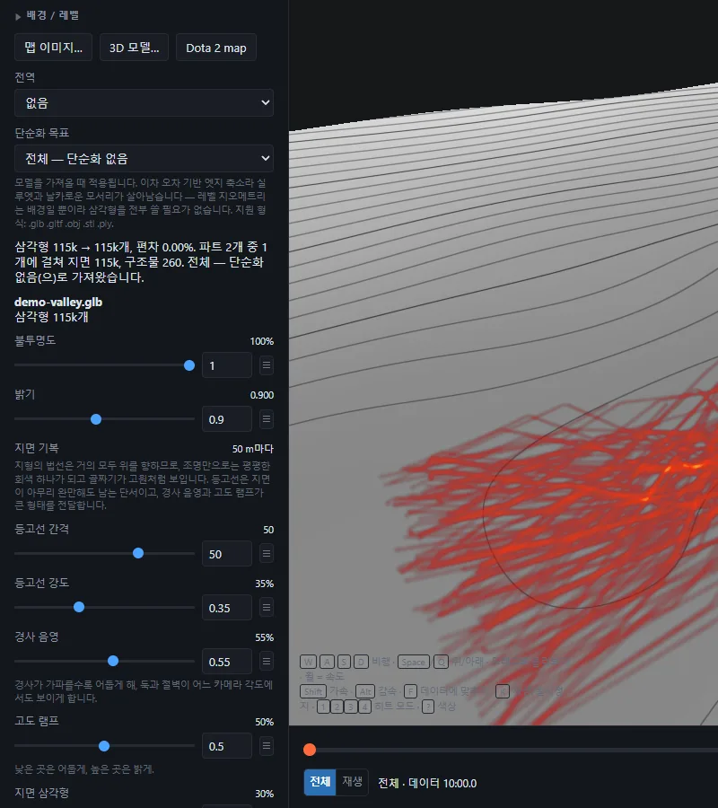

# 레벨과 배경 지오메트리

레벨은 게임이 일어난 3D 공간입니다. 지도, 마을, 트랙 같은 것입니다. 데이터 뒤에 레벨을 놓으면 히트가 *어디에* 있는지 볼 수 있습니다. **배경 / 레벨** 패널([용어집](glossary.md)의 "레벨" 참고)은 세 가지 종류의 맥락을 줍니다.

- **맵 이미지**. 두 개의 기준점으로 지리 좌표를 맞춘 그림입니다. [맵 이미지](map-images.md)를 보세요.
- **3D 레벨**. `.glb`, `.gltf`, `.obj`, `.stl`, `.ply` 파일이며, 지면, 구조물, 물로 나뉘고, 불러올 때 단순화됩니다. [3D 레벨](model-levels.md)과 [레벨 외관](level-appearance.md)을 보세요.
- **실제 세계 배경**. 지구상의 어디인지 알려 주는 기록(Tacview ACMI 파일)에 대해, 열린 데이터에서 내려받은 실제 지형, 도로, 물, 비행장, 건물입니다. [세계 배경](world-backdrop.md)을 보세요.

아무것도 불러오지 않으면 장면은 격자와 색 있는 축(**카메라와 장면**의 **격자**와 **축**, [카메라](camera.md) 참고)과 함께 어둡게 보이며, 패널에는 *불러온 것 없음 — 장면에 격자와 축만 보입니다. 히트에 맥락을 주려면 맵 이미지나 레벨 메시를 추가하세요.* 라고 나옵니다.

레벨은 세 탭이 공유합니다. 레이스 분석 탭에서 불러온 코스가 히트맵이 보여 주는 것과 같은 레벨입니다.

## 데이터 뒤에 레벨 놓기 {#put-a-level-behind-your-data}

1. 먼저 데이터를 불러옵니다([데이터 가져오기](getting-data-in.md)). 그래야 레벨이 데이터에 맞춰집니다.
2. 사이드바에서 **배경 / 레벨**을 엽니다.
3. 그림이라면 **맵 이미지…**를, 3D 레벨이라면 **3D 모델…**을 누르고 파일을 고릅니다. 실제 세계의 기록이라면 **실제 세계 배경**이나 **전역**을 대신 씁니다.
4. 진행 표시줄이 끝날 때까지 기다립니다. 큰 모델은 먼저 단순화합니다(아래 **단순화 목표** 참고).
5. 보기에서 `F`를 눌러 모든 것에 화면을 맞춥니다. 히트가 레벨 위에서 돋보일 때까지 **불투명도**와 **밝기**를 조절합니다.
6. 레벨을 다시 쓸 생각이면 **라이브러리에 저장**을 누르세요([레벨 라이브러리](level-library.md)).

## 레벨이 히트에 하는 일 {#what-a-level-does-for-the-heat}

- **가림**: 레벨 뒤의 데이터 점은 표면별로 어두워지고, 지형 뒤의 데이터 점은 숨겨집니다([깊이와 컬링](depth-and-culling.md)). 레벨이 없으면 가림도 없습니다.
- [단면](slice.md)과, *레벨도 자르기*를 켜면 [거리 컬링](depth-and-culling.md#distance-culling)으로 히트와 함께 **잘립니다**.
- [피사계 심도](camera.md#depth-of-field)가 흐리게 만드는 것은, 격자와 상자를 빼면 레벨뿐입니다.
- 3D 레벨이 데이터보다 크면 **카메라의 먼 평면을 넓힙니다**. 근거리와 원거리 평면은 데이터셋에서 보정되는데, 몇 킬로미터에 걸친 내보낸 지도는 그렇지 않으면 전부 먼 평면 뒤에 놓여 빈 화면이 되기 때문입니다. 레벨의 수평 범위가 더 크면 먼 평면은 그 3배가 되고, 근거리 평면도 함께 움직입니다(가림이 의존하는 깊이 정밀도를 지키기 위해 최소 먼 평면 / 100,000). 비행 속도는 범위 / 12 이상으로 올라갑니다. 넓히기만 하고 좁히지는 않습니다.

## 패널을 위에서 아래로 {#the-panel-top-to-bottom}

| 부분 | 자세한 내용 |
|---|---|
| **맵 이미지…**, **3D 모델…** | 하나를 불러옵니다. 현재 레벨을 대체합니다. |
| **실제 세계 배경**, **지도 타일 지우기** | 지리 기준이 있는 데이터셋에만 해당합니다. 그 아래의 실제 장소를 레벨로 만들거나, 내려받은 타일을 지웁니다. [세계 배경](world-backdrop.md) |
| **단순화 목표** | 다음 모델 불러오기의 삼각형 예산: *전체 - 단순화 없음*(기본값), *높음 - 8M*, *중간 - 3M*, *낮음 - 800k*, *실루엣 - 100k*. [3D 레벨](model-levels.md#simplification) |
| 진행 상황과 **취소** | 디코딩 또는 가져오는 동안. |
| 가져오기 메모 | 전후의 삼각형 수, 지면 / 구조물 / 물 나눔, 사용한 세부 수준. |
| 이름과 크기 | 그림이면 `너비×높이 px · x × z m/px`, 모델이면 `삼각형 N개(M개에서)`. |
| **불투명도**, **밝기** | 두 종류 모두. |
| 그림 조절 | **채도 낮추기**, **남북 뒤집기**, **배치**(두 기준점), **데이터 범위에 맞추기**, **고도**. [맵 이미지](map-images.md) |
| 모델 조절 | 지면 기복, 물, 지면 삼각형, 와이어프레임, 텍스처, 캡처한 색, 구조물, 부분 분류. [레벨 외관](level-appearance.md) |
| **라이브러리에 저장**, **제거** | [레벨 라이브러리](level-library.md). 제거는 레벨을 내립니다. |
| **라이브러리** | 이 브라우저에 저장된 레벨. [레벨 라이브러리](level-library.md) |

## 이 섹션의 페이지 {#pages-in-this-section}

- [맵 이미지](map-images.md)
- [3D 레벨](model-levels.md) - 형식, 부분, 분류, 단순화, 텍스처
- [레벨 외관](level-appearance.md) - 3D 레벨의 모든 조절 장치
- [레벨 라이브러리](level-library.md)
- [세계 배경](world-backdrop.md) - 열린 데이터로 본, 기록 아래의 실제 세계

게임과 엔진에서 레벨을 꺼내는 방법은 별도의 내보내기 도구가 담당합니다(저장소 [README](https://github.com/Holdi601/3DHeat/blob/main/README.md) 참고). 도구들이 쓰는 규격은 [3D 레벨](model-levels.md#the-exporter-contract)에 요약되어 있습니다.
